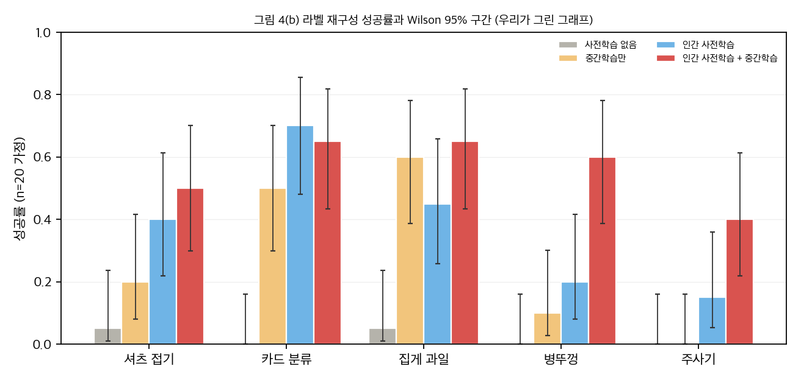
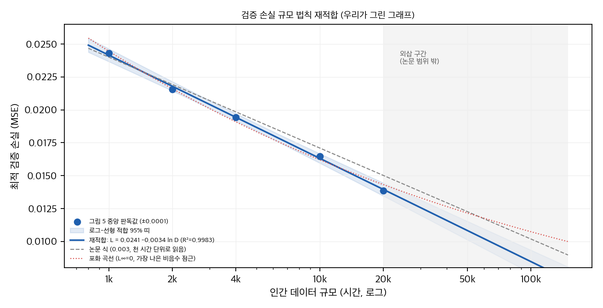
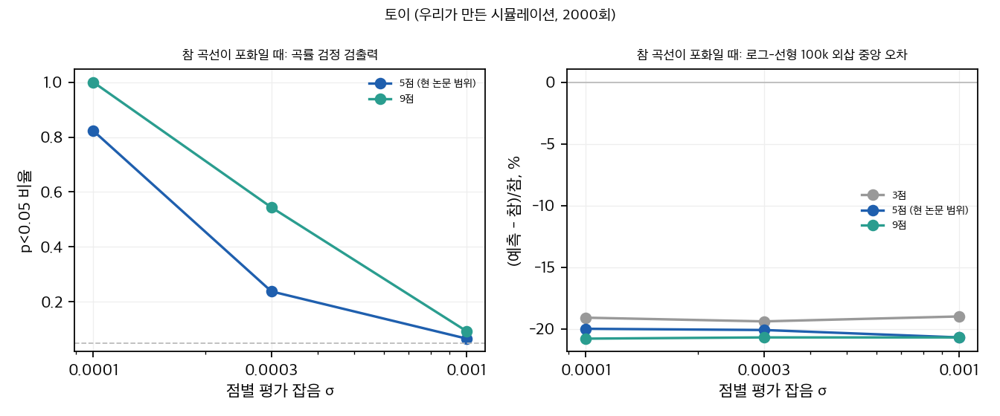

> **논문:** Ruijie Zheng 외 15명. *EgoScale: Scaling Dexterous Manipulation with Diverse Egocentric Human Data.* CoRL 2026 구두 발표, arXiv:2602.16710 (v1, 2026-02-18).
> 공식 코드는 확인되지 않았습니다. 논문 PDF에는 "© 2026 NVIDIA. All rights reserved." 표기가 있어서, 이 글은 논문 그림을 싣지 않고 우리가 만든 그래프만 씁니다.

---

## 논문이 묻는 것

로봇 데이터는 비쌉니다. 사람의 행동은 훨씬 많이 모을 수 있습니다. 문제는 사람 영상이 고자유도 손의 정교한 조작까지 가르칠 수 있느냐입니다. 선행 연구는 대개 수십에서 수백 시간, 그리퍼나 저자유도 손에 머물렀습니다.

EgoScale은 1인칭 사람 영상 20,854시간으로 흐름 VLA를 사전학습하고, 정렬된 사람-로봇 데이터로 중간학습을 붙입니다. 손은 22자유도 Sharpa 손입니다. 주장은 세 가지입니다. 사람 데이터 규모와 검증 손실이 로그-선형 관계이고, 그 손실이 실로봇 성능과 강하게 상관하며, 두 단계 전이로 사전학습 없음 대비 성공률이 크게 오른다는 것입니다.

## 이 글에서 확인한 것

- **평균 격차는 강합니다.** 그림 4의 다섯 과제 평균 과제 점수는 사전학습 없음 0.24에서 인간 사전학습과 중간학습 결합 0.83으로 올라갑니다. 평균 성공률은 0.02에서 0.56입니다.
- **"54%"는 절대 차이입니다.** 성공률 0.56 − 0.02 = 0.54입니다. 상대로는 28배입니다. 점수 "55%"도 절대 차이 0.59입니다. 단위가 본문에 없어서 독자가 상대 증가로 읽기 쉽습니다.
- **스케일링 법칙의 R²는 재현됩니다.** 그림 5 중앙 패널을 판독해 다시 맞추면 R² = 0.9983이고 기울기는 −0.0034입니다. 하지만 논문 식의 계수 0.003과 단위(천 시간)는 맞지 않습니다.
- **R²로는 직선임을 증명할 수 없습니다.** 포화 곡선도 잡음이 작으면 R² ≥ 0.99를 넘습니다. 5점 곡률 검정은 p = 0.83으로 아무것도 말하지 않습니다. 토이에서 포화가 참일 때 로그-선형으로 100k 시간을 외삽하면 약 20% 낮게 나옵니다.
- **통계 근거가 얇습니다.** 시드 2개, 시도 10회입니다. 과제별로 80% 검출력에 필요한 차이는 약 0.45–0.5입니다. 과제별 "인간 사전학습+중간학습 대 인간 사전학습" 차이는 Holm 보정 후 유의하지 않습니다.

그래프: 그림 4 성공률 라벨을 성공 수(시도 20회 가정)로 바꾸고 Wilson 95% 구간을 붙였습니다. 우리가 그린 그래프입니다.

## 스케일링 법칙을 다시 맞추기

그림 5 중앙 패널의 마커 다섯 개를 픽셀에서 읽어 로그-선형 적합을 했습니다. 기울기는 −0.0034(95% 구간 −0.0037 ~ −0.0031)입니다. 1–10k 시간 점으로 맞춰서 20k를 예측하면 오차는 0.0002입니다. 좋아 보이지만 점이 다섯 개뿐이고, 대안 곡선과 구별되지 않습니다.

그래프: 판독 5점, 로그-선형 재적합과 95% 띠, 논문 식, 포화 곡선(L∞=0). 100k 시간 이후는 외삽입니다. 우리가 그린 그래프입니다.

검증 손실과 과제 점수의 상관(r = −0.985)은 두 값이 모두 데이터 규모에 따라 단조로 움직이기 때문에 나온 것이 많습니다. 논문은 상관 계수를 보고하지 않습니다.

## 토이로 본 외삽의 위험

참 곡선이 포화일 때 점 다섯 개와 평가 잡음으로 무슨 일이 생기는지 시뮬레이션했습니다. 잡음이 작으면 포화 곡선도 로그-선형처럼 보입니다. 5점 곡률 검정은 잡음 0.0001에서 검출력이 0.82이지만, 0.0003에서는 0.24입니다. 실제 판독 잔차 0.0002는 그 사이입니다. 점을 아홉 개로 늘려도 외삽 편향은 줄지 않고, 예측구간은 더 좁아져서 참값을 거의 포함하지 못합니다.

그래프: 참 곡선이 포화일 때 점 수와 잡음에 따른 곡률 검정 검출력(왼쪽)과 로그-선형 100k 외삽의 중앙 오차(오른쪽). 2000회 반복. 우리가 만든 시뮬레이션입니다.

## 재현할 수 있을까

이 맥(Apple M4 Pro, CUDA 없음)에서 논문 방법의 전체 재현은 불가능합니다. 사전학습은 256장 GPU 규모이고, 20k 시간 데이터와 정렬된 로봇 데이터는 공개되지 않았습니다. 실로봇과 G1 평가도 필요합니다. 공식 코드는 확인되지 않았습니다.

부분 구현은 가능합니다. 손목 상대 행동 표현, 소형 흐름 정책, 리타게팅 최적화는 CPU와 MPS에서 할 수 있습니다. 목표를 "논문 수치 재현"에서 "방법을 작게 옮긴 구현과 분석"으로 낮추면 실행할 수 있습니다.

## 정리

사람 영상이 손 조작의 사전지식을 준다는 주장은 설득력이 있습니다. 평균 격차가 크고, 중간학습과 결합했을 때 효과가 분명합니다. 다만 두 가지는 조심해서 읽어야 합니다. 첫째, 스케일링 법칙은 다섯 점과 최적화 기준에 기댄 관찰이라서 외삽을 믿기 어렵습니다. 둘째, 54%는 절대 차이입니다. 논문의 재현 정보(백본, 파라미터 수, 청크 길이, 추론 스텝 수)가 없으므로, 공개 코드와 데이터가 나오기 전까지는 판단을 보류하는 것이 맞습니다.

---

*이 글은 논문 저자와 무관한 독립 분석입니다. 그림 라벨과 판독 마커 위치는 논문에서 옮겼고, 그래프와 토이는 직접 만들었습니다. 재계산 스크립트와 토이는 `publish/git/` 폴더에 있습니다.*

## 자료

- [통합 리포트 PDF](report/report_public.pdf)
- [01. 논문 분석: EgoScale (arXiv:2602.16710)](analysis/01_paper_analysis.md)
- [02. 선행연구와 자료 지도: EgoScale (arXiv:2602.16710)](analysis/02_prior_work.md)
- [03. 수치 재계산과 해석: EgoScale (arXiv:2602.16710)](analysis/03_analysis.md)
- [04. 주장 검증과 구현 가능성: EgoScale (arXiv:2602.16710)](analysis/04_claim_verification.md)
