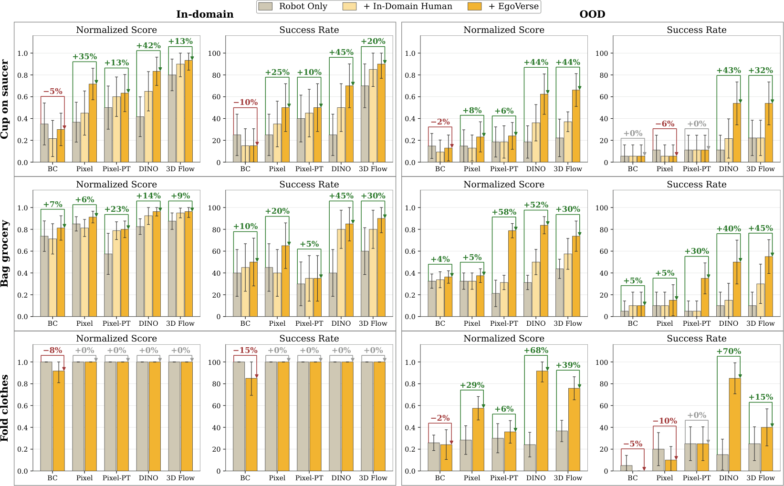
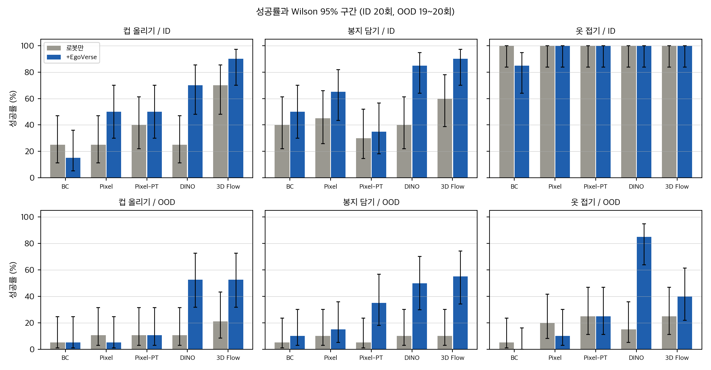
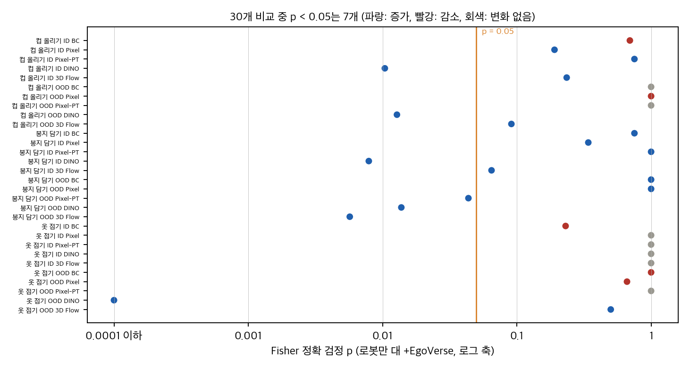
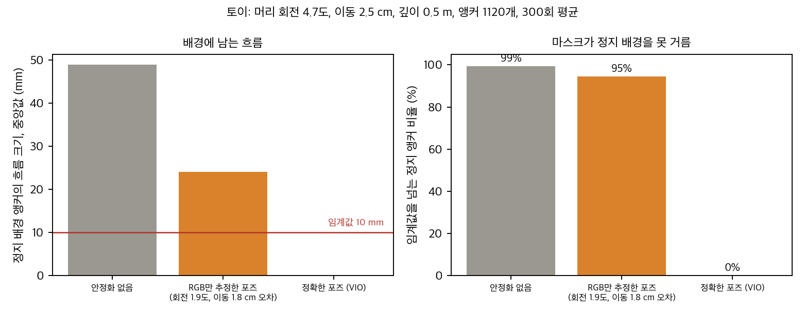
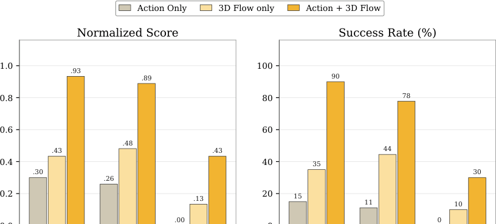

> **논문:** Baoyu Li, Xinchen Yin, Mengying Lin, Yixin Zhang, Danfei Xu. *EgoWAM: World Action Models Beyond Pixels with In-the-Wild Egocentric Human Data.* CoRL 2026 포스터, arXiv:2607.08436 (v2, 2026-10-13).
> 공식 코드는 GitHub GaTech-RL2/EgoWAM(MIT)에 있습니다. 이 글의 그림은 논문 그림 두 장(출처 표기)과 우리가 그린 그래프입니다.

## 논문이 묻는 것

일인칭 사람 영상으로 로봇을 키울 때 행동 복제(BC)는 사람의 형태와 머리 움직임이 행동 채널로 새어 들어가는 문제가 있다고 논문은 말합니다. 대안으로 정책이 행동과 함께 **미래 장면**을 예측하는 World Action Model(WAM)을 쓰고, 질문을 하나로 좁힙니다. 세계 헤드의 목표를 Pixel(영상 VAE 잠재), DINO(특징), 3D Flow(카메라 안정화된 3D 점 변위) 중 무엇으로 두어야 사람에서 로봇으로 전이되는가. 트렁크, 행동 헤드, 데이터 혼합은 고정하고 세계 헤드만 바꾸며, 추론에서는 세계 헤드를 버립니다.

*그림 3 (논문 원문). © 저자, CC BY 4.0, 출처 arXiv:2607.08436. 막대 위 라벨은 로봇만 대비 +EgoVerse의 증감입니다.*

## 이 글에서 확인한 것

**1. DINO의 OOD 이득이 가장 확실합니다.** OOD 성공률은 컵 2/19 → 10/19(Fisher p = 0.013), 봉지 2/20 → 10/20(0.014), 옷 3/20 → 17/20(< 0.001)입니다. 반면 로봇만 대 +EgoVerse 30개 비교 중 p < 0.05는 7개뿐입니다.

*그래프 (우리가 그림). 논문 그림 3의 막대 값에서 시행 수(ID 20, OOD 19–20)를 복원해 다시 그렸습니다.*

*그래프 (우리가 그림). 0.0001보다 작은 값은 잘렸습니다.*

**2. "BC는 사람 데이터로 나빠진다"와 "3D Flow가 ID를 20–30% 올린다"는 방향만 맞습니다.** BC 컵 ID는 5/20 → 3/20(p = 0.69), 3D Flow 컵 ID +20%p는 p = 0.24, 봉지 +30%p는 p = 0.065입니다. 셀당 ID 20회로는 약 40%p 차이만 가릴 수 있습니다. 비정렬 절제(BC 8/20 → 4/20)도 p = 0.30입니다.

**3. DINO와 3D Flow의 "보완 관계"는 한 칸에서만 구분됩니다.** 옷 접기 OOD에서 17/20 대 8/20(p = 0.008)입니다. 나머지 다섯 칸은 구분되지 않습니다.

**4. 사람 데이터 확장 주장은 두 점짜리입니다.** 사람 데이터는 2 h와 7–21 h이고 시간 기준 비율은 논문의 "~10:1"이 아니라 6.1:1입니다. 배치는 두 체제 모두 로봇 32 : 사람 32라서 데이터가 늘어도 감독 비율은 같습니다.

**5. 논문 안의 시행 수가 맞지 않습니다.** 컵 OOD 물체는 9회일 때만 정수 격자가 맞고(본문은 10 + 10), "1800 롤아웃"은 그림 3 격자로 1600입니다.

**6. 부록 A.5의 RGB 포즈 대체는 임계값 마스크와 함께 쓰면 성립하지 않습니다.** 1초 회전 오차 1.9°는 실제 머리 회전 4.7°의 40%이고, 깊이 0.3 m부터 사람 임계값 10 mm를 넘습니다. 작은 기하 토이에서 정지 배경 앵커의 95%가 임계값을 통과했습니다(가정은 문서에 적었습니다).

*그래프 (우리가 그림). 앵커 1120개, 깊이 0.5 m, 머리 회전 4.7°, 이동 2.5 cm, 300회 평균입니다.*

*그림 9 (논문 원문). © 저자, CC BY 4.0, 출처 arXiv:2607.08436. 3D 흐름만과 행동만의 차이는 p = 0.27, 0.29, 1.0으로 구분되지 않습니다(우리 계산).*

## 공식 코드와 논문의 차이

구조와 대부분의 하이퍼파라미터(트렁크, 행동 헤드, 배치, 옵티마이저, 흐름 격자, 임계값)는 논문과 맞습니다. 다만:

- **DINO 헤드**: 논문은 2블록·2048차원 넓은 DDT 헤드를 쓴다고 쓰지만 공개 설정은 평범한 6블록·384차원 DiT이고, 논문 A.4의 파라미터 수 19.6M이 그것과 정확히 맞습니다(계산 19,620,992).
- **헤드 조건 방식**: Pixel·DINO는 미래 토큰을 평균 풀링하고 3D Flow는 토큰 전체와 현재 프레임 점 위치를 받아 세 목표 비교의 통제가 약합니다.
- 공개 데이터 설정은 에피소드의 20%를 검증용으로 떼고, 학습률은 T_max 1400 이후 다시 오르며, 세계 손실의 시간 방향이 논문 식과 반대입니다. 3D 흐름 추출 스크립트가 부르는 모듈은 릴리스에 없습니다.

## 재현 가능성

실로봇과 공식 학습은 이 맥(CUDA 없음)에서 불가능합니다. 표 재계산, 정적 코드 대조, 위 토이는 가능하고 끝냈습니다. 자세한 표와 스크립트는 함께 올린 분석 노트에 있습니다.

## 자료

- [통합 리포트 PDF](report/report_public.pdf)
- [01. 논문 분석: EgoWAM (arXiv:2607.08436)](analysis/01_paper_analysis.md)
- [02. 선행연구와 구성 요소 출처](analysis/02_prior_work.md)
- [03. 수치 재계산, 일관성 검사, 토이, 주장 판정](analysis/03_analysis.md)
- [04. 공식 코드 대조와 구현 가능성](analysis/04_code_verification.md)
