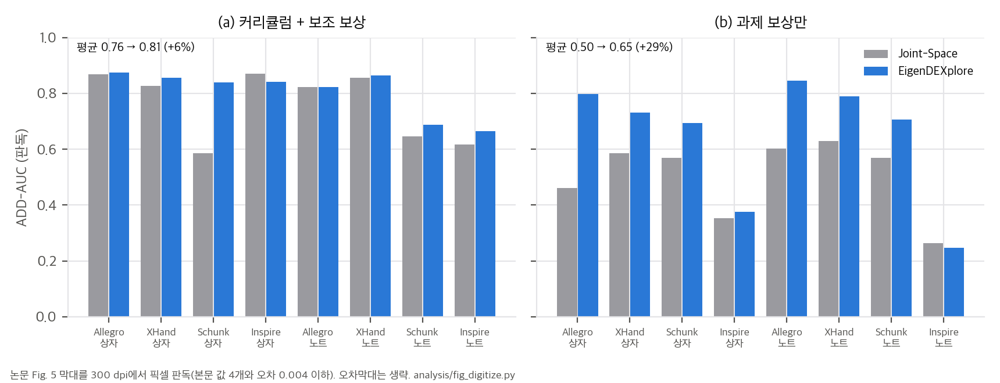

# 01. 논문 분석: EigenDEXplore (arXiv:2610.07681)

- 제목: *EigenDEXplore: Structured Exploration for Dexterous Manipulation with Human Priors*
- 저자: Harsh Gupta\*, Tyler Ga Wei Lum\*, Changhao Wang, Chuer Pan, C. Karen Liu, Jeannette Bohg, Shuran Song (Stanford University)
- 공개: arXiv v1 2026-10-06, **v2 2026-10-13**(분석 기준, 15쪽: 본문 9쪽 + 참고문헌 + 부록 A–B) · 코드 https://github.com/hgupt3/eigendexplore (확인 커밋 `5d57180`, 2026-10-11 "Initial release", MIT) · 프로젝트 https://eigendexplore.github.io
- 라이선스: arXiv 비독점 배포(nonexclusive-distrib 1.0)라 **CC BY가 아닙니다.** PDF 안에 다른 권리 표기는 없습니다.
- 분석 범위: v2 본문·부록 전체, v1 대조, 프로젝트 페이지, 공식 코드(패키지, 벤치마크 어댑터, 공개 PCA 자산, 고정된 외부 벤치마크 설정)
- v1 ↔ v2(문장 단위 diff): 수치·그림·표는 같습니다. 바뀐 것은 실험 조건을 밝히는 문장 네 곳입니다. (1) Sec. 1의 "early SimToolReal training, larger gains in extended runs"가 "at a fixed training budget"로 바뀌었습니다. (2) Sec. 4.1에서 "under each benchmark's protocol"이 빠지고 "We adapt the training pipeline of SimToolReal"과 "원본과 달리 Sharpa 외전 관절의 전체 범위를 쓴다"는 문장이 들어갔습니다. (3) 연장 학습은 "방법마다 실행 하나"라고 명시했습니다. (4) Sec. 4.5의 "original ... hardware protocols"가 "hardware setups"로 바뀌고, "Joint-Space 정책은 공개 SimToolReal 체크포인트가 아니다"라는 문장이 추가되었습니다.

---

## 1. Abstract (한 줄 요약과 주장)

**한 줄 요약:** 사람 손 동작을 로봇 관절로 리타겟하고 PCA로 뽑은 "협응 방향(eigenvector)"을, **행동 공간이 아니라 탐색 잡음에만** 넣습니다. 정책은 그대로 관절 목표를 출력하고, 탐색 잡음만 IID 관절 잡음 + 사람 주성분 방향 잡음으로 바꿉니다(Eq. 2). 학습이 끝나면 기저는 버리고 평균 행동만 결정론적으로 실행합니다.

논문이 내세우는 주장은 다음과 같습니다(Sec. 1).

1. 사람 동작 사전 분포의 이득은 "협응 동작을 직접 명령하는 것"이 아니라 **상관된 탐색**에서 나옵니다. 행동 공간을 줄이거나(Eigen-Space) 늘리면(Eigen-Residual) 오히려 손해가 생길 수 있습니다.
2. 같은 방법이 **비구조 RL**(SimToolReal, DeXtreme), **레퍼런스 추적 RL**(DexMachina), **표본 기반 궤적 최적화**(SPIDER), **sim-to-real** 모두에서 이깁니다. 손은 여섯 종입니다.
3. 헤드라인 수치는 다음과 같습니다.
   - SimToolReal 연속 성공 +34%, DeXtreme +40%
   - 실물 SimToolReal 과제 진행 33% → 82%, 실물 DeXtreme +41%
   - DexMachina 추적 정확도 +28%(커리큘럼·보조 보상 없이)
   - SPIDER 비용 −16%(여섯 손 평균)
4. 이득은 자유도가 많은 손과 보상 설계가 적은 설정에서 가장 큽니다. 대규모 egocentric 영상(EgoSuite)으로 만든 사전 분포가 소규모 mocap(GRAB, ARCTIC)보다 낫습니다.

---

## 2. Method

### 2.1 전체 구조 (Fig. 1–2, Sec. 3)

```
사람 손 자세 (EgoSuite 영상 복원, 양손을 한쪽으로 거울 대칭해 합침)
        │  ManipTrans식 운동학 리타겟 (손별 정렬·스케일·손가락 대응)
        ▼
로봇 관절각 → PCA → 분산 90%까지의 상위 k개 방향 E ∈ R^{k×d} (관절 반범위로 정규화한 좌표)
        │                                       Sharpa k=9/22, XHand 6/12, Allegro 10/16, Inspire 3/6
        ▼
탐색 분포  q⋆ ~ N(μ_q, Σ),   Σ = diag(σ_q²) + Eᵀ diag(σ_e²) E          (Eq. 2)
   RL(PPO):   μ_q = π_θ(o),  σ_q·σ_e 학습, E 고정, log-prob·entropy·KL은 이 분포로 계산 (Sec. 3.3)
   궤적 최적화(SPIDER): 후보 섭동만 바꾸고, 하위 10% 가중 평균으로 갱신, σ 고정 (Eq. 3, Sec. 3.4)
배포: μ_q만 실행, E와 탐색 파라미터는 버림
```

### 2.2 네 가지 행동·잡음 설계 (Eq. 1)

| 이름 | 표본 관절 목표 q⋆ | 행동 차원 | 논문이 보는 문제 |
|---|---|---|---|
| Joint-Space | a_q + σ_q⊙η_q | d | 관절을 따로 흔들어 부자연스러운 자세 |
| Eigen-Space | Eᵀ(a_e + σ_e⊙η_e) | k | 부분공간 밖을 표현할 수 없음 |
| Eigen-Residual | a_q + σ_q⊙η_q + Eᵀ(a_e + σ_e⊙η_e) | d + k | 표현은 되지만 행동 좌표가 중복됨 |
| **EigenDEXplore** | a_q + σ_q⊙η_q + Eᵀ(σ_e⊙η_e) | d | 행동은 그대로, 잡음만 구조화 |

초기화 규칙(Sec. 3.2)은 σ_e,i ∝ √λ_i입니다. 그리고 EigenDEXplore는 "관절 전체로 합한 초기 잡음 분산이 Joint-Space와 같고, 두 성분이 반씩 나누도록" σ_q와 σ_e를 다시 조정한다고 적습니다. 이 규칙이 공개 설정에서 벤치마크마다 다르게 구현되어 있다는 점이 이 분석의 핵심 발견 중 하나입니다(`04` D1–D3).

### 2.3 사람 사전 분포 (Sec. 3.1, 4.4)

- 데이터: EgoSuite-Open100K(Lightwheel 2026, 영상 10만 시간, 1.5만 과제)
- 비교 대상: GRAB(시퀀스 1,334개, 강체 51개), ARCTIC(시퀀스 339개, 관절 물체 11개)
- 리타겟: ManipTrans[Li 2025]의 운동학 절차를 손별로 고쳐 씁니다.
- 보존 분산 ρ = 0.9로 k를 정합니다. 이 값은 SPIDER sweep(Fig. 7b)으로 고른 것입니다.

---

## 3. Experiments

### 3.1 행동 공간과 탐색 (Sec. 4.1, Fig. 3–4, 부록 A)

| 벤치마크 | 설정 | Joint-Space | Eigen-Space | Eigen-Residual | **EigenDEXplore** | 출처 |
|---|---|---|---|---|---|---|
| SimToolReal (Sharpa 손-팔, 도구 재배치) | 9B frame, 허용 오차 6 cm·50° 고정, seed 5 | 7.9 | 개선 | 개선 | **10.6** (+34%) | Fig. 3a |
| SimToolReal 연장 | 60B frame, 1 cm·8°로 조이는 커리큘럼, **방법마다 실행 1개** | 4.9 | 이점 사라짐 | 12.0 | **14.1** | Fig. 3b |
| DeXtreme (Allegro 큐브 재배향, ADR) | 2B frame, seed 5 | 8.8 | 부진 | EigenDEXplore 조금 아래 | **12.3** (+40%) | Fig. 4 |
| 부록 A (Δ 행동) | Joint-Δ, Eigen-Residual-Δ | SimToolReal에서 비슷, DeXtreme에서 크게 뒤짐 | | | | Fig. 10 |

수치는 연속 성공(도달한 목표 자세 수)입니다. Eigen-Space와 Eigen-Residual의 9B 값은 그림에만 있습니다.

### 3.2 DexMachina: 레퍼런스 추적 양손 RL (Sec. 4.2, Fig. 5)

ARCTIC 상자·노트를 Allegro(16), XHand(12), Schunk(9), Inspire(6)로 추적합니다(seed 5, 약 2B frame, ADD-AUC). Fig. 5를 300 dpi로 판독했습니다(`03` §4, 본문 값 4개와 오차 0.004 이하).

| 설정 | Joint-Space 평균 | EigenDEXplore 평균 | 향상 |
|---|---|---|---|
| 커리큘럼 + 보조 보상 | 0.76 | 0.81 | +6% (Schunk 상자 0.59 → 0.84만 큼) |
| 과제 보상만 | 0.50 | 0.65 | **+29%** (Allegro 상자 0.46 → 0.80) |

본문의 "28%"는 과제 보상만 쓴 설정의 평균 비율(+28.6%)과 맞습니다. Inspire는 상자 +6.5%, 노트 −6.5%로 사실상 변화가 없습니다.



### 3.3 SPIDER: 표본 기반 리타겟 (Sec. 4.3, Fig. 6)

OakInk2 과제 10개, 손 여섯 종, 같은 초기 자세에서 cold start, commit당 16번 갱신, seed 10개로 비교합니다.

| 손 (DoF) | Sharpa (22) | Wuji (20) | Allegro (16) | XHand (12) | Schunk (9) | Inspire (6) |
|---|---|---|---|---|---|---|
| Δ 비용 | −25.4% | −31.2% | −21.5% | −14.3% | −3.5% | −0.4% |

평균은 −16.05%입니다. DoF와의 Spearman 순위 상관은 0.94입니다(`04` C6). 저자들은 "SPIDER는 잡음 크기를 학습하지 않으므로 이득은 표본 분포에서만 나온다"고 해석합니다.

### 3.4 데이터셋과 탐색 설계 (Sec. 4.4, Fig. 7, 부록 B)

- **데이터셋 비교(SimToolReal, 9B):** EgoSuite 10.6, ARCTIC 9.8, GRAB 9.4, Joint 7.9입니다. 그림의 95% 구간은 EgoSuite와 ARCTIC이 겹칩니다(seed 5).
- **보존 분산 sweep(SPIDER, Sharpa):**
  - Eigen 잡음만 쓰면 ρ = 0.5에서 0.126으로, Joint-Space 0.089보다 나쁩니다.
  - IID와 합치면 ρ = 0.9에서 최소 0.066입니다(Joint 대비 −25.8%).
- **무작위 방향 대조(App. B.2):** 같은 고유값 스펙트럼을 무작위 정규직교 방향에 실으면 Joint-Space보다 나쁩니다. 저자들은 이를 근거로 "상관 자체가 아니라 사람 방향이 이득의 원천"이라고 결론짓습니다.

### 3.5 실물 (Sec. 4.5, Fig. 8–9)

- **SimToolReal:** Sharpa + KUKA로 망치질, 닦기, 뜨기, 솔질 4과제를 합니다. 과제(물체-궤적 조합)당 10회입니다.
  - 과제별 평균(Fig. 8)은 망치질 0.42 → 0.71, 닦기 0.34 → 0.92, 뜨기 0.20 → 0.76, 솔질 0.36 → 0.90입니다. 네 과제 평균이 33% → 82%로 본문과 맞습니다(`04` C8). 정책은 방법마다 하나이고, 표준편차는 없습니다.
  - 정성 차이도 있습니다. 기준선은 가운데 손가락 패드와 검지·약지 등 사이에 도구를 끼우고, EigenDEXplore는 엄지·검지·중지 손끝으로 잡습니다.
- **DeXtreme:** 방법마다 40회입니다. 평균 연속 성공 8.45 → 11.90(+40.8%), 최장 32 → 41입니다.

---

## 4. Limitations

### 4.1 저자가 밝힌 한계 (Sec. 5)
- 선형 기저가 고정되어 있어서, 데이터에 없는 협응이나 비선형 synergy는 IID 잡음으로 찾아야 합니다.
- 사전 분포가 운동학 리타겟에 의존하므로, 사람 손과 형태가 크게 다른 손에서는 효과가 약할 수 있습니다.
- 자유도가 적은 손에서는 이득이 작습니다.
- 잡음이 시간적으로 독립입니다. 시간 상관 잡음(Raffin 2021, Eberhard 2023)을 사람 동작에서 끌어내는 것을 확장 방향으로 듭니다.

### 4.2 분석하면서 추가로 발견한 한계와 의문점
1. **공개 SimToolReal 설정은 탐색 분산이 기준선의 두 배입니다**(`04` D1, `03` §2).
   - 공개 preset은 IID σ를 기준선과 같은 1로 두고, eigen 잡음(RMS 1)을 그 위에 더합니다. 그래서 관절당 초기 분산이 2.0이 됩니다(Joint-Space 1.0). 스펙트럼 지수도 0.5라서 σ_e ∝ λ^¼입니다.
   - 논문 서술("총 분산을 맞추고 반씩 나눔, σ_e ∝ √λ")과 맞는 것은 DeXtreme preset뿐입니다.
   - 논문 실험이 이 preset으로 돌았다면, SimToolReal의 +34%와 실물 33 → 82%는 "구조"와 "두 배 탐색"이 섞인 결과입니다. toy에서는 탐색 크기만으로도 결과의 부호가 바뀌었습니다(`03` §3).
2. **SPIDER도 스펙트럼과 총량이 서술과 다릅니다**(`04` D2).
   - 코드 주석이 "eigenvalue power 1"이라고 밝히듯 σ_e ∝ λ입니다(√λ보다 가파름).
   - 기존 IID 잡음은 그대로 두고 eigen 잡음을 더하므로 총 분산이 늘어납니다(추정 약 1.35배).
   - 다만 SPIDER에는 같은 스펙트럼의 무작위 방향 대조군이 있어서, 크기만으로 이득을 설명할 수 없다는 근거는 이 벤치마크에서는 서 있습니다.
3. **공개된 "EgoSuite 기저"는 세 데이터셋의 가중 혼합입니다**(`04` D4).
   - 여섯 손 manifest 모두 `source_corpora`가 ARCTIC, GRAB, EgoSuite이고, `dataset_weights`가 [0.6, 0.2, 0.2]입니다(목록 순서대로 대응한다면 ARCTIC 0.6).
   - 원 시퀀스는 3,596개입니다. "10만 시간 영상"이라는 서술과 규모가 다릅니다.
   - 저장소 규칙상 기저는 하나뿐이고 fitting 파이프라인과 코퍼스가 없어서, Fig. 7a의 데이터셋 비교는 재현할 수 없습니다.
4. **SimToolReal 기준선이 원 설정보다 불리할 수 있습니다.**
   - v2에서 추가된 문장대로, 원 SimToolReal은 Sharpa의 외전 관절 범위를 좁혔습니다. 이 논문은 모든 방법에 전체 범위를 씁니다. 범위를 좁히는 것 자체가 손으로 넣은 사전 지식이라, 그것을 뺀 Joint-Space는 원래보다 약할 수 있습니다.
   - 실물 기준선도 원 공개 체크포인트가 아니라, 이 파이프라인에서 120B의 절반인 60B만 학습한 정책입니다.
   - 공개 PCA로 계산하면 정규화 좌표에서 eigen 잡음이 가장 큰 관절이 바로 외전 관절입니다(소지 MCP_AA, 엄지 CMC_AA, `03` §2).
5. **가장 큰 격차는 표본이 가장 적은 곳에서 나옵니다.** 연장 학습(4.9 대 14.1)과 실물 두 실험은 방법마다 정책 하나입니다. 9B·2B 결과도 seed 5개이고, 검정 통계는 없습니다. v1은 서론에서 "연장 실행에서 더 큰 이득"을 내세웠는데, v2는 이 문장을 "같은 학습 예산에서"로 바꿨습니다.
6. **이득은 보상 설계가 적을 때로 한정됩니다.** DexMachina에서 커리큘럼과 보조 보상이 있으면 평균 향상은 +6%이고, 한 칸(Schunk 상자)을 빼면 거의 0입니다. 정책 기울기에서 이차(조밀) 보상의 기대 기울기는 Σ와 무관하다는 점(`03` §5)과 맞는 그림입니다. 이득의 본질은 "더 나은 기울기"가 아니라 "희소한 성공의 발견"입니다.
7. **DexMachina 실험은 공개 코드에 없습니다.** README의 벤치마크는 DeXtreme, SimToolReal, SPIDER 셋뿐입니다(`04` D6).
8. **README가 권하는 시간 상관 변형은 논문 밖입니다.** AR(1), ρ = 0.94, 지속 약 16 step인 변형을 "초기 시험에서 기본보다 나을 수 있다"고 권하지만, 논문에 결과가 없습니다.
