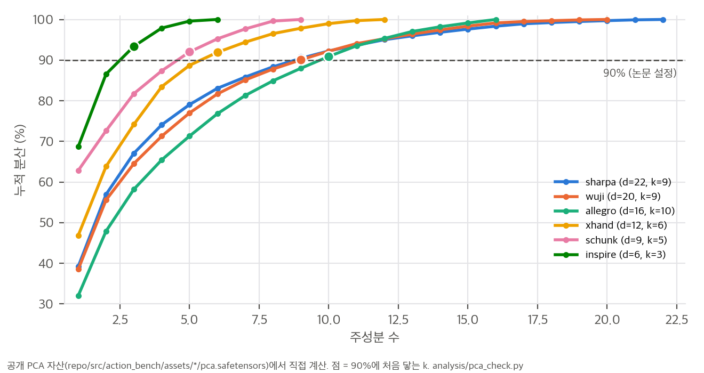
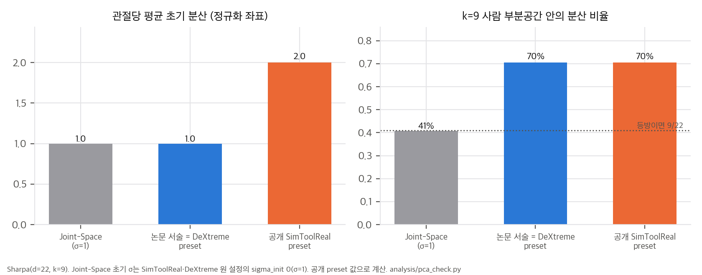
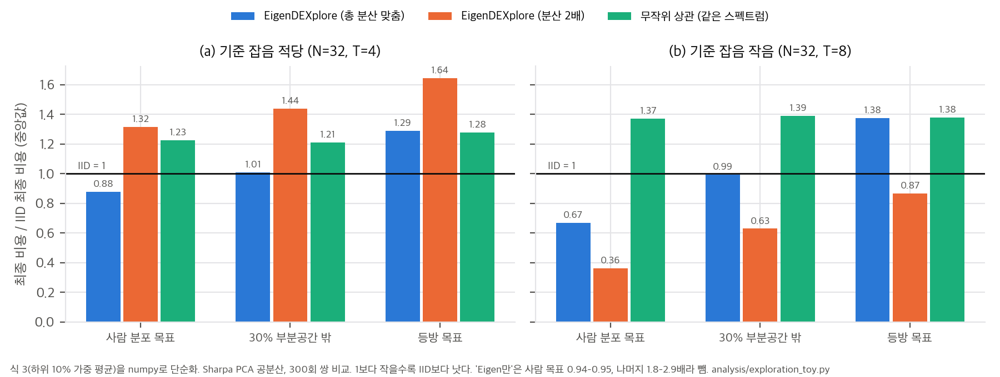

# 03. 핵심 식 해석과 CPU 검증

스크립트(모두 numpy, 단일 스레드, 각 수 초):
- `analysis/pca_check.py`: 공개 PCA 자산 검산, 설정별 초기 공분산 → `pca_check_results.json`
- `analysis/exploration_toy.py`: 탐색 분포 toy → `exploration_toy_results.json`
- `analysis/fig_digitize.py`: Fig. 5 판독 → `fig_digitize_results.json`
- `analysis/table_check.py`: 본문 수치 재계산 → `table_check_results.json`

공개 PCA 자산(`pca.safetensors`)은 safetensors 형식을 numpy로 직접 읽었습니다. 기저 변환은 공식 `EigenDExplore.from_pca`(반범위로 나누고 RMS를 맞춤)를 줄 단위로 옮겼습니다.

## 1. Eq. 2가 만드는 탐색 예산

공분산 Σ = diag(σ_q²) + Eᵀdiag(σ_e²)E에서, 정규화 관절 좌표의 관절당 평균 분산은 다음과 같습니다.

```
tr(Σ)/d = mean(σ_q²) + RMS_e²        (RMS_e: eigen 잡음의 관절당 RMS)
```

논문 서술대로 Joint-Space(σ = 1)와 총량을 맞추고 반씩 나누면 σ_q² = RMS_e² = 0.5입니다. 이때 eigen 분산은 모두 k차원 부분공간 안에 있고, IID 분산은 차원마다 고르게 퍼집니다. 그래서 부분공간 안의 분산 비율은 다음과 같습니다.

```
share_in = (0.5·d + 0.5·k) / d = 0.5 + 0.5·k/d        (등방이면 k/d)
```

| 손 | d | k | 부분공간 비율 (등방 → EigenDEXplore) | 참여비 유효 차원 |
|---|---|---|---|---|
| Sharpa | 22 | 9 | 41% → **70%** | 22 → 11.2 |
| Wuji | 20 | 9 | 45% → 73% | 20 → 10.6 |
| Allegro | 16 | 10 | 63% → 81% | 16 → 11.4 |
| XHand | 12 | 6 | 50% → 75% | 12 → 6.9 |
| Schunk | 9 | 5 | 56% → 78% | 9 → 5.2 |
| Inspire | 6 | 3 | 50% → 75% | 6 → 3.8 |

공개 자산에서 보존 분산 90%에 처음 닿는 k는 여섯 손 모두 논문·catalog와 같습니다. Inspire는 k = 3에서 93.4%입니다(본문 "세 성분이 90%"와 맞음).



## 2. 공개 preset은 이 예산을 지키지 않는다 (P2, P3)

| 설정 (Sharpa) | IID σ | eigen RMS | σ_e ∝ | 관절당 평균 분산 | 부분공간 비율 |
|---|---|---|---|---|---|
| Joint-Space (원 설정 sigma_init 0) | 1 | – | – | 1.0 | 41% |
| 논문 서술 = 공개 DeXtreme preset | √0.5 | √0.5 | √λ | 1.0 | 70% |
| **공개 SimToolReal preset** | 1 | 1 | λ^¼ (`spectrum_power 0.5`) | **2.0** | 70% |
| 공개 SPIDER 설정 | 기존 그대로 | 0.235 rad | **λ** | 기존 대비 약 1.35배(가정) | – |

- **SimToolReal:** 부분공간 집중도는 같지만 탐색 총량이 두 배입니다. 스펙트럼은 평평해서, 마지막 성분 σ_e가 첫 성분의 0.48배입니다(√λ면 0.23배).
- **SPIDER:** σ_e ∝ λ라서 마지막/첫 비가 0.053으로 훨씬 가파릅니다. 총량 1.35배는 "손가락 IID 잡음 = joint_noise_scale(0.1) × 스케줄(마지막 knot 4.0)"이라고 가정하고 계산한 값입니다.
- **정규화 좌표의 부작용:** 반범위로 나누므로 범위가 작은 관절에 정규화 잡음이 커집니다. Sharpa에서 eigen 잡음 σ가 가장 큰 관절은 소지 MCP_AA(1.01)와 엄지 CMC_AA(0.93)이고, 둘 다 반범위가 0.349 rad인 외전 관절입니다. 가장 작은 관절은 DIP와 IP(0.17)입니다. 원 SimToolReal이 좁혔던 바로 그 외전 범위를 이 논문은 넓혀서 썼습니다(`01` §4.2).



## 3. 표본 최적화(SPIDER)에서 Σ는 보폭을 바꾼다

### 3.1 유도
ε ~ N(0, Σ)로 평활화한 비용 J(μ) = E[f(μ+ε)]의 기울기는 ∇J = Σ⁻¹ E[f(μ+ε) ε]입니다. 그래서 다음이 성립합니다.

```
E[f(μ+ε) ε] = Σ ∇J
```

ES·CEM·MPPI 계열의 "좋은 섭동의 가중 평균"(Eq. 3)은 기대값으로 −Σ∇J 방향이고, **Σ가 기울기를 전처리(precondition)**합니다. 오차 방향 u로의 상대 보폭은 uᵀΣu / (trΣ/d)입니다. 사람 자세 분포에서 뽑은 방향과 등방 방향에서 이 값을 쟀습니다(P4).

| 손 | 사람 방향 보폭 | 등방 방향 보폭 |
|---|---|---|
| Sharpa | **2.21배** | 1.00 |
| Wuji | 2.23배 | 1.00 |
| Allegro | 1.58배 | 1.00 |
| XHand | 1.79배 | 1.00 |
| Schunk | 1.90배 | 1.01 |
| Inspire | 1.61배 | 1.00 |

trace를 맞췄으므로 등방 방향은 평균적으로 손해가 없습니다. 다만 부분공간에 직교하는 최악 방향은 0.5배입니다.

### 3.2 toy (T1): 예산이 적은 SPIDER식 최적화
Sharpa 사람 공분산, 차원 22, 표본 N = 32, 하위 10% 가중 평균, 300회 쌍 비교, 수치는 IID 대비 최종 비용의 중앙값입니다.

| 분포 | (a) 기준 잡음 적당: 사람 목표 / 부분공간 밖 30% / 등방 | (b) 기준 잡음 작음: 같은 순서 |
|---|---|---|
| EigenDEXplore (총량 맞춤) | **0.88** / 1.01 / 1.29 | **0.67** / 0.99 / 1.38 |
| EigenDEXplore (분산 2배) | 1.32 / 1.44 / 1.64 | **0.36** / 0.63 / 0.87 |
| 무작위 상관 (같은 스펙트럼) | 1.23 / 1.21 / 1.28 | 1.37 / 1.39 / 1.38 |
| Eigen만 | 0.94 / 1.79 / 2.56 | 0.95 / 2.00 / 2.92 |
| 가파른 스펙트럼 (σ_e ∝ λ) | 0.97 / 1.07 / 1.34 | 1.00 / 1.21 / 1.56 |



해석:
- **방향이 맞을 때만 이깁니다.** 사람 분포 목표에서는 이기고(쌍 승률 64%, 86%), 등방 목표에서는 집니다. 무작위 방향은 사람 목표에서도 IID보다 나쁩니다. 논문 App. B.2와 같은 결론입니다.
- **총량 2배는 영역에 따라 부호가 뒤집힙니다.** 기준 잡음이 작은 영역에서는 구조보다 "두 배 탐색"의 효과가 더 큽니다(0.36 대 0.67, 쌍 승률 99.7%). 적당한 영역에서는 오히려 손해입니다(1.32). 따라서 탐색 총량이 다른 두 설정을 비교하면, 구조의 효과를 따로 읽을 수 없습니다. 공개 SimToolReal preset의 결과를 해석할 때 가장 중요한 점입니다.
- **Eigen만은 부분공간 밖 목표에서 실패합니다**(1.8–2.9배). 논문의 Eigen-Space 결과(DeXtreme 부진, 연장 학습에서 이점 소실)와 같은 방향입니다.

## 4. DexMachina Fig. 5 판독

축 눈금 5개로 픽셀을 값으로 바꾸었습니다. 본문 값과 비교한 판독 오차는 다음과 같습니다.

| 칸 | 본문 | 판독 |
|---|---|---|
| Allegro 상자, 과제 보상만 | 0.46 / 0.80 | 0.460 / 0.797 |
| Schunk 상자, 커리큘럼 | 0.59 / 0.84 | 0.586 / 0.839 |

8칸 평균은 커리큘럼 0.761 → 0.806(+5.9%), 과제 보상만 0.504 → 0.648(+28.6%)입니다. "28%"는 과제 보상만 쓴 설정의 평균 비율입니다. 과제 보상만 쓴 설정의 칸별 향상은 Allegro 상자 +73%, 노트 +40%, Inspire 노트 −6.5%입니다.

## 5. 정책 기울기(PPO)에서는 Σ가 기대 기울기를 바꾸지 않는다

REINFORCE의 기대값은 E[R ∇_μ log π] = E[R Σ⁻¹(a−μ)] = ∇_μ E[R]입니다. 이차 보상 R = −‖a − q*‖²이면 E[R] = −‖μ − q*‖² − trΣ이므로, 기대 기울기 −2(μ − q*)는 **Σ와 무관**합니다. 3절의 ES와 달리 전처리가 없습니다.

toy(T3, 배치 64, 200회)에서도 확인됩니다.

| | 평균 기울기 cos (참값 대비) | 배치 추정 cos 중앙값 |
|---|---|---|
| IID, 사람 목표 | 0.987 | 0.417 |
| EigenDEXplore, 사람 목표 | 0.975 | **0.297** |
| IID, 등방 목표 | 0.985 | 0.438 |
| EigenDEXplore, 등방 목표 | 0.969 | 0.334 |

조밀한 이차 보상에서 구조화 잡음은 기울기를 개선하지 않습니다. 오히려 Σ⁻¹이 부분공간 밖(분산 0.5)을 2배로 키워 추정 잡음을 늘립니다.

**그러면 PPO에서 이득은 어디서 오는가: 희소한 성공의 발견(T2).** 목표 방향 u로 IID σ의 a배 이상 나아갈 확률 P(⟨ε, u⟩ ≥ a)는 다음과 같습니다.

| | a = 2 | a = 3 |
|---|---|---|
| IID | 0.0228 | 0.00135 |
| EigenDEXplore, 사람 방향 | 0.0855 | **0.0235** (17배) |
| EigenDEXplore 2배, 사람 방향 | 0.147 | 0.0597 (44배) |
| 무작위 상관, 사람 방향 | 0.0265 | 0.00255 |
| EigenDEXplore, 등방 방향 | 0.0239 | 0.00216 |
| EigenDEXplore 2배, 등방 방향 | 0.0775 | 0.0178 (13배) |

몬테카를로로 확인한 값(a = 3, 사람 방향)은 0.0232로 해석값 0.0235와 맞습니다.

정리하면 다음과 같습니다.
- 조밀 보상에서는 기대 기울기가 같으므로 이득이 작습니다.
- 희소 보상에서는 꼬리 확률이 크게 늘어 이득이 큽니다.
- 이 구조는 논문의 관찰과 맞습니다. 커리큘럼·보조 보상이 있으면 비슷하고, 과제 보상만 있으면 크게 이깁니다.
- 꼬리 확률은 구조보다 **총량**에 훨씬 민감합니다. 등방 방향에서도 2배 분산은 13배입니다. 그래서 2절의 SimToolReal preset 차이가 이 메커니즘에서는 특히 큰 교란입니다.

## 6. SPIDER 이득은 무엇과 함께 커지나

Δ비용(Fig. 6)과의 Spearman 순위 상관은 다음과 같습니다(손 6개).

| 설명 변수 | ρ | p |
|---|---|---|
| DoF | 0.94 | 0.005 |
| d − k (부분공간 밖 차원) | 0.93 | 0.008 |
| k (90%) | 0.81 | 0.05 |
| 사람 방향 보폭 이득 (§3.1) | 0.60 | 0.21 |

보폭 이득만으로는 Inspire(1.61배인데 −0.4%)와 Schunk(1.90배인데 −3.5%)를 설명하지 못합니다. 작은 손에서는 IID만으로도 표본 16 × 1,024개가 공간을 충분히 덮어서, 전처리의 여지가 없는 것으로 보입니다(가설). 이득이 "탐색 공간이 클 때" 나온다는 저자 해석과 맞지만, 표본 수 대비 차원으로 설명하는 것이 더 정확합니다.
