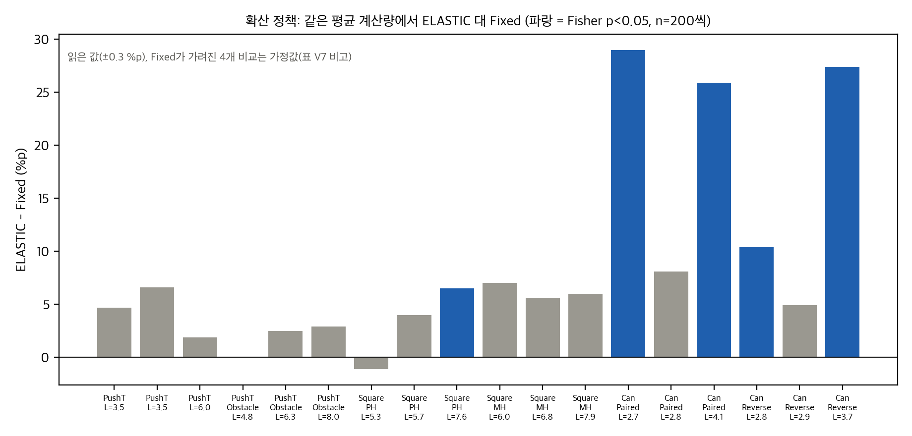
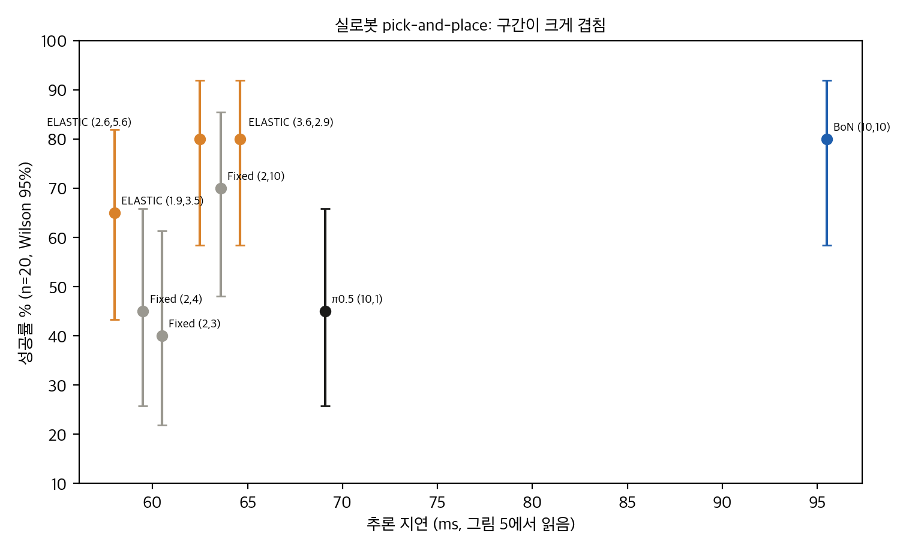
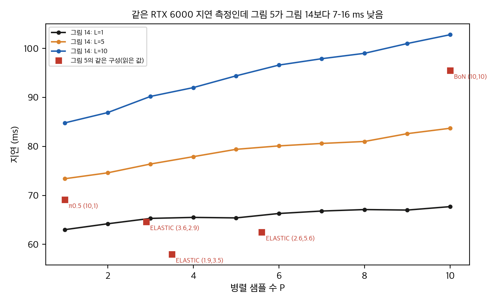

> **논문:** Andrew Zou Li, Gokul Swamy, Yonatan Bisk, Andrea Bajcsy. *ELASTIC: Efficiently Learning to Adaptively Scale Test-Time Compute for Generative Control Policies.* CoRL 2026 포스터, arXiv:2606.31132 (v1, 2026-06-30).
> 공식 코드와 프로젝트 페이지는 찾지 못했습니다. 논문 라이선스가 arXiv non-exclusive라서 이 글에는 논문 그림을 넣지 않고 우리가 그린 그래프만 실었습니다.

## 논문이 묻는 것

확산 정책이나 플로 기반 VLA는 추론 때 계산을 두 방향으로 늘릴 수 있습니다. 디노이징 스텝을 늘리는 **순차 축**은 행동을 정밀하게 만들고, 후보를 여러 개 뽑아 검증기로 고르는 **병렬 축**은 행동의 모드를 탐색합니다. 둘 다 제어 지연으로 돌아오므로 얼마나 쓸지가 문제인데, 최적 배분은 과제와 상태마다 다릅니다.

ELASTIC은 고정된 기본 정책 위에 **메타 정책**을 얹습니다. 디노이징 반복마다 각 샘플의 전진 폭(stride)을 고르고, 폭이 0이면 그 샘플을 가지치기합니다. 보상은 `Qtask(x,u) − α·L − β·(P−1)`입니다. L은 가장 늦게 끝나는 샘플의 길이, P는 평균 활성 샘플 수이고, Qtask는 환경 수준 Q 함수를 종료 가치로 쓴 것입니다. 학습은 SAC로 하며 샘플 집합에 어텐션을 씁니다.

## 이 글에서 확인한 것

이 논문은 결과 표가 없고 수치가 그림에 있습니다. 그림의 마커 중심과 막대 높이를 읽어(성공률 ±0.3 %p, 지연 ±0.7 ms) 재계산했습니다.

**1. 확산 정책: 방향은 일관되지만 개별 유의성은 일부입니다.** 같은 평균 계산량의 Fixed와 18개를 비교하면 ELASTIC이 높은 것이 16개, 같은 것 1개, 낮은 것 1개입니다(평균 +8.5 %p). 200회씩 Fisher 검정에서 p<0.05인 것은 5개이고 모두 Can Paired, Can Reverse, Square PH 한 점입니다. 두 Can 과제는 논문(§5.1)이 모드 문제를 보이려고 만든 설정입니다.

*ELASTIC과 같은 평균 계산량의 Fixed 사이의 성공률 차이(%p). 파랑은 Fisher p<0.05(200회씩)입니다. 우리가 그린 그래프이고 값은 논문 그림 2에서 읽었습니다. Fixed가 ELASTIC 마커에 가려진 4개 비교는 같은 값으로 가정했습니다.*

본문에서 수치로 논의되지 않은 **Learned Fixed**(상태 무관 (L,P)를 같은 RL로 학습) 대조가 부록 그림 13에 있습니다. Can Paired를 뺀 다섯 과제에서 ELASTIC과의 차이는 +0.4–3.9 %p이고 어느 것도 유의하지 않습니다. Learned Fixed는 순차 스텝을 더 쓰므로 순수 대조는 아니지만, 상태 의존의 몫을 가늠하는 데 이 그림이 가장 중요합니다.

**2. 실로봇의 "BoN과 같은 성공률, 지연 34% 감소"는 20회짜리 한 점에서 재현됩니다.** π0.5-DROID 머그 과제에서 ELASTIC (2.6, 5.6)이 80%(16/20), BoN이 80%, 기본 정책이 45%(9/20)입니다. 지연 감소는 이 점에서 34.6%이고, 같은 성공률의 다른 ELASTIC 점은 32.4%입니다. ELASTIC 대 기본 정책은 Fisher p = 0.048이고, ELASTIC 대 BoN의 차이 구간은 ±24.7 %p라 동등성은 20회로 보일 수 없습니다. 80% 대 45%를 검정력 0.8로 보려면 설정당 28회가, 80% 대 70%는 292회가 필요합니다.

*실로봇 8개 설정의 성공률(n=20)과 Wilson 95% 구간을 지연 위에 놓았습니다. 우리가 그린 그래프이고 값은 논문 그림 5에서 읽었습니다.*

**3. 같은 지연 절감을 단순 고정이 이미 냅니다.** 논문이 ELASTIC 결과를 본 뒤 시험한(§5.3) Fixed (2 스텝, 10 샘플)은 지연이 약 33% 줄고 성공률 70%(14/20)입니다. ELASTIC과 p = 0.72라 차이를 말할 수 없습니다. 지연 이득의 상당 부분은 π0.5의 스텝 수 10이 과다하다는 관찰에서 오고, 적응형 할당만의 기여는 이 데이터로 분리되지 않습니다.

**4. LIBERO-10의 Sequential 기준선은 계산량이 맞지 않습니다.** 논문 식(App. 7.2.1)으로 ELASTIC의 평균 (2.6, 6.9)을 환산하면 Sequential은 L≈7.1이어야 하는데 그림 11은 (18, 1)이고 지연이 BoN 수준(96.5 ms)입니다. 성공률은 ELASTIC 94.0, 기본 91.5로 p = 0.44라 유의하지 않고, 실제 메시지는 "성공률 유지에 지연 6.1% 감소"입니다. 이 값은 재계산으로 재현됩니다.

**5. 지연의 절대값이 그림마다 어긋납니다.** 같은 RTX 6000 측정이라는 그림 5의 점이 그림 14의 지연 곡선보다 7–16 ms 낮습니다. 그림 14의 모델로 다시 계산한 BoN 대비 감소율은 30–34%입니다.

*논문 그림 14의 지연 곡선(L=1, 5, 10)과 그림 5의 같은 구성 점들. 우리가 그린 그래프이고 값은 두 그림에서 읽었습니다.*

**6. 최적성 문장과 학습 비용.** §4.2는 종료 가치 변환이 최적성을 보존한다고 쓰지만, Qtask는 기준 정책(10 DDIM 스텝)의 return-to-go에 회귀한 값입니다. 이 경우 각 시점의 최적화는 기준 정책을 이어 따른다는 가정 아래의 한 단계 개선이고, 이 가정은 본문에 명시되지 않았습니다. 학습 환경 스텝, GPU 시간, 시드 수도 없어서 제목의 "Efficiently Learning"은 이 논문만으로 확인되지 않습니다.

## 구현 가능성

공식 코드가 없고 메타 정책 학습 코드, Can Paired와 Can Reverse 변형, 과제별 검증기가 공개되지 않았습니다. openpi, V-GPS, diffusion_policy, robomimic, LIBERO 같은 외부 구성 요소는 공개돼 있습니다. LIBERO와 π0.5, 실로봇은 GPU와 로봇이 필요합니다. 샘플별 stride와 가지치기를 갖춘 2차원 토이는 CPU에서 구현할 수 있습니다(추정 3–5일).

## 남은 것

- OpenReview 심사 기록은 접근이 막혀 확인하지 못했습니다.
- 공식 코드와 프로젝트 페이지가 생기면 stride의 매개변수화, 고정 확산 정책에 임의의 전진 폭을 주는 방법, 비용 환산을 대조해야 합니다.
- 이 글의 모든 p 값은 단일 실행의 이항 분산만 반영하며 메타 정책의 학습 분산은 포함하지 않습니다.

## 자료

- [통합 리포트 PDF](report/report_public.pdf)
- [01. 논문 분석: ELASTIC](analysis/01_paper_analysis.md)
- [02. 선행연구와 관련 저장소](analysis/02_prior_work.md)
- [03. 수치 재계산과 일관성 검사](analysis/03_analysis.md)
- [04. 주장 검증 (공식 코드 없음)](analysis/04_claim_verification.md)
