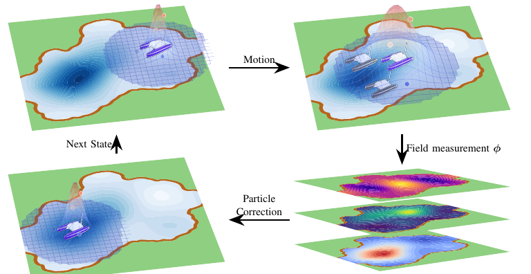
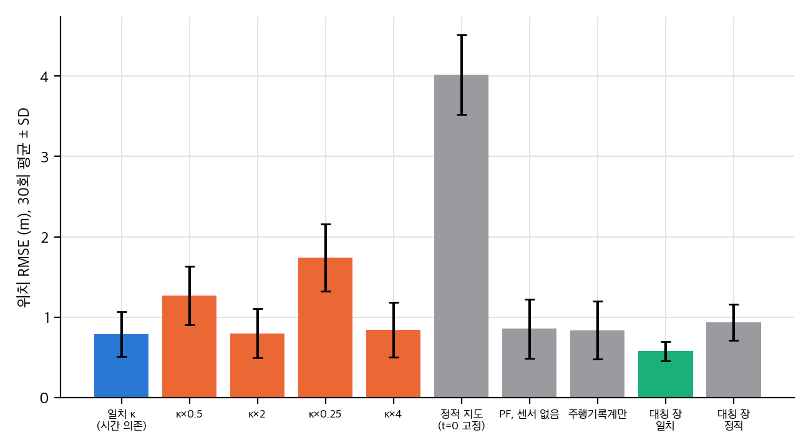

# PDE 장으로 위치를 맞출 수 있는가

GPS가 없는 바다나 강에서 배는 수온, 염분, 용존산소, 물 높이 같은 환경 장을 측정합니다. 이 장이 시간에 따라 PDE로 움직인다는 사실을 위치추정에 쓰면 어떨까요? 이번 IROS 2026 논문(arXiv:2608.00272)은 얕은 물 방정식과 이류–확산 방정식의 수치 해를 측정 모형으로 쓰는 Rao-Blackwell 입자 필터를 제안합니다. 이 글은 논문 수치를 다시 계산하고, 핵심 가정을 CPU toy로 시험한 결과입니다. 재현은 하지 않았습니다.

## 논문이 한 일

- 장 φ의 PDE 해를 측정 모형 y = φ(p, t) + 편향 + 잡음으로 씁니다.
- 편향은 입자마다 칼만 필터로 해석적으로 추정합니다(RBPF).
- 시뮬레이션 두 종(SWE, ADE)과 ASV 현장 실험 하나를 보고합니다.

## 수치로 본 결과

- SWE, 500 입자: RMSE 0.80 ± 0.03 m 대 PF 1.07 ± 0.04 m. 다시 계산하면 p ≈ 4·10⁻⁶로 유의합니다. 최종 오차는 p ≈ 0.15로 유의하지 않습니다.
- ADE, 500 입자: 47% 감소. 하지만 400 입자에서는 RBPF 평균(3.1 m)이 PF(≈2.35 m)보다 큽니다. "같은 입자 수에서 일관되게 우세"는 이 점에서 지지되지 않습니다.
- 실행은 5회입니다. 이 정도로는 작은 차이를 가리기 어렵습니다.

## 가장 큰 가정: 장을 안다

논문의 필터는 κ, 경계 조건, 초기 조건이 모두 참값이라고 가정합니다. 격자, 시간 간격, 수치 기법도 공개되지 않았습니다.

- toy에서 확산 계수를 실제의 절반으로 잡으면 RMSE가 0.79 m에서 1.27 m로 커집니다. 2배로 잡으면 차이가 없습니다.
- 장을 t = 0에 고정하면 RMSE가 4.0 m입니다. 시간 변화하는 지도가 필수입니다.
- 1차 풍상 기법은 격자가 거칠면 수치 확산이 κ 범위와 비슷한 크기가 됩니다(u·dx/2)(1 − C). 보고된 κ가 물리량인지 격자 효과인지 구분하기 어렵습니다. 다만 이 수치 확산이 만든 κ_eff 차이(약 12%)는 보정해도 필터 오차를 바꾸지 않았습니다(직접 계산, p > 0.8). 해로운 것은 κ를 절반으로 과소 추정하는 쪽입니다.

## 관측가능성에 대해

방사 대칭 장에서 점 센서는 반지름만 측정합니다. 경로 전체를 중심 둘레로 돌려도 측정이 같아서, 회전 방향은 식별되지 않습니다. 장이 비대칭이면 이 방향이 식별됩니다.

논문 Fig. 1. © 저자, CC BY 4.0. 출처 https://arxiv.org/abs/2608.00272

직접 계산(toy). 30회 평균 ± SD. 정적 지도와 κ의 과소 추정이 가장 나쁩니다.

## 구현할 수 있을까

공식 재현은 불가능합니다. 코드, 지형·바람 자료, 수치 방법, 현장 데이터가 공개되지 않았습니다. 장을 가정하고 필터를 다시 만드는 것은 ADE 규모에서는 쉽고, SWE 규모에서는 중간에서 어렵습니다. 실물은 현장 장비가 필요합니다.

자세한 분석과 코드는 `analysis/`와 `report/`에 있습니다.

## 자료

- [통합 리포트 PDF](report/report_public.pdf)
- [01. 논문 분석: Localization in Spatiotemporal Fields via Environmental PDEs](analysis/01_paper_analysis.md)
- [02. 선행연구와 관계](analysis/02_prior_work.md)
- [03. 유도, 재계산, toy 검증](analysis/03_analysis.md)
- [04. 주장 검증과 구현 가능성 (공식 코드 없음)](analysis/04_claim_verification.md)
