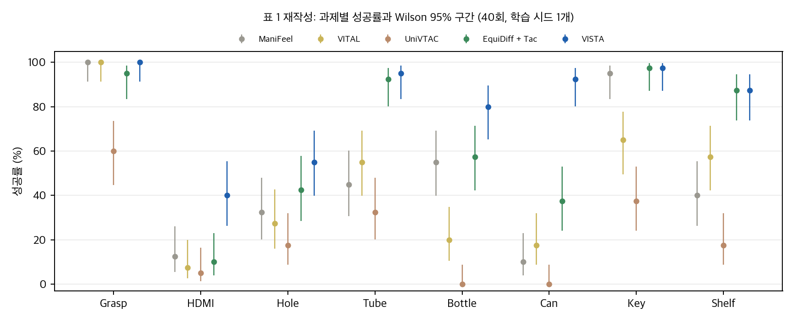
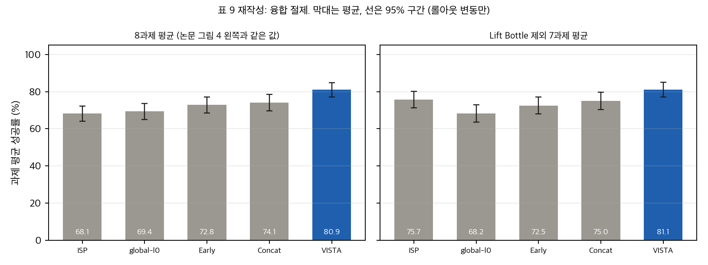
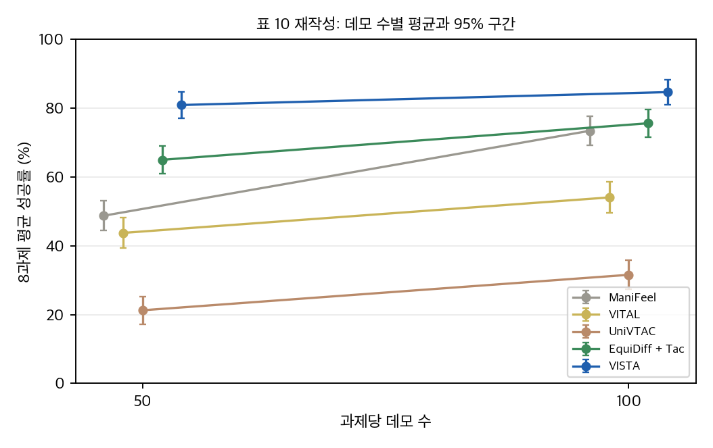
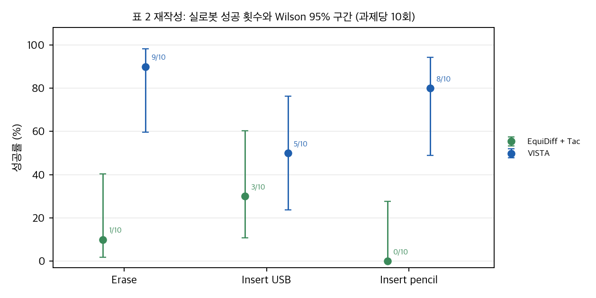
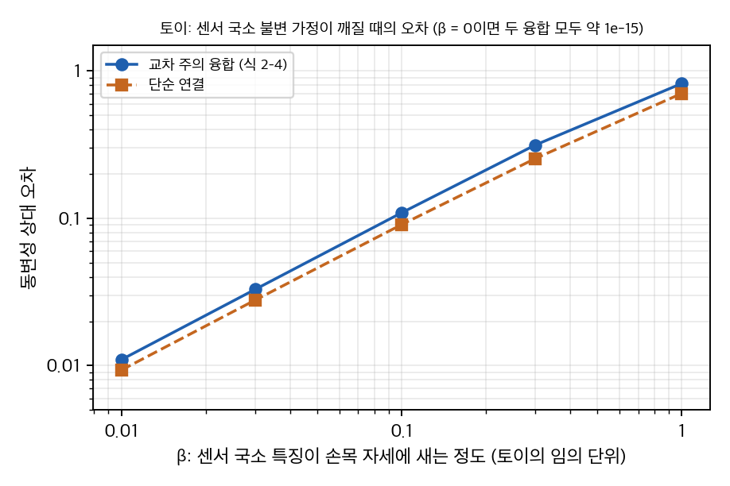

# 03. 수치 재계산, 일관성 검사, 검정

`analysis/recompute.py`가 논문 표 1, 2, 6–10의 값을 옮겨 적고 다시 계산합니다(numpy, scipy, 수 초). 결과는 `analysis/recompute_results.json`에 있습니다. `analysis/toy_equivariance.py`는 동변성 구조를 numpy로 다시 만든 토이입니다(§6, 수 초).

**시행 수와 가정.** 시뮬 성공률은 논문이 밝힌 대로 과제당 40회 롤아웃, 실로봇은 과제당 10회로 계산했습니다(부록 A.7, §4.3). 논문은 학습 시드를 1개로 밝혔습니다(A.7). 그래서 아래 구간과 p값은 **롤아웃 표집 변동만** 반영하고, 학습 실행 사이의 변동은 들어 있지 않습니다. 실제 불확실성은 아래 값보다 큽니다. 방법 사이에 롤아웃 시드(1000–1039)가 같아도 시드별 성공 여부는 공개되지 않아 쌍별 자료로 쓰지 못했고, 독립 표본으로 계산했습니다. 과제 평균의 차이는 과제 여덟 개에 같은 가중치를 준 단순 평균이며, 구간은 과제별 Agresti-Coull 분산을 더한 Wald 구간입니다. 과제별 비교는 Fisher 정확 검정에 Holm 보정(과제 8개)을 씁니다. 과제를 층으로 둔 Cochran-Mantel-Haenszel(CMH) 검정을 보조로 두었습니다.

## 1. 확인 결과 요약

| 번호 | 확인 내용 | 결과 |
|---|---|---|
| V1 | 모든 시뮬 셀이 k/40 격자 위에 있는가 (표 7–10, 셀 176개) | 모두 그렇습니다 |
| V2 | 표 7, 8, 9, 10의 평균 재계산 | 모두 일치합니다. 48.75 → 48.8, 21.25 → 21.3, 80.9375 → 80.9처럼 0.05는 올림으로 보고되었습니다 |
| V3 | 표 사이 같은 값 (표 7 = 표 10의 50 시연 열, 표 8의 ISP = 표 9의 ISP, 표 7·8·9의 VISTA) | 모두 같습니다 |
| V4 | 본문 인용 차이 (32.1, 37.1, 59.6, 15.9, 12.8, 6.8, 1.3, 6.0, 5.3, 3.8, 과제별 +7.5/0/2.5/5.0) | 모두 **반올림한 평균의 차이**와 같습니다. 반올림 전 차이는 32.2, 37.2, 59.7, 15.9, 12.8, 6.9, 1.25, 5.9, 5.3, 3.8입니다 |
| V5 | 실로봇 평균 (표 2): 4/30 = 1.33/10, 22/30 = 7.33/10, 프로젝트 페이지의 73.3% | 일치합니다 |
| V6 | 실로봇 검정 | Erase 9/10 대 1/10과 Insert pencil 8/10 대 0/10은 Holm 후에도 구분되고(p = 0.002), Insert USB 5/10 대 3/10은 구분되지 않습니다(p = 0.65). 합산 22/30 대 4/30은 p = 5e-6 |
| V7 | 주 비교: VISTA 대 EquiDiff+Tac | +15.9점, 95% 구간 10.3–21.6, p = 3e-8. 과제별로는 Lift Can과 Insert HDMI만 Holm 후 구분됨 |
| V7b | 촉각 없는 ISP 대 EquiDiff+Tac | +3.1점, 구간 −2.7–8.9, p = 0.29. ISP가 이미 기준선 수준 |
| V8 | 융합 절제 | VISTA 대 ISP+Concat-Tac +6.9점, 구간 1.0–12.7, p = 0.021. 대 Early Fusion +8.1, 대 global-ℓ0 +11.6 |
| V8b | Lift Bottle을 뺀 7과제 | VISTA 대 ISP +5.4점(구간 −0.6–11.3). 세 대안은 ISP보다 −7.5–−0.7점 |
| V9 | 데모 수 | VISTA 50 대 EquiDiff+Tac 100: +5.3점, 구간 −0.3–10.9, p = 0.064. VISTA 100 대 50: +3.8점, p = 0.17. 격차는 시연이 늘면 줄고(ManiFeel 32.2 → 11.3점, p = 3e-7) 나머지는 구분이 약함 |
| V10 | 검출력 | 과제 평균 차이의 최소 검출 차이 약 11점, 과제 하나는 약 31점 (양측 5%, 검정력 80%, 모든 과제 p = 0.5 가정). 실로봇 과제 하나(10회)는 약 63점 |
| V11 | 지연 표 산술 | C8 → I60 증가분 VISTA 7.8 ms (본문 일치), ISP 4.4 ms. 부록 본문의 두 스트림 측정 70.18 ms는 표 6의 71.54 ms와 1.36 ms 다름(측정 조건이 다르다고 본문에 있음) |
| V12 | 텐서 차원 산술 (부록 A.1) | (ℓmax+1)² = 49, Σ(2ℓ+1)² = 455 일치 |
| V13 | UniVTAC 원 논문과의 교차 비교 | UniVTAC 행 21.3%는 원 논문 자기 보고 48.0%와 다름(프로토콜이 다름) |
| V14 | 과제별 VISTA 대 ISP | 6과제 높고, 2과제 같고, 낮은 과제 없음. 합계 +102.5점 중 Lift Bottle이 +65.0점 |
| V15 | 동변성 토이 | 융합이 교차 주의든 연결이든 상대 오차 약 1e-15. 센서 국소 불변 가정이 깨지면 오차가 β에 비례해 커짐 |

## 2. 주 비교: 표 1 (V7)

### 2.1 VISTA 대 각 기준선

| 비교 | 평균 차이 (점) | 95% 구간 | p (Wald) | p (CMH) |
|---|---|---|---|---|
| VISTA − ManiFeel | +32.2 | 26.4–37.9 | 6e-28 | < 1e-12 |
| VISTA − VITAL | +37.2 | 31.3–43.0 | 1e-35 | < 1e-12 |
| VISTA − UniVTAC | +59.7 | 54.1–65.3 | 2e-97 | < 1e-12 |
| **VISTA − EquiDiff+Tac** | **+15.9** | **10.3–21.6** | **3e-8** | **1e-7** |

본문의 32.1, 37.1, 59.6점은 반올림한 평균의 차이이고 이 표는 반올림 전 값(V4)입니다. 이 방향은 어느 쪽 계산으로도 같습니다.

### 2.2 가장 강한 기준선과 과제별 비교

| 과제 | VISTA | EquiDiff+Tac | 차이 (점) | p (Fisher) | p (Holm) |
|---|---|---|---|---|---|
| Grasp Classify | 40/40 | 38/40 | +5.0 | 0.49 | 1.0 |
| Insert HDMI | 16/40 | 4/40 | +30.0 | 0.0038 | 0.027 |
| Insert Hole | 22/40 | 17/40 | +12.5 | 0.37 | 1.0 |
| Insert Tube | 38/40 | 37/40 | +2.5 | 1.0 | 1.0 |
| Lift Bottle | 32/40 | 23/40 | +22.5 | 0.053 | 0.32 |
| Lift Can | 37/40 | 15/40 | +55.0 | 3e-7 | 2e-6 |
| Pull Out Key | 39/40 | 39/40 | 0.0 | 1.0 | 1.0 |
| Put Bottle in Shelf | 35/40 | 35/40 | 0.0 | 1.0 | 1.0 |

그래프: 표 1을 다시 그린 과제별 성공률과 Wilson 95% 구간 (과제당 40회, 학습 시드 1개). 우리가 그린 그래프입니다.

- 평균 격차 15.9점 가운데 과제별로 보정 후 구분되는 것은 Lift Can(+55.0점)과 Insert HDMI(+30.0점)입니다. 네 과제(Grasp Classify, Insert Tube, Pull Out Key, Put Bottle in Shelf)는 두 방법이 거의 같습니다. Lift Can 한 과제가 평균 격차에 6.9점(55.0 / 8)을 기여합니다.
- 비교의 설계 단서(부록 A.7, 코드 `04` D6): EquiDiff+Tac과 ManiFeel, UniVTAC은 좌우 촉각 둘을 쓰고 VISTA는 왼쪽 하나만 씁니다. 이미지 입력 해상도와 배치 크기도 방법마다 다릅니다(`04` D6).

## 3. 절제와 이득의 구성 (V7b, V8, V8b, V14)

### 3.1 표 9의 융합 절제

| 비교 (평균 차이, 점) | 8과제 평균 | 95% 구간 | p (Wald) | Lift Bottle을 뺀 7과제 | 95% 구간 |
|---|---|---|---|---|---|
| global-ℓ0 − ISP | +1.25 | −4.7–7.2 | 0.68 | **−7.5** | −13.9–−1.1 |
| Early Fusion − ISP | +4.7 | −1.3–10.7 | 0.12 | **−3.2** | −9.6–3.2 |
| ISP+Concat-Tac − ISP | +5.9 | −0.1–11.9 | 0.053 | **−0.7** | −7.1–5.6 |
| **VISTA − ISP** | **+12.8** | **7.2–18.5** | **9e-6** | **+5.4** | −0.6–11.3 |
| VISTA − ISP+Concat-Tac | +6.9 | 1.0–12.7 | 0.021 | +6.1 | 0.0–12.2 |
| VISTA − Early Fusion | +8.1 | 2.3–13.9 | 0.006 | +8.6 | 2.5–14.7 |
| VISTA − global-ℓ0 | +11.6 | 5.8–17.3 | 9e-5 | +12.9 | 6.8–18.9 |

그래프: 표 9의 과제 평균(왼쪽)과 Lift Bottle을 뺀 7과제 평균(오른쪽). 선은 95% 구간(롤아웃 변동만). 우리가 그린 그래프입니다.

- **본문이 말하는 것은 맞습니다.** 촉각을 구면 토큰으로 올리고 시각 방향별로 교차 주의하는 VISTA가 다른 세 융합보다 평균이 높고, 세 대안과 ISP의 평균 차이는 1.3–6.0점(반올림 전 1.25–5.9점)입니다. 가장 가까운 대안 ISP+Concat-Tac과의 차이 +6.9점은 구간이 1.0–12.7점으로 넓습니다.
- **관측되는 구조.** ISP는 Lift Bottle에서 6/40(15.0%)으로 유난히 낮습니다. 촉각을 어떤 방식으로든 넣으면 이 과제는 67.5–80.0%(27–32/40)로 오릅니다. 8과제 평균의 이득은 이 한 과제가 크게 좌우합니다: VISTA − ISP 합계 +102.5점 가운데 +65.0점이 Lift Bottle이고, 이 과제를 빼면 평균 이득은 12.8점에서 5.4점으로 줄고 구간(−0.6–11.3)이 0을 걸칩니다.
- 나머지 7과제에서 세 대안은 ISP와 같거나 낮습니다(−0.7, −3.2, −7.5점). 가장 큰 낙차는 Pull Out Key의 global-ℓ0(37/40 → 23/40, −35.0점, Fisher p = 5.5e-4, Holm 0.004)입니다. 이 과제에서 VISTA는 97.5%(39/40)입니다. 즉 이 절제에서 나타난 VISTA의 우위는 Lift Bottle과 Pull Out Key, Put Bottle in Shelf(VISTA 35/40, Concat 26/40)에서 옵니다. 과제별 VISTA − Concat은 Pull Out Key +20.0점(Holm 0.12), Put Bottle in Shelf +22.5점(Holm 0.24)으로 보정 후에는 구분되지 않습니다.
- **검출력.** 이 설계(과제 8개 × 40회)는 80% 검정력으로 약 11점(모든 과제 p = 0.5 가정) 이상의 평균 차이만 가릅니다(V10). VISTA와 ISP+Concat-Tac의 차이는 이보다 작고, 이 비교는 단일 시드, 단일 실행의 방향 증거로 읽는 편이 맞습니다.

### 3.2 이득의 구성: 구면 백본 대 촉각

| 단계 | 평균 | 차이 | 비고 |
|---|---|---|---|
| EquiDiff+Tac (표 7) | 65.0 | | C8 등변 ResNet + 촉각 자명 표현 |
| ISP (표 8) | 68.1 | +3.1 (구간 −2.7–8.9, p = 0.29) | 구면 올림, 촉각 없음 |
| VISTA | 80.9 | +12.8 (구간 7.2–18.5) | 촉각 구면 올림과 교차 주의 |

논문의 "+15.9점"은 두 단계의 합입니다. 앞 단계(촉각 없는 구면 백본 대 EquiDiff+Tac의 촉각 연결)는 구분되지 않습니다. 과제별로는 ISP가 EquiDiff+Tac보다 Lift Can에서 +55.0점(37/40 대 15/40), Insert HDMI에서 +22.5점 높고 Lift Bottle에서 −42.5점 낮습니다. 즉 "EquiDiff+Tac이 촉각을 가지고도 Lift Can에서 약한 이유"는 촉각 융합이 아니라 시각 백본(구면 올림 또는 입력 해상도 등)에 있을 가능성이 있고, 이 논문의 실험으로는 가를 수 없습니다.

## 4. 데모 수 (표 10, V9)

| 방법 | 50 시연 | 100 시연 | 자기 증가 (점) | VISTA와의 격차 50 → 100 (점) |
|---|---|---|---|---|
| ManiFeel | 48.8 | 73.4 | +24.7 (p < 1e-12) | 32.2 → 11.3 (변화 −20.9, 구간 −29.0–−12.9, p = 3e-7) |
| VITAL | 43.8 | 54.1 | +10.3 (p = 0.0013) | 37.2 → 30.6 (변화 −6.6, 구간 −14.8–1.7, p = 0.12) |
| UniVTAC | 21.3 | 31.6 | +10.3 (p = 0.0006) | 59.7 → 53.1 (변화 −6.6, 구간 −14.5–1.4, p = 0.10) |
| EquiDiff+Tac | 65.0 | 75.6 | +10.6 (p = 0.0003) | 15.9 → 9.1 (변화 −6.9, 구간 −14.7–1.0, p = 0.087) |
| VISTA | 80.9 | 84.7 | +3.8 (구간 −1.6–9.1, p = 0.17) | |

그래프: 표 10의 데모 수별 과제 평균과 95% 구간(롤아웃 변동만). 우리가 그린 그래프입니다.

- **본문 인용.** "50 시연의 VISTA(80.9%)가 100 시연의 EquiDiff+Tac(75.6%)보다 높다"는 +5.3점이고 구간이 −0.3–10.9점(p = 0.064)입니다. 방향은 일관되지만 5% 수준에서 구분되지는 않습니다.
- **"시연이 늘어도 계속 개선"** (VISTA +3.8점)은 구간이 −1.6–9.1점입니다. VISTA는 50 시연에서 이미 80.9%이고 100 시연에서 8과제 중 세 과제가 97.5–100%라 천장 효과도 있을 수 있습니다.
- **격차의 변화.** VISTA의 우위는 시연이 적을 때 가장 큽니다. 특히 ManiFeel은 시연이 두 배가 되면 +24.7점 올라 VISTA와의 격차가 32.2점에서 11.3점으로 줄어듭니다. 이는 "VISTA가 데이터 효율적이다"라는 서술과 같은 방향이고, 동시에 기준선도 시연에 민감하다는 뜻입니다. 100 시연에서 VISTA는 모든 기준선보다 높습니다(격차 9.1–53.1점).
- **비단조 칸.** 시연을 늘렸는데 낮아진 칸이 5개 있습니다: VITAL Insert Hole 27.5 → 20.0, UniVTAC Insert HDMI 5.0 → 0.0과 Insert Hole 17.5 → 15.0, EquiDiff+Tac Put Bottle in Shelf 87.5 → 60.0(35/40 → 24/40, p = 0.010), VISTA Insert Tube 95.0 → 92.5와 Put Bottle in Shelf 87.5 → 85.0. 단일 시드 결과에서 체크포인트 선택 변동의 범위를 보여 주는 값입니다(체크포인트가 20 에폭마다 후보가 되는 구조는 `04` D5).

## 5. 실로봇 (표 2, V5, V6)

| 과제 | VISTA | EquiDiff+Tac | Fisher p | Holm p | VISTA Wilson 95% | EquiDiff+Tac Wilson 95% |
|---|---|---|---|---|---|---|
| Erase | 9/10 | 1/10 | 0.0011 | 0.0022 | 59.6–98.2% | 1.8–40.4% |
| Insert USB | 5/10 | 3/10 | 0.65 | 0.65 | 23.7–76.3% | 10.8–60.3% |
| Insert pencil | 8/10 | 0/10 | 0.0007 | 0.0021 | 49.0–94.3% | 0.0–27.8% |
| 합산 | 22/30 | 4/30 | 5e-6 (CMH 1e-5) | | 55.6–85.8% | 5.3–29.7% |

그래프: 표 2의 실로봇 성공 횟수와 Wilson 95% 구간(과제당 10회). 우리가 그린 그래프입니다.

- **본문 서술.** "이득은 Insert pencil과 Erase에서 가장 크고 Insert USB는 어려운 채로 남아 있지만 VISTA가 더 높다"(§4.3)는 수치와 일치합니다. Insert USB 5/10 대 3/10은 10회로는 구분되지 않습니다(p = 0.65). 이 차이를 가리려면 과제당 약 63점의 격차가 필요합니다(V10).
- 비교 대상은 EquiDiff+Tac 하나입니다. 시뮬에서 ISP(촉각 없음)가 EquiDiff+Tac 수준(§3.2)이었으므로, 실로봇에서 "촉각 이득"과 "구면 백본 이득"을 가르려면 ISP 실로봇 행이 필요합니다. 논문에는 없습니다.
- 실로봇 시연은 과제당 100개(A.8)이고 시뮬 주 비교는 50개입니다. 프로젝트 페이지의 "50 Demonstrations per task"는 시뮬 설정입니다. 실로봇 VISTA가 C8과 I60 중 어느 군을 썼는지는 논문(표 5는 시뮬 과제만)에 없습니다(`04` D1).

## 6. 동변성 토이 (V15, `toy_equivariance.py`)

목적은 두 명제의 구조를 수치로 확인하는 것입니다. 실제 e3nn 합성곱과 학습은 쓰지 않았고(설치하지 않음), ℓ ≤ 2의 실수 구면 조화와 최소제곱으로 구한 D^ℓ로 대체한 축소판입니다. 구성은 "센서 국소 토큰 → 융합 → 조화 투영 → D(R_t) 곱 → ℓ = 1 블록에서 벡터 읽기"입니다.

| 확인 | 결과 |
|---|---|
| T1. 식 2–4 교차 주의가 시각 토큰 순열과 가환하는가 | 최대 절대 오차 0 (명제 1 성립). 같은 인덱스끼리 연결하는 융합은 시각만 순열하면 오차 3.1로 가환하지 않음 |
| T2. 보정 뒤 출력이 임의 회전 g에 대해 동변인가 (200쌍) | 교차 주의 평균 상대 오차 8.0e-16, 연결 7.9e-16 (둘 다 기계 정밀도) |
| T3. 센서 국소 특징이 손목 자세에 비율 β로 새면 | 상대 오차가 β에 거의 비례: β = 0.01에서 약 0.011, 0.1에서 약 0.11, 1에서 약 0.8 (토이의 임의 단위) |
| T4. 위치 중심 이동 c_ws = (0, 0, 0.8) | 회전 중심이 c_ws일 때만 동변. 원점 중심 임의 회전에서는 평균 오차 1.03, 연직축(C8) 회전은 c_ws가 축 위라 오차 0 |
| T5. 부분 격자 수 | HEALPix nside 8 반구: P = 368(z > 0) 또는 400(z ≥ 0 포함), 촉각 투영 로짓 파라미터 49·P = 18,032–19,600개. 논문은 P를 적지 않음 |

그래프: 토이 T3. 센서 국소 특징이 손목 자세에 새는 정도 β에 따른 동변성 상대 오차(각 100쌍 평균). 우리가 그린 그래프이며 β의 크기는 토이의 임의 단위입니다.

- **읽는 법.** (i) 명제 1은 성립하지만 명제 2의 증명에는 쓰이지 않습니다(`01` §2.4). (ii) 동변성은 융합 방식과 무관하고 "센서 국소 특징 불변"이라는 가정이 지탱합니다. 그래서 융합 설계의 효과는 표 9 같은 성능 실험으로만 확인됩니다(§3). (iii) 가정이 깨지면 오차는 가정 위반 정도에 비례해 커지고, 논문 §5도 같은 한계(배경·조명, 중력 의존 접촉, 보정 오차)를 적었습니다. (iv) T4: 정책은 위치에서 c_ws를 빼므로 대칭 중심은 c_ws입니다. 코드는 c_ws를 데이터에서 계산합니다(`04` D2).
- 토이가 보여 주지 않는 것: 학습된 정책의 정확도, 반구 격자의 불완전 구적(A.2가 스스로 적음), 이산 군(I60, C8)에서의 표본화 오차, 실제 이미지가 회전에 불변인지.

## 7. 교차 비교, 검출력, 지연

### 7.1 UniVTAC 원 논문과의 비교 (V13)

UniVTAC 원 논문(arXiv:2602.10093)은 같은 8과제를 과제당 100회 롤아웃으로 평가하고 ACT+UniVTAC 평균 48.0%, VITaL 40.5%를 보고합니다. VISTA 논문은 같은 기준선을 다시 학습해 표 1에 넣었습니다. 이 논문은 와이드 시야 손목 카메라와 10차원 절대 엔드이펙터 행동 인터페이스로 바꿨다고 밝히므로(§4.1) 프로토콜이 다릅니다. 차이만 적고 검정은 하지 않습니다.

| 과제 | UniVTAC 원 논문 ACT+UniVTAC | VISTA 논문 UniVTAC | UniVTAC 원 논문 VITaL | VISTA 논문 VITAL |
|---|---|---|---|---|
| Grasp Classify | 99 | 60.0 | 100 | 100.0 |
| Insert HDMI | 28 | 5.0 | 6 | 7.5 |
| Insert Hole | 24 | 17.5 | 25 | 27.5 |
| Insert Tube | 56 | 32.5 | 34 | 55.0 |
| Lift Bottle | 71 | 0.0 | 72 | 20.0 |
| Lift Can | 29 | 0.0 | 8 | 17.5 |
| Pull Out Key | 46 | 37.5 | 47 | 65.0 |
| Put Bottle in Shelf | 31 | 17.5 | 32 | 57.5 |
| **평균** | **48.0** | **21.3** | **40.5** | **43.8** |

UniVTAC 행은 모든 과제에서 VISTA 논문 쪽이 낮고(평균 −26.8점), VITAL 행은 방향이 섞입니다(평균 +3.3점). 따라서 이 논문에서 UniVTAC의 격차(+59.6점)는 그 기준선을 이 프로토콜에서 다시 돌린 값에 의존합니다. 어느 설정 차이가 원인인지는 논문에서 확인할 수 없습니다.

### 7.2 검출력 (V10)

- 과제 하나(n = 40), p ≈ 0.5 근처: 80% 검정력으로 가를 수 있는 차이는 약 31점.
- 8과제 평균: 약 11점. 한 방법의 8과제 평균 구간 반폭은 약 5점(p(1−p) = 0.2 가정).
- 실로봇 과제 하나(n = 10): 약 63점. 그래서 Insert USB(+20점)는 구분되지 않는 것이 예상됩니다.

### 7.3 지연과 차원 (V11, V12)

- 표 6 지연은 모두 80 ms 이하이고 재계획 창(0.6, 0.8 s)보다 훨씬 짧습니다. C8 → I60 증가분은 VISTA 7.8 ms, ISP 4.4 ms입니다. VISTA가 ISP보다 C8에서 2.5 ms, I60에서 5.9 ms 큽니다.
- 부록 A.9의 두 스트림 측정(70.18 → 73.13 ms, +2.95 ms)은 "무작위 초기화 모델, 격리된 측정"이라고 본문이 밝힙니다. 표 6의 VISTA I60(71.54 ms)과 1.36 ms 차이가 나는 것은 측정이 다르기 때문으로 보입니다.
- 지연은 모델 쪽 시간만이라 센서 읽기와 로봇 통신은 빠져 있습니다(A.9 스스로 밝힘).
