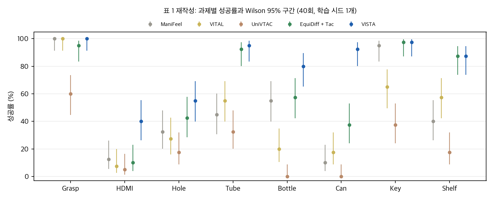
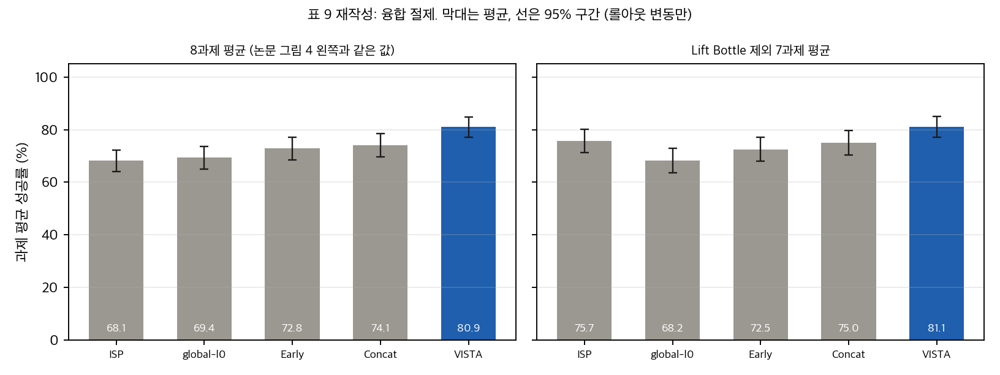
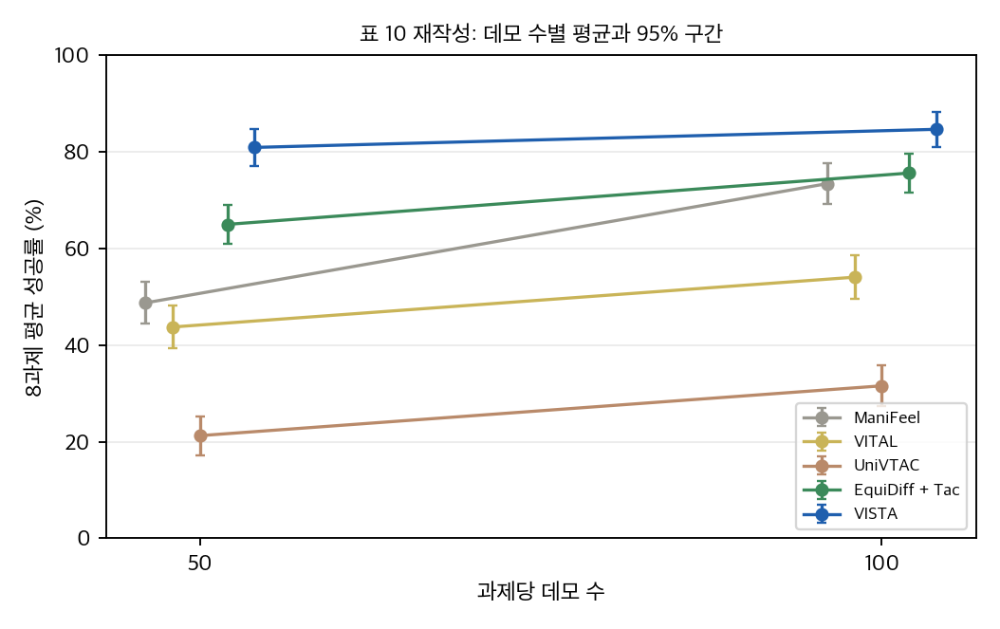
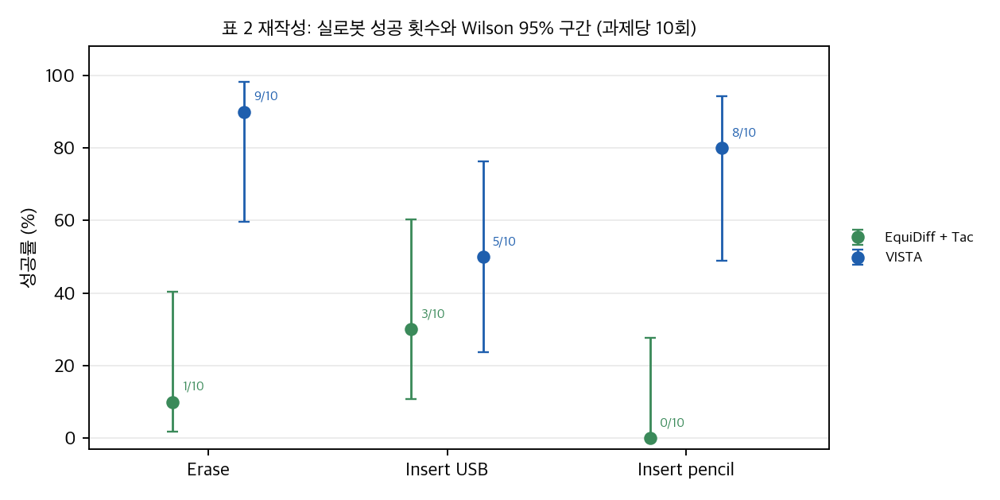
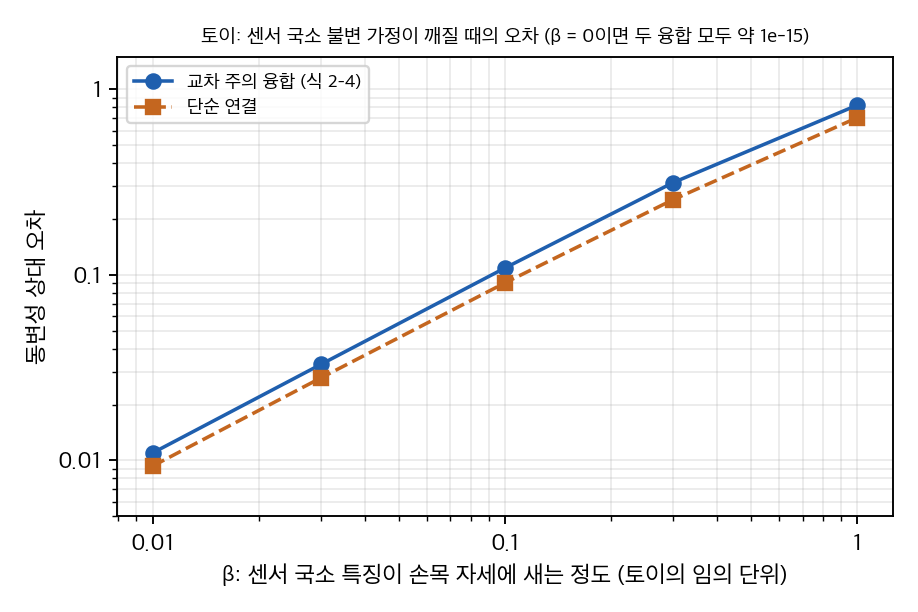

> **논문:** Wong Lik Hang Kenny, Ma Yiyao, Wei Xiu-Shen, Tan Zelong, Song Zhuheng, Xie Dongsheng, Chen Kai, Dou Qi. *Equivariant Visual-Tactile Diffusion Policy for Contact-Rich Manipulation.* CoRL 2026 포스터, arXiv:2610.03333 (v1, 2026-10-02, 단일 버전).
> 공식 코드는 GitHub Kenn3o3/Vista(시뮬)와 vt_franka(실로봇)에 있습니다. 이 글의 그림은 모두 우리가 그린 그래프입니다. 논문 라이선스가 arXiv 비독점 배포라서 논문 그림은 싣지 않았습니다.

## 논문이 묻는 것

접촉이 많은 조작은 시연이 비싸고, 시연은 물체와 손의 자세 범위를 좁게만 덮습니다. 동변(equivariant) 정책은 "관측을 돌리면 행동도 같은 식으로 돌아간다"는 구조를 정책에 넣어 필요한 시연 수를 줄이는데, 기존 동변 정책은 RGB나 점군 같은 시각 입력만 다룹니다. VISTA는 손목 카메라와 촉각 센서가 모두 엔드이펙터에 붙어 있다는 점에 기댑니다. 로봇, 물체, 센서를 함께 돌리면 센서가 보는 국소 측정은 그대로이고 엔드이펙터 자세만 바뀝니다. 그래서 센서 국소 표현을 만든 뒤 엔드이펙터 자세로 작업 공간 프레임에 돌려 놓으면 됩니다.

구체적으로는 (1) 시각과 촉각 이미지를 각각 구 위 토큰으로 올리고, (2) 시각 방향마다 촉각 토큰에 교차 주의를 해 융합하고, (3) 융합된 구면 조화 계수에 엔드이펙터 자세의 Wigner-D 행렬을 곱하고, (4) 유한군(정20면체 I60 또는 8회 회전 C8) 위의 동변 확산 정책으로 행동 청크를 만듭니다. 시각 쪽은 선행 연구 ISP(Image-to-Sphere Policy)의 틀이고, 새 부분은 촉각 구면 토큰과 교차 주의 융합입니다.

## 이 글에서 확인한 것

**1. 표 산술은 모두 일치합니다.** 시뮬 표의 176개 칸이 모두 40회 롤아웃의 정수 격자(k/40) 위에 있고, 평균, 표 사이 같은 값, 본문 인용 차이가 다시 계산한 값과 맞습니다. 본문의 "32.1, 37.1, 59.6점 높다"는 반올림한 평균의 차이이고, 반올림 전 값은 32.2, 37.2, 59.7점입니다.

**2. 가장 강한 기준선과의 격차는 확실하지만 과제별로는 두 과제가 이끕니다.** VISTA 80.9% 대 EquiDiff+Tac 65.0%의 차이 +15.9점은 95% 구간이 10.3–21.6점입니다(학습 시드 1개, 롤아웃 변동만 반영). 과제별로는 Lift Can(37/40 대 15/40, +55.0점)과 Insert HDMI(16/40 대 4/40, +30.0점)만 다중 비교 보정 후에도 구분됩니다. Grasp Classify, Insert Tube, Pull Out Key, Put Bottle in Shelf는 두 방법이 같거나 거의 같습니다.

*그래프 (우리가 그림). 표 1의 과제별 성공률과 Wilson 95% 구간(과제당 40회, 학습 시드 1개)입니다.*

**3. 촉각 이득의 대부분은 한 과제에서 옵니다.** 촉각 없는 ISP(68.1%)가 이미 EquiDiff+Tac(65.0%)보다 3.1점 높습니다(구간 −2.7–8.9점). VISTA의 촉각 추가 이득 +12.8점 가운데 8.1점은 Lift Bottle 한 과제(6/40 → 32/40, +65.0점)에서 옵니다. 이 과제를 빼면 이득은 +5.4점(구간 −0.6–11.3점)입니다. 논문도 Lift Bottle을 가장 큰 이득으로 짚고 "그리퍼 폐쇄 제어가 필요한 과제에서 촉각이 유용하다"고 해석합니다.

**4. 융합 설계의 우위는 방향이 맞고 구간이 넓습니다.** VISTA가 가장 가까운 대안(구면 토큰 연결)보다 6.9점(반올림 전, 본문 6.8점) 높고 구간은 1.0–12.7점입니다. 8과제 평균에서 이 설계가 80% 검정력으로 가를 수 있는 차이는 약 11점(모든 과제 성공률 50% 가정)이라, 이 비교는 단일 시드의 방향 증거로 읽는 편이 맞습니다. 세 대안(전역 ℓ = 0 벡터, 조기 융합, 연결)이 ISP보다 높은 정도(1.3–6.0점)는 Lift Bottle을 빼면 −7.5–−0.7점으로 바뀝니다.

*그래프 (우리가 그림). 표 9의 과제 평균(왼쪽)과 Lift Bottle을 뺀 7과제 평균(오른쪽). 선은 95% 구간(롤아웃 변동만)입니다.*

**5. 데이터 효율은 방향이 맞고, 격차는 시연이 늘면 줄어듭니다.** "50 시연의 VISTA(80.9%)가 100 시연의 EquiDiff+Tac(75.6%)보다 높다"는 +5.3점이고 구간이 −0.3–10.9점입니다. 시연을 50에서 100으로 늘리면 ManiFeel은 +24.7점 올라 VISTA와의 격차가 32.2점에서 11.3점으로 줄고, 나머지 기준선의 격차는 6.6–6.9점 줄지만 5% 수준에서는 구분되지 않습니다. 100 시연에서도 VISTA가 모든 기준선보다 높습니다.

*그래프 (우리가 그림). 표 10의 데모 수(50, 100)별 8과제 평균과 95% 구간(롤아웃 변동만)입니다.*

**6. 실로봇은 과제당 10회, 기준선 하나입니다.** Erase 9/10 대 1/10과 Insert pencil 8/10 대 0/10은 Holm 보정 후에도 구분됩니다(p = 0.002). Insert USB 5/10 대 3/10은 p = 0.65입니다. 합산은 22/30 대 4/30입니다. 비교 대상이 EquiDiff+Tac 하나뿐이라 촉각 효과와 구면 백본 효과를 실로봇에서 가르지는 못합니다.

*그래프 (우리가 그림). 표 2의 실로봇 성공 횟수와 Wilson 95% 구간(과제당 10회)입니다.*

**7. 동변성은 융합 방식이 아니라 센서 국소 불변 가정이 지탱합니다.** 논문의 명제 2(작업 공간 동변성) 증명은 "센서 국소 특징이 전역 회전에 불변이다"라는 가정에서 나오고, 명제 1(융합이 시각 토큰 순열과 가환)은 이 증명에 쓰이지 않습니다. 이를 구면 조화 ℓ ≤ 2의 numpy 토이로 확인했습니다. 융합이 교차 주의든 단순 연결이든 보정 뒤 출력의 상대 오차는 약 1e-15입니다. 센서 국소 특징이 손목 자세에 새는 정도 β를 키우면 오차가 β에 거의 비례해 커집니다. 논문 §5가 한계로 적은 배경·조명, 중력 의존 접촉, 보정 오차가 이 가정을 깨는 경로입니다.

*그래프 (우리가 그림). 토이에서 센서 국소 특징이 손목 자세에 새는 정도 β에 따른 동변성 상대 오차입니다. β의 크기는 토이의 임의 단위이고 학습된 정책의 결과가 아닙니다.*

## 공식 코드와 논문의 차이

공식 저장소의 구조(차원, 손실, 군 표본화, 자세 보정, 융합 식, 촉각 투영 초기화 등 16개 항목)는 논문과 맞습니다. 논문에 없거나 다른 설정이 있습니다.

- 군(I60 대 C8)의 과제별 선택 절차가 코드에 없습니다. 논문은 과제별 군을 표로 주고 "학습 전 과제 기하로 고른다"고 적습니다. 저장소의 학습 예시는 Lift Can을 `so3`(I60)로 학습하는데 논문 표는 이 과제를 C8로 적습니다.
- 작업 공간 중심은 논문이 (0, 0, 0.8) 고정이라고 적습니다. 코드 기본값은 과제 데이터의 엔드이펙터 위치 중점(auto)입니다.
- 학습 설정(300 에폭, 배치 32, 학습률 1e-4, 코사인 일정, EMA, 체크포인트 후보는 `1000 / 시연 수` 에폭마다)이 논문에 없습니다. 시연 50개에서 체크포인트 후보가 15개, 100개에서 30개입니다.
- 50 시연 학습에서 경사 갱신에 쓰이는 것은 앞 40개이고 뒤 10개는 검증입니다(논문은 8:2 분할을 적음).
- 기준선과 VISTA의 입력 해상도와 배치 크기가 다릅니다(EquiDiff+Tac은 224 자르기와 배치 16, VISTA는 84×84와 배치 32). 센서 수의 차이(기준선 좌우 촉각 둘, VISTA 하나)는 논문이 적습니다.
- 융합 모듈의 용량이 절제 변형마다 다릅니다(정적 계산: 교차 주의 블록 약 5.25 M, 연결 블록 약 2.10 M 파라미터).
- 실로봇 저장소의 설정 파일에는 실행 horizon이 8과 16으로 나오는데 논문은 삽입 6, 지우기 8행동이라고 적습니다. 표 2를 만든 설정이 어느 파일인지 코드만으로는 확인할 수 없습니다.

라이선스: 저장소 루트는 Apache-2.0이지만 ISP에서 가져온 부분은 학술·교육 한정 라이선스입니다. 공개 체크포인트와 실로봇 데이터는 없습니다.

## UniVTAC 기준선의 비교

같은 UniVTAC 벤치마크를 쓴 원 논문(arXiv:2602.10093)은 ACT+UniVTAC 평균 48.0%(100회)를 보고하고, 이 논문은 같은 기준선을 21.3%(40회)로 적었습니다. 이 논문이 손목 카메라 시야와 행동 인터페이스를 바꿔서 다시 학습했다고 밝히므로 프로토콜이 다릅니다. 이 논문에서 UniVTAC 대비 격차(+59.6점)는 이 프로토콜에서 다시 돌린 값에 의존합니다.

## 구현 가능성 (Apple M4 Pro, CUDA 없음)

- **시뮬 학습과 평가: 불가.** NVIDIA GPU 리눅스, Isaac Sim 4.5, cuRobo가 필요하고 시연 데이터는 124.8 GB입니다.
- **공식 체크포인트 추론: 불가.** 공개 체크포인트가 없습니다.
- **공식 코드로 오프라인 학습: 조건부.** 설치, 데이터 다운로드 승인이 필요하고 MPS 호환은 확인하지 못했습니다.
- **실로봇: 불가.**
- **구조 소형 재구현과 동변성 토이: 가능.** 이 글의 토이가 그 예입니다.

이 글은 재현 실험을 하지 않았습니다.

## 한계

- 학습 시드가 1개라서 구간과 p값은 롤아웃 표집 변동만 반영합니다. 학습 실행 사이의 변동은 빠져 있습니다.
- 방법 사이에 롤아웃 시드가 같아도 시드별 성공 여부가 공개되지 않아 독립 표본으로 계산했습니다.
- 과제 평균은 과제 여덟 개에 같은 가중치를 준 단순 평균이고, 구간은 과제별 Agresti-Coull 분산을 더한 값입니다.
- 실로봇은 과제당 10회, 기준선 하나입니다. 군(I60 또는 C8)이 어느 쪽인지 논문에 없습니다.
- 동변성 토이는 e3nn 합성곱이 아니라 ℓ ≤ 2의 구면 조화로 만든 축소판이고, 학습된 정책의 성능을 보여 주지 않습니다.

## 출처와 라이선스

- 논문: arXiv:2610.03333, arXiv 비독점 배포 라이선스(CC BY 아님, arXiv 라이선스 페이지 확인). 원문 PDF 저작권 표시는 찾지 못했습니다. 논문 그림은 싣지 않았습니다.
- 표 값과 본문 수치는 인용과 재계산을 위해 옮겼습니다. 그래프, 토이, 분석 문서와 스크립트는 이 저장소 작성자가 만들었습니다.
- 공식 코드, 데이터, 체크포인트는 받아서 실행하지 않았습니다. 코드는 정적으로만 읽었습니다.

## 자료

- [통합 리포트 PDF](report/report_public.pdf)
- [01. 논문 분석: VISTA (arXiv:2610.03333)](analysis/01_paper_analysis.md)
- [02. 선행연구, 코드, 구성 요소별 출처](analysis/02_prior_work.md)
- [03. 수치 재계산, 일관성 검사, 검정](analysis/03_analysis.md)
- [04. 논문과 공식 코드의 대조](analysis/04_code_verification.md)
