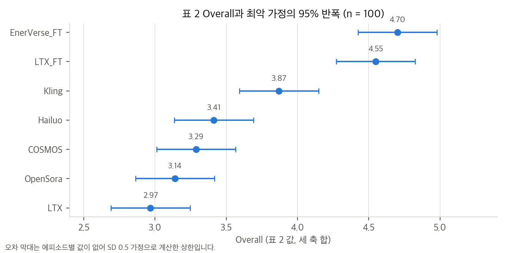
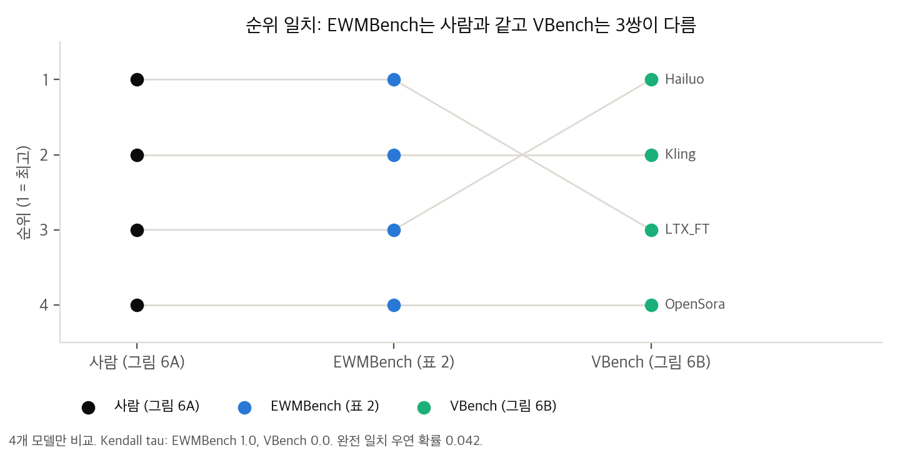
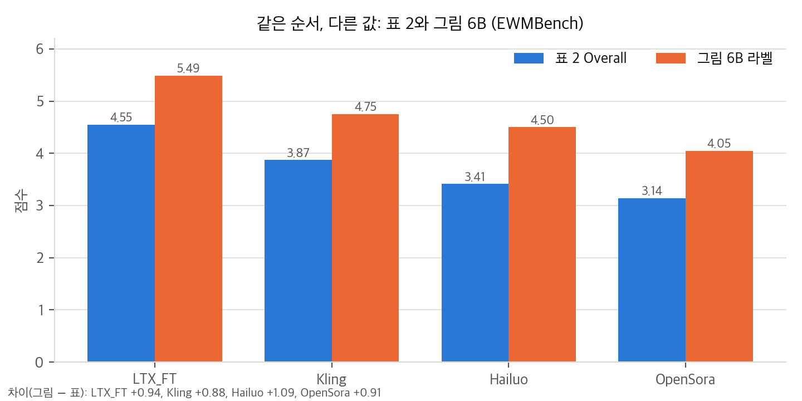

> **논문:** Yue Hu, Siyuan Huang, Yue Liao, Shengcong Chen, Pengfei Zhou, Liliang Chen, Maoqing Yao, Guanghui Ren. *EWMBench: Evaluating Scene, Motion, and Semantic Quality in Embodied World Models.* BMVC 2025, arXiv:2505.09694 (v2, 2025-05-18).
> 공식 코드(AgibotTech/EWMBench)는 정적으로만 읽었고 실행하지 않았습니다. 이 글의 그래프는 모두 우리가 만든 것입니다. 논문 그림은 싣지 않았습니다.

## 논문이 묻는 것

영상 생성 모델이 로봇 세계모델 노릇을 하려면 화질만으로는 부족합니다. 로봇 조작 영상에서는 배경과 물체 배치, 로봇 모양은 그대로 있고 팔의 움직임만 지시에 따라 바뀌어야 합니다. 저자들은 이를 장면 일관성, 동작 정확성, 의미 정합성 세 축으로 채점하는 벤치마크 EWMBench를 만들었습니다. 데이터는 AgiBot-World에서 과제 10개를 골라 만들었고, 일곱 개 영상 생성 모델을 같은 조건에서 비교합니다.

## 채점 방식

| 축 | 지표 | 무엇을 봅니까 |
|---|---|---|
| 장면 | SceneC | 미세조정 DINOv2 패치 특징의 프레임 간 유사도 |
| 동작 | HSD, NDTW, DYN | 양손 2D 궤적을 정답 궤적과 비교 (거리, 시간 정렬, 속도·가속도 분포) |
| 의미 | Diversity, BLEU, CLIP, Logics | 같은 과제의 후보 다양성, 캡션 기반 문장 유사도, 논리 제약 판정 |

세 축의 합을 Overall로 씁니다. 표 2의 Overall은 세 축 점수를 그대로 더한 값입니다. 축을 같은 무게로 더한다는 점이 이 글의 출발점입니다.

## 확인한 것

그래프: 표 2의 Overall과, 에피소드별 값이 없을 때 쓸 수 있는 최악 가정(SD 0.5, 에피소드 100개)의 95% 반폭. 우리가 그린 그래프입니다.

- **합계는 맞습니다.** Motion, Semantics, Overall은 구성 요소의 합과 4자리 안에서 일치합니다.
- **Logics는 1/90 배수입니다.** 과제 10 × 에피소드 10 = 100과 맞지 않습니다. 코드는 키가 없는 항목을 건너뛰므로 유효 표본이 90일 가능성이 있습니다.
- **차이의 대부분은 동작 축에서 나옵니다.** 상위 두 모델의 차이 0.83 중 0.72가 동작 축입니다.
- **인접 모델의 순서는 대부분 구분되지 않습니다.** 최악 가정에서 구분되는 쌍은 두 개뿐입니다.

그래프: 사람 순위(그림 6A), 표 2의 EWMBench 순위, 그림 6B의 VBench 순위. 4개 모델만 비교했습니다. 우리가 그린 그래프입니다.

- EWMBench 순위는 사람 순위와 같습니다(Kendall tau 1.0). VBench는 3쌍이 어긋납니다(tau 0.0).
- 하지만 모델이 4개뿐이라 완전 일치가 우연히 나올 확률도 약 4%입니다. 주장을 세우기에는 약한 근거입니다.
- 사람 평가는 3/2/0점 체계이고 3위 점수가 본문에 없습니다. 주석자 수와 샘플 수도 적혀 있지 않습니다.

그래프: 표 2 Overall과 그림 6B에 인쇄된 EWMBench 라벨. 순서는 같지만 값이 0.88–1.09 차이 나고, 차이도 일정하지 않습니다. 우리가 그린 그래프입니다.

## 코드와 논문이 다른 곳

공식 저장소를 정적으로 읽어 보니 논문과 다른 부분이 몇 있습니다.

- **최고 후보 선택:** 논문은 세 후보 중 HSD가 가장 좋은 것을 고른다고 하지만, 코드에는 그 선택이 없습니다. 모든 후보의 평균이 저장됩니다.
- **CLIP 점수:** 논문은 단계별 설명으로 계산한다고 하지만, 코드는 전역 설명으로 계산합니다.
- **정규화 상수:** 궤적 지표는 24.979, 22.519, 50.202 같은 상수로 나누지만, 논문에는 이 값이 없습니다. 상수에 따라 점수 척도가 바뀝니다.
- **Overall 계산:** 집계 식과 표를 만드는 코드가 저장소에 없습니다.

## 이 맥에서 구현할 수 있는가

**표 2 전체 재현은 이 맥에서 불가능합니다.** 캡션 모델(Qwen2.5-VL-7B)과 검출기가 CUDA 경로로 고정되어 있고, 영상 2,100개에 대한 캡션 생성이 필요합니다. 학습 코드와 사람 평가 자료는 공개되지 않았습니다.

**궤적 지표(HSD, NDTW, DYN)만 CPU에서 다시 구현하는 것은 가능합니다.** 샘플 궤적을 받으면 하루에서 이틀 정도 걸릴 것으로 보입니다. 다만 데이터 다운로드가 먼저 필요합니다.

## 라이선스

논문은 arXiv CC BY 4.0입니다. 공식 코드와 데이터, 가중치는 CC BY-NC-SA 4.0이며 저장소에 LICENSE 파일은 없습니다. 이 글은 논문 그림을 쓰지 않고, 우리가 그린 그래프만 씁니다.

## 자료

- [통합 리포트 PDF](report/report_public.pdf)
- [01. 논문 분석: EWMBench](analysis/01_paper_analysis.md)
- [02. 선행연구와 계보](analysis/02_prior_work.md)
- [03. 수치 재계산, 일관성 검사](analysis/03_analysis.md)
- [04. 논문 ↔ 공식 코드 정적 대조와 구현 가능성](analysis/04_code_verification.md)
