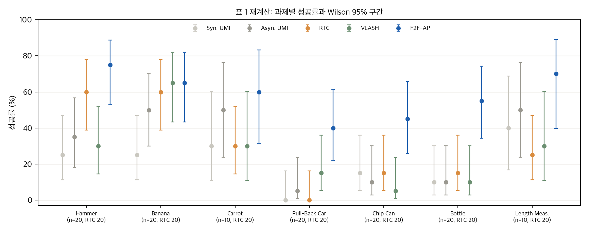
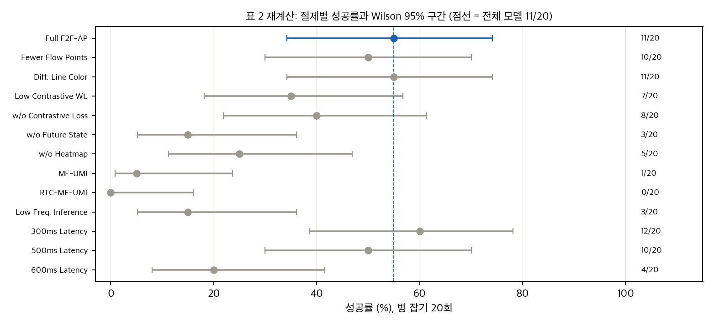
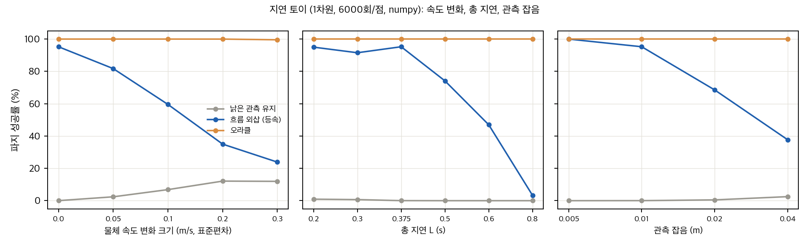

> **논문:** Haoyu Wei, Xiuwei Xu 외. *F2F-AP: Flow-to-Future Asynchronous Policy for Real-time Dynamic Manipulation.* CoRL 2026 포스터, arXiv:2604.02408 (v4, 2026-10-15).
> 공식 코드는 GitHub Why-peace/F2F-AP에 있습니다(라이선스 파일 없음). 이 글의 그래프는 모두 직접 그렸고 논문 그림은 쓰지 않았습니다(arXiv 비독점 배포 라이선스).

## 논문이 묻는 것

비동기 추론은 모델이 추론하는 동안 로봇이 앞선 행동 덩어리를 계속 실행하게 해 움직임을 부드럽게 만듭니다. 그런데 추론이 끝났을 때 영상은 이미 낡았습니다. 움직이는 물체를 잡는 과제에서는 이 낡음이 치명적입니다. 최근 VLASH는 정책에 "지연이 지난 뒤의 로봇 상태"를 주지만 영상은 여전히 낡은 채입니다.

F2F-AP는 영상도 앞으로 당깁니다. 지난 6프레임에서 물체 위의 4개 점이 앞으로 어디로 움직일지 예측해(흐름) 현재 영상 위에 선으로 그려 넣고, 이 "미래가 그려진 영상"과 지연 뒤 로봇 상태를 UMI식 Diffusion Policy에 넣습니다. 정책 인코더 특징이 실제 미래 영상의 특징과 가까워지도록 CLIP식 대조 손실도 겁니다. 총 지연 0.375 s(관측 125 + 추론 200 + 제어기 <50 ms)와 제어 간격 0.1 s에서 지연 보상 스텝은 H = ⌈0.375/0.1⌉ = 4입니다.

## 이 글에서 확인한 것

**1. 과제를 합치면 우위가 확실하고, 과제별로는 절반만 구분됩니다.** 표 1의 과제별 F2F-AP 대 기준선 28개 비교(Fisher 정확 검정) 중 14개가 p < 0.05이고, 28개 전체에 Holm 보정을 하면 0개입니다. 7개 과제를 층으로 한 Mantel-Haenszel 합산에서는 F2F-AP 대 동기 UMI 오즈비 6.9, 비동기 UMI 4.3, RTC 3.8, VLASH 4.3이고 모두 p ≤ 3.2e-6입니다. 방향도 일관됩니다.

*그림 1. 표 1 성공 횟수에서 다시 그린 성공률과 Wilson 95% 구간(직접 그린 그래프). 구간 폭이 약 ±20 %p라서 과제 하나로는 15 %p 차이가 보이지 않습니다.*

**2. "해머, 풀백 카, 병에서 성공률 2배 이상"은 병과 풀백 카에서만 맞습니다.** 최고 기준선 대비 배수는 해머 1.25배(RTC 12/20 대 F2F-AP 15/20, p = 0.50), 풀백 카 2.67배, 병 3.67배입니다. 논문 v1에는 RTC 비교가 해머에 없었고, v3에서 RTC가 모든 과제에 추가되었는데 문장은 그대로입니다.

**3. 실행 시간은 VLASH보다 짧지 않습니다.** 성공한 시도의 평균 시간은 동기·비동기 UMI보다 6/6, 6/7 과제에서 짧고, VLASH보다는 7개 중 6개 과제에서 1.03–1.36배 깁니다(1개는 같음). 평균만 있어 검정은 못 하고, 성공 수가 다른 평균끼리의 비교라는 점도 있습니다.

**4. 절제에서 확실한 것은 "미래 상태"입니다.** 병 과제 20회에서 미래 상태 제거는 3/20 대 11/20(p = 0.019)이지만, 대조 손실 제거는 8/20(p = 0.53), 가중치 낮춤은 7/20(p = 0.34), 히트맵 제거는 5/20(p = 0.11)로 전체 모델과 구분되지 않습니다. 20회로 11/20 대 8/20을 80% 검정력으로 구분하려면 한 군당 약 170회가 필요합니다.

*그림 2. 병 잡기 20회 절제(표 2)를 다시 그린 것. 점선은 전체 모델 11/20입니다.*

**5. 버전 사이에 값이 바뀐 곳이 있습니다.** Banana의 VLASH는 v1/v2의 7/20에서 v4의 13/20으로 바뀌어 F2F-AP와 같아졌습니다. 지연 실험은 v1의 6/10, 5/10, 2/10(실행 시간 7.4, 8.5, 11.2 s)에서 v4의 12/20, 10/20, 4/20(7.5, 8.5, 11.2 s)으로 성공 수가 정확히 두 배이고 실행 시간도 거의 같습니다. 시행 수가 10회에서 20회로 바뀐 경위는 적혀 있지 않아 저자 확인이 필요합니다.

**6. 공식 코드는 논문 설명과 다르게 보이는 곳이 있습니다.** 정적 대조 결과입니다(실행하지 않았습니다).
- 기본 설정(`policy_type: asyc`)은 F2F가 아니라 비동기 기준선이고, README의 스모크 명령은 F2F 경로를 돌리지 않습니다.
- 평가 스크립트는 F2F와 VLASH를 4스텝(2.5 Hz), 기준선을 2스텝(5 Hz)으로 하드코딩합니다. 논문은 5 Hz와 동일 추론 주파수를 말합니다.
- 지연 H는 시간 샘플러에서 원시 프레임 단위(4프레임, 60 Hz 가정 시 약 0.067 s)로 쓰이는데 평가의 행동 시각표는 4 × 0.1 s입니다. 단위 혼동 가능성이 있고 저자 확인이 필요합니다.
- 대조 손실의 두 입력은 영상과 같은 로봇 상태를 함께 담은 전체 인코더 출력이라, 영상을 정렬하지 않고도 손실을 낮출 수 있는 지름길이 있습니다. 정답 미래 영상 쪽은 그래디언트가 막혀 있고 시간 마스크는 배치당 평균 0.4–0.8개 항에만 닿습니다.
- 사족 로봇 쪽 코드(`ModelServer`)와 RTC·MF-UMI 기준선 평가는 저장소에 없어 표 1의 사족 과제는 확인할 수 없습니다.

## 지연 토이: 외삽은 등속에서만 잘 됩니다

핵심 가설 "지연만큼 앞선 물체 위치를 예측해 쓰면 낡은 관측 문제가 줄어든다"를 1차원 점 로봇으로 시험했습니다(학습 없음, numpy, 수 초). 총 지연 0.375 s에서 물체가 0.1–0.4 m/s로 움직이면 낡은 위치와 현재 위치가 3.8–15 cm 어긋나 3 cm 파지 창에 못 들어옵니다(낡은 관측 유지 0%). 6프레임 선형 외삽(예측 흐름의 최소 모형)은 직선 운동에서 95%입니다. 하지만 도중 속도가 바뀌면(표준편차 0.2 m/s) 35%로, 총 지연이 0.6 s이면 47%로 떨어지고, 관측 잡음이 2 cm이면 69%입니다.

*그림 3. 지연 토이(1차원, 셀당 6,000회). 낡은 관측 유지, 6프레임 외삽, 오라클을 비교합니다. 가정된 잡음과 속도 변화 분포를 쓴 단순 모형이며 논문 실험의 재현이 아닙니다.*

이 토이는 학습된 예측기의 성능이 아니라 어떤 조건에서 예측 보상이 깨지는지를 보여 줍니다. 논문 표 2의 600 ms 지연 열화, 병 과제의 비선형 궤적이 어려운 이유와 같은 방향입니다. 논문은 흐름 예측 정확도(끝점 오차 등)를 보고하지 않아서 이 민감도는 아직 확인되지 않은 부분입니다.

## 맺음

F2F-AP의 방향(영상 쪽 낡음까지 고친다)은 설득력이 있고 과제를 합친 수치도 이를 지지합니다. 다만 과제별 시도 수가 10–20회라 개별 비교는 약하고, 일부 문장(2배 이상, VLASH와 비슷한 시간, 모든 구성요소가 필요)은 표로 지지되지 않으며, 공개 코드는 사족 쪽과 기준선이 빠졌고 설정 몇 곳이 논문 설명과 어긋납니다. 그림은 직접 그렸고, 코드는 실행하지 않고 정적으로만 읽었습니다.

## 자료

- [통합 리포트 PDF](report/report_public.pdf)
- [01. 논문 분석: F2F-AP (arXiv:2604.02408)](analysis/01_paper_analysis.md)
- [02. 선행연구, 구성요소 출처, 저장소, 학회](analysis/02_prior_work.md)
- [03. 수치 재계산, 일관성 검사, 토이, 주장 판정](analysis/03_analysis.md)
- [04. 공식 코드 정적 대조와 구현 가능성](analysis/04_code_verification.md)
