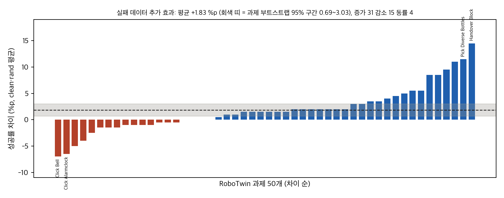
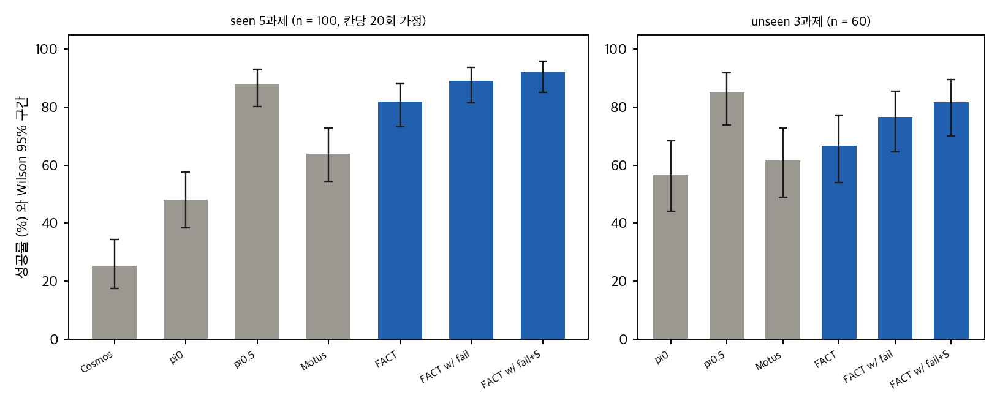
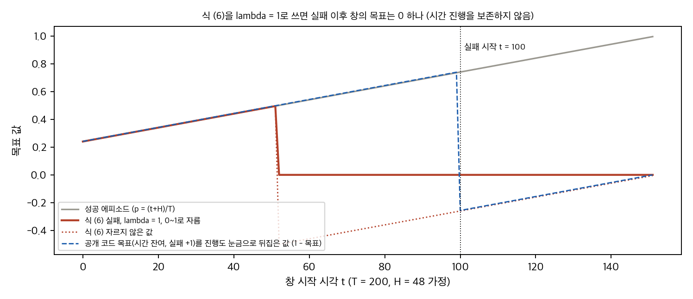
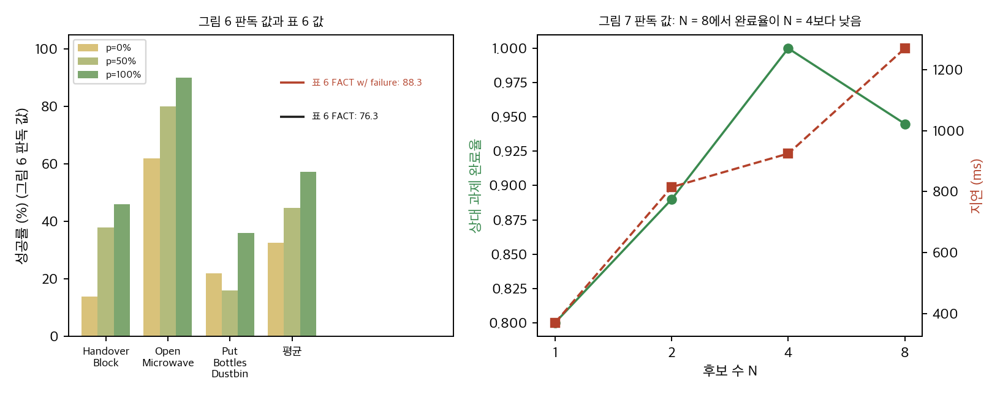

> **논문:** Quanquan Peng, Yutong Liang, Rui Yan, Nicklas Hansen, Xiaolong Wang. *FACT: Failure-Aware Causal Training for World-Action Models.* CoRL 2026 포스터, arXiv:2608.10232 (v2, 2026-10-13).
> 공식 코드는 GitHub Bariona/FACT(Apache-2.0)에 있습니다. 이 글의 그림은 모두 우리가 그린 그래프입니다. 논문 라이선스가 CC BY-NC-ND 4.0이라 논문 그림은 싣지 않았습니다.

## 논문이 묻는 것

월드-액션 모델(WAM)은 행동을 만들면서 미래 영상도 예측하도록 학습합니다. 논문은 기존 WAM의 미래 목표가 대부분 전문가 시연이라서, 나쁜 행동이 들어와도 성공으로 치우친 미래를 낸다고 봅니다. 질문은 이렇습니다. **실패한 롤아웃을 모방 목표로 쓰지 않고, 행동의 결과를 알려 주는 감독으로만 쓸 수 있는가.**

FACT의 답은 두 가지 설계입니다.

1. **행동 먼저, 미래는 그 행동에 조건부.** 토큰 순서를 [관측, 노이즈 낀 행동 A, 깨끗한 행동 G, 가치 V, 미래 영상 I]로 두고, V와 I는 G만 보게 합니다. 행동 생성(A)과 결과 예측(V, I)이 분리됩니다.
2. **실패 롤아웃은 행동 손실만 끕니다.** 가치와 영상 손실은 그대로 두어, 실패한 행동의 결과(실패한 미래, 낮은 진행도)를 학습합니다.

추론은 두 단계입니다. 행동을 먼저 만들고, 원하면 그 행동을 G 자리에 넣어 가치를 계산해 후보 N개를 고릅니다(best-of-N).

## 이 글에서 확인한 것

### 1. 보고된 평균은 재계산과 일치합니다

RoboTwin 50과제의 clean, 무작위 평균(표 6), 표 1의 값, 표 2, 3의 평균 열, 표 4와 8의 "All" 열, 표 7의 성공률 열을 다시 계산했고 모두 맞았습니다. 부록 D의 시연 수(2,500개와 25,000개)도 산술이 맞습니다.

### 2. 영상 공동학습 효과는 확실하고, 실패 데이터 효과는 작게 일관됩니다

과제 50개를 짝지어 비교하면 영상 공동학습은 +3.87 포인트(42승 5패 3무)입니다. 실패 데이터를 더하면 +1.83 포인트(95% 구간 0.62~3.04, 31승 15패 4무, 쌍체 t p = 0.004)입니다. 다만 이득이 몇 과제에 몰려 있습니다. 상위 5과제가 전체 이득의 60%를 차지하고, 이 5개를 빼면 평균 차이는 +0.81입니다. 가장 강한 기준선 Motus와의 차이(−0.38, 구간 −3.42~2.66)는 구분되지 않아, 본문의 "Motus에 가깝다"와 같은 방향입니다.

*그림 1. 표 6 값으로 그린 과제별 차이(FACT w/ failure − FACT, clean·rand 평균). 회색 띠는 과제 부트스트랩 95% 구간입니다. 우리가 그린 그래프입니다.*

### 3. 실로봇 비교는 칸당 20회라 효과가 구분되지 않습니다

표 2와 3은 칸마다 20회로 평가했습니다. 칸을 합쳐 본 과제 n = 100, 미학습 n = 60으로 가정(시행 수 n 가정)하면, 실패 데이터 효과(82 → 89, 67 → 77)는 Fisher p = 0.23, 0.31이고 점수화 효과도 p ≥ 0.63입니다. 방향은 일관됩니다. 표 2에서 5칸 중 4칸이, 표 3에서 3칸 모두 올랐습니다. 반면 영상 공동학습 제거(82 대 58, p = 0.0003)와 실패 행동 손실을 켠 경우(82 대 63, p = 0.004)는 시행 수에 비해 큰 효과입니다. 본문의 "점수화는 실패 학습 뒤에만 유용하다"(점수화 효과 +3.0 대 −3.0)도 방향은 같지만, 두 효과의 차이는 p = 0.39입니다.

*그림 2. 표 2, 3의 실로봇 성공률과 Wilson 95% 구간(칸당 20회 합산, 시행 수 n 가정). 우리가 그린 그래프입니다.*

4.2절은 실패 롤아웃을 "큐브 과제당 약 30개" 모았다고 쓰는데, 표 2에서는 큐브가 아닌 과제의 값도 달라집니다(Hand-over −5, Stack Bowls +15, Pour +10). 큐브가 아닌 과제에도 실패 롤아웃이 있었는지는 논문에서 확인되지 않아 저자 확인이 필요합니다.

### 4. 식 (6)을 λ_fail = 1로 쓰면 실패 창의 목표가 상수입니다

3.3절의 가치 목표는 실패 시 clip(p_{t+H} − λ_fail · 1_fail, 0, 1)이고 구현은 λ_fail = 1, p_t = t/T입니다. 실패 표시가 켜진 창에서 p − 1 ≤ 0이므로 0~1로 자르면 p < 1인 모든 창에서 목표가 0입니다. "시간 진행을 보존한다"는 설명은 λ_fail < 1에서 성립하는 서술로 읽힙니다.

공개 코드는 다른 식을 씁니다. 가치를 진행도 대신 **시간 잔여**((L − 인덱스 − 1)/(L − 1), 작을수록 좋음)로 정의하고, 실패 창에서는 값에 +1을 더해 [−1, 2] 범위로 정규화합니다. 그러면 실패 창 안에서도 시간 순서가 남고, 후보 선택은 argmax가 아니라 argmin입니다. 방향이 반대일 뿐 같은 정보이지만, 식 (6)과는 다른 목표입니다.

*그림 3. T = 200, H = 48을 가정한 가치 목표 비교. 식 (6)(λ = 1, 자름)은 실패 이후 0으로 평평해지고, 코드식은 시간 순서를 유지합니다. 우리가 그린 그래프입니다.*

### 5. 그림 6과 7은 설정 설명이 더 필요합니다

그림 6의 막대를 읽은 값(그림 판독 값)에서 평균은 32.7 → 44.7 → 57.3으로 본문 값과 일치합니다. 다만 과제 하나(Put Bottles Dustbin)는 22 → 16 → 36으로 단조가 아닙니다. 또 같은 세 과제의 표 6 clean 열은 FACT 평균 76.3, + 실패 88.3인데 그림 6은 32.7과 57.3이라, 그림 6의 학습 설정이 본문에 없어 두 값을 같은 척도로 읽을 수 없습니다.

그림 7(그림 판독 값)에서는 N = 4의 상대 완료율이 1.00이고 N = 8은 약 0.945입니다. 본문 "Larger candidate sets provide a smaller gain"은 이득이 작다고 쓰지만 읽은 값은 감소입니다. 지연은 N = 1이 약 370 ms(표 7의 380 ms와 맞음), N = 4가 약 925 ms로 읽혀서, "Motus보다 약 3배 빠르다"(380 ms 대 1,220 ms)는 행동만 쓸 때의 값입니다.

*그림 4. 그림 6(막대)과 7(점)을 읽은 값과 표 6의 같은 세 과제 값. 그림 판독 값은 픽셀에서 읽은 근사입니다. 우리가 그린 그래프입니다.*

### 6. 미래 예측 PSNR 개선은 구성상 예상되는 방향입니다

실패 창의 PSNR은 19.51 → 25.92 dB(+6.41 dB, 평균제곱오차 약 4.4배 감소)이고 성공 창은 26.12 → 26.08로 거의 같습니다. 성공만 학습한 모델은 실패 창을 본 적이 없으므로 실패 창의 개선은 예상되는 방향이고, 정보가 큰 부분은 성공 창이 변하지 않는다는 점입니다. 표본은 512개(반반)이고 구간이나 반복이 없으며, 지표가 "성공으로 치우친 환각"을 직접 재지는 않습니다.

## 공개 코드와의 차이

공개 저장소(커밋 5b299a2, RoboTwin 파이프라인)를 정적으로 읽었습니다. 마스크 규칙, 행동 손실 마스킹, 학습률, H = 48, 2단계 추론은 논문과 일치합니다. 다른 점은 다음과 같습니다.

| 항목 | 논문 | 공개 코드 |
|---|---|---|
| 손실 가중치 | w_a = 20, w_v = w_I = 1 | 행동 10, 가치 0.4, 영상 1 |
| 미래 상태 예측 | 없음 | 있음 (손실 가중치 0.4) |
| 가치 방향과 선택 | 진행도, argmax | 시간 잔여, argmin |
| 실패 목표 | clip(p − λ, 0, 1) | 잔여 + 1, 정규화 후 자름 |
| 실패 표시 시점 | 청크가 끝나는 t + H | 창 시작 t |
| 평가 횟수 | 과제·분할당 100 | 평가 설정 기본 50 |
| 학습 설정 | AdamW, 두 학습률만 | 배치 256, 150k 스텝, β = (0.9, 0.95) 등 |

공개 체크포인트의 학습 설정이 이 파일과 같은지는 확인하지 못했습니다. 또 저장소에는 실패 롤아웃을 수집·주석하는 코드와 실패 데이터, 실로봇·기준선·절제 코드가 없습니다. 기본 데이터 탐색은 `Fail` 그룹을 제외하도록 되어 있어, 실패 롤아웃을 쓰려면 폴더를 직접 지정해야 합니다.

## 읽을 때 주의할 점

- **학습 단계 수.** 알고리즘 2는 성공 데이터로 학습한 뒤 실패를 더해 "계속 학습"합니다. 같은 단계 수만큼 성공 데이터로 더 학습한 대조군이 없어, 실패 데이터 효과와 추가 학습 효과가 분리되지 않습니다.
- **다른 실패 활용법과의 비교.** 실패를 모방에 쓰는 경우(63)만 비교되고, 가치만 또는 영상만 쓰는 변형은 없습니다.
- **통계 단위.** 모델 학습 반복(시드)이 하나로 보이고, 실로봇 칸은 20회입니다.
- **"미학습 변형"의 범위.** 본 과제와 같은 과제에서 색, 모양, 지시를 바꾼 세 개입니다.

## 요약

방법의 아이디어(행동은 모방하고 결과는 감독하는 분리)는 마스크 하나로 구현되고 공개 코드에서도 확인됩니다. 영상 공동학습 효과는 확실하고, 실패 데이터 효과는 시뮬레이션에서 작은 폭으로 일관됩니다. 실로봇의 단계별 이득은 이 시행 수에서 구분되지 않습니다. 식 (6)의 λ = 1 목표와 코드의 가치 목표, 그림 6의 설정, 380 ms의 설정은 저자 확인이 필요합니다.

**재현 가능성.** 이 글의 수치 재계산은 numpy와 scipy로 수 초에 끝납니다. 공식 설정의 학습(WAN2.2-5B, 8 GPU)과 RoboTwin 평가는 GPU가 필요하고, 실로봇은 장비가 필요합니다.

## 자료

- [통합 리포트 PDF](report/report_public.pdf)
- [01. 논문 분석: FACT (arXiv:2608.10232 v2)](analysis/01_paper_analysis.md)
- [02. 선행 연구, 코드 저장소, 관련 분석](analysis/02_prior_work.md)
- [03. 수치 재계산과 일관성 검사](analysis/03_analysis.md)
- [04. 공식 코드 대조](analysis/04_code_verification.md)
