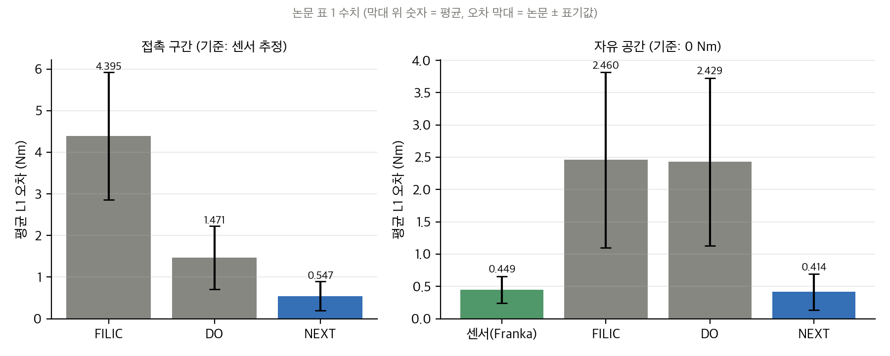
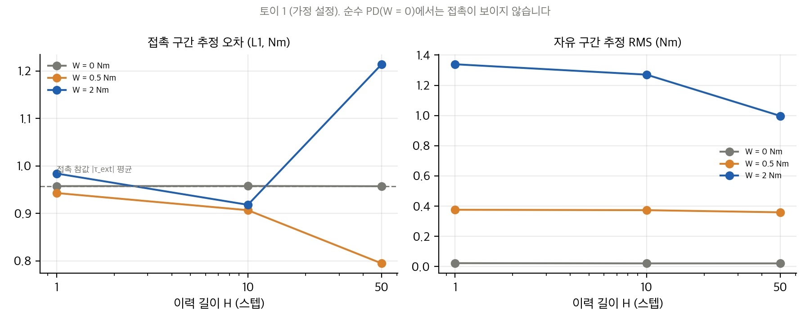
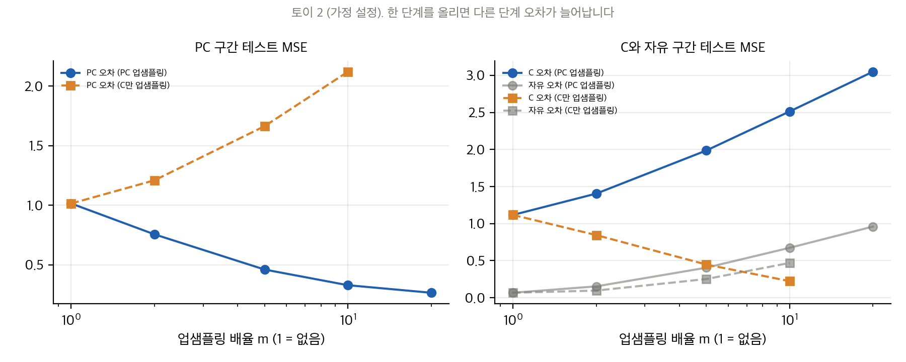

> **논문:** Oh 외 7인. *FACTR 2: Learning External Force Sensing for Commodity Robot Arms Improves Policy Learning.* CoRL 2026 구두 발표, arXiv:2606.12406 (v2, 2026-08-12).
> 논문 배포 조건은 arXiv non-exclusive이며 CC BY가 아닙니다. 그래서 논문 그림은 싣지 않았고, 이 글의 그래프는 논문 표의 수치와 직접 만든 토이로 그렸습니다. 공식 NEXT 구현은 Apache-2.0이며, 정적으로 읽기만 했습니다.

---

## 논문이 묻는 것

힘 센서가 없는 저가 로봇팔은 접촉이 많은 조작에서 힘을 느끼지 못합니다. 센서를 달면 팔 값보다 비쌉니다. 저자들은 **NEXT**를 냅니다. 자유 운동 데이터 10분으로 LSTM을 1분 학습해 "자유 공간에서 필요한 관절 토크"를 예측하고, 측정 토크에서 그 예측을 뺀 잔차를 외부 토크로 씁니다.

그 위에 **FIRST**를 얹습니다. 추정한 외부 토크로 접촉 직전 1초와 접촉 구간을 찾고, 학습 때 그 구간을 더 자주 뽑습니다. 손실 함수는 그대로입니다.

## 표를 다시 계산해 보기

접촉 구간 오차는 표 1에서 NEXT 0.547 Nm, 외란 관측기 1.471 Nm, FILIC 4.395 Nm입니다. 감소율 87.6%와 62.8%는 표에서 그대로 나옵니다.

*그래프: 논문 표 1 수치. 우리가 그린 그래프이며 논문 수치만 옮겼습니다.*

자유 공간에서는 NEXT 0.414 Nm가 센서 0.449 Nm보다 낮다고 씁니다. 그런데 차이는 0.035 Nm이고 표준편차는 0.2–0.3입니다. 시행 단위가 불분명해서 검정할 수 없고, 가정(n = 6)을 두면 p = 0.81입니다. **"센서보다 낫다"는 근거가 없습니다.**

FIRST의 과제 짝 비교(PC 대 접촉 구간 C, 5과제)는 p = 0.046으로 약하게 지지됩니다. 그런데 초록의 "17% 이상"의 기준선과 계산 방식은 본문에 없습니다.

## 값이 서로 맞지 않는 곳

- 표 2의 진행도 네 값(벨트·공구의 PC, PC+C)이 표 9의 성공률 네 값과 같습니다. 지표를 혼동했거나 옮기다 생긴 오류일 수 있습니다.
- 표 9, 10의 값은 "롤아웃 20회"로는 만들 수 없습니다. 여러 실행을 합쳤을 가능성이 있는데 논문은 밝히지 않았습니다.
- 표 4의 "Δq 입력이 일관되게 낫다"는 주장은 접촉 구간에서 지지되지 않습니다.

## 공식 코드와 비교

공식 저장소 `factr2_next`는 NEXT의 학습과 추론만 담고 있습니다. 모델 구조(LSTM 2층 128, 머리 256, 입력 (q, q̇, Δq_d), H = 50)는 논문과 같습니다. 그러나 학습 설정은 다릅니다. 논문 표 3은 AdamW, 조기 종료, 기울기 클리핑을 쓴다고 했지만, 코드는 Adam으로 20 에폭을 돌리고 클리핑과 조기 종료가 없습니다. FIRST, 정책 학습, 기준선 코드는 저장소에 없습니다.

## 무엇이 식별을 가능하게 하나

토이로 확인한 가장 중요한 점입니다. 측정 토크가 제어기의 PD 출력과 같아서 입력 특징만으로 결정되면, 자유 운동으로 학습한 모델은 접촉 구간의 외부 토크를 전혀 보지 못합니다. 토이에서 접촉 추정은 0.017 Nm이었고 참값은 0.957 Nm였습니다. 잔차 방식이 작동하려면 측정 토크에 입력으로 설명되지 않는 정보가 있어야 합니다. 논문은 이 조건이 Franka와 Piper에서 어떻게 성립하는지 설명하지 않습니다.

*그래프: 토이 1(가정 설정). 순수 PD에서는 접촉이 보이지 않고, 피드포워드가 있을 때만 이력 길이 효과가 나타납니다.*

## 업샘플링은 한 단계를 올리고 다른 단계를 내린다

두 번째 토이는 업샘플링 배율을 올릴수록 올린 단계의 오차는 줄고 자유 공간 오차는 커진다는 것을 보여 줍니다. 논문의 최적 배율 5 근처와 같은 방향이지만, 토이에서는 접촉 구간만 올려도 효과가 났습니다. 논문 표 2는 그 경우 효과가 없다고 보고합니다. 결과가 설정에 따라 바뀌므로 결론으로 쓰지 않습니다.

*그래프: 토이 2(가정 설정). 방향 확인용이며 논문 수치와 비교하지 않았습니다.*

## 이 맥에서 구현할 수 있는가

- **NEXT 추정기:** 구현할 수 있습니다. 모델은 약 24만 파라미터이고 추론은 단일 스레드 0.8 ms입니다(무작위 가중치 측정). 학습은 CPU로 가능합니다. 저가 팔 10분 데이터만 있으면 됩니다.
- **FIRST:** 아이디어는 쉽지만 T_high, T_low, 제어 주파수가 없어서 같은 결과를 보장하기 어렵습니다.
- **정책 학습과 실로봇 실험:** 이 맥에서는 불가능합니다. 과제당 GPU 12–24시간과 실물 팔, 피험자가 필요합니다.

## 정리

NEXT는 "힘 센서 대신 토크 잔차"라는 실용적인 방법이고, 접촉 구간 추정은 기준선보다 낫습니다. 다만 자유 공간에서 센서를 이겼다는 주장, 17%라는 수치, 표 2와 9의 값은 지금 자료로는 확인되지 않습니다. 잔차 방식을 내 장비에 옮기기 전에 측정 토크가 입력으로 결정되지 않는지 로그로 먼저 확인하는 것이 좋습니다.

## 자료

- [통합 리포트 PDF](report/report_public.pdf)
- [01. 논문 분석: FACTR 2 (arXiv:2606.12406)](analysis/01_paper_analysis.md)
- [02. 선행 연구와 관련 저장소](analysis/02_prior_work.md)
- [03. 수치 재계산, 정밀도 점검, 검정, 토이 검증](analysis/03_analysis.md)
- [04. 코드 대조와 주장 검증, 구현 가능성](analysis/04_code_verification.md)
