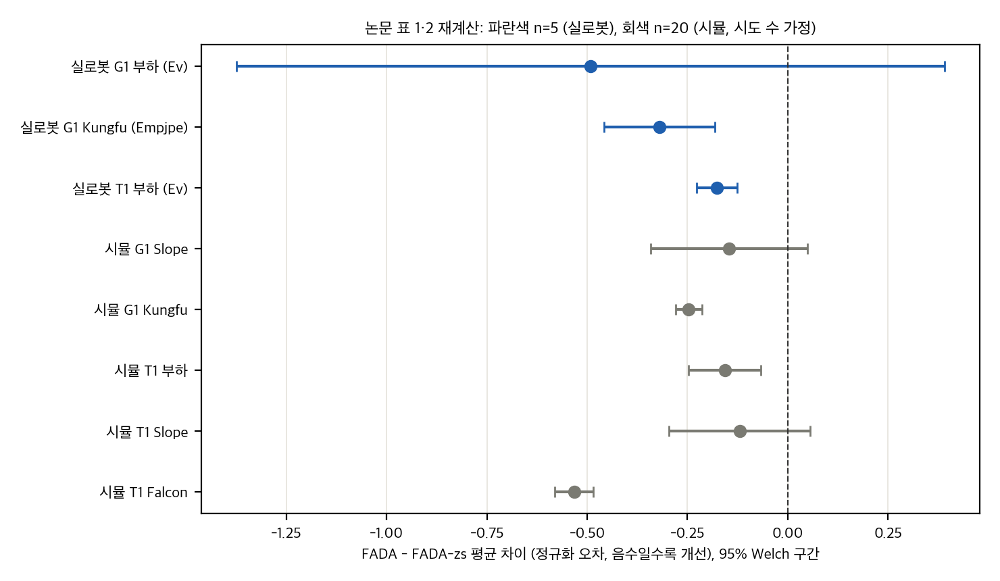
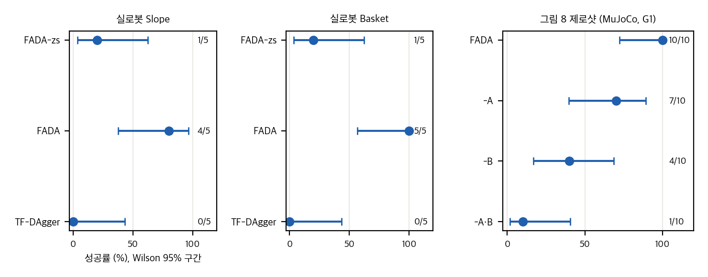

> **논문:** Angchen Xie, Nikhil Sobanbabu, Ishayu Shikhare, Alan Wang, Max Simchowitz, Guanya Shi. *FADA: Few-Shot Domain Adaptation via Dynamics Alignment for Humanoid Control.* CoRL 2026 (포스터), arXiv:2606.28476 (v2, 2026-10-09).
> 공식 코드는 GitHub LeCAR-Lab/FADA에 있습니다(Apache-2.0). 이 글의 그림은 모두 우리가 그린 그래프입니다. 논문 그림은 라이선스가 CC BY가 아니어서 싣지 않았습니다.

## 논문이 묻는 것

휴머노이드는 지형이나 적재물이 바뀌면 같은 명령이 다른 몸 운동을 만듭니다. 기존 대응은 두 방향입니다. 도메인 무작위화로 정책을 보수적으로 만들거나, 시스템 식별과 잔차 학습으로 모델을 맞추는 것입니다. 둘 다 비싸거나 모델을 요구합니다.

FADA는 정책을 **플래너**와 **역동역학 모듈(IDM)**로 나눕니다. 플래너는 "다음에 몸이 어떻게 움직여야 하는가"를 예측하고, IDM은 그 움직임을 만드는 행동을 고릅니다. 적응할 때는 플래너를 얼리고 IDM만 저랭크(LoRA)로 갱신합니다. 데이터는 목표 로봇에서 약 2분 동안 실행한 롤아웃입니다. 보상도 오라클도 필요 없습니다.

## 이 글에서 확인한 것

**1. 적응 효과의 방향은 맞습니다.** 실로봇 다섯 과제, 시뮬레이터 간 전이 다섯 과제, 같은 시뮬레이터 안의 이동 세 과제에서 모두 개선이 보입니다. 논문의 표 1과 표 2 수치를 다시 계산했고, 평균 감소 27.4%와 15.9%는 맞습니다.

*그림 1 (우리가 그림). 파란색은 실로봇 n = 5, 회색은 시뮬 n = 20(시도 수는 논문 본문에서 가정). 평균 차이와 Welch 95% 구간입니다.*

**2. 실로봇 통계는 약합니다.** 과제당 시도가 5회입니다. 제로샷 20%에서 적응 후 80%로 오른 G1 Slope는 Fisher 검정으로 p = 0.21입니다. Basket은 5/5 대 1/5로 p = 0.048입니다. 정규화 오차는 G1 부하 과제가 p = 0.20이고, 나머지 두 과제는 p ≤ 0.001입니다.

*그림 2 (우리가 그림). 왼쪽 두 패널은 실로봇 성공 횟수, 오른쪽은 제로샷 절제(n = 10)의 성공률입니다.*

**3. 시뮬에서는 다섯 과제 중 세 과제만 유의합니다.** 평균 감소 24.7%는 합계 비율로 계산한 값입니다. 과제별 감소의 평균은 25.7%입니다. 다중 비교를 보정하면 G1 Slope와 T1 Slope는 유의하지 않습니다.

**4. 핵심 주장은 대조 실험이 없습니다.** "플래너를 얼리고 IDM만 적응하는 것이 핵심"이라는 주장은 두 가지 간접 증거에 의존합니다. 하나는 미래 관측을 예측하도록 미세조정한 기준선이 더 나빠진다는 결과, 다른 하나는 LoRA가 전체 IDM 미세조정보다 낫다는 결과입니다. 같은 예산에서 플래너만 적응하거나 전체 정책을 행동 손실로 적응하는 조건은 없습니다.

**5. 공식 코드와 논문의 설정이 다릅니다.** 적응 학습률은 논문 3×10⁻⁴, 800 스텝이고 코드 기본값은 1×10⁻⁴, 100 스텝입니다. 학습 중 부분 최적 데이터도 논문은 2배인데 코드 기본값은 1배입니다. 관측 노이즈와 마스킹 증강은 논문에 없지만 코드에서는 켜져 있습니다.

**6. 코드에서 빠진 것이 있습니다.** README는 전신 추종 학습을 "미완료"로 두었습니다. 기준선 코드(TF–DAgger, TF–CoPred)는 릴리스에서 삭제되었다고 표시되어 있습니다. MLP 절제 코드도 없습니다. 학생 체크포인트와 목표 롤아웃 데이터는 공개되지 않았습니다.

## 이 맥에서 재현할 수 있는가

**학습과 시뮬 평가는 재현할 수 없습니다.** 오라클 PPO 학습과 DAgger 학생 학습은 IsaacSim과 CUDA GPU를 전제합니다. 맥(Apple M4 Pro, MPS)은 이 조건을 맞추지 못합니다. 학생 체크포인트가 없어서 적응 실험의 입력도 없습니다.

할 수 있는 것은 두 가지입니다. 하나는 논문 표의 재계산과 코드 대조(이 글에서 한 것)입니다. 다른 하나는 "플래너만, IDM만, 전체 정책" 세 조건을 CPU 토이로 비교하는 축소 실험입니다. 두 번째는 아직 하지 않았습니다. 재현 계획은 사용자 확인 뒤에 시작합니다.

## 한계

- 실로봇 시도가 5회입니다. 표준편차 정의도 논문에 없습니다.
- 전신 추종 과제의 시간 예산이 맞지 않습니다. Kungfu 한 동작이 15 s인데 여섯 번 반복하면 90 s이므로 2분 예산과 다릅니다.
- 적응 데이터와 평가 데이터가 분리되었는지 본문에서 확인할 수 없습니다. IDM 손실 비교는 정책마다 자기 롤아웃에서 측정되어 교란이 있습니다.
- 그림 9의 예산 곡선과 그림 12의 팔 실험 값은 그림에서만 읽었습니다.

## 출처와 라이선스

- 논문: arXiv:2606.28476, 라이선스는 arXiv 비독점 배포(`nonexclusive-distrib/1.0`)입니다. CC BY가 아닙니다.
- 공식 코드: github.com/LeCAR-Lab/FADA (Apache-2.0). 이 글에서는 복사하지 않았고, 설치하거나 실행하지 않았습니다. 정적 읽기만 했습니다.
- 표 값은 인용과 재계산을 위해 옮겼습니다. 그래프, 분석 문서, 스크립트는 이 저장소 작성자가 만들었습니다.

## 자료

- [통합 리포트 PDF](report/report_public.pdf)
- [01. 논문 분석: FADA (arXiv:2606.28476)](analysis/01_paper_analysis.md)
- [02. 선행연구와 관련 저장소](analysis/02_prior_work.md)
- [03. 재계산, 일관성 검사, 주장 판정](analysis/03_analysis.md)
- [04. 공식 코드 대조와 구현 가능성](analysis/04_code_verification.md)
