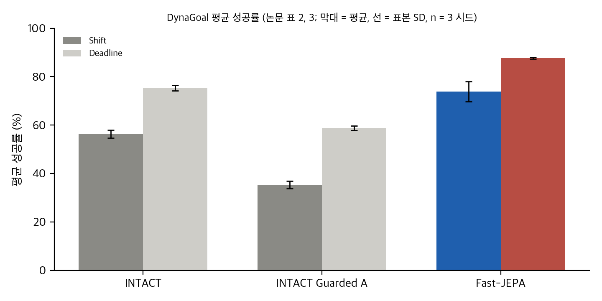
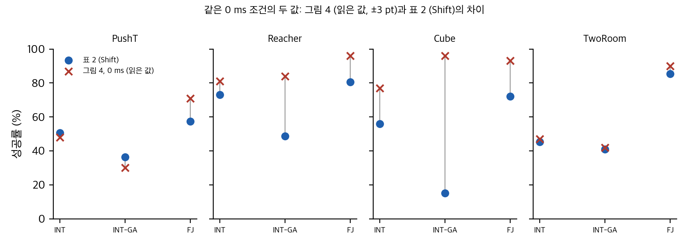

> **논문:** Yao Zhang, Bin Yu, Shijie Lian, Haishan Liu, Changti Wu, Yu Wu, Kai Chen. *Fast-JEPA: Advancing the Success–Latency Frontier for Latent World Models.* arXiv:2611.25927 (v1, 2026-11-19). 학회 표기는 없습니다.
> 저장소(`DeepCybo-PhysAI/Fast-JEPA`)에는 README와 그림만 있고 구현 코드가 없습니다. 이 글의 그래프는 논문 수치로 우리가 그린 것입니다. 논문 그림은 라이선스(arXiv 비독점 배포)상 싣지 않았습니다.

## 논문이 묻는 것

잠재 세계 모델로 행동 후보를 고르는 계획기는 후보마다 예측을 여러 번 돌립니다. 후보가 많으면 온라인 지연이 커집니다. Fast-JEPA는 이 비용을 줄이려고 **계획 단계마다 예측을 다르게 씁니다.**

- **후보를 만들 때**는 중간 예측을 씁니다. 행동 생성기가 한 청크씩 고르고, 그 결과를 다음 청크의 입력으로 씁니다. 이 예측은 항상 관측 표현에서 출발합니다. 예측된 상태를 다음 예측의 시작점으로 쓰지 않습니다.
- **후보를 비교할 때**는 종점 예측만 씁니다. 완성된 행동열은 전부 알려져 있으므로, 시각 목표와의 거리를 한 번의 질의로 잽니다.

제안을 중심으로 CEM을 한두 라운드 돌리고, 제안과 지금까지 가장 좋은 계획은 후보 목록에 남깁니다. 그래서 예측 비용 기준으로는 제안보다 나빠지지 않습니다. 실제 실행 성공이 좋아진다는 보장은 아닙니다. 저자도 이 점을 적어 두었습니다.

계산량은 식으로 쓰면 이렇습니다. 롤아웃 기반 CEM은 `(NI+1)HW`, Fast-JEPA는 `HG+(H+NI)W`입니다. H = 5, N = 64, I = 2에서 세계 모델 호출은 645회 대 133회입니다. 실제 지연은 배치와 오버헤드에 따라 달라집니다.

## 확인한 것

**1. 채점 비용 감소는 계산과 맞습니다.** 같은 탐색에서 재귀 채점은 11.16 ms, 직접 종점 채점은 2.32 ms입니다. 4.8배입니다. H = 5에서 기대되는 비율과 가깝습니다. 전체 지연은 20.54 ms 대 10.78 ms(1.9배)입니다.

*그래프: 우리가 그린 그림입니다. 논문 표 2(Shift)와 표 3(Deadline)의 평균 성공률을 막대로, 시드 3개의 표본 SD를 선으로 나타냈습니다. 논문 값을 옮긴 것입니다.*

**2. 지연 우위는 큽니다.** 4과제 평균 지연은 10.88 ms입니다. INTACT는 26.19 ms, INTACT Guarded A는 127.09 ms입니다. 2.41배는 INTACT 기준이고, 성공률이 더 높은 Guarded A 기준으로는 11.7배입니다.

**3. 성공률 우위는 확인되지 않습니다.** 평균 성공률은 96.50%로 가장 높게 보고됩니다. 그러나 Guarded A의 96.33%와 차이는 0.17 pp입니다. 시드 3개로 Welch 검정을 하면 p = 0.72입니다. INTACT와 비교해도 p = 0.15입니다. 초록에서 "가장 높은 성공률"은 맞는 말이지만, 차이는 구분되지 않습니다.

**4. 이득이 분명한 곳은 DynaGoal입니다.** 목표나 환경이 바뀌는 Shift에서는 73.83%, 실행 마감이 있는 Deadline에서는 87.67%입니다. INTACT는 각각 56.25%와 75.33%입니다. 시드 기준으로 p = 0.010과 p = 0.0014입니다. 특히 TwoRoom에서 움직이는 문에 대한 차이가 큽니다(85.33 대 45.33).

**5. 그림과 표가 맞지 않습니다.** 지연 0 ms에서 측정한 DynaGoal 결과(그림 4)가 표 2와 맞지 않습니다. 같은 조건에서 INTACT Guarded A의 Cube 값은 그림에서 약 96%, 표에서 15%입니다. 같은 컨트롤러의 4과제 값도 표 1(96.50%)과 표 4·5(96.33%)에서 다릅니다. 저자가 설명해야 할 부분입니다.

*그래프: 우리가 그린 그림입니다. 논문 그림 4의 0 ms 값은 그림에서 ±3 pt 정도로 읽었습니다. 표 2의 값과 나란히 놓았습니다.*

## 구현 가능성

이 맥(Apple M4 Pro, 24 GiB, MPS, CUDA 없음) 기준으로 나눠 보았습니다.

- **구현할 수 있는 것:** 제안 생성, 제안 중심 CEM, 종점 채점은 PyTorch로 짤 수 있습니다. 행동 모델과 학습 목표도 부록 A의 설정으로 옮길 수 있습니다.
- **재현할 수 없는 것:** 공식 코드, 체크포인트, DynaGoal 케이스 목록이 공개되지 않았습니다. 학습은 GPU 기준으로 4과제 × 3 시드에 5.95 GPU-h가 들었다고 보고되었습니다. 지연 10.88 ms는 RTX PRO 6000 기준이라 같은 조건에서 비교할 수 없습니다.

## 남는 질문

- 성공률 우위가 더 많은 시드와 에피소드에서도 유지되는가?
- 그림 4와 표 2의 0 ms 값은 어떤 실행인가?
- 프로토콜마다 지연이 10.88, 13.42, 13.75 ms로 다른 이유는 무엇인가?
- "1 에폭" 학습과 5.95 GPU-h는 어떻게 맞는가?

공식 코드가 공개되면 이 글의 판정을 다시 확인해야 합니다.

## 자료

- [통합 리포트 PDF](report/report_public.pdf)
- [01. 논문 분석: Fast-JEPA (arXiv:2611.25927)](analysis/01_paper_analysis.md)
- [02. 선행연구와 관련 자료](analysis/02_prior_work.md)
- [03. 재계산, 통계 검정, 일관성 검사](analysis/03_analysis.md)
- [04. 주장 검증 (공식 구현 없음)](analysis/04_claim_verification.md)
