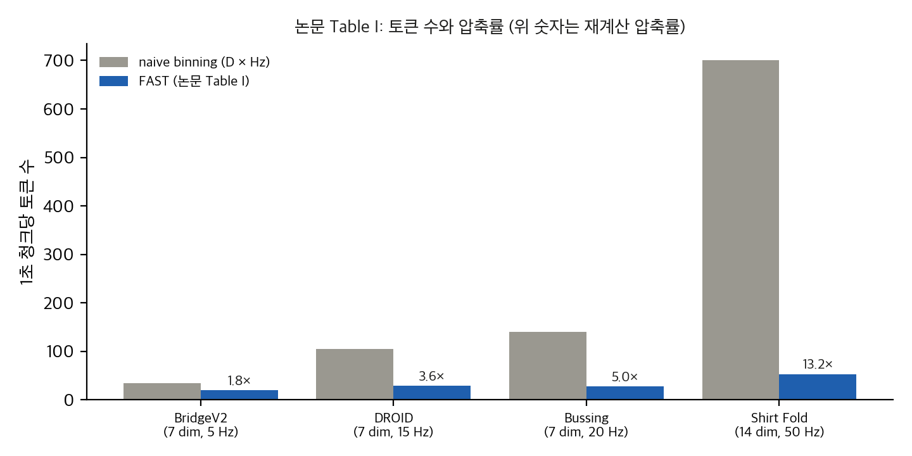
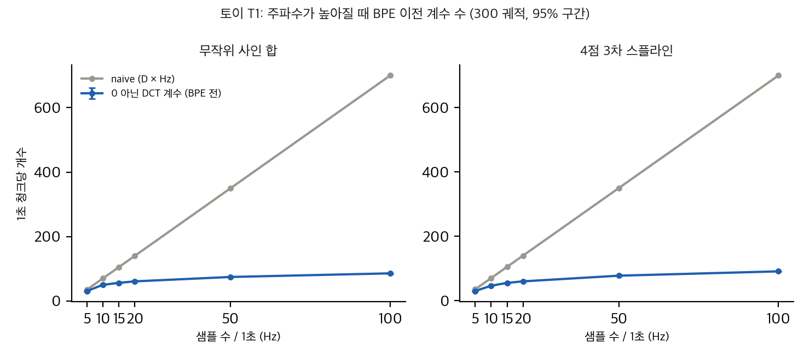

> **논문:** Karl Pertsch, Kyle Stachowicz, Brian Ichter, Danny Driess, Suraj Nair, Quan Vuong, Oier Mees, Chelsea Finn, Sergey Levine. *FAST: Efficient Action Tokenization for Vision-Language-Action Models.* arXiv:2501.09747 (v1, 2025-01-16, 단일 버전).
> 공식 코드는 GitHub Physical-Intelligence/openpi(Apache-2.0)와 Hugging Face `physical-intelligence/fast`(Apache-2.0)에 있습니다. 이 글은 코드를 실행하지 않고 정적으로만 읽었습니다.

## 논문이 묻는 것

자기회귀 VLA는 행동을 토큰 열로 바꿔 예측합니다. 지금까지 흔한 방식은 행동 차원마다, 시점마다 256 구간으로 나누는 것입니다. 1초 청크에 행동 차원이 7개이고 제어가 50 Hz이면 350개 토큰이 생깁니다. 저자들은 이렇게 긴 토큰 열이 고주파 데이터에서 학습을 망친다고 봅니다. 연속한 토큰이 거의 같아서, 모델이 마지막 토큰을 복사하는 것만으로 손실이 낮아지는 나쁜 지역 최적에 빠진다는 설명입니다.

FAST는 행동 청크를 먼저 압축합니다. 분위수 정규화로 [-1, 1]에 맞춘 뒤, 차원마다 DCT를 적용하고, 스케일 10을 곱해 반올림합니다. 그다음 낮은 주파수부터 펼쳐서 BPE로 묶습니다. 학습되는 부분은 BPE 어휘뿐이고, 범용 토크나이저 FAST+는 약 100만 개의 1초 청크로 학습했다고 밝혔습니다.

## 이 글에서 확인한 것

**1. 토큰 수와 압축률은 표 값과 맞습니다.** 1초 청크의 naive 토큰 수는 행동 차원 × 제어 주파수와 정확히 같습니다. 압축률은 BridgeV2 1.75배, DROID 3.6배, Bussing 5.0배, Shirt Fold 13.2배입니다.

*그림 1. 논문 Table I 값을 옮긴 막대 그래프입니다. 위 숫자는 재계산한 압축률입니다. 우리가 그렸습니다.*

**2. "팔당 약 30개 토큰, 주파수에 무관"은 절반만 맞습니다.** 표 값으로 팔당 토큰은 20–29개입니다. 그런데 본문은 양팔 설정에서 60개라고 쓰고, 표의 셔츠 접기 값은 53개입니다. 주파수 무관성은 BPE 이후 토큰만 재면 확인할 수 있는데, 저자들은 이 부분의 그림을 제공하지 않았습니다.

**3. 토이에서는 주파수 무관성이 보이지 않습니다.** BPE를 빼고 양자화 후 0이 아닌 DCT 계수 수를 세어 봤습니다(1초, 7차원, 300 궤적). 5 Hz에서 약 31개, 100 Hz에서 약 86개였습니다. 같은 기간 naive 토큰은 35개에서 700개로 늘었으므로 압축률은 커지지만, 계수 수 자체는 주파수와 함께 늘었습니다. BPE가 이 증가를 얼마나 흡수하는지는 이 토이로 알 수 없습니다.

*그림 2. 토이 T1 결과입니다. 두 신호 종류(무작위 사인 합, 4점 3차 스플라인)에서 같은 경향이 나타납니다. 우리가 그렸습니다.*

**4. DROID 제로샷 비교는 근거가 약합니다.** 정책당 시행은 44회이고, 과제당 2–4회입니다. 두 정책 성공률 차이의 95% 구간 반폭은 약 ±21 포인트이고, 80% 검정력으로 찾을 수 있는 최소 차이는 약 30 포인트입니다. 논문이 주장하는 "언어 따르기가 더 낫다"는 이보다 작을 수 있습니다.

**5. 논문 안의 작은 불일치.** 본문은 DROID 평가를 16개 과제라고 쓰는데, 표 II는 17행입니다. 시행 합계 44는 맞습니다.

## 공식 코드와 논문의 차이

공개 코드의 토크나이저는 논문 알고리즘을 그대로 따릅니다. 평탄화 순서도 같습니다(주파수 우선). 다만 몇 가지가 다릅니다.

- **디코딩 실패를 조용히 덮습니다.** 토크나이저의 `decode`는 예외가 나면 0 행동을 돌려주고, openpi의 `extract_actions`도 "Action:" 표지가 없으면 0을 돌려줍니다. 잘못된 토큰이 오류 없이 정지 명령으로 바뀝니다.
- **범위 밖 값이 잘립니다.** 최솟값 `min_token = −354` 아래는 0으로 잘립니다. 정규화된 행동이 대략 ±5 밖이어야 생기는 일이지만, 정규화 뒤에도 클리핑이 없습니다.
- **DROID 설정이 논문과 다릅니다.** 공개 `pi0_fast_droid`는 청크 10, 배치 32, EMA 0.99입니다. 논문 부록은 청크 15, 배치 256, EMA 0.999, 240k 반복입니다. openpi 저장소도 이 설정을 "근사 구현"이라고 밝힙니다.
- **FAST+ 학습 코드와 데이터는 공개되지 않았습니다.** 공개된 것은 `fit()` 함수와 가중치입니다.

## 구현 가능성 (Apple M4 Pro, CUDA 없음)

- **토크나이저 검증은 가능합니다.** SciPy와 `tokenizers`만 있으면 CPU에서 돕니다. 디코딩 실패와 클리핑은 실제 입력으로 확인해야 합니다. 추정 노력은 반나절입니다.
- **π0-FAST 추론은 조건부입니다.** openpi는 JAX 기반이고 체크포인트는 수 GB로 추정됩니다. 속도는 아직 측정하지 않았습니다.
- **학습과 시뮬 평가는 불가능합니다.** 논문 DROID 설정은 8장의 H100에서 약 4일이고, 이 맥은 CUDA가 없습니다.

## 한계

- 실제 정책 성능은 정적 매니퓰레이터에서만 측정했습니다. 저자들도 손, 모바일, 휴머노이드는 압축률만 보였다고 밝혔습니다.
- 자기회귀 추론이 느립니다. 논문 측정에서 FAST는 청크당 750 ms, 확산은 100 ms입니다(하드웨어 조건은 FAST 쪽에 적히지 않았습니다).
- 그림 6, 8, 9, 15의 막대 값은 텍스트에 없어서 검정을 다시 하지 못했습니다.

## 출처와 라이선스

- 논문: arXiv 라이선스 링크는 CC BY 4.0입니다. PDF에서 추가 권리 표시를 찾지 못했습니다. 이 글의 그림 두 장은 우리가 그린 그래프입니다. 논문 그림은 싣지 않았습니다.
- 공식 코드: openpi(Apache-2.0), Hugging Face `physical-intelligence/fast`(Apache-2.0). 이 글은 코드를 실행하거나 설치하지 않았습니다.
- 프로젝트 페이지는 접근이 차단되어 읽지 못했습니다.
- 수치 재계산, 토이, 분석 문서는 이 글의 작성자가 만들었습니다.

## 자료

- [통합 리포트 PDF](report/report_public.pdf)
- [01. 논문 분석: FAST (arXiv:2501.09747)](analysis/01_paper_analysis.md)
- [02. 선행연구와 관련 자료: FAST (arXiv:2501.09747)](analysis/02_prior_work.md)
- [03. 수치 재계산과 일관성 검사: FAST (arXiv:2501.09747)](analysis/03_analysis.md)
- [04. 공식 코드 대조: FAST (arXiv:2501.09747)](analysis/04_code_verification.md)
