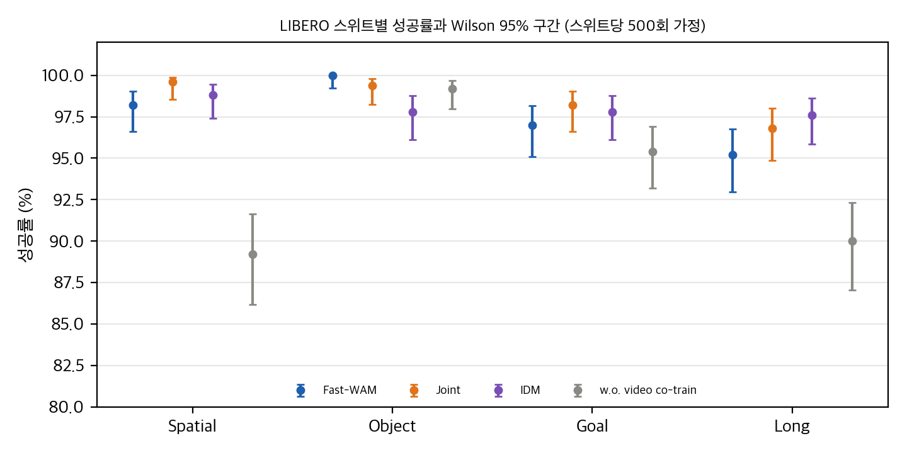
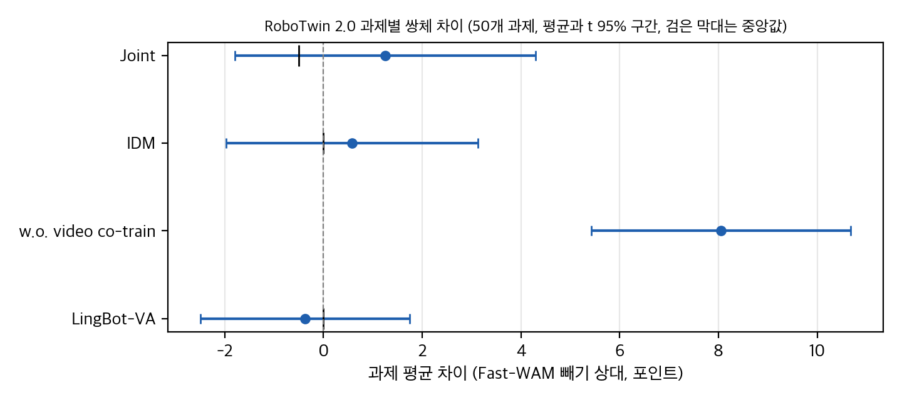
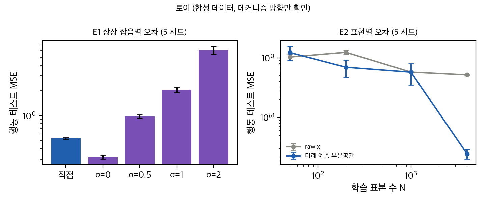

> **논문:** Tianyuan Yuan, Zibin Dong, Yicheng Liu, Hang Zhao. *Fast-WAM: Do World Action Models Need Test-time Future Imagination?* arXiv:2603.16666 (v2, 2026-03-23). NeurIPS 2026 poster.
> 공식 코드는 GitHub yuantianyuan01/FastWAM (MIT)에 있습니다. 이 글의 그래프는 우리가 표 수치로 다시 그렸습니다. 논문 그림은 쓰지 않았습니다.

## 질문

월드 액션 모델(WAM)은 미래 영상을 예측하면서 행동을 냅니다. 대부분은 **먼저 영상을 상상하고, 그다음 행동을 고르는** 방식입니다. 영상 denoising을 매 추론마다 돌려야 하므로 느립니다.

이 논문은 묻습니다. 그 상상이 정말 필요한가? 아니면 이득은 학습 중 영상 예측이 표현을 만들어 준 데서 오는가?

## 설계

Fast-WAM은 두 가지를 분리합니다.

- **학습:** 영상 DiT (Wan2.2-TI2V-5B 기반)와 1B 행동 전문가를 함께 학습합니다. 영상 예측 손실을 유지합니다.
- **테스트:** 첫 관측 프레임만 영상 DiT에 한 번 넣고 키-값 캐시를 만듭니다. 그다음 행동 전문가가 10 스텝 만에 행동 청크를 냅니다. 미래 영상은 만들지 않습니다.

비교를 위해 같은 골격에서 세 변형을 만듭니다. 미래 영상과 행동을 함께 denoise하는 Joint, 영상을 먼저 만드는 IDM, 그리고 영상 손실을 뺀 "공동학습 제거" 변형입니다.

## 이 글에서 확인한 것

**1. 표 평균은 모두 맞습니다.** RoboTwin 2.0의 과제 50개 평균이 표 3과 소수 둘째 자리까지 일치하고, 표 1, 2도 맞습니다. 다만 LingBot-VA의 LIBERO 98.5%(Spatial, Long)는 스위트당 500회로는 정수가 되지 않고, LingBot-VA 논문의 1500회(3 시드) 평가에서 가져온 값입니다. 평가 횟수가 다른 수치가 한 표에 함께 있습니다.

**2. 영상 공동학습을 빼면 확실히 나빠집니다.** RoboTwin에서 평균이 8.05포인트 떨어지고(95% 구간 5.4–10.7), 과제 50개 중 40개에서 떨어집니다. LIBERO에서는 4.15포인트 떨어집니다. 실로봇 수건 접기에서는 성공률이 약 0.75에서 0.10으로 떨어집니다.

*그래프 (우리가 그림). 논문 표 2의 성공 횟수를 스위트당 500회로 복원해 Wilson 95% 구간을 그렸습니다.*

**3. "상상이 없어도 동등하다"는 확정되지 않습니다.** LIBERO 2000회에서 검출 가능한 최소 차이는 약 1.4포인트입니다. Fast-WAM과 Joint의 차이 0.9포인트는 비쌍체 검정에서 p=0.04이고, 여러 비교를 보정하면 유의하지 않습니다. IDM과의 0.4포인트는 검출 한계 안입니다. 시도별 결과를 주지 않아 쌍체 검정은 할 수 없습니다.

**4. RoboTwin에서는 과제별 결과가 엇갈립니다.** 평균 차이는 Fast-WAM 쪽으로 +1.25이지만, 과제별로는 Joint가 26개에서 이기고 Fast-WAM은 12개에서 이깁니다(부호 검정 p=0.034). 평균 차이는 Open Microwave 한 과제(+45포인트)에 기댑니다. 그 과제를 빼면 평균은 +0.36, 중앙값은 −0.5입니다.

*그래프 (우리가 그림). 표 3의 50개 과제에서 Fast-WAM과 다른 방법의 차이를 계산했습니다. 점은 평균, 선은 t 95% 구간, 검은 막대는 중앙값입니다.*

**5. "4배 이상 빠르다"는 IDM에 한해 맞습니다.** Fast-WAM 190 ms는 IDM 810 ms의 약 4.3배 빠르지만, Joint 580 ms에 대해서는 약 3배입니다. 행동 전문가 10 스텝이 지연의 대부분입니다. 영상 백본 1회는 두 번째 항입니다.

**6. 공식 코드는 논문 설명과 다릅니다.** 정책 입력에 로봇 상태가 들어갑니다. 시간 샘플링은 논문이 말한 logit-normal이 아니라 시프트 기반입니다. 손실은 식 (6)의 균일 MSE가 아니라 시간 가중치를 곱한 형태입니다. 행동 전문가는 Wan2.2의 가중치를 보간해 초기화합니다. 이 초기화는 "사전학습 없음"의 의미를 바꿉니다. 추론 시프트와 재계획 간격도 논문에 없습니다. 공개 README는 원래 체크포인트를 시프트 5.0으로 재현하라고 적습니다.

## 토이로 본 메커니즘

합성 데이터에서 두 가지를 확인했습니다. 상상으로 만든 미래는 원래 관측에서 나온 것이므로 정보를 더하지 못합니다. 하지만 상상 예측에 오차가 조금만 섞여도 행동 오차가 빠르게 커집니다. 한편 미래를 예측하도록 만든 부분공간은 표본이 많을 때 교란 변수를 버려 오차를 낮춥니다. 이 결과는 "이득은 표현에서 온다"는 해석과 방향이 맞습니다. 다만 합성 설정이므로 크기는 의미가 없습니다.

*그래프 (우리가 그림). 합성 데이터, 시드 5개. 메커니즘의 방향만 확인했습니다.*

## 정리

- 영상 예측 목적함수는 성능에 중요합니다. 이 실험 설정에서 확실합니다.
- 테스트 때 미래를 만드는 것이 꼭 필요하다는 근거는 약합니다. 같은 수준이라는 주장도 이번 실험 규모로는 검증되지 않았습니다.
- 재현하려면 공식 코드의 설정(시프트, 재계획 간격, 체크포인트 버전)을 논문과 맞춰야 합니다. GPU가 필요합니다.

*학회: NeurIPS 2026 포스터입니다(공식 virtual 페이지 확인). 발표 형식은 확인하지 못했습니다.*

## 자료

- [통합 리포트 PDF](report/report_public.pdf)
- [01. 논문 분석: Fast-WAM](analysis/01_paper_analysis.md)
- [02. 선행연구, 가까운 대안, 공식 저장소](analysis/02_prior_work.md)
- [03. 수치 재계산, 통계 검정, 일관성 검사, 토이](analysis/03_analysis.md)
- [04. 논문 ↔ 공식 코드 대조 (정적 읽기만)](analysis/04_code_verification.md)
