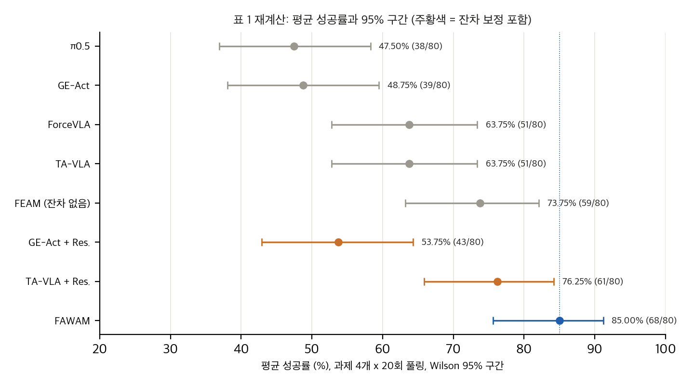
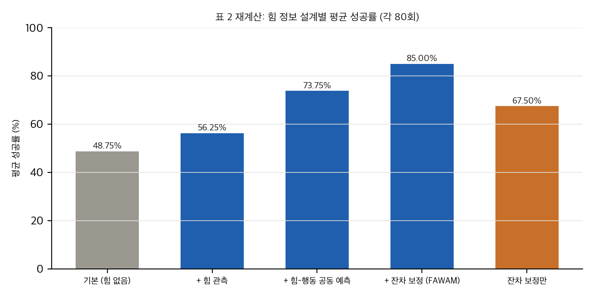
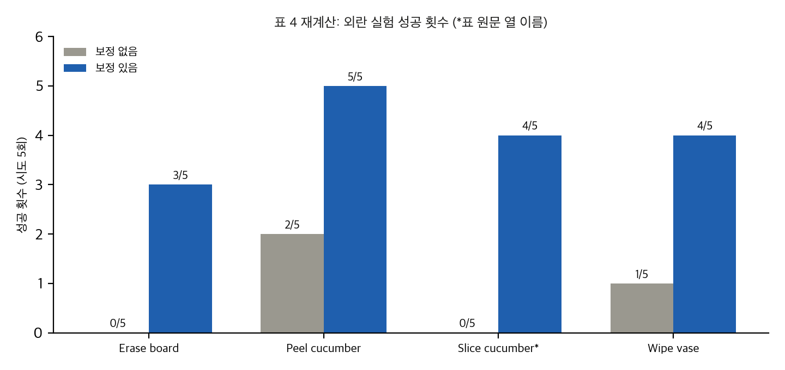

> **논문:** Haotian He, Zeyu Yan, Qipeng Liu, Ning Guo, Wenzhao Lian. *FAWAM: Force-Aware World Action Models for Closed-Loop Contact-Rich Manipulation.* CoRL 2026 포스터, arXiv:2606.08555 (v3, 2026-10-27).
> 공식 코드(MIT, HaotianHehaha/FAWAM)는 정적으로만 읽었고 실행하지 않았습니다. 이 글의 그림은 우리가 만든 그래프 세 장입니다. 논문 그림은 싣지 않았습니다.

## 논문이 묻는 것

접촉이 많은 작업은 사진만으로는 약한 접촉이나 과한 압력을 알기 어렵습니다. 그래서 많은 방법이 힘 센서 값을 정책의 입력에 넣습니다. FAWAM은 여기서 한 걸음 더 나갑니다. 힘을 **입력으로만** 쓰지 않고 세 단계에 넣습니다.

1. **지각.** 최근 0.5초의 손목 힘·토크를 작은 인코더로 요약하고, 그 특징으로 행동 생성기의 AdaLN-Zero 파라미터를 조정합니다.
2. **예측.** 행동 청크와 앞으로의 손목 힘을 한 흐름 매칭 디코더로 함께 만듭니다. 힘을 별도 헤드로 붙이지 않는 것이 특징입니다.
3. **실행 중 보정.** 예측한 힘과 실제 측정한 힘의 차이로 남은 행동을 고칩니다. 차이가 작으면 게이트가 보정을 끕니다.

## 결과는 어떻게 읽히나

과제는 네 개입니다. 칠판 지우기, 오이 벗기기, 상자 피벗, 꽃병 닦기. 과제마다 20회씩 평가했습니다.

*그래프 1. 논문 표 1의 평균 성공률과 Wilson 95% 구간(과제 4개 x 20회 풀링). 우리가 그린 그래프입니다.*

| 정책 | 평균 | 같은 예산 비교 |
|---|---|---|
| GE-Act (힘 없음) | 48.75% | — |
| ForceVLA (힘 관측) | 63.75% | — |
| TA-VLA (힘 예측 보조) | 63.75% | — |
| GE-Act + Res. | 53.75% | 기준선 |
| TA-VLA + Res. | 76.25% | 기준선 |
| **FAWAM** | **85.00%** | 8.75%p 우위 (p = 0.23) |

초록의 **36.25%p**와 **21.25%p**는 보정 데이터가 없는 기준선(GE-Act, TA-VLA)과 비교한 값입니다. 보정 데이터를 같은 만큼 쓴 기준선과 비교하면 차이는 **8.75%p**입니다. 이 차이는 80회 평가로는 유의하지 않습니다. 8.75%p를 검출하려면 방법마다 약 320회가 필요합니다.

36.25%p는 퍼센트포인트 차이입니다. 상대 향상으로 옮기면 74%가 되므로, 인용할 때 두 뜻을 섞지 않도록 주의가 필요합니다.

## 힘 정보는 확실히 도움이 됩니다

힘을 쓰는 설계들을 하나씩 더해 보면 흐름이 보입니다.

*그래프 2. 논문 표 2의 힘 설계별 평균 성공률(각 80회). 우리가 그린 그래프입니다.*

- 힘을 관측에만 더한 경우는 +7.5%p로, 유의하지 않습니다.
- 힘의 미래 예측을 더한 경우는 +17.5%p(p = 0.03)로, 유의합니다. 이 논문에서 가장 분명한 기여입니다.
- 예측 없이 보정만 쓴 경우는 +18.75%p(p = 0.02)입니다.

## 외란에서는 보정이 강하게 보입니다

논문은 접촉 조건을 사람이 바꾸는 외란 실험을 네 과제에서 했습니다. 과제마다 5회씩입니다.

*그래프 3. 논문 표 4의 과제별 성공 횟수(시도 5회). 우리가 그린 그래프입니다.*

보정이 없는 경우 3/20, 있는 경우 16/20입니다. 풀링하면 p < 0.001입니다. 다만 같은 체크포인트를 반복 평가한 것이라 독립 가정이 과대 추정일 수 있고, 과제별로는 5회라 경계 수준의 한 과제를 빼면 유의하지 않습니다. 표의 세 번째 열 이름 "Slice cucumber"도 본문의 과제 목록과 맞지 않아 저자에게 확인이 필요합니다.

## 코드로 확인되는 것과 안 되는 것

공개 저장소(MIT)에는 힘 조건 행동 모델의 학습과 추론이 있습니다. 힘 입력 크기(0.5초, 6축, 360차원), AdaLN-Zero 영 초기화, 행동과 힘의 공동 투영, 학습률과 옵티마이저 설정은 논문과 맞습니다.

반면 **잔차 보정 코드는 없습니다.** README는 "정리 중"이라고 적었습니다. 이 논문의 두 번째 기여인 예측 힘 기준 보정, 게이트, 10 Hz 루프, 교정 데이터 수집은 코드로 확인할 수 없습니다. 행동 단계 배치 크기(설정 128 대 논문 64)와 힘 인코더 은닉 폭(128 대 256)도 논문과 다릅니다.

## 이 맥에서 재현할 수 있을까

**논문 결과는 재현할 수 없습니다.** 설정 기준 학습은 A100급 GPU 여러 장으로 수일이 걸리고, 실로봇 네 과제에는 힘 센서와 텔레오퍼레이션 장비가 필요합니다. 데이터도 네 과제 합계 약 9.7 GB입니다.

조건부로 가능한 것은 보정 아이디어 자체를 작은 접촉 모델에서 검증하는 실험입니다. 예측 힘의 차이로 보정하는 방식이 측정 힘만 쓰는 방식보다 나은지 numpy로 비교할 수 있습니다. 이 글에서는 수행하지 않았습니다.

## 정리

FAWAM은 힘을 예측 대상이자 실행 중 기준으로 쓰는 설계를 간결하게 보여 줍니다. 힘 정보의 효과는 분명하고, 보정의 추가 효과는 이 실험 규모로는 확정하기 어렵습니다. 논문을 인용할 때는 초록의 36.25%p가 어떤 비교인지 밝혀야 합니다.

공개 저장소의 보정 코드가 공개되면 이 글의 "재현 불가" 판단은 다시 봐야 합니다.

## 자료

- [통합 리포트 PDF](report/report_public.pdf)
- [01. 논문 분석: FAWAM (arXiv:2606.08555 v3)](analysis/01_paper_analysis.md)
- [02. 선행연구와 자료 계보 (FAWAM)](analysis/02_prior_work.md)
- [03. 수치 재계산과 통계 검정 (FAWAM, arXiv:2606.08555 v3)](analysis/03_analysis.md)
- [04. 논문 ↔ 공식 코드 대조 (FAWAM, arXiv:2606.08555 v3)](analysis/04_code_verification.md)
