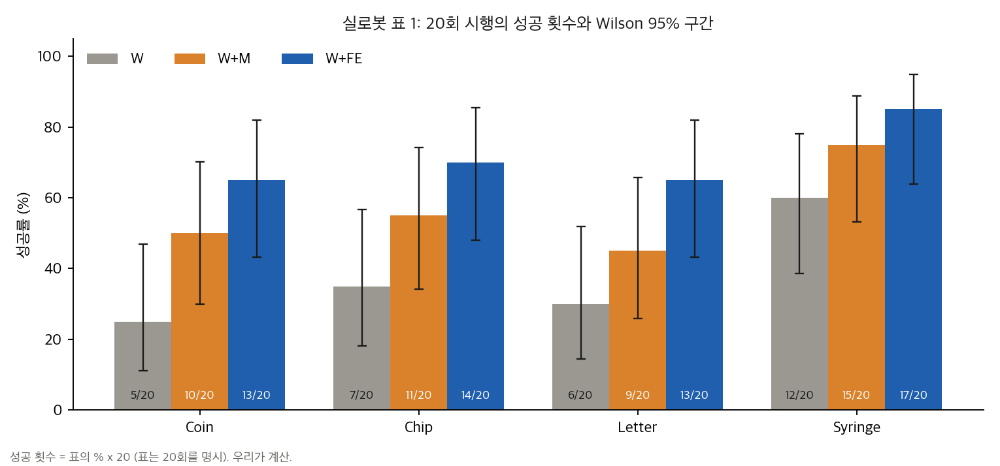
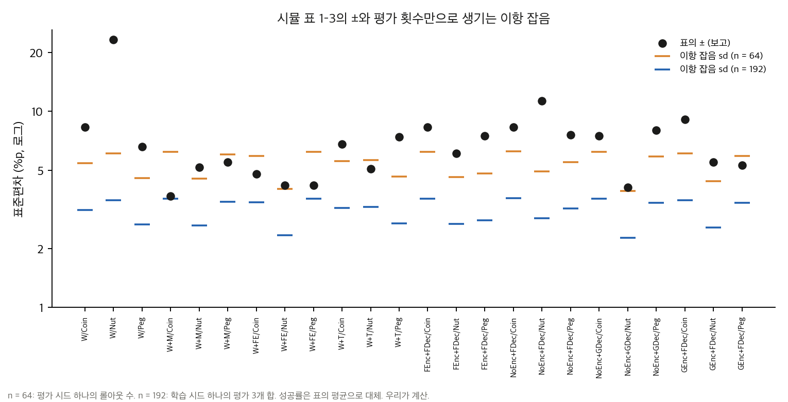
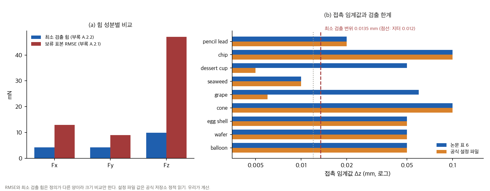

> **논문:** Zhixuan Xu, Yichen Li, Xuanye Wu, Tianyu Qiu, Lin Shao. *FingerEye: Learning Dexterous Manipulation with Continuous Vision-Tactile Sensing.* CoRL 2026 스포트라이트, arXiv:2604.20689 (v4, 2026-10-06).
> 공식 코드는 정적으로만 읽었고 실행하지 않았습니다. 논문 그림은 싣지 않고(arXiv non-exclusive 라이선스), 우리가 만든 그래프만 씁니다.

## 논문이 묻는 것

손가락으로 동전을 세우려면 닿기 전에 가장자리를 봐야 하고, 닿는 순간을 알아야 하고, 닿은 뒤에는 힘을 조절해야 합니다. 손목 카메라는 닿기 전을 거칠게 보고, 겔형 촉각 센서는 닿은 뒤만 압니다. 이 논문은 손가락 끝의 **RGB 카메라 두 대**(팁과 루트), 투명 아크릴판, 판을 둘러싼 **실리콘 고리**, 판 안쪽의 **AprilTag 35개**로 이 사이를 하나의 영상 스트림으로 잇는 센서 FingerEye를 만듭니다. 고리가 접촉력으로 변형되면 태그가 보이는 판의 자세가 바뀌고, 이 6차원 변화를 힘의 대용으로 씁니다. 정책 쪽은 ACT 계열 트랜스포머에 동결 RADIO 요약 토큰을 넣고, 손가락 카메라 토큰끼리 먼저 섞은 뒤(그룹 인코딩), 디코더에서 그룹별 교차 어텐션의 잔차를 평균하는(그룹 디코딩) 구조를 제안합니다.

실험은 시뮬 3과제와 실세계 4과제입니다. 초록의 결론은 손목 카메라만 쓰는 정책보다 평균 성공률이 시뮬과 실세계 모두 30%p 넘게 높다는 것입니다.

## 이 글에서 확인한 것

시행 수는 논문이 명시한 것을 썼습니다. 실로봇은 방법·과제당 20회(성공 횟수 = 표의 % x 20), 시뮬은 학습 시드 3 x 평가 시드 3 x 64 롤아웃입니다. 표의 ±가 무엇의 표준편차인지는 적혀 있지 않아 두 해석으로 나눠 계산했습니다.

**표 산술은 모두 맞고, 시뮬 평균은 보고된 프로토콜의 격자와 정합합니다.** 표 1–3의 평균(26.7, 59.1, 65.9 등), 증분(+39.1, +33.8, +6.8, +15.0 %p), 본문의 11.3, 7.1, 13.9 %p가 모두 재현됩니다. 3 x 3 x 64회 평균이라면 값은 100k/576 % 격자 위에 있어야 하는데, 표 1–3의 시뮬 평균 27개가 모두 이 격자 위에 있습니다(임의의 값이면 우연히 맞을 확률은 24개 독립 값 기준 약 2e-6). 표가 서술된 평가 프로토콜과 맞게 만들어졌다는 방향의 확인입니다.

**손목 단독 대비 효과는 실로봇 합산에서 뚜렷하고, 과제별로는 20회로 확정되지 않습니다.** W+FE 대 W는 네 과제 합산 57/80 대 30/80(Fisher p = 3e-5)이고, 과제별로는 Holm 보정 후 p = 0.10–0.17입니다. 쌍안(W+FE) 대 단안(W+M)은 합산 57/80 대 45/80으로 p = 0.070(과제 층화 CMH p = 0.047)이며 과제별 p는 0.34–0.69입니다. 과제당 20회 두 군으로 65% 대 45%를 구분하는 검출력은 0.24이고, 80% 검출력에는 군당 약 96회가 필요합니다. 모달리티 순서 W+FE > W+M > W는 실로봇 네 과제와 시뮬 세 과제에서 방향이 모두 같아서, 순서는 일관되지만 쌍안과 단안 사이의 크기는 이 시행 수에서 확정하기 어렵습니다.

**"촉각" 경로는 정책 평가 밖에 있습니다.** 4.2절은 학습된 정책이 판 자세와 추정 손목력을 입력으로 쓰지 않는다고 밝힙니다. 표 1–3의 이득은 손가락 카메라 영상에서 오고, 판 자세(힘 대용)를 넣은 경우는 부록 A.5.4의 시뮬 실험 하나입니다. W+FT는 W보다 +6.8%p(26.7 → 33.5), W+FE에 더하면 +1.2%p(65.9 → 67.1)이고 표준편차는 없습니다. 시뮬은 실리콘 변형을 모사하지 않는다고 논문이 밝히며(4.1절), 실로봇 정책 실험은 없습니다. 접촉 후 신호와의 비교(표 2)는 시뮬에서는 1 mm 이내 충돌 기하 맵, 실로봇에서는 Chip과 Syringe 두 과제의 GelSight 열(합산 31/40 대 22/40, p = 0.058)이고, 논문도 센서와 손가락 형상이 섞인 비교라고 적습니다. 손목 카메라 하나에서 카메라 다섯 개로 늘어나는 비교이므로, 뷰 수와 센서 설계의 기여를 가르려면 같은 뷰 수의 대조군이 도움이 됩니다.

**시뮬 표의 ±는 해석에 따라 읽는 법이 달라집니다.** 학습 시드 3개의 표준편차로 읽으면 24칸 모두 평가 횟수만으로 생기는 이항 잡음 이상이고, 평가 9개 각각의 표준편차로 읽으면 6칸이 이항 잡음(n = 64)보다 작습니다. 세 값의 표준편차는 불안정해서 이 비교는 참고용입니다. 그룹 인코딩과 그룹 디코딩을 합친 효과(+13.9%p, 비그룹 최강 NoEnc+FDec 대비)는 두 해석에서 모두 유의하고, GEnc+FDec 대비 +6.0%p는 p = 0.10(n = 3 해석)과 0.002(n = 9 해석)로 갈립니다(3과제 독립 가정). 실로봇에서 Coin과 Letter 40회의 65.0% 대 52.5%는 26/40 대 21/40으로 p = 0.36입니다.

**공개 코드의 그룹 디코더는 논문 설명과 다르게 읽히는 부분이 있습니다.** 공식 저장소(`2466c11`, 2026-06-08, 라이선스 없음)를 정적으로 읽었습니다.

- 그룹 디코더는 고유감각(1토큰), 손목(1토큰), FE(4토큰)에 각각 교차 어텐션을 두고 세 잔차를 평균합니다. 키가 하나인 어텐션의 softmax 가중치는 항상 1이므로 고유감각과 손목 그룹의 출력은 쿼리와 무관한 같은 벡터가 됩니다. 무작위 가중치로 확인한 결과 쿼리 16개 사이의 최대 편차는 2e-7이었고, 키가 2개나 4개면 0.34였습니다. 이 구현에서 쿼리 의존 정보를 만드는 그룹은 FE뿐이고 평균에서의 몫은 1/3입니다.
- 비그룹 디코더는 고유감각을 쿼리에 더하고 컨텍스트 토큰으로 쓰지 않습니다. 부록 A.4의 어텐션 질량 진단(고유감각 토큰 35.6–59.0%, 균등 기준 16.7%)은 고유감각이 컨텍스트 토큰인 구조를 가정하므로, 공개 코드의 FDec와 표 7의 진단 대상이 같은지 확인이 필요합니다.
- FlatEnc(표 3의 FEnc+FDec 행)는 코드에 구현되어 있지 않고, 논문이 쓴 크기 맞춤(은닉 폭 조정) 설정도 없습니다. 기본 차원에서 네 변형의 파라미터 수는 31.7 M에서 52.7 M(1.66배)입니다.
- 공개 저장소의 마지막 푸시가 v3 직후여서 v4의 부록 항목(손목 입력, 접촉 깊이 맵 기준선, 태그 수 절제)은 코드에 없습니다.

**센서 감도 서술은 계산상 맞고, 몇 가지는 해상도의 정의를 확인하면 좋습니다.** 최소 검출 변위 0.0135 mm와 최소 검출 힘 4.30 / 4.22 / 9.93 mN은 부록의 가정(모서리 0.25 px, 태그 37 px)에서 다시 계산됩니다. 같은 부록의 보류 표본 RMSE(0.013, 0.009, 0.047 N)는 최소 검출 힘의 3.0 / 2.1 / 4.7배인데, 둘은 정의가 다른 양(이론 하한 대 보정 잔차)이므로 달성 해상도는 보정 오차가 정할 수 있다고 읽는 것이 안전합니다. 병진 감도 0.0135 mm는 세 축에 같게 쓰였지만 깊이 축은 단일 태그의 원근 모델에서 더 거칠어집니다. 공식 설정의 태그 위치 35개와 카메라 내부 파라미터로 핀홀 모델을 세워 Cramér–Rao 하한을 계산하면(모서리 잡음 0.25 px 가정) 35태그의 병진 정밀도는 약 0.0014–0.0020 mm로 논문의 0.0135 mm보다 7–10배 작고, 표 5의 측정 지터(35태그 0.012 mm)는 이 하한의 약 7배입니다(지터를 표준편차로 읽은 가정).

접촉 임계값(표 6)은 이 감도 옆에서 읽으면 흥미롭습니다. 김의 0.01 mm는 최소 검출 변위 0.0135 mm보다 작고 연필심 0.02 mm는 그 1.5배입니다. 공식 설정 파일에서는 종이컵과 포도가 0.005, 0.006 mm로 논문 값(0.05, 0.06 mm)의 1/10입니다. 코드는 첫 프레임 대비 변화를 필터 없이 비교하고 엄지와 검지가 모두 임계값을 넘을 때 손 전체 보간을 멈추는데, 논문 3.2절의 "각 손가락이 멈춘다"와 다르게 읽힙니다. 단위나 이후 수정의 영향일 수 있어 저자 확인이 필요합니다.

**버전 사이에 달라진 것.** v1(2026-04-22)은 시뮬 증강 표현 학습과 ACT·Diffusion Policy 비교를 담았고, v3(06-06)에서 정책 인터페이스 중심으로 개편되면서 이 실험들이 빠졌습니다. 실로봇 Chip과 Letter는 v1에서 18회와 12회(그림 판독 값)였고 v4에서 20회로 통일됐습니다. 시뮬 Coin의 W 기준선은 v1 그림에서 39.1%(30개 데모), v4 표에서 25.5%(50개 데모)입니다. 이 사이에 데모 수와 정책 구조가 바뀌었습니다. v4는 태그 수 절제, 내구성, GelSight 실로봇 열, 실로봇 그룹 융합, 손목 입력 실험을 추가했습니다.

## 구현 가능성

이 맥(Apple M4 Pro, 약 24 GiB, MPS, CUDA 없음)에서 **논문 수치의 재현은 불가능합니다.** 데모 데이터가 공개되지 않았고, 시뮬은 Isaac Sim 5.1과 NVIDIA GPU, 실세계는 xArm7, LEAP Hand, FingerEye 모듈(모듈당 약 $60), 리더-팔로워 장비가 필요합니다. 반면 정책 학습 자체는 가볍습니다. 캐시된 RADIO 요약 위의 52.7 M 파라미터 정책을 논문의 크기로 만들어 무작위 입력으로 측정하면 한 스텝(배치 256)이 MPS에서 0.18초이고, 데모 50개로 500에폭(약 2만 스텝 가정)은 1시간 안팎입니다. 병목은 연산량이 아니라 데이터와 하드웨어입니다.

## 저자에게 확인하면 좋은 점

1. 표 3·7의 플랫 디코더 변형에서 고유감각은 컨텍스트 토큰입니까? 공개 코드의 구현과 같습니까?
2. 크기 맞춤에 쓴 은닉·FF 폭과 FlatEnc 구현은 무엇입니까?
3. 표 6의 종이컵·포도 임계값(공개 설정 0.005, 0.006 mm 대 논문 0.05, 0.06 mm)의 단위와 정지 규칙은 무엇입니까?
4. 시뮬 성공은 "한 번이라도" 판정입니까, 실세계 Coin과 같은 유지 조건이 있습니까?
5. 37 px 태그 폭과 본문의 약 10 mm 작업 거리는 같은 거리를 가리킵니까?

재계산 스크립트, 토이, 정적 대조 문서와 공개용 통합 리포트는 이 글과 함께 올린 자료에 있습니다.

## 자료

- [통합 리포트 PDF](report/report_public.pdf)
- [01. 논문 분석: FingerEye (arXiv:2604.20689)](analysis/01_paper_analysis.md)
- [02. 선행연구, 구성 요소 출처, 관련 자료 (FingerEye)](analysis/02_prior_work.md)
- [03. 수치 재계산과 일관성 검사 (FingerEye)](analysis/03_analysis.md)
- [04. 논문 ↔ 공식 코드 대조 (FingerEye)](analysis/04_code_verification.md)
