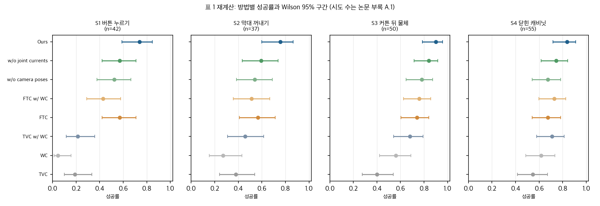
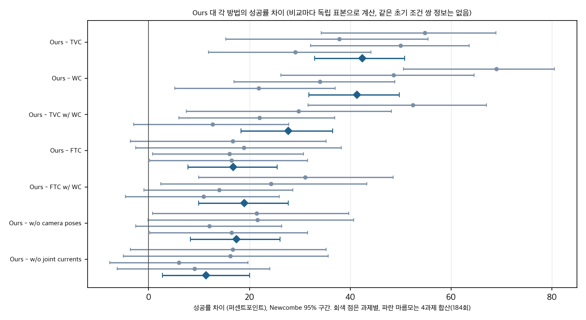
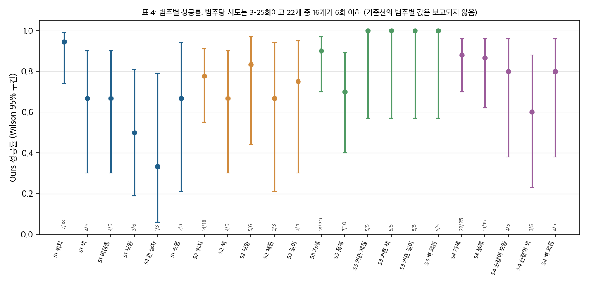

> **논문:** Zhen Zhang, Weinan Wang, Hejia Sun, Qingpeng Ding, Xiangyu Chu, Guoxin Fang, K. W. Samuel Au. *FingerViP: Learning Real-World Dexterous Manipulation with Fingertip Visual Perception.* CoRL 2026, arXiv:2604.21331 (v3, 2026-09-24).
> 공식 코드는 `zhzhen0626/FingerViP`입니다. 이 글의 그림은 우리가 그린 그래프 세 장뿐입니다. 논문 그림은 arXiv 비독점 라이선스라서 싣지 않았습니다.

## 논문이 묻는 것

다지 손 조작에서 외부 카메라와 손목 카메라는 좁고 가려진 공간에서 손과 물체에 가립니다. FingerViP은 다섯 손가락 끝마다 소형 카메라를 달고, 외부 카메라 한 대와 합쳐 26-DoF 관절 명령을 내는 확산 정책을 학습합니다. 손끝 이미지 특징에는 카메라 자세(손 순기구학)와 손가락 관절 전류를 이어 붙입니다.

네 개 실세계 과제(상자 안 버튼 누르기, 막대 꺼내기, 커튼 뒤 물체 꺼내기, 닫힌 캐비닛)에서 평균 성공률 80.8%를 보고합니다. 외부+손목 기준선(51.6%) 대비 56.6% 상대 향상이 초록의 핵심 수치입니다.

## 이 글에서 확인한 것

- **표 1의 산술은 모두 맞습니다.** 32칸의 퍼센트와 평균 열이 횟수에서 재현됩니다. 평균은 네 과제 퍼센트의 단순 평균이고, 합산 성공률로 계산하면 56.6%는 51.5%가 됩니다.
- **외부+손목 구성과의 격차는 확실합니다.** 합산 150/184 대 99/184(+27.7점)입니다. 과제별로는 버튼 누르기에서 가장 큽니다(31/42 대 9/42).
- **손끝만 쓰는 기준선과의 격차는 합산에서만 확인됩니다.** FTC 대비 +16.8점이고 합산 Fisher p = 0.0004입니다. 과제별 p는 0.066–0.168이고(시행 수는 부록 A.1 값, 독립 표본 가정) Holm 보정 후 유의한 칸이 없습니다.
- **두 인코딩의 기여도 합산에서 확인됩니다.** 전류 제거 150/184 대 129/184(p = 0.015), 자세 제거 150/184 대 118/184(p = 0.0003). 본문은 과제별 서술("크게", "눈에 띄게")을 쓰지만 과제별 p는 0.07–0.55입니다.
- **손끝만(FTC)과 외부+손목의 비교는 과제에 따라 다릅니다.** 버튼 누르기에서 24/42 대 9/42이고, 커튼과 캐비닛 과제에서는 37/50 대 34/50, 37/55 대 39/55로 비슷합니다.
- **연산량 표의 단위는 곱셈-덧셈 수로 읽힙니다.** ViT-B/16 이미지 12장과 4장의 차이를 계산하면 135.9 G로 논문의 136.01 G와 거의 같습니다.

그림: 표 1의 방법별 성공률과 Wilson 95% 구간(시행 수는 논문 부록 A.1). 우리가 그린 그래프입니다.

그림: Ours와 각 방법의 성공률 차이와 Newcombe 95% 구간. 회색은 과제별, 파란 마름모는 네 과제 합산입니다. 독립 표본으로 계산했고 같은 초기 조건 쌍 정보는 없습니다. 우리가 그린 그래프입니다.

## 표가 말하지 않는 것

- 방법마다 학습을 몇 번 했는지, 시드가 몇 개인지가 적혀 있지 않습니다. 위 구간에는 학습 변동이 들어 있지 않습니다.
- 일반화 범주별 결과(표 4)는 Ours만 보고됩니다. 22개 범주 중 16개가 시도 6회 이하이고, 위치 변화(T1) 71/81 대 나머지 79/103은 p = 0.084입니다.
- 촉각 센서를 쓴 기준선은 실험에 없습니다. 서론의 촉각 센서 대비 서술은 실험으로 검증되지 않았습니다.

그림: 표 4의 범주별 성공률(Ours)과 Wilson 95% 구간. 우리가 그린 그래프입니다.

## 코드와 논문이 다른 곳

공식 저장소를 읽었습니다(실행하지 않았습니다).

- **샘플러:** 논문 그림은 DDPM 스케줄러이고 코드 설정은 DDIM(학습 50스텝, 추론 16스텝)입니다.
- **논문에 없는 학습 설정:** 입력 교란 0.1, 손끝 카메라 무작위 탈락 0.05, 에폭 100과 EMA, ImageNet 정규화(CLIP 입력)가 코드에 있습니다.
- **카메라 자세 절제의 해석:** 조건 토큰마다 학습 가능한 위치 임베딩이 남아 있어, 자세를 뺀 절제는 손가락 정체가 아니라 기구학 자세 정보를 뺀 것으로 읽힙니다.
- **빠진 것:** 손목 카메라 기준선 코드, 표 2·3·5의 측정 코드, 시연 데이터와 체크포인트가 저장소에 없습니다.
- **배치:** 평가 노드는 예측한 8개 행동을 각각 12 제어 주기(약 96 ms)씩 유지하고 묶음이 끝난 뒤 새로 예측합니다. 논문의 10.2 FPS가 무엇을 가리키는지는 코드로 정할 수 없습니다. 저자 확인이 필요합니다.

## 구현 가능성

논문의 결과를 이 글쓴이의 환경(Apple M4 Pro, MPS)에서 재현하는 것은 불가능합니다. 손끝 모듈, UR5e, Vision Pro가 필요하고 시연 데이터가 공개되어 있지 않으며, 학습은 RTX 4090에서 정책당 평균 37시간입니다. 정책 구조를 합성 입력으로 다시 쓰고 속도를 재는 것은 가능해서, 임의 가중치로 한 번 호출에 MPS에서 약 178 ms(기준선형 111 ms)를 얻었습니다.

## 자료

- [통합 리포트 PDF](report/report_public.pdf)
- [01. 논문 분석: FingerViP (arXiv:2604.21331)](analysis/01_paper_analysis.md)
- [02. 선행 연구와 공식 저장소](analysis/02_prior_work.md)
- [03. 재계산과 해석](analysis/03_analysis.md)
- [04. 논문과 공식 코드 대조, 구현 가능성](analysis/04_code_verification.md)
