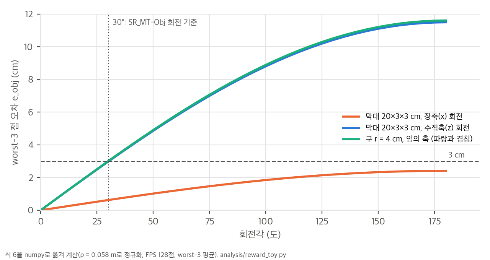

# 03. 핵심 식 해석과 toy 검증

재계산 스크립트는 `analysis/reward_toy.py`(보상 식, 결과 `reward_toy_results.json`)와 `analysis/table_check.py`(Table I과 계산량, 결과 `table_check_results.json`)입니다. 보상 식은 공식 코드 `src/envs/rewards/motion_tracking.py`의 `_obj_pcd_match_error_exp`와 `tracking_ref_mano_tip_distance_bound_exp`를 numpy로 줄 단위로 옮겨서 계산했습니다. 모두 CPU에서 몇 초 안에 끝납니다.

## 1. 점군 정합 오차 (Eq. 6)는 무엇을 재는가

### 1.1 식 정리
물체 좌표계 점 p_m에 대해 코드는 `disp_m = (t_ref − t_sim) + (R_ref − R_sim) p̃_m`를 계산합니다. 두 번째 항은 R_sim(R_simᵀR_ref − I)p̃_m이므로, 크기는 상대 회전 ΔR = R_simᵀR_ref로 점을 돌렸을 때의 변위와 같습니다. 회전축에서 점까지의 거리를 r_⊥, 회전각을 θ라고 하면 다음이 성립합니다.

```
|ΔR p − p| = 2 · r_⊥ · sin(θ/2)
```

정규화 p̃ = ρ·p / max‖p‖ 때문에 모든 점은 원점에서 ρ 이내에 있습니다. 따라서 순수 회전일 때 다음 상한이 생깁니다.

```
e_obj(순수 회전) ≤ 2ρ · sin(θ/2)
```

등호는 가장 먼 점들이 회전축에 수직인 평면 위에 있을 때만 성립합니다.

### 1.2 ρ = 0.058 m 주장 확인 (V1)
θ = 30°이면 2 × 0.058 × sin 15° = **3.002 cm**입니다. 논문의 "30° 회전이 약 3 cm"는 위 상한과 정확히 일치합니다(Sec. III-B a). 같은 환산으로 1 rad는 약 5.56 cm에 해당합니다. 위치와 회전을 따로 가중하지 않아도 이 비율로 자동으로 섞입니다.

순수 병진 t에서는 모든 점이 같이 움직이므로 e_obj = ‖t‖입니다. 정리하면 e_obj는 "위치 오차 1 cm = 회전 약 10°(구형 물체 기준)"로 환산되는 단일 거리이고, 물체 크기와 무관합니다.

## 2. 회전축에 따라 보상이 달라진다 (V2)

상한이 등호가 되는지는 물체 모양과 회전축에 달려 있습니다. 표본 128점(FPS, 코드와 같음)을 쓰고 30° 회전을 무작위 축 2,000개에 대해 계산했습니다.

| 형상 (정규화 전 크기) | worst-3 오차 min / 중앙값 / max (cm) | 2 cm 미만 비율 | 전체 평균을 쓰면 (중앙값) |
|---|---|---|---|
| 구 r = 4 cm | 3.00 / 3.00 / 3.00 | 0% | 2.36 cm |
| 정육면체 8 cm | 2.46 / 2.79 / 2.96 | 0% | 1.75 cm |
| 막대 20×3×3 cm | **0.64** / 2.76 / 2.99 | **16%** | 1.48 cm |
| 판 16×16×1 cm | 2.13 / 2.80 / 2.97 | 0% | 1.31 cm |
| 원점이 중심에서 5 cm 벗어난 정육면체 | 1.44 / 2.85 / 2.96 | 4.5% | 1.67 cm |



**막대를 장축으로 돌리는 경우가 사각지대입니다.** 30° 회전의 오차는 0.62 cm(보상 0.94)이고, 90°는 1.70 cm, 180°를 돌려도 2.4 cm로 3 cm에 이르지 않습니다. 정규화 뒤 막대 단면의 최대 r_⊥가 ρ의 약 21%뿐이기 때문입니다.

해석:
- **대칭 물체에는 오히려 맞는 성질입니다.** 원통형 병을 축으로 돌린 상태는 물리적으로 구분되지 않습니다. 이 점에서 worst-3 오차는 대칭을 인정하는 ADD-S에 가깝게 동작합니다.
- **문제는 평가 기준과 어긋날 때입니다.** SR_MT-Obj와 MORE는 쿼터니언 각도로 회전을 재므로 장축 30° 회전도 실패입니다. 보상은 그 회전을 거의 신경 쓰지 않는데 평가는 실패로 셉니다. 숟가락이나 주걱 날처럼 장축 회전이 과제에 중요한 비대칭 도구에서는, 보상이 정작 필요한 신호를 약하게 줍니다.
- 이 어긋남이 Table I에서 FlashDexRetarget의 MORE가 기준선보다 나쁜 원인 중 하나일 수 있습니다(01 §3.2). 다만 표본이 다른 선택 효과로도 설명되므로 가설입니다. 확인하려면 모션별 회전 오차를 물체 종횡비로 나눠 봐야 하는데, 공개 결과가 없어서 여기서는 할 수 없습니다.
- **정규화 자체는 의도대로 동작합니다.** 정규화를 끄면 같은 30° 회전의 중앙값 오차가 물체 크기에 따라 2.07 cm(구 4 cm)에서 5.46 cm(판 16 cm)까지 벌어집니다. 정규화를 켜면 모든 형상이 2.8–3.0 cm로 모입니다.

## 3. 보상값과 거리 기준의 환산 (V3)

| 양 | 값 |
|---|---|
| r_obj (e = 3 cm, 성공 기준) | 0.741 |
| r_obj (e = 10 cm) | 0.368 |
| 조기 종료 기준(5스텝 누적 r_obj < 0.6)에 해당하는 오차 | 5.11 cm |
| r_int 손끝 하나, 초과 거리 5 mm / 2 cm | 0.607 / 0.135 |

σ_obj = 0.1 m는 성공 기준 3 cm보다 훨씬 넓습니다. 성공 경계 근처에서 보상 기울기는 1 cm당 약 0.074라서 완만합니다. 대신 조기 종료가 5 cm에서 걸리므로, 실제로는 "넓은 보상 + 5 cm 종료 벽"으로 학습 신호를 만듭니다. 반대로 σ_int = 1 cm는 날카로워서, 손끝이 사람보다 1 cm만 멀어도 그 손가락 보상이 0.37로 떨어집니다.

## 4. 레퍼런스 거리의 여유와 SDF 해상도 (V4, V5)

**한쪽 방향 벌칙의 자동 gate.** 사람 손끝이 물체에서 5 cm 떨어져 있으면 로봇 손끝이 3 cm 거리에 있어도 만점입니다. 접촉하지 않는 손가락은 저절로 보상에서 빠지므로 이진 접촉 레이블이 필요 없습니다. 반대로 사람이 닿은(0 mm) 곳에서 로봇이 1 cm 떠 있으면 0.37입니다.

**꼭짓점 거리의 여유.** 사람 쪽 d_ref는 가장 가까운 메쉬 **꼭짓점**까지의 거리(`build_motion_pt.tip_contacts`, KD-tree)이고, 로봇 쪽 d는 표면까지의 SDF입니다. 사람 손끝이 표면에 정확히 닿아 있어도 d_ref는 0보다 크게 기록되고, 그만큼 로봇은 벌칙 없이 떨어져 있을 수 있습니다. 반지름 4 cm 구에서 꼭짓점 수에 따른 여유는 다음과 같습니다.

| 꼭짓점 수 | 평균 여유 | 95% 분위 여유 | σ_int 대비 (95%) |
|---|---|---|---|
| 500 | 3.17 mm | 6.07 mm | 0.61 |
| 2,000 | 1.59 mm | 3.15 mm | 0.31 |
| 8,000 | 0.78 mm | 1.50 mm | 0.15 |
| 32,000 | 0.40 mm | 0.79 mm | 0.08 |

스캔 메쉬처럼 꼭짓점이 촘촘하면 무시할 만합니다. 꼭짓점이 수백 개인 저폴리 메쉬에서는 σ_int의 절반을 넘는 여유가 생겨, 접촉 보상이 체계적으로 관대해집니다.

**SDF 격자.** 128³ 격자가 ±0.30 m를 덮으므로 voxel은 4.72 mm입니다. 반지름 4 cm 구에서 삼선형 보간 오차의 99% 분위는 0.23 mm로 σ_int보다 훨씬 작습니다. 매끈한 형상에서는 해상도가 문제가 되지 않습니다. 다만 voxel보다 얇은 벽(냄비 가장자리, 얇은 판)은 이 toy로 확인하지 않았습니다.

## 5. 계산량 해부 (C9, C10, C13)

**성공 1건당 GPU-h (XHand):**

| 방법 | 시도 1건당 | SR_SPIDER 성공 1건당 | SR_MT-Obj 성공 1건당 |
|---|---|---|---|
| Do as I Do | 1.32 | 3.67 | 33.0 |
| DexMachina | 8.94 | 18.6 | 27.9 |
| CHORD | 56.9 | 123.8 | 2,847 (1건) |
| FlashDexRetarget | 0.58 | 0.64 | 0.67 |

엄격한 기준(SR_MT-Obj)으로 보면 비용 차이는 "100배"가 아니라 DexMachina 대비 약 42배, CHORD 대비 수천 배입니다. 기준선은 싸게 실패하거나(Do as I Do) 비싸게 실패합니다(CHORD).

**레퍼런스 길이 대비 학습량:** 50개 클립은 총 26,387프레임(60 Hz로 7.3분)입니다. 300M 스텝이면 레퍼런스 프레임 하나당 약 11,400번 방문하고, 레퍼런스 1초당 237 GPU-초를 씁니다. 처리량은 XHand 초당 2,874 env step(2,048개 환경이면 초당 1.4번 수집 + 2.8번 업데이트), Sharpa 초당 2,525 step입니다.

**확장 시 효율:** 1,000개 모음은 60 GPU-h에 600개 이상을 변환합니다(GPU-h당 10개 이상, 프로젝트 페이지). 50개 실험(GPU-h당 1.48개)의 6.7배입니다. 같은 처리량이면 600M 스텝이 약 58 GPU-h이므로, Fig. 6의 60 GPU-h는 학습 예산 거의 전체입니다.

**메모리:** replay buffer는 백만 행당 1.76 GB(코드 문서)라서 50M 행은 88 GB이고, 기본 FlashSAC 10M 행도 17.6 GB입니다. 버퍼를 뺀 시뮬레이션과 네트워크가 약 16 GB이므로, RTX 3090(24 GB)에서는 10M 설정조차 GPU에 다 올라가지 않습니다. 논문 실험은 버퍼를 호스트 RAM에 둔 설정(`buffer_device_type=cpu`, RAM 약 100 GB)이었을 것으로 보입니다. 논문에는 이 요구가 적혀 있지 않습니다.
