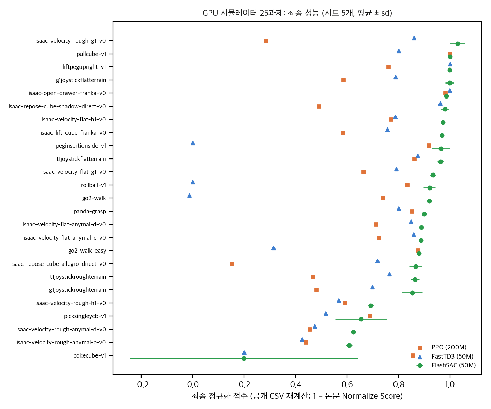
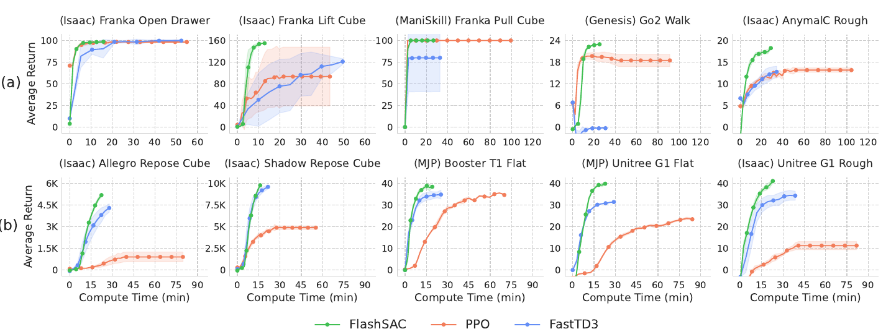
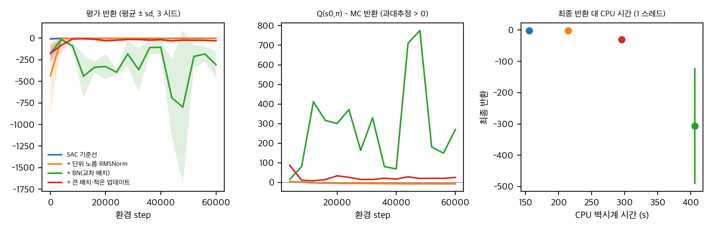

# 빠른 off-policy RL은 안정적인가

로봇 제어에서는 PPO가 여전히 기본값입니다. 데이터를 버리는 방식이라 느리지만 안정적이기 때문입니다. FlashSAC(arXiv:2604.04539, RSS 2026)는 SAC를 기반으로 이 둘을 함께 얻겠다는 논문입니다. 고차원 손 조작과 휴머노이드 보행에서 PPO보다 빠르고 안정하며, 실물 G1 보행 학습 시간을 수 시간에서 수십 분으로 줄였다고 주장합니다.

이 글은 논문 본문과 부록, 공식 저장소의 학습 곡선 CSV, 그리고 CPU 토이로 주장을 점검한 결과입니다. 재현 실험은 하지 않았습니다.

## 무엇을 바꿨나

- **데이터와 모델을 키우고 업데이트를 줄였습니다.** 병렬 환경 1024개, 배치 2048, 새 전이 1024개당 업데이트 2회입니다. 논문은 이것을 scaling law에서 가져왔다고 설명합니다.
- **비판자를 구조로 안정시켰습니다.** 가중치를 단위 노름으로 투영하고, 교차 배치 BN과 RMSNorm, 분포형 비판자를 씁니다. 코드에서 이 구현을 확인했습니다. 기울기 클리핑은 없습니다.
- **탐색을 설계했습니다.** 엔트로피 목표를 행동 표준편차 σ = 0.15로 정하고, 잡음을 Zeta 분포 길이만큼 반복합니다.

## 공개 자료로 확인한 것

직접 계산: 공개 학습 곡선(시드 5개)으로 다시 계산한 과제별 최종 정규화 점수. 정규화 식은 논문에 없어서 반환을 논문 표의 Normalize Score로 나눴습니다.

- 고차원 10과제에서는 FlashSAC(50M step)가 PPO(200M step) 평균보다 모두 높고, 다중 비교 보정 후에도 유의합니다.
- 전체 25과제에서는 22과제에서 높습니다. 같은 50M step에서 PPO와 비교해도 22과제에서 앞섭니다. 그래서 "PPO가 계산량이 많아서 졌다"는 설명은 샘플 기준으로 맞지 않습니다.
- 예외는 ManiSkill 컵 밀기(PokeCube)입니다. FlashSAC는 5시드 중 1개만 성공했습니다. 논문 본문은 이 과제를 따로 다루지 않습니다.

논문 Fig. 3. © 저자, CC BY 4.0. 출처 https://arxiv.org/abs/2604.04539

위 그림은 논문의 벽시계 축 학습 곡선입니다. 벽시계는 공개 CSV에 없어서 이 그림의 시간 비교는 재계산할 수 없습니다.

## 확인하지 못한 것

- **벽시계 주장.** "수 시간에서 수십 분", "PPO 대비 약 3배 계산량"은 공개 CSV에 시간 열이 없고, 공식 코드에도 시간 측정 코드가 없어서 검증할 수 없습니다.
- **조건수 감소.** 논문은 구조를 더할수록 조건수가 단조 감소한다고 쓰지만, 공개 자료에서는 잔차 블록과 RMSNorm을 더하면 조건수가 오릅니다. 최종 구조가 중앙값 기준 가장 낮은 것은 맞습니다. 기울기 노름은 최종 두 구조에서 0으로 기록되어 판단할 수 없습니다.
- **시각 설정.** 논문 시각 실험의 인코더와 프레임 스택은 공개 코드에 없습니다. 시각 1M step 비교에서 MR.Q는 10과제 중 7과제에서 FlashSAC보다 높습니다.
- **실물 G1.** 시드가 하나이고 배포 코드가 없습니다.

## 코드와 논문의 어긋남

- UTD는 본문과 코드가 2/1024인데 표 9는 2/2048입니다.
- IsaacLab 스크립트만 n-step을 3으로 씁니다. 표 9는 1입니다.
- CPU 과제 수는 본문 40, 부록 표 합계 39입니다.
- 액터를 갱신할 때 배치 BN 통계에 다음 상태를 넣고, 비판자는 이동 평균 모드로 평가합니다. 논문에는 이 선택이 없습니다.

## 샘플 재사용을 기준으로 보면

UTD만 보면 GPU와 CPU 설정이 크게 달라 보이지 않습니다. 하지만 전이 하나당 배치 샘플 수로 보면 차이가 큽니다. GPU 설정은 전이 하나를 평균 4번 뽑고, CPU 설정은 512번 뽑습니다. 학습 곡선을 비교할 때는 업데이트 수와 함께 이 값을 같이 봐야 합니다.

## SAC 토이로 본 안정화 요소

LQR 과제(상태 4차원, 행동 2차원, 시드 3개, 60k 전이)에서 SAC를 네 설정으로 돌렸습니다. 논문 설정 그대로는 아니고, 공식 코드도 실행하지 않았습니다.

- **단위 노름 투영과 RMSNorm:** 기준선과 차이가 없었습니다(반환 −1.66 대 −1.60). 이 쉬운 과제에서는 안정화가 필요하지 않았습니다.
- **교차 배치 BN:** 세 시드 모두 발산했습니다(반환 −307 ± 185). 비판자의 과대추정이 +270까지 커졌습니다. 이 토이 규모에서는 BN이 도움이 되지 않았습니다.
- **큰 배치와 적은 업데이트:** 발산은 없었지만 업데이트가 3,626회뿐이라 덜 학습했습니다(반환 −30 ± 11).

이 결과는 토이 규모의 경향입니다. BN이 실패한 정확한 원인은 아직 가리지 못했습니다. 논문의 BN 주장을 시험하려면 배치 2048과 평가 모드 비교가 필요합니다.

직접 계산(토이). 시드 3개 평균 ± sd. 과대추정은 Q(s₀, π(s₀)) − 같은 정책의 할인 반환.

## 구현할 수 있을까

- **공식 GPU 재현(IsaacLab 등 25과제):** 이 맥에는 CUDA가 없어 불가능합니다. 시드 5개에 약 100 GPU시간 이상이 필요합니다.
- **공식 CPU 재현(MuJoCo, DMC 등 일부):** 패키지 설치를 승인하면 과제 한두 개, 시드 한두 개는 실행당 1–2시간으로 할 수 있습니다.
- **알고리즘 재구현:** 교차 배치, 가중치 투영, 분포형 비판자를 합쳐 약 300줄이면 됩니다. CPU로 충분합니다.
- **실물과 시각:** 공개 코드가 없어 재현할 수 없습니다.

자세한 분석과 코드 대조는 `analysis/`와 `report/`에 있습니다.

## 자료

- [통합 리포트 PDF](report/report_public.pdf)
- [FlashSAC 논문 분석 (arXiv:2604.04539)](analysis/01_paper_analysis.md)
- [FlashSAC 선행연구와 계보](analysis/02_prior_work.md)
- [FlashSAC 수치 재계산과 검산](analysis/03_analysis.md)
- [FlashSAC 코드 대조 (논문 ↔ 공식 저장소)](analysis/04_code_verification.md)
