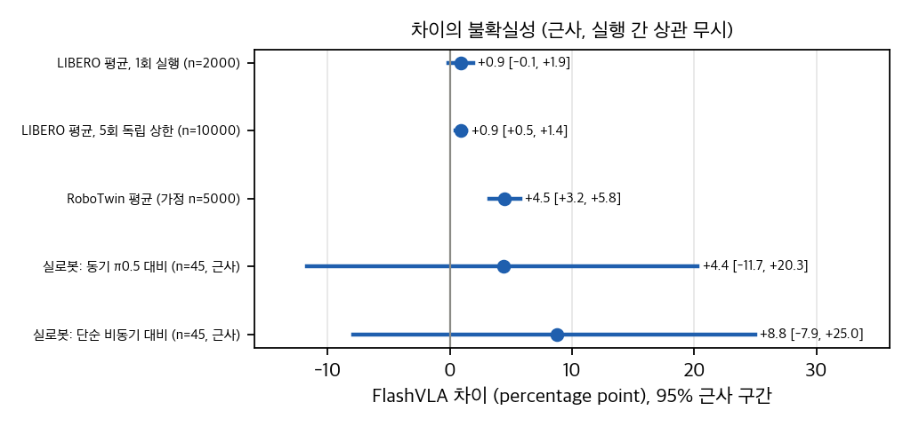
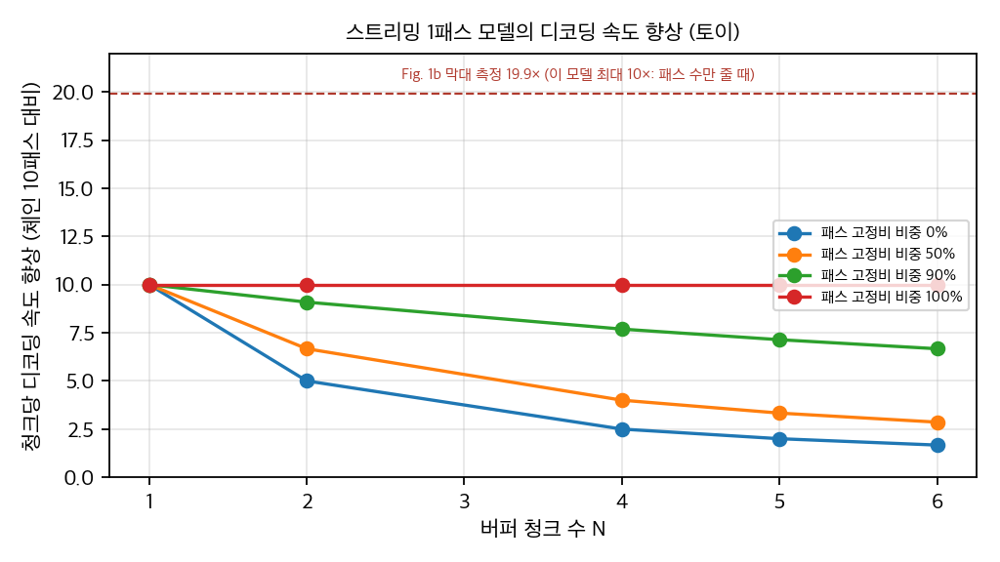
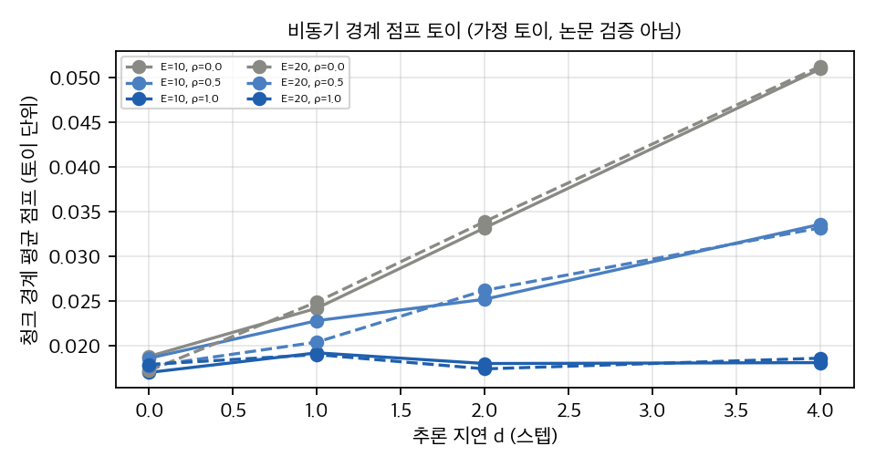

> **논문:** Zekai Li, Jiaming Tang, Zhijian Liu. *FlashVLA: Streaming Action Decoding for Fast and Asynchronous VLA Inference.* CoRL 2026 포스터, arXiv:2608.27384 (v1, 2026-08-27).
> 공식 코드: `z-lab/flashvla` (Apache-2.0, 정적으로만 읽음). 논문 라이선스는 CC BY 4.0이지만 이 글에는 논문 그림을 싣지 않았습니다. 아래 그래프는 논문 수치와 직접 만든 토이로 그렸습니다.

---

## 논문이 묻는 것

흐름 매칭 VLA는 행동 청크 하나를 여러 번의 디노이징 스텝으로 만듭니다. 논문은 π0.5에서 이 디코딩이 추론 시간의 75%를 차지한다고 보고합니다(미최적화, RTX 4090). 그래서 동기 추론은 청크 경계에서 로봇이 멈추고, 비동기 추론은 오래된 관측으로 예측해 실행 시점과 어긋납니다.

FlashVLA는 두 문제를 한 가지 구조로 풉니다. 노이즈 수준이 다른 청크 N개를 버퍼에 두고, 청크 단위 인과 마스크로 함께 디노이징합니다. 매 스텝 실행 가능한 청크가 하나씩 나옵니다. 저자는 이 구조가 디코딩을 상각하고, 미래 청크가 실행 중인 청크를 보게 해 비동기 연속성을 준다고 주장합니다.

## 기억할 설계 세 가지

- **스태거드 버퍼.** 가장 깨끗한 청크가 가장 먼저 실행됩니다. 노이즈 수준이 곧 실행 순서입니다.
- **청크 단위 인과 마스크.** 더 노이즈가 많은 청크가 더 깨끗한 청크를 봅니다. 반대 방향은 막습니다.
- **다중 버퍼 공동 미세조정.** 사전학습 VLA를 관측 하나당 N개 버퍼 구성을 묶은 샘플로 적응시킵니다.

## 숫자를 다시 계산해 보기

LIBERO 평균은 표와 맞습니다. 96.9%에서 97.8%(d=1), 시간/스텝 53.8 ms에서 22.1 ms(2.43×)입니다. 그런데 신뢰구간을 계산하면 이야기가 달라집니다.

*그래프: 주요 차이의 근사 95% 구간 (Newcombe, 실행 간 상관과 과제 군집은 무시). 우리가 그린 그래프입니다.*

- LIBERO +0.9점: 실행 한 번(2000 에피소드) 기준 p≈0.08. 실행 5회를 독립으로 본 상한에서만 유의합니다.
- RoboTwin +4.5점: 과제별 시행 수가 본문에 없어 100회 가정 아래 구간이 +3.2에서 +5.8입니다.
- 실로봇 +4.4점(동기 대비): 과제당 15회라 구간이 −11.7에서 +20.3입니다. 판정할 수 없습니다.

## 긴 과제의 +36.6점은 과제 몇 개에서 나올까

RoboTwin 50과제를 짧음, 중간, 긴으로 나눈 표(Tab. 4)와 전체 평균 표(Tab. 3)를 함께 맞춰 보면, 가능한 과제 구성은 짧음 30, 중간 15, 긴 5 하나뿐입니다. 긴 과제 이득은 약 5개 과제의 평균이고, 전체 +4.5점 가운데 약 +3.7점을 설명합니다. 논문은 과제 수를 쓰지 않으므로 이 값은 추정입니다.

## "최대 20×"의 정체

Fig. 1b의 디코딩 막대는 97.4 ms에서 4.9 ms로 줄어듭니다. 19.9배입니다. 체인 10패스가 1패스가 되면 10배입니다. 나머지 2배는 패스당 비용이 줄어야 나옵니다.

*그래프: 토이 모델(패스 고정비 비중별)의 청크당 디코딩 속도 향상. 19.9배는 이 모델 최대치보다 큽니다. 우리가 그린 그래프입니다.*

각주 1은 이 2배를 "커널 실행 직렬화 제거"로 설명합니다. 그런데 Fig. 1b 본문은 시스템 최적화를 적용하지 않았다고 합니다. 두 설명이 맞으려면 설명이 더 필요합니다. 전체 추론 지연 이득은 Tab. 2에서 1.5–1.8배입니다. 측정 대상이 다릅니다.

## 비동기 경계는 지연과 함께 거칠어집니다 (토이)

논문 실험은 성공률로 연속성을 간접 측정합니다. 토이에서는 청크 경계의 행동 점프를 직접 봅니다. 추론 지연 d가 커질수록 점프가 커집니다. 토이의 ρ(진행 중 청크를 조건화해 줄이는 비율)는 자유 파라미터라서, 이 그래프로 논문의 성공률 차이를 설명할 수는 없습니다.

*그래프: 청크 길이 E=10, 20에서 추론 지연 d별 평균 경계 점프. ρ는 가정값입니다. 논문 측정이 아니라 가정 토이이며, 우리가 그린 그래프입니다.*

## 코드와 논문이 맞는 곳, 다른 곳

공식 저장소는 Apache-2.0이고 구조가 논문과 맞습니다. 청크 단위 인과 마스크, 구성 격리, 콜드 스타트, 설정값(LIBERO C=10, N=4)이 모두 있습니다.

- **버퍼 순서가 논문 안에서 반대입니다.** 본문 §3.3과 부록 A.4는 패딩과 실제 청크의 위치를 반대로 적었고, 코드는 실제 청크를 깨끗한 쪽에 둡니다.
- **비동기 평가에 RTC식 재정렬 옵션이 있습니다.** 기본값은 꺼져 있습니다. 논문이 어떤 설정으로 측정했는지는 적혀 있지 않습니다.
- **지연 측정 설정이 주 설정과 다릅니다.** 벤치마크 설정은 버퍼 5, 컴파일 켬입니다.

## 이 맥에서 할 수 있는 것

Apple M4 Pro, 24 GiB, MPS, CUDA 없음 기준입니다. 공식 코드를 실행해 지연을 재는 것은 불가능합니다. 지연 측정 경로가 CUDA 장치와 CUDA Graph를 전제로 합니다. 학습은 8장짜리 H200 설정이고, 실로봇은 장비와 데이터가 없습니다.

반면 구조를 작게 옮기고 단위 테스트로 확인하는 일은 중간 노력(추정 2–4일)입니다. 소형 접촉 과제에서 청크 인과 마스크의 효과를 같은 방향으로 보는 실험도 가능합니다.

## 정리

- 구조는 명확하고 구현하기 쉽습니다. 인과 마스크 제거 실험(약 10점 하락)이 핵심 주장을 뒷받침합니다.
- 속도는 측정 대상을 나눠 읽어야 합니다. 전체 추론은 1.5–1.8배, 실행 주기는 2.43배, 디코딩 단계는 19.9배입니다.
- 품질 향상(LIBERO +0.9점)은 1회 기준으로 경계에 있습니다. 긴 과제의 큰 이득은 약 5개 과제에서 나옵니다.

---

*이 글은 논문 본문, 공개 저장소의 정적 읽기, 직접 만든 토이를 바탕으로 합니다. 학습과 평가는 하지 않았고, 가중치와 데이터는 받지 않았습니다. 논문 그림과 원문 PDF는 싣지 않았습니다.*

## 자료

- [통합 리포트 PDF](report/report_public.pdf)
- [01. 논문 분석: FlashVLA (arXiv:2608.27384)](analysis/01_paper_analysis.md)
- [02. 선행연구와 관련 자료](analysis/02_prior_work.md)
- [03. 수치 재계산, 일관성, 검정, 토이](analysis/03_analysis.md)
- [04. 논문 ↔ 코드 대조 (정적 읽기)](analysis/04_code_verification.md)
