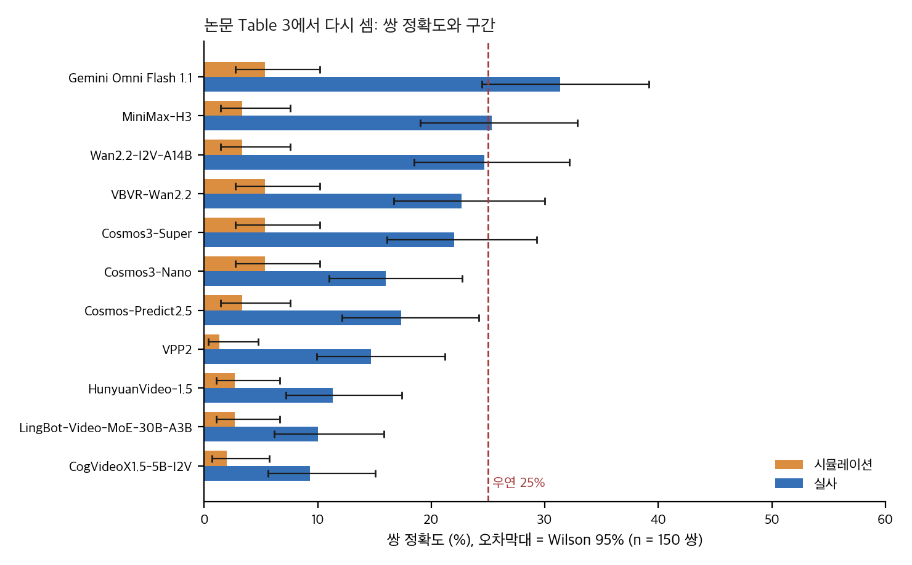
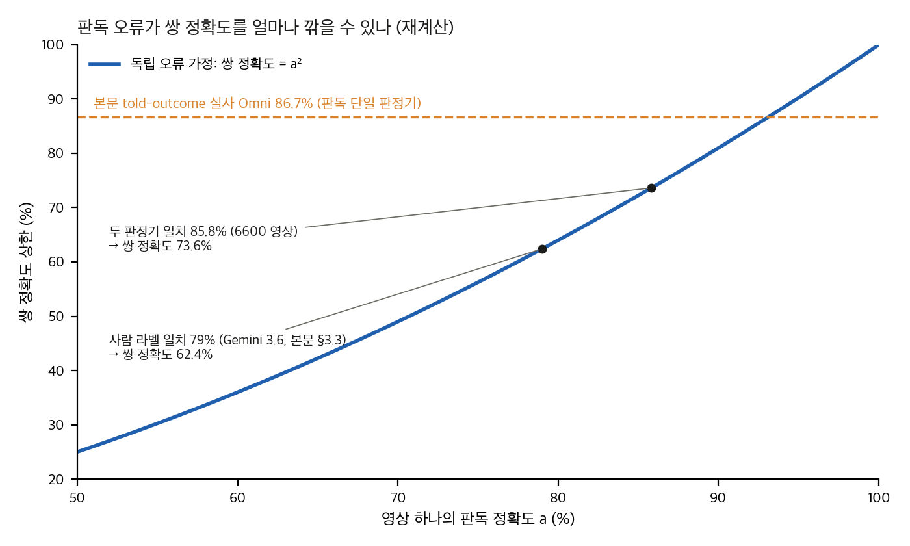

> **논문:** Mi Luo 외 12인. *The Flip Test: Video World Models Fail to Learn the World State.* arXiv:2611.19822 (v1, 2026-11-15). 학회 표기 없음.
> 공식 코드는 아직 공개되지 않았습니다(프로젝트 블로그의 [Code&Data]는 "expected Dec 2026"). 논문 그림은 싣지 않고, 우리가 표에서 다시 그린 그래프만 씁니다.

## 논문이 묻는 것

비디오 세계모델은 초기 프레임에서 미래를 예측합니다. 그런데 예측이 **세계의 상태**를 따르는지는 따로 묻기 어렵습니다. 이 논문은 질문을 counterfactual로 바꿉니다. 책이 탁자 모서리에서 몇 밀리미터 나와 있으면 넘어지고, 조금 안쪽이면 버팁니다. 두 장면이 거의 같아도 결과는 반대입니다. 세계를 추적하는 모델이라면 예측도 뒤집혀야 합니다.

FlipTest는 세 단계입니다. 탐지(최소쌍 300개), 선택성(같은 크기 변화의 제어 집단), 국소화(경계 주변 스윕)입니다. 시뮬레이션 10과제와 실사 15과제, 11개 영상 모델을 평가합니다.

## 논문이 보여 준 것

- **쌍 정확도:** 전체 평균 최고는 Gemini Omni Flash 1.1의 18.3%입니다. 우연 25%보다 낮습니다. 시뮬레이션에서는 어떤 모델도 5.3%를 넘지 못합니다.
- **선택성:** 비디오 모델은 결과가 바뀌지 않는 변화에도 같은 빈도로 예측을 바꿉니다. VLM은 경계 건너에서만 바꿉니다(SS = +0.46).
- **진단:** 같은 초기 프레임을 측정하는 코딩 에이전트는 실사 쌍의 93% 이상을 맞힙니다. 정답을 프롬프트에 알려 줘도 비디오 모델은 4분의 1 이상을 놓칩니다.

## 이 글에서 확인한 것

**표 값은 대부분 맞습니다.** 표 3의 행 합계, 11개 모델 평균, 실사와 시뮬 값, 같은 결과 비율(시뮬 89%, 실사 72%), 1,680 프레임, 21,000개 넘는 영상이 모두 맞습니다.

**우연 25%는 약간 높습니다.** 3지선다 과제(뉴턴 요람, 실사 시소)가 섞여 있어 쌍 우연은 약 24%입니다. 결론은 바뀌지 않습니다.

*그림: 논문 Table 3의 개수로 다시 그린 모델별 쌍 정확도와 Wilson 95% 구간입니다. 시뮬레이션은 모든 모델이 우연 아래입니다. 실사 Omni의 31.3%는 단측 p = 0.047, 양측 p = 0.089로 우연과 확실히 다르다고 말하기 어렵습니다.*

**실사 순위는 약합니다.** Omni의 실사 31.3%는 단측 검정에서만 우연보다 높다고 볼 수 있습니다. MiniMax 25.3%와 Wan2.2 24.7%는 우연과 구별되지 않습니다.

**두 수치는 판정 규칙이 다릅니다.** 중립 조건 18.3%는 두 판정기가 모두 맞아야 하는 규칙입니다. 정답을 알려 준 조건 73.7%는 판정기 하나로 읽었습니다. 같은 영상의 실사 Omni는 판정기 하나로 34.7%, 두 판정기로 31.3%입니다. 따라서 상승 폭이 3–4 pp 부풀었을 수 있습니다. 상승 자체는 훨씬 큽니다.

**판독 정확도와 쌍 정확도가 맞지 않습니다.** 사람 라벨과 판정기의 일치는 79%입니다. 영상마다 독립으로 틀린다고 가정하면 완벽한 생성기도 쌍 정확도 62%를 넘기 어렵습니다. 그런데 본문은 정답을 알려 준 실사 조건에서 86.7%를 보고합니다. 판독 오류가 독립이 아니거나 표본이 다를 수 있습니다. 논문은 이를 설명하지 않습니다.

*그림: 영상 하나의 판독 정확도 a에서 독립 오류를 가정한 쌍 정확도 상한 a²입니다. 사람 라벨 일치 79%는 62.4%, 두 판정기 일치 85.8%는 73.6%입니다. 본문의 정답 조건 실사 86.7%는 이 독립 가정 상한을 넘습니다.*

**측정 에이전트의 실사 우위는 구별되지 않습니다.** 측정 에이전트 93.3%(140/150)와 직접 VLM 87.3%(131/150)는 짝지음 없이 비교하면 p = 0.12입니다. 스윕에서는 차이가 큽니다(477/480 대 356/480).

## 구현 가능성 (이 맥 기준)

- **재현은 어렵습니다.** 11개 영상 모델을 모두 돌리고(21,000개 넘는 영상), 상용 판정기로 읽는 작업은 GPU와 API가 필요합니다. 맥(M4 Pro, 24 GiB, MPS)에서는 메모리와 시간이 막습니다.
- **축소판은 가능합니다.** 시뮬레이션 쌍 벤치마크는 MuJoCo로 CPU에서 만들 수 있고, 논문의 상수(예: 루프 높이 0.776 m, 마찰 1/3)로 다시 짤 수 있습니다. 노력은 2–4주로 추정합니다.

## 한계와 다음에 볼 것

- 공식 원자료(영상, 판정 결과)가 아직 없습니다. 공개되면 쌍 정확도와 판정 일치를 다시 셀 수 있습니다.
- 판정기와 평가 모델이 같은 계열(Google)입니다. 블라인드 설계이지만 계열 편향을 따로 확인해야 합니다.
- 과제 효과를 반영한 구간이 없습니다. 쌍을 과제 단위로 묶어 다시 보는 것이 필요합니다.
- 강체, 단일 요인, 단일 프레임이라는 범위가 있습니다. 접촉이나 변형이 중요한 장면은 다루지 않습니다.

## 정리

이 논문의 방향, 즉 최소쌍으로 세계 상태를 묻는 방법은 쓸 만합니다. 다만 본문 수치를 그대로 인용하면 과장되기 쉽습니다. 우연 기준, 실사 순위의 유의성, 판정 규칙, 판독 정확도를 함께 보고해야 합니다.

## 자료

- [통합 리포트 PDF](report/report_public.pdf)
- [The Flip Test: Video World Models Fail to Learn the World State (arXiv:2611.19822) 논문 분석](analysis/01_paper_analysis.md)
- [The Flip Test: 선행연구와 관련 자료 (arXiv:2611.19822)](analysis/02_prior_work.md)
- [The Flip Test: 수치 재계산과 일관성 검사 (03)](analysis/03_analysis.md)
- [The Flip Test: 주장 검증 (04)](analysis/04_claim_verification.md)
