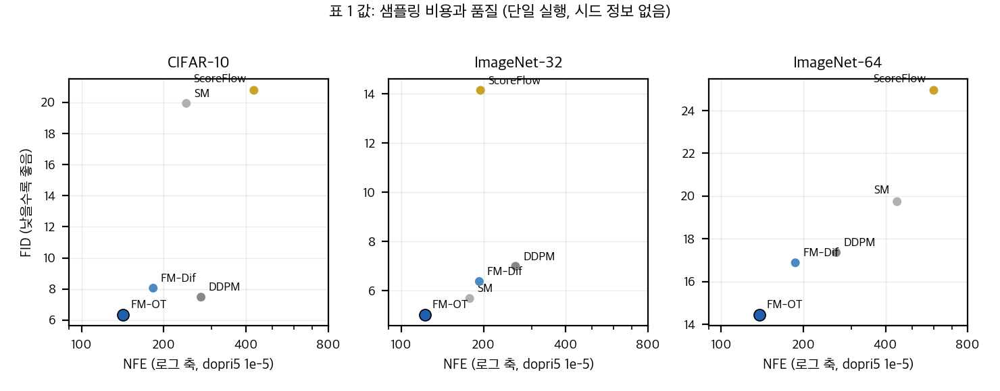

> **논문:** Yaron Lipman, Ricky T. Q. Chen, Heli Ben-Hamu, Maximilian Nickel, Matt Le. *Flow Matching for Generative Modeling.* arXiv:2210.02747 (v2). ICLR 2023.
> 공식 코드는 찾지 못했습니다. 이 글의 그림은 모두 우리가 그린 그래프이며, 논문 그림은 라이선스(arXiv non-exclusive)상 싣지 않았습니다.

## 논문이 묻는 것

연속 정규화 흐름(CNF)은 임의의 확률 경로를 모델링할 수 있지만, 우도 학습에 ODE 시뮬레이션이 필요해 큰 데이터에는 비쌉니다. 확산 모델은 스코어 매칭으로 학습되지만, 경로가 확산 과정에 묶여 있습니다. Flow Matching은 확률 경로를 직접 지정하고, 각 데이터 샘플에 대한 조건부 벡터장을 회귀하는 목표를 제안합니다. 이 목표는 주변 벡터장을 회귀한 목표와 같은 그래디언트를 줍니다.

## 이 글에서 확인한 것

**1. 핵심 식은 맞습니다.** 조건부 목표는 x = ψ_t(x0 | x1), 타깃 u = x1 − (1−σ_min)x0, 손실 ||v − u||²입니다. 가우시안 경로의 벡터장 식 (15)와 OT 벡터장 식 (21)을 손으로 유도했고, 시간 미분과 수치로 비교하면 오차가 1e-9 수준입니다. 두 목표의 차이가 v에 무관한 상수라는 정리 2도 1차원 예제에서 확인했습니다.

**2. 표 1의 방향은 맞지만 차이의 크기는 확인할 수 없습니다.** FM-OT는 CIFAR-10, IN-32, IN-64에서 NLL, FID, NFE 모두 최고입니다. FM-Dif 대비 NFE는 22–37% 적습니다. 그런데 시드와 분산이 없어서 검정을 할 수 없고, IN-32와 IN-64의 NLL 차이 0.01 bpd는 같은 방법에서 dequantization 샘플 수를 바꿀 때 생기는 변화(0.03–0.09 bpd)보다 작습니다.

**3. 표끼리 맞지 않는 값이 있습니다.** 표 1과 표 4의 IN-32 SM과 FM-Dif 값이 0.01–0.02 bpd 다릅니다. 표 3의 CIFAR-10 반복 수(391k)는 1000 에폭, 배치 256과 맞지 않습니다(약 196k여야 함). v1에서 v2로 바뀌면서 IN-32의 FM-OT 대 FM-Dif NFE 비율은 0.99에서 0.63으로 바뀌었는데, 논문은 측정 변경을 밝히지 않았습니다.

**4. 초해상도 주장은 과장되어 있습니다.** 본문은 FM-OT의 PSNR과 SSIM이 SR3와 "비슷하다"고 하지만, PSNR은 1.7 dB 낮습니다. FID와 IS가 낫다는 것은 맞습니다.

## 구현 관점

- CFM 목표와 OT 경로, 샘플링 ODE는 수십에서 백여 줄의 PyTorch로 옮길 수 있습니다.
- 시간 방향이 확산 코드와 반대입니다(t=0이 노이즈). 이를 놓치면 부호가 뒤집힙니다.
- σ_min 값이 논문에 없습니다. 재현에는 값을 가정하고 민감도를 확인해야 합니다.
- 표 1 규모(IN-32 이상, 16–32 GPU)의 재현은 개인 장비에서 불가능합니다. 2차원 실험과 CIFAR-10 소형 모델까지가 현실적입니다.

## 정리

Flow Matching의 목표 식과 OT 경로는 명확하고 검증할 수 있습니다. 그러나 실험 결과는 단일 실행이고 표끼리도 어긋나는 값이 있어, 샘플링 효율과 우도 우위를 확정적으로 말하기에는 근거가 약합니다. 이후 재현을 한다면 σ_min 민감도와 시드 분산부터 측정하는 것이 좋습니다.

## 자료

- [통합 리포트 PDF](report/report_public.pdf)
- [01. 논문 분석: Flow Matching for Generative Modeling](analysis/01_paper_analysis.md)
- [02. 선행연구와 관련 저장소](analysis/02_prior_work.md)
- [03. 수치 재계산, 일관성 검사, 수식 검증](analysis/03_analysis.md)
- [04. 주장 검증 (C1–C17)](analysis/04_claim_verification.md)
