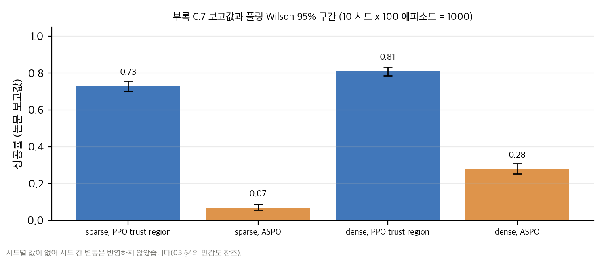
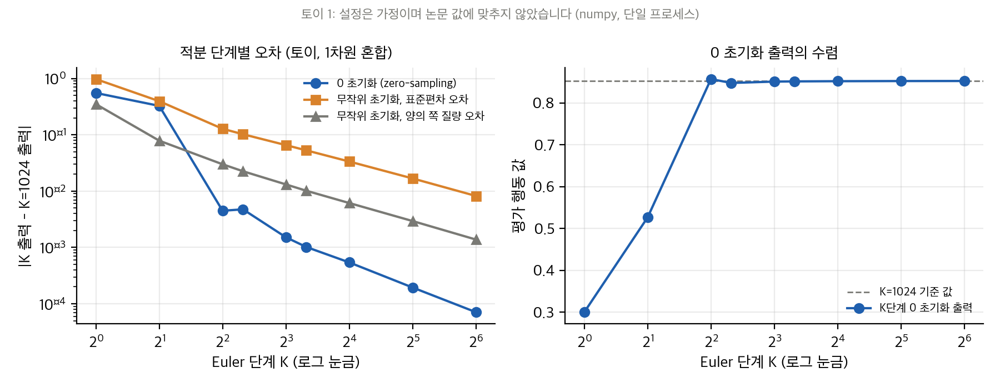
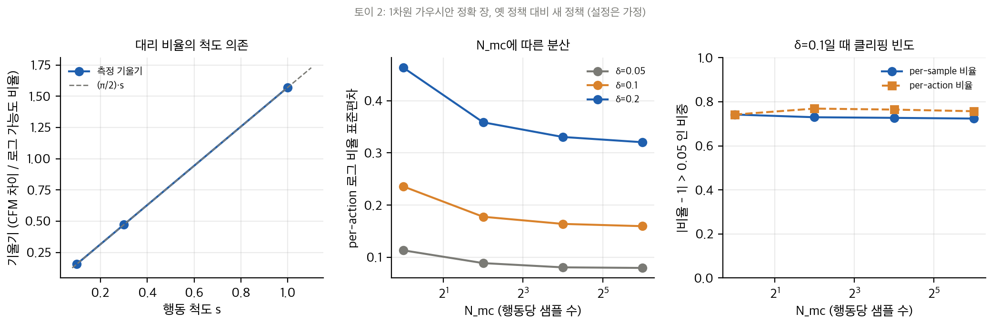

> **논문:** Brent Yi, Hongsuk Choi 외 10인. *Flow Policy Gradients for Robot Control.* CoRL 2026 구두 발표, arXiv:2602.02481 (v2, 2026-10-13).
> 논문 배포 조건은 CC BY 4.0입니다. 이 글에는 논문 그림을 넣지 않았고, 그래프는 논문 수치와 직접 만든 토이로 그렸습니다. 공식 코드(`amazon-far/fpo-control`)는 LICENSE 파일이 없어서 정적으로 읽기만 했고, 실행하지 않았습니다.

---

## 논문이 묻는 것

로봇 정책을 강화학습으로 학습할 때 가장 흔한 방법은 가우시안 정책입니다. 행동의 우도를 닫힌 형태로 계산할 수 있어서 policy gradient에 바로 쓸 수 있습니다. 그런데 가우시안은 행동 분포를 단순한 모양으로 제한합니다.

흐름 정책(flow matching)은 더 복잡한 분포를 표현할 수 있지만 우도를 계산하려면 부피 변화를 적분해야 합니다. 저자들은 이 계산을 피하는 FPO(McAllister 외, 2025)를 가져와서 **FPO++**로 고칩니다. 바뀐 점은 두 가지입니다.

1. **샘플별 비율:** 행동 하나의 조건부 흐름 매칭(CFM) 손실을 여러 (노이즈, 시간) 쌍으로 평균하지 말고, 쌍마다 비율을 따로 만듭니다.
2. **비대칭 trust region(ASPO):** advantage가 양수이면 PPO 클리핑, 음수이면 SPO를 씁니다. 음수 쪽에서 기울기가 0이 되지 않아 엔트로피가 덜 무너진다고 봅니다.

보행, 휴머노이드 모션 트래킹, 조작 미세조정에서 안정적인 학습을 보였고, 두 휴머노이드에서 sim-to-real까지 보고합니다.

## 숫자를 다시 세 보니

논문의 수치가 평가 설정과 맞는지 확인했습니다. 재계산 스크립트는 `analysis/table_check.py`입니다.

- **베이스 정책 성공률 두 개가 1,000 에피소드와 맞지 않습니다.** 부록 C.4의 Can 73.76%와 Square 28.62%는 1,000 에피소드로 나올 수 없는 값입니다(정수 횟수가 아님). 같은 평가 설정을 다시 확인해야 합니다.
- **희소·조밀 보상의 ASPO 실험은 방향이 분명합니다.** 부록 C.7은 시드 10개에서 희소 보상 PPO 0.73 대 ASPO 0.07, 조밀 보상 PPO 0.81 대 ASPO 0.28을 보고합니다. 성공률의 시드 간 표준편차는 0.5를 넘을 수 없어서, 이 차이는 시드 변동으로 설명되지 않습니다. 다만 과제 한 개와 제한된 조건에서 나온 결과입니다.
- **v1의 제로 샘플링 표는 검정력이 약합니다.** v1 표 I에서 제로 샘플링 5단계와 무작위 5단계의 차이는 10.4이고 p=0.09입니다(100 롤아웃). v2에서는 이 표가 빠졌습니다.

*그래프: 부록 C.7 보고 성공률(10 시드 x 100 에피소드)과 Wilson 95% 구간. 시드 간 변동은 반영하지 않았습니다.*

## 토이 1: 적분 단계를 줄이면 무엇이 깨지나

흐름 정책은 노이즈에서 행동까지 여러 단계로 적분합니다. 논문은 학습에 64단계(조작은 10단계)를 쓰고, 모션 트래킹 배포에서는 노이즈를 0으로 두고 5단계로 적분한다고 씁니다.

가장 단순한 설정에서 이 선택이 무엇을 바꾸는지 봤습니다. 목표는 두 봉우리를 가진 1차원 분포이고, 속도장은 정확히 계산했습니다(numpy, 1 프로세스, 수 초).

*그래프: 토이 1. 적분 단계별 오차와 0 초기화 출력의 수렴. 설정은 가정입니다.*

- 무작위 초기화에서는 **분산이 먼저 줄어듭니다.** 5단계에서 표준편차가 약 10% 작아집니다. 탐색을 중요하게 보는 학습에서는 이 차이가 중요할 수 있습니다.
- 0 초기화 출력은 **5단계에서 기준 값의 0.5% 안**입니다. 1–2단계에서는 크게 틀립니다.
- 이 결과는 목표 분포의 모양에 달려 있습니다. 단봉 가우시안에서는 0 초기화 오차가 0입니다.

## 토이 2: 대리 비율은 가능도 비율을 따르는가

FPO의 핵심 식은 CFM 손실 차이 exp(L_old − L_new)를 우도 비율의 대리치로 씁니다. 1차원 가우시안에서 정확한 속도장을 두고 이 대리치를 정확한 로그 가능도 비율과 비교했습니다.

*그래프: 토이 2. 대리 비율의 척도 의존, 분산, 클리핑 빈도. 설정은 가정입니다.*

- **방향은 맞습니다.** 상관이 0.9998–0.9999입니다.
- **크기는 다릅니다.** 기울기는 1이 아니라 (π/2)·s입니다. 행동 척도가 10배 커지면 같은 클리핑 값이 가리키는 우도 변화량도 10배 달라집니다.
- **샘플별 비율은 같은 행동에서도 자주 흔들립니다.** 평균이 표준편차의 1/3만큼(δ=0.1, s=0.3) 움직였을 때 쌍마다 비율의 74%가 클리핑 경계를 넘습니다. 이 점이 샘플별 방식의 "세밀한 trust region"이면서 동시에 클리핑을 자주 걸리게 하는 이유입니다.

## 공식 코드와 논문이 다른 곳

공식 저장소는 `8f460e4`(2026-08-12) 커밋을 기준으로 정적으로 읽었습니다. 몇 군데가 논문과 다릅니다.

- **손실 노름:** 논문 식 (7)은 제곱 L2이고, 저장소 기본값은 `sqrt`(합/√d)입니다. 비율의 척도가 행동 차원에 따라 달라지는 원인입니다.
- **모션 트래킹 설정:** 논문 표 A.2의 학습률 3e-4, 에포크 5, 미니배치 4, 적분 50단계와 달리, 저장소 설정은 기본값(1e-4, 16, 6, 64)을 씁니다. 설정 파일이 논문 실험에 쓰였는지는 확인할 수 없습니다.
- **적응 학습률:** 논문은 적응 학습률을 실험 변형으로 설명하지만, 모션 트래킹 설정에서는 켜져 있습니다.
- **조작 비교:** 그림 5의 FPO와 FPO++는 샘플별 비율 외에도 Huber 손실, 클램프, 클리핑, 기울기 노름이 다릅니다. 차이를 한 요인으로 돌릴 수 없습니다.
- **ASPO 커밋:** 저장소 최신 커밋 제목은 "ASPO 목적을 고쳤다"입니다. 이 수정이 논문의 조작 ASPO 실험 이전인지 이후인지 알 수 없습니다.

## 구현 가능성 (맥 기준)

이 글은 Apple M4 Pro, 24 GiB, MPS, CUDA 없는 맥을 기준으로 봤습니다.

- **알고리즘은 구현할 수 있습니다.** 샘플별 비율, ASPO, 클램프, 제로 샘플링을 PyTorch로 350–500줄쯤(추정 3–5일) 옮길 수 있습니다.
- **소형 과제 비교는 조건부입니다.** MuJoCo 같은 소형 과제에서 FPO++와 가우시안 PPO를 비교하는 것은 패키지 설치 후에 가능합니다.
- **논문 규모 재현은 불가능합니다.** 보행은 IsaacLab과 CUDA GPU가 필요하고, 모션 트래킹과 sim-to-real은 데이터와 실물 로봇이 필요합니다. 조작 미세조정은 베이스 정책과 GPU 수 시간이 필요합니다.

## 라이선스와 출처

- 논문은 arXiv에서 CC BY 4.0입니다. 그래도 이 글에는 논문 그림을 넣지 않았습니다.
- 공식 코드는 LICENSE 파일이 없습니다. 저장소 README는 구성요소의 라이선스(IsaacLab BSD-3, LeRobot Apache-2.0, robosuite MIT, DexMimicGen 비상업)를 나열합니다. 코드를 복사해 공개하지 않았습니다.
- 공개 분석 노트(`publish/git/`)에는 분석 문서, 재계산과 토이 스크립트와 결과, 우리가 그린 그래프가 들어 있습니다.

원문과 자세한 판정은 논문 폴더의 `analysis/` 문서에 있습니다. 재계산은 `python3 analysis/table_check.py`로 다시 돌릴 수 있습니다.

## 자료

- [통합 리포트 PDF](report/report_public.pdf)
- [Flow Policy Gradients for Robot Control (arXiv:2602.02481) 분석](analysis/01_paper_analysis.md)
- [02 선행연구와 관련 자료 (Flow Policy Gradients, arXiv:2602.02481)](analysis/02_prior_work.md)
- [03 수치 재계산, 일관성 검사, 토이 검증 (Flow Policy Gradients, arXiv:2602.02481)](analysis/03_analysis.md)
- [04 코드 대조, 주장 검증, 구현 가능성 (Flow Policy Gradients, arXiv:2602.02481)](analysis/04_code_verification.md)
