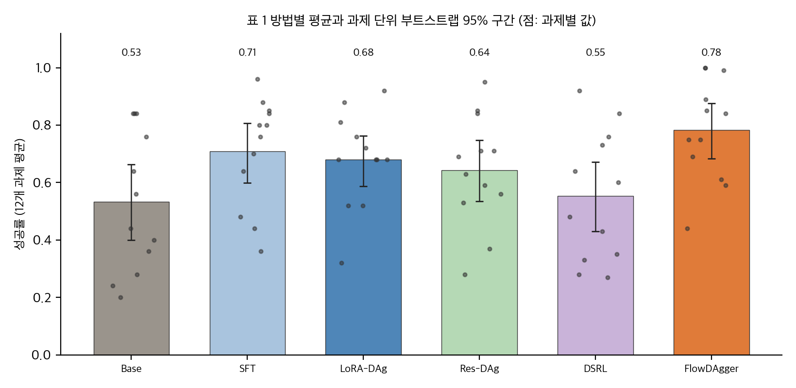
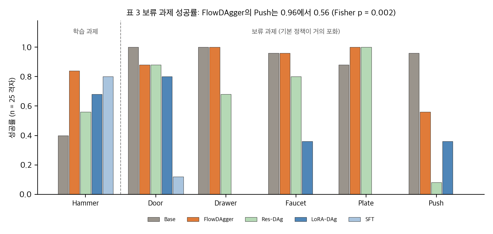
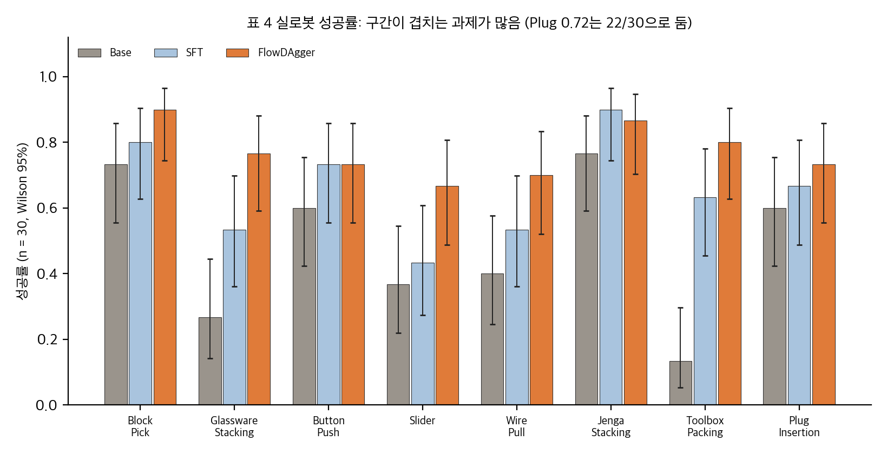
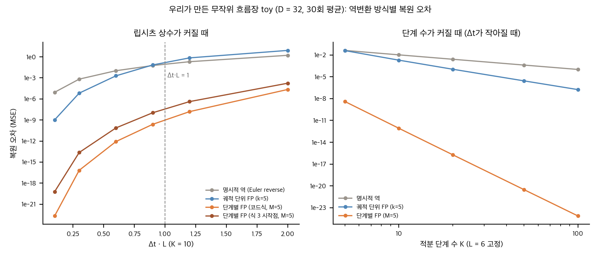

> **논문:** Michael Murray, Daphne Chen, Simran Bagaria, Dean Fortier, Tess Hellebrekers, Galen Mullins, Harshavardhan Gajarla, Oier Mees, Maya Cakmak, Andrey Kolobov. *FlowDAgger: Human-in-the-Loop Adaptation of Generative Robot Policies in Latent Space.* CoRL 2026 스포트라이트, arXiv:2607.08877 (v1, 2026-07-09, v2 없음).
> 공식 코드는 GitHub microsoft/FlowDAgger(MIT)에 있습니다. 이 글의 그림은 모두 우리가 그린 것이고, 논문 그림은 넣지 않았습니다(arXiv 라이선스가 비독점 배포).

## 논문이 묻는 것

흐름 정합과 확산으로 만든 로봇 정책은 사전학습 때 보지 못한 상황에서 실패합니다. 고치는 길은 셋이고 각각 문제가 있습니다. 가중치를 미세조정하면 계산이 들고 기존 기술이 깎입니다. 행동 공간에서 잔차를 더하면 기본 정책이 만들 수 있는 행동 밖으로 나갈 수 있습니다. 입력 잡음만 학습하는 잠재 공간 강화학습(DSRL)은 보상과 자율 탐색이 병목입니다.

FlowDAgger는 사람 교정으로 잠재 공간(입력 잡음)을 학습합니다. 핵심은 **행동 역변환**입니다. 사람이 준 교정 행동 a\*를 "기본 정책이 이 행동을 내려면 어떤 잡음이 필요했는가"로 되돌려 w\*를 얻고, 작은 잡음 정책이 상태 s에서 w\*를 회귀하게 합니다. 기본 정책은 한 번도 수정하지 않습니다.

## 방법

- **역변환.** K = 10단계 오일러 적분의 한 단계 `x_{k+1} = x_k + Δt v(x_k)`를 `x_k = x_{k+1} − Δt v(x_k)`로 놓고 고정점 반복으로 풉니다(식 3). 한 번의 명시적 역 단계는 속도를 잘못된 점에서 재서 O(Δt) 오차가 나는데, 단계가 적은 행동 머리(Δt = 0.1)에서는 이 오차가 큽니다. 기본 모델 역전파가 필요 없습니다.
- **잡음 정책.** 관측 인코더와 MLP가 `π^w(s)`를 내고, 배포 때 `a = π_gp(s, π^w(s))`입니다. 손실은 `||π^w(s) − w*||²`입니다.
- **버퍼.** 역변환된 교정을 모은 개입 버퍼와 성공한 자율 롤아웃의 잡음을 모은 자율 버퍼에서 같은 비율로 뽑아, 드문 교정에 과적합하지 않게 합니다.
- **세계 행동 모델.** Cosmos-Policy처럼 행동이 결합 잠재의 조각인 모델은 결합 과정 전체를 역변환합니다.

## 이 글에서 확인한 것

**1. MetaWorld 평균 우위는 맞고, 크기는 보통입니다.**

*그림 1. 표 1의 12과제 평균(점은 과제별 값, 구간은 과제 부트스트랩). FlowDAgger 0.78, SFT 0.71, LoRA-DAgger 0.68, Residual-DAgger 0.64, DSRL 0.55, 기본 0.53.*

평균과 "12개 중 8개 과제에서 최고"는 재계산과 일치합니다. 과제 단위 짝 비교로 FlowDAgger와 SFT의 평균 차이는 +0.074이고 95% 구간이 0.018–0.130입니다. 방향은 안정적이지만 크기는 작습니다.

**2. 표마다 시행 수가 다른 것으로 보입니다.** 논문은 모든 표를 "3 시드 × 25 롤아웃"으로 서술합니다. 그런데 값의 격자를 보면 기본 정책, SFT, LoRA-DAgger 열은 거의 모두 0.04의 배수(단일 25회)이고, FlowDAgger와 Residual-DAgger 열은 3 시드(1/75 간격) 격자입니다. 표 2의 Cosmos-Policy 열 14개는 전부 25회 격자입니다. SFT Box Close 0.70은 25회와 75회 어느 쪽에서도 나올 수 없는 값입니다. 평균 비교는 유효하더라도, 방법 간 격차를 정밀하게 해석하기는 어렵습니다.

**3. "기본 정책 보존"은 평균에서만 맞습니다.**

*그림 2. Hammer에 적응한 뒤 보류 과제 성공률. FlowDAgger의 Push는 0.96에서 0.56으로 떨어집니다(Fisher p = 0.002).*

보류 5과제 평균은 FlowDAgger 0.88(−0.08), Residual-DAgger 0.69, LoRA-DAgger 0.30, SFT 0.02로 FlowDAgger가 가장 작게 떨어집니다. 그러나 평균은 Plate +0.12와 Door −0.12 사이에 Push −0.40을 묻습니다. 학습 과제 Hammer의 이득도 FlowDAgger 0.84 대 SFT 0.80(21/25 대 20/25)으로 구분되지 않습니다.

**4. 실로봇은 합산에서 강하고 과제별에서 약합니다.**

*그림 3. 표 4의 실로봇 성공률과 Wilson 95% 구간(n = 30). Plug Insertion FlowDAgger 0.72는 30회로 나올 수 없는 값이라 22/30으로 그렸습니다.*

8과제를 합치면(240회) FlowDAgger 184–185, 기본 116, SFT 157이고 p ≈ 1e-10(대 기본), 0.006–0.009(대 SFT)입니다. 하지만 과제별로는 대 기본 4개(다중 보정 후 2개), 대 SFT는 하나도 p < 0.05가 아닙니다. 본문의 "SFT보다 Jenga 외 모든 과제 우위"는 Button Push가 0.73 대 0.73 동률이라 부정확하고, 표 4의 값 일곱 개는 반올림이 아니라 버림으로 적혀 있습니다.

**5. 역변환 정확도는 확인되고 속도는 구현에 달렸습니다.**

*그림 4. 우리가 만든 무작위 흐름장 toy(D = 32)에서 역변환 방식별 복원 오차(로그 눈금). 단계별 고정점이 명시적 역과 궤적 단위 고정점보다 훨씬 정확하고, 궤적 단위는 반복을 늘려도 나아지지 않습니다.*

표 5·6의 비율(약 20배, 14배, 2.4배 등)은 모두 재계산과 일치하고, 우리 toy도 같은 방향입니다. 다만 본문의 비용 `K·M`은 표 6의 `K(M+1)`과 반복 한 번 어긋납니다. 궤적 단위 방식이 느린 이유는 모델 평가 수보다 호출 횟수(호출당 약 99 ms로 추정)로 설명됩니다.

## 공식 코드와의 차이

공식 코드는 MIT이고 π0.5 + MetaWorld assembly와 GR00T N1.7 + LIBERO-90 한 과제만 담습니다. 기준선, 열두 과제, Cosmos-Policy, 실로봇 코드는 없습니다. 코드는 읽기만 했고 실행하지 않았습니다. 기본 실행이 논문의 서술과 다른 곳은 다음과 같습니다.

- 개입이 매 에피소드 앞 25스텝 안에서 시작해 에피소드 끝까지 전문가가 맡습니다. 실패한 에피소드는 버려지고 전문가 시드 에피소드 10개가 먼저 들어갑니다.
- 두 버퍼는 기본으로 꺼져 있습니다.
- 잡음 정책이 DCT 10계수(320차원)를 출력하고 역변환된 전체 잡음은 최소제곱으로 투영됩니다. 논문 부록은 행동 머리 정책에는 이런 차원 축소가 필요 없다고 씁니다.
- 역변환 잔차가 큰 청크는 버퍼에서 빠집니다(임계값 0.001).
- GR00T 기본 실행은 모든 청크를 전문가가 맡아서 상호작용 없는 오프라인 회귀에 가깝고, 평가 초기 상태 25개 중 20개가 훈련과 겹칩니다.

## 이 맥에서 구현할 수 있는가

Apple M4 Pro, 약 24 GiB, CUDA 없음 기준입니다. 논문의 표를 재현할 수는 없습니다. 기준선과 Cosmos, 실로봇 코드가 없고, 공식 코드는 JAX CUDA를 전제하며 체크포인트가 약 12.4 GB입니다. 반면 방법의 핵심(작은 흐름 정합 정책, 행동 역변환, 잡음 정책 회귀)은 소형 연속 제어에서 직접 구현할 수 있습니다(추정 2–4일).

## 남는 의문

- 표 1–3의 원래 시행 수와 시드 구성은 확인하지 못했습니다(격자 추론).
- 시뮬레이션의 "사람 교정"은 완벽한 스크립트 전문가입니다. 사람의 불완전함은 실로봇 표에만 들어 있습니다.
- 논문이 인용하지 않은 가까운 연구로 UniSteer(arXiv:2605.10821)와 Flow Reversal Steering(arXiv:2606.13675)이 있습니다. 둘 다 v1보다 먼저 올라왔고, 초록만 읽었습니다.
- 부록 B의 확장 실험(Gr00t, 확산 정책)은 단일 시드 15 롤아웃이고, 기준 48%와 97%는 15회로는 나올 수 없는 값입니다.

## 자료

- [통합 리포트 PDF](report/report_public.pdf)
- [01. 논문 분석: FlowDAgger: Human-in-the-Loop Adaptation of Generative Robot Policies in Latent Space](analysis/01_paper_analysis.md)
- [02. 선행연구, 공식 저장소, 관련 분석](analysis/02_prior_work.md)
- [03. 수치 재계산, 검정, 일관성 검사](analysis/03_analysis.md)
- [04. 공식 코드 대조 (정적 읽기): 논문 ↔ 코드 차이 D1–D18](analysis/04_code_verification.md)
