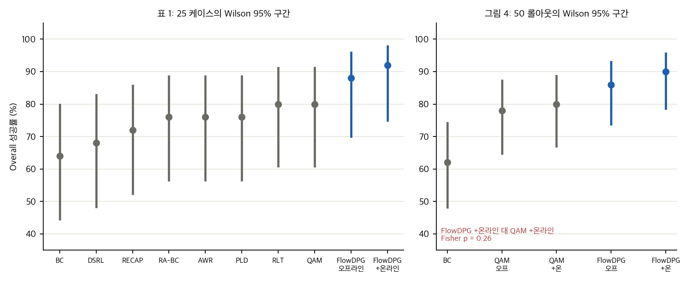
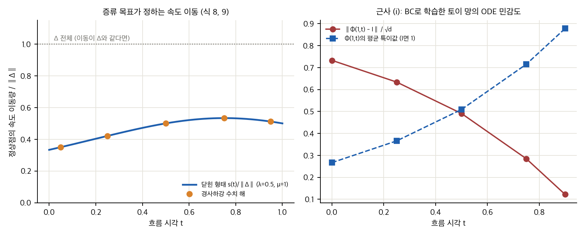
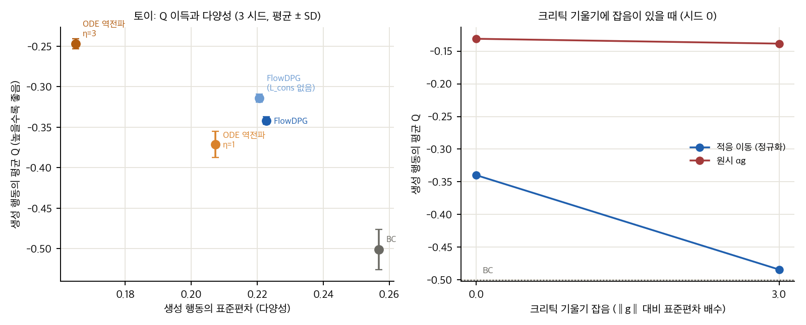

> **논문:** Kexin Shi, Junyao Shi, Poorvi Hebbar, Zhuolun Zhao, Tarun Amarnath, Yifan Su, Shikhar Bahl, Deepak Pathak. *FlowDPG: Deterministic Policy Gradient on Flow Matching Policies for Real-World Manipulation.* CoRL 2026 포스터, arXiv:2606.22303 (v2, 2026-09-30).
> 공식 코드는 없습니다(2026-11-22 확인). 논문 그림은 싣지 않고 우리가 만든 그래프만 씁니다.

## 논문이 묻는 것

흐름 정합(flow matching) 정책에 크리틱 기울기를 쓰려면 노이즈에서 행동까지의 ODE 전체를 따라 역전파해야 합니다. 비용이 단계 수에 비례하고 기울기가 폭주하거나 사라지기 쉽습니다. FlowDPG는 중간 점에서 속도 예측기를 한 번 써서 깨끗한 행동 â를 추정하고, 그 지점의 크리틱 기울기 g로 보정한 목표 a\* = â + α‖u‖·g/‖g‖를 만들어 속도장에 L2로 회귀합니다. 추론은 그대로입니다.

실로봇 두 과제의 결과는 양팔 Franka 에어팟 조립에서 종단 성공 92%(BC 64%, QAM 80%), 양팔 YAM 달걀 요리에서 오프라인 평가 점수 64.2% → 85.8%입니다.

## 표를 다시 계산하면

**BC보다 낫다는 것은 이 규모에서도 보입니다.** 표 1의 23/25 대 16/25는 Fisher p = 0.037입니다. 반복 평가의 45/50 대 31/50은 p = 0.002입니다.

**QAM보다 약 10점 높다는 것은 검정되지 않습니다.** 반복 평가의 90% 대 80%는 각 50 롤아웃에서 p = 0.26이고, 이 차이를 잡을 확률(검정력)은 약 0.2입니다. 80%의 검정력에는 팔당 약 225 롤아웃이 필요합니다. 그림 4의 오차막대는 한 번의 학습 실행에서 얻은 체크포인트 5개 평균의 표준오차라서 학습 시드 변동은 들어 있지 않습니다.

그래프: 보고된 성공률의 Wilson 95% 구간. FlowDPG와 기준선의 구간이 크게 겹칩니다. 우리가 그린 그래프입니다.

**기준선의 단계별 비율은 25 케이스로 만들어지지 않습니다.** 표 1은 재시도를 분모에 넣은 단계별 비율을 보고합니다. 4의 배수가 아닌 셀 중 기준선 38개를 k/n 분수로 맞춰 보면 26개가 n ≤ 75로는 표현되지 않습니다(QAM의 70.58%는 n이 452 이상이어야 합니다). FlowDPG 열 10개는 전부 작은 분수로 표현되고, 그중 4개는 성공 수가 25를 넘어서 한 케이스에서 같은 단계 성공을 여러 번 센 것으로 읽힙니다. 두 열이 같은 방식으로 집계되었는지는 저자 확인이 필요합니다.

**표 1과 그림 4가 네 곳에서 정확히 2점씩 다릅니다**(64/62, 80/78, 88/86, 92/90). 두 평가가 독립 표본이라는 가정에서는 드문 일치이고(거친 가정에서 약 6e-5), 두 평가가 롤아웃을 공유하는지는 저자 확인이 필요합니다.

**크리틱 값의 척도가 맞지 않습니다.** 이전 버전(v1)에 적힌 보상 값으로 에어팟의 반환 상한은 약 14인데 표 3의 Q는 33.6, 그림 7의 V는 30–42입니다. v2는 하이퍼파라미터 표를 삭제해서 값이 다시 척도화되었는지 알 수 없습니다.

## 갱신식이 실제로 하는 일

목표 u\*는 â를 포함하므로 정상점이 단순하지 않습니다. 증류 항, BC 항, 일관성 항(식 9는 (1−t)²로 가중한 BC 항과 같습니다)을 합쳐 정상점을 구하면 속도 이동량이 s(t) = λΔ / (λt + 1 − λ + µ(1−t)²)입니다. 논문의 값(λ = 0.5, µ = 1)에서는 Δ의 33–53%만 속도에 반영됩니다. 수치 해와 소수 다섯째 자리까지 같습니다.

"세 가지 근사로 바닐라 DPG를 회복한다"는 주장의 첫째 근사는 ODE 민감도 Φ(1,t)를 항등행렬로 두는 것입니다. 작은 토이에서 BC로 학습한 흐름의 Φ는 t = 0에서 항등행렬과 상대 편차 0.73이고 평균 특이값이 0.27이었습니다. 그래서 FlowDPG는 정확히는 "Φ를 항등으로 둔 DPG"입니다.

그래프: 왼쪽은 증류 + BC + 일관성 항의 정상점이 정하는 속도 이동(닫힌 형태와 수치 해), 오른쪽은 BC로 학습한 2차원 토이 망에서 Φ(1,t)가 항등행렬에서 떨어진 정도입니다. 우리가 그린 그래프입니다.

## 작은 토이로 본 것

행동 2차원, 해석적 크리틱, 가우시안 데모의 토이에서 FlowDPG와 ODE 역전파 DPG, BC를 비교했습니다(3 시드).

그래프: 왼쪽은 방법별 평균 Q와 생성 행동의 다양성, 오른쪽은 크리틱 기울기에 잡음을 더했을 때 정규화한 이동과 원시 αg의 평균 Q. 우리가 그린 토이이며 논문 과제의 수치를 예측하지 않습니다.

- FlowDPG는 BPTT 없이 Q를 −0.50에서 −0.34로 올렸고, ODE 역전파 DPG의 두 설정 사이에 놓였습니다. 이 규모에서는 ODE 역전파가 불안정하지 않았습니다. 논문이 말한 취약성은 큰 모델에서의 현상이라 이 토이로 시험하지 못합니다.
- 일관성 항을 빼면 Q가 오히려 올랐습니다. BC 가중이 함께 줄기 때문입니다. 논문의 일관성 정규화 절제(92% → 80%)는 이 두 효과를 나누지 못합니다.
- 크리틱 기울기에 잡음이 크면 정규화한 이동의 이득이 +0.16에서 +0.02로 줄었습니다. 원시 αg는 이득이 같지만 생성 행동의 분산이 0.009로 붕괴했습니다.

## 이 맥에서 구현할 수 있는가

**논문 결과의 재현은 불가능합니다.** 양팔 Franka와 YAM 실로봇, 원격 조종 시연, 단계 인식 보상 모델이 필요하고 코드, 데이터, 가중치가 없습니다.

**알고리즘은 구현할 수 있습니다.** 흐름 정책 위에 손실 몇 개를 얹는 일이라 PyTorch로 300–500줄, 3–5일(추정)입니다. 작은 시뮬레이션 과제에서의 축소 검증은 1–2주(추정)로 가능합니다. 행동 머리 규모(176 M 파라미터)는 Apple M4 Pro의 MPS에서 한 스텝 0.67초(배치 64)라서 배치 256, 10,000 스텝이면 하한 약 7.5시간이고, 비전 백본 합동 학습은 24 GiB에서 현실적이지 않습니다.

## 읽을 때 조심할 것

- 논문 안에 BPTT 기준선과 한 단계 정책(FQL류) 비교가 없어서 핵심 동기가 실험으로 검증되지 않았습니다.
- 표 3의 Q 증가는 최적화 대상 크리틱의 점수이고 논문(§4.3)도 독립 증거가 아니라고 적습니다.
- 그림 5d와 6의 표본 수(25로 추정)는 본문에 없습니다.
- 토이는 우리가 만든 모형입니다. 학습된 크리틱의 오류, 시각 입력, 다봉 분포는 들어 있지 않습니다.

## 정리

FlowDPG의 아이디어(한 단계 추정에서 기울기를 구해 L2로 증류)는 간결하고 구현하기 쉽습니다. BC 대비 개선은 이 표본에서도 보입니다. 다만 기준선과의 우위, 절제의 인과 해석, 크리틱 척도, 기준선 수치의 집계 방식은 아직 열려 있습니다. 소표본 실로봇 비교에서는 케이스 단위 기록과 검정력 계산을 같이 보고하는 것이 안전합니다.

## 자료

- [통합 리포트 PDF](report/report_public.pdf)
- [01. 논문 분석: FlowDPG](analysis/01_paper_analysis.md)
- [02. 선행연구와 계보](analysis/02_prior_work.md)
- [03. 수치 재계산, 일관성 검사, 유도와 토이](analysis/03_analysis.md)
- [04. 주장 검증과 구현 가능성](analysis/04_claim_verification.md)
