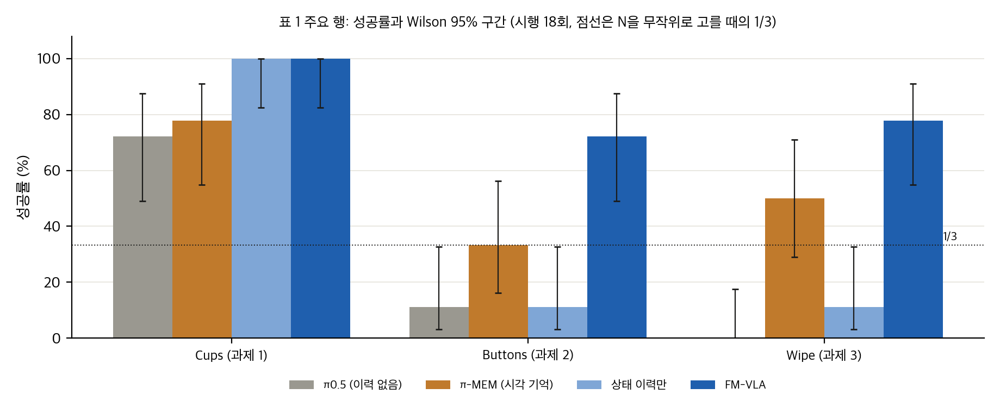
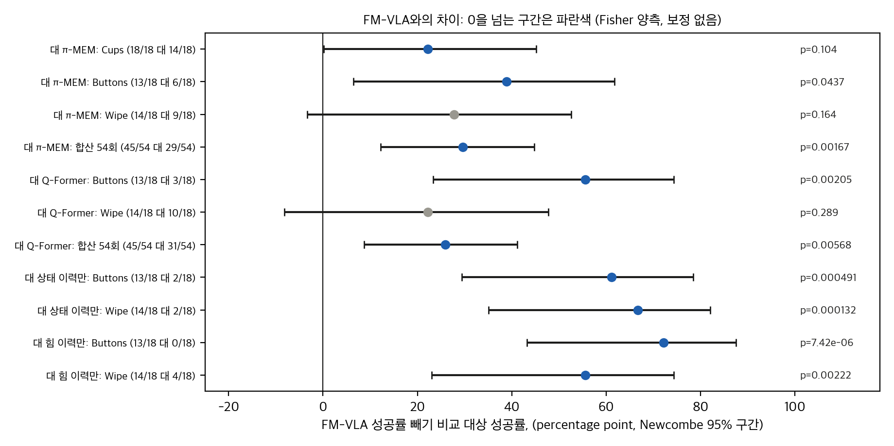
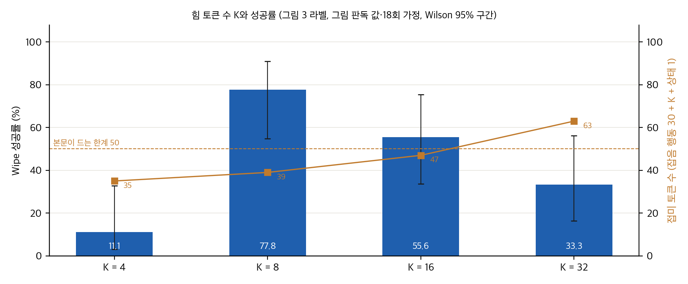

# FM-VLA 수치 재계산과 일관성 검사 (V1–V20, K1–K10)

논문 표 1·2, 그림 3의 값과 부록의 설정을 다시 계산했습니다. 입력과 가정은 `analysis/recompute.py` 머리말에 있고, 결과는 `analysis/recompute_results.json`입니다(numpy, scipy, 수 초). 공식 코드가 없어 계산은 논문에 적힌 값만 씁니다. 아래 "JSON 키"는 그 파일의 키입니다.

## 0. 가정

- 분모는 부록 B.2의 시행 수(과제당 방법마다 18회)이고, 성공 수는 표 1 괄호의 k/18을 그대로 씁니다(시행 수 18 가정이 아니라 논문 기재).
- 여러 과제를 합친 검정(합산 54회)은 시행이 독립이라고 가정합니다. 같은 모델·로봇의 시행이 묶여 있을 수 있어 p값이 낙관적일 수 있습니다.
- 학습 시드 수, 과제별 모델 여부, 평가자와 N의 배치 방식이 논문에 없어 시드 변동은 반영하지 못했습니다.
- 그림 3의 값은 막대 위 라벨(그림 판독 값)이고, 성공 수는 18회 기준으로 역산했습니다. 그림 4의 에피소드 길이는 시간 축에서 읽은 대략 값입니다(그림 판독 값).
- 검정은 Fisher 정확검정(양측), 구간은 Wilson(단일)과 Newcombe(차이)입니다. 다중 비교는 Holm입니다.

## 1. 재계산

| 번호 | 내용 | 결과 | 판정 | JSON 키 |
|---|---|---|---|---|
| V1 | 표 1 퍼센트 = k/18 반올림 | 8개 방법 × 3과제 모두 일치 | 일치 | `V1_V2_table1_arith` |
| V2 | 평균 열 = 합산 성공 수 / 54 | 8개 모두 일치(예: FM-VLA 45/54 = 83.3, π-MEM 29/54 = 53.7). 반올림한 퍼센트의 평균과도 소수 첫째 자리에서 같음 | 일치 | 같은 키 |
| V3 | 보고된 퍼센트가 18회 정수 격자에서 가능한가 | 12개 값 모두 가능하고 각 값에 맞는 k가 하나뿐(예: 33.3 → 6, 55.6 → 10) | 일치 | `V3_percent_integer_feasibility_n18` |
| V4 | FM-VLA 대 각 방법, 과제별 Fisher | 아래 §1.1 | — | `V4_V6_fm_vla_vs_each` |
| V5 | 합산 54회 Fisher | 아래 §1.1 | — | 같은 키 |
| V6 | Holm 보정 | 과제별 21개 검정, 합산 7개 검정 각각 | — | 같은 키 |
| V7 | 검정력과 필요 시행 수 | §1.2 | — | `V7_power` |
| V8 | 기준선끼리 비교 | §1.3 | — | `V8_baselines_among_themselves` |
| V9 | 초록의 "80% 이상" | 45/54 = 83.3%, Wilson 95% 71.3–91.0. 귀무 "참 성공률 ≤ 80%"의 단측 이항 p = 0.34 | 점추정은 맞음, 하한은 80% 아래 | `V9_over80` |
| V10 | 표 2 지연 Δ | 64.0 − 60.7 = 3.3, 99.8 − 60.7 = 39.1, 190.0 − 60.7 = 129.3. 비율 1.054, 1.644, 3.130배 | 일치 | `V10_latency` |
| V11 | 그림 3 대 표 1·2 | K = 8의 77.8%는 표 1 Wipe 14/18과 같고, K = 8의 지연 64.0 ms는 표 2와 같음. 77.8, 55.6, 33.3, 11.1은 18회 격자에서 k = 14, 10, 6, 2 | 일치 | `V11_fig3_token_ablation` |
| V12 | 횟수 세기 과제의 우연 수준(N을 무작위로 고를 때 1/3) | §1.4 | — | `V12_vs_chance_1_of_3` |
| V13 | Cups의 뒤 컵 시행 하한 | §1.4 | — | `V13_cups_lower_bound` |
| V14 | KL 항의 크기 | §1.7 | — | `V14_kl_term_scale` |
| V15 | 토큰 수를 평가 시행으로 고른 효과(시뮬레이션) | §1.5 | — | `V15_selection_on_eval` |
| V16 | π-MEM 기억 구간 대 에피소드 길이 | §1.6 | — | `V16_pimem_memory_span` |
| V17 | 힘 입력 값 수 대 잠재 값 수 | 8초 1440 대 768(1.9배), 10초 1800 대 768(2.3배), 20초 3600 대 768(4.7배). 30 Hz, 6채널 가정 | 참고 | `V17_compression_ratio_30hz` |
| V18 | 학습 예산 | Stage 2는 5만 × 32 = 160만 표본(FM-VLA와 기준선 동일). FM-VLA만 Stage 1에서 10만 × 512 = 5120만 표본을 추가로 씀 | 참고 | `V18_training_budget` |
| V19 | 합성 데이터에서 잠재 공간의 횟수 정보 | §3.1 (소형 toy) | — | `toy_count_probe_results.json` |
| V20 | Force-VAE 크기와 CPU 한 스텝 시간 | §3.2 (측정) | — | `toy_force_vae_cost_results.json` |

### 1.1 FM-VLA 대 각 방법 (V4–V6)

성공 수는 표 1의 k/18입니다. 차이는 percentage point(pp), 구간은 Newcombe 95%, p는 Fisher 양측(보정 없음), Holm은 과제별 21개 검정을 한 묶음으로 본 값입니다.

| 비교 대상 | Cups | Buttons | Wipe | 합산 54회 |
|---|---|---|---|---|
| π-MEM | 18 대 14: +22.2 pp [0.2, 45.2], p = 0.104 (Holm 0.55) | 13 대 6: +38.9 pp [6.4, 61.8], p = 0.044 (Holm 0.35) | 14 대 9: +27.8 pp [−3.3, 52.6], p = 0.164 (Holm 0.66) | 45 대 29: +29.6 pp [12.2, 44.8], p = 0.0017 |
| π0.5 | 18 대 13: +27.8 pp, p = 0.046 (Holm 0.35) | 13 대 2: +61.1 pp, p = 0.0005 (Holm 0.008) | 14 대 0: +77.8 pp, p = 1.6e-6 | 45 대 15: +55.6 pp, p = 7.7e-9 |
| TA-VLA | 18 대 9: +50.0 pp, p = 0.001 | 13 대 2: +61.1 pp, p = 0.0005 | 14 대 1: +72.2 pp, p = 2.0e-5 | 45 대 12: +61.1 pp, p = 1.8e-10 |
| 힘 이력만 | 18 대 10: p = 0.003 | 13 대 0: p = 7.4e-6 | 14 대 4: p = 0.002 | 45 대 14: p = 2.4e-9 |
| 상태 이력만 | 18 대 18: 차이 0, p = 1.0 | 13 대 2: +61.1 pp, p = 0.0005 (Holm 0.008) | 14 대 2: +66.7 pp, p = 0.0001 (Holm 0.002) | 45 대 22: +42.6 pp, p = 8.8e-6 |
| GRU | 18 대 10: p = 0.003 | 13 대 7: +33.3 pp [1.1, 57.4], p = 0.092 | 14 대 1: +72.2 pp, p = 2.0e-5 | 45 대 18: +50.0 pp, p = 2.0e-7 |
| Q-Former | 18 대 18: 차이 0, p = 1.0 | 13 대 3: +55.6 pp, p = 0.002 (Holm 0.025) | 14 대 10: +22.2 pp [−8.2, 47.8], p = 0.289 | 45 대 31: +25.9 pp [8.7, 41.2], p = 0.0057 |

*그림 A. 표 1의 k/18에서 우리가 그린 그래프(Wilson 95% 구간, 점선은 N을 무작위로 고를 때의 1/3).*

*그림 B. FM-VLA와의 성공률 차이와 Newcombe 95% 구간(Fisher 양측 p, 보정 없음).*

읽는 법은 다음과 같습니다.

- **메모리 없는 π0.5, TA-VLA, 단일 모달리티 절제 대비 우위는 큽니다.** 과제별 21개 검정 Holm 후에도 Buttons와 Wipe에서 유의합니다.
- **시각 기억 기준선(π-MEM) 대비는 합산에서만 유의합니다.** 합산 p = 0.0017(합산 7개 검정 Holm 0.0033)이지만 과제별로는 Cups 0.104, Buttons 0.044(Holm 0.35), Wipe 0.164입니다. 과제당 18회라서 π-MEM과의 과제별 차이는 확정하기 어렵습니다. 합산 검정은 시행의 독립과 과제 간 합산이 같은 효과라는 가정이 필요합니다.
- **Cups에서 FM-VLA는 상태 이력만, Q-Former와 같습니다**(모두 18/18). 본문의 "모든 기준선을 일관되게 앞선다"는 이 두 행에서 동점입니다(K9).

### 1.2 검정력과 필요 시행 수 (V7)

| 비교 | 정규 근사 80% 검정력 필요 시행 수(팔당) | n = 18, 관측 비율을 참값으로 둔 Fisher 검정력(시뮬레이션) |
|---|---|---|
| Buttons 72.2% 대 π-MEM 33.3% | 25 | 0.58 |
| Wipe 77.8% 대 50.0% | 46 | 0.30 |
| Cups 약 100%(0.99로 제한) 대 77.8% | 35 | 0.24 |
| 합산 83.3% 대 53.7% | 38 | — |

관측된 차이가 참값이라 해도 n = 18에서는 Buttons를 구분할 확률이 0.58, Wipe는 0.30입니다. 이 수치는 "차이가 없다"가 아니라 "이 시행 수로는 단정하기 어렵다"는 뜻입니다.

### 1.3 기준선끼리 (V8)

- π-MEM 대 π0.5: Cups 14 대 13(p = 1.0), Buttons 6 대 2(p = 0.23), Wipe 9 대 0(p = 0.001), 합산 29 대 15(p = 0.011). 시각 기억은 Wipe에서 분명히 돕고, Buttons는 방향만 같습니다. 본문의 "Buttons에서 시각 기억은 충분하지 않다"는 서술과 방향은 같지만 π-MEM 대 π0.5의 Buttons 차이(6/18 대 2/18)는 유의하지 않습니다.
- 힘 이력만 대 π0.5: 합산 14 대 15(p = 1.0). 힘 기억만으로는 기준선 대비 이득이 없습니다. 상태 이력만 대 π0.5: 합산 22 대 15(p = 0.22), Cups만 18 대 13(p = 0.046).

### 1.4 Buttons·Wipe 우연 수준, Cups 하한, 결합 효과 (V12, V13)

- **횟수 세기의 우연 수준:** Buttons와 Wipe에서 N ∈ {1, 2, 3}을 무작위로 고르는 정책의 성공 확률을 1/3로 두고 양측 이항검정을 하면, π-MEM의 Buttons 6/18은 p = 1.0(1/3과 구분되지 않음), Wipe 9/18은 p = 0.14입니다. FM-VLA는 Buttons 0.002, Wipe 1.4e-4입니다. 이 1/3은 지침을 무시하고 N을 무작위로 정해 정확히 수행하는 이상적 정책의 기준일 뿐이고, 실제 실패에는 접촉 실패와 정지 실패도 있어 참고 값입니다. π0.5의 Buttons 2/18(0.047)과 Wipe 0/18은 1/3보다 낮습니다.
- **Cups의 하한:** 앞 컵에 블록이 있는 시행은 9회입니다(부록 B.2). 기억 없는 π0.5가 13/18 성공이면 뒤 컵 시행(9회)에서 최소 4회 성공한 것입니다(13 − 9). π-MEM(14/18)은 최소 5회, 상태 이력만(18/18)은 9회 모두입니다. 과제 설명(§4.1)은 뒤 컵 시행에서 "이미 확인한 컵을 기억해야 한다"고 하는데, 이력이 없는 정책도 뒤 컵 시행에서 성공한 사례가 있다는 뜻입니다(앞 컵 시행 중 일부 실패를 고려하면 하한은 더 올라갑니다).
- **결합 효과:** Buttons에서 π0.5 2/18, 힘만 0/18, 상태만 2/18이 결합하면 13/18입니다. Wipe는 0/18, 4/18, 2/18에서 14/18입니다. 각각의 절제가 기준선과 구분되지 않는데(V8) 결합 후 크게 오르는 형태입니다. 본문은 상태 토큰이 접촉 전 동작을 안정시킨다고 설명합니다(§4.3). 이 설명을 직접 재는 지표(접촉 전 구간의 동작 지표 등)는 논문에 없습니다.

### 1.5 토큰 수 K와 선택 효과 (V11, V15)

| K | 성공(그림 3) | k/18 | 접미 토큰 수(30 + K + 1) |
|---|---|---|---|
| 4 | 11.1% | 2 | 35 |
| 8 | 77.8% | 14 | 39 |
| 16 | 55.6% | 10 | 47 |
| 32 | 33.3% | 6 | 63 |

*그림 C. 그림 3의 막대 라벨(그림 판독 값, 18회 가정)에 Wilson 구간과 접미 토큰 수를 겹쳐 그린 그래프.*

- 쌍별 Fisher: 8 대 4 p = 1.3e-4, 8 대 32 p = 0.018, 8 대 16 p = 0.29, 16 대 32 p = 0.32. 8과 16의 차이(14/18 대 10/18)는 이 시행 수로 구분되지 않습니다.
- **50 토큰 설명과 K = 16:** 본문은 16과 32의 하락을 "사전학습 행동 전문가가 최대 50 토큰을 보므로 32개의 추가 토큰이 그 한계를 넘는다"로 설명합니다(§4.3). 잡음 행동 30 + 힘 토큰 K + 상태 토큰 1로 세면 K = 16은 47 토큰으로 50 이하입니다. 이 설명은 K = 32(63 토큰)에는 맞지만 K = 16(47 토큰)의 하락을 설명하지 못합니다(K2).
- **선택 효과:** K를 정하는 데 쓴 평가가 최종 보고와 같은 18회라면, K = 8, 16, 32의 참 성공률이 같더라도(공통 p = 30/54 = 0.556) 세 값 중 최고는 평균 약 65%가 되고 14/18 이상이 나올 확률은 0.13입니다(시뮬레이션 20만 회). 14/18은 그 귀무에서 드문 값은 아니므로 "8이 최적"을 이 데이터로 정하기는 어렵습니다. 별도의 검증 시행으로 K를 고른 것이 아니라면 보고된 K = 8의 값은 낙관적일 수 있습니다(논문에 선택 절차 설명이 없어 가능성으로만 적습니다).

### 1.6 π-MEM의 기억 구간 (V16)

부록 D에서 π-MEM은 카메라당 K = 5프레임, 보폭 45프레임(30 Hz에서 1.5 s)입니다. 보는 구간은 (5 − 1) × 1.5 = 6.0 s입니다(K = 16이면 22.5 s). 그림 4의 시간 축(그림 판독 값)은 Cups 약 20 s, Buttons 약 8 s, Wipe 약 10 s입니다. FM-VLA의 힘 기억은 에피소드 처음부터 현재까지입니다. 성공률은 π-MEM K = 5만 보고하고 K = 16은 지연만 보고합니다(표 2). 따라서 시각 기억 대비 우위에는 "기억 방식"과 "기억 구간 길이"가 함께 들어 있습니다.

### 1.7 KL 항의 크기 (V14)

식 4의 KL 항은 β · 평균 max(D_KL, λ)이고 β = 1e-3, λ = 0.5 nats입니다(표 3). 차원당 KL이 0.5 nats보다 작으면 그 차원의 KL 기울기는 꺼지고, 그 이상이어도 계수가 1e-3입니다. 가우시안 사후에서 µ = 1, σ = 0.1이면 차원당 KL은 2.3 nats이고 항의 기여는 약 0.0023입니다. σ = 0.01이면 4.6 nats, 기여 약 0.0046입니다. 모든 차원이 λ 아래면 이 항의 값은 5e-4로 고정됩니다. 재구성 항의 실제 크기는 원자료가 없어 알 수 없지만, 이 계수에서는 사후 분산을 줄이는 방향의 압력이 작게 보입니다. 같은 관찰이 소형 합성 실험(§3.1)에서도 나왔습니다(논문 설정과 KL 없음의 차이가 작음). 프로젝트 페이지는 "KL 병목이 잡음을 거른다"고 설명하는데, 이 설정에서 병목의 역할은 KL보다 토큰 수(8개)와 차원(96)이 맡는 것으로 보입니다(가능성).

## 2. 일관성 검사 (K1–K10)

| 번호 | 위치 | 관찰 | 비고 |
|---|---|---|---|
| K1 | §3.2.1, 부록 E.1, 표 3 | 사전 패딩 최대 길이를 본문은 "10 s"로, 부록은 "1000 프레임(약 10 s)"과 "30 Hz"로 적음. 30 Hz에서 1000 프레임은 33.3 s이고 100 Hz에서 10 s | 센서 원 주파수(100 Hz)로 센 길이일 가능성. 저자 확인 필요 |
| K2 | §4.3 | 토큰 한계 50은 K = 32(63)에만 해당하고 K = 16(47)은 50 이하 | §1.5 |
| K3 | §4.3, 부록 E.4, 표 1 | "상태만" 절제를 본문은 "관절 상태만", 부록 E.4는 "같은 Perceiver-IO 구조로 긴 상태 이력을 인코딩하고 10만 스텝 학습"으로 적음. 표 1에는 "Modality ablation (VAE)" 아래에 있음 | 짧은 창 상태인지 긴 이력인지 불분명 |
| K4 | 표 4, 부록 E.4 | 표 4는 "FM-VLA와 모든 기준선에서 동일(5만 스텝)", E.4는 "모든 절제가 5만 스텝"인데, 같은 절에서 상태만은 10만 스텝 | 상태만의 스텝 수 예외 |
| K5 | 부록 D, E.4 | 부록 D는 "감쇠 단계 없음(no decay phase)"의 학습률, E.4는 "같은 WSD 스케줄" | 감쇠 길이가 0인 WSD로 읽을 수 있음 |
| K6 | §3.2.2, 부록 E.1 | 상태 창을 본문은 "마지막 1초", 부록은 0.9 s(27/30)로 적음 | 근사 표현으로 읽힘 |
| K7 | §3.1, 부록 E.1 | d_s = 16(7 × 2 + 1 × 2)과 d_f = 6, 잠재 96차원, 토큰 8개 | 일치 |
| K8 | §4.1, 부록 E.1 | 두 손목에 센서가 있으나 오른손목 wrench만 사용. 세 과제 모두 힘이 중요한 동작을 오른손이 함 | 왼손목은 사용하지 않음 |
| K9 | §4.2 | "모든 기준선을 일관되게 앞선다"는 Cups에서 상태만과 Q-Former가 18/18로 같음 | 동점 |
| K10 | 참고문헌 [9] | 저자 표기가 "P. K. Diederik and W. Max"로 이름과 성 순서가 뒤바뀐 것으로 보임(Kingma and Welling) | 서지 표기 |

## 3. 작은 계산 실험 (이 맥, CPU)

### 3.1 V19: 재구성으로 학습한 8토큰 잠재에 횟수가 남는가

`analysis/toy_count_probe.py`. 합성 힘 한 채널(30 Hz, 창 240프레임, 펄스 1–3개, 앞쪽은 무작위 길이의 저진폭 잡음 패딩)로 소형 Perceiver 구조 VAE(K = 8, 토큰당 16차원, 너비 48)를 1500 스텝(배치 32) 재구성만으로 학습하고 동결한 뒤, 평균 µ(128차원)에 선형 분류기를 붙여 펄스 수를 맞힙니다. 시드 1개, 테스트 1000개입니다(약 2분).

| KL 설정 | 선형 프로브 정확도 | 최종 재구성 MSE | 평균 KL(nats/차원) |
|---|---|---|---|
| 논문 설정(β = 1e-3, free-bits 0.5) | 0.839 | 0.0082 | 1.57 |
| KL 없음(β = 0) | 0.848 | 0.0086 | 5.41 |
| 강한 KL(β = 0.1, free-bits 0) | 0.740 | 0.0466 | 0.07 |
| 대조: 무작위 초기화 인코더 | 0.742 | — | — |
| 대조: 원신호 구간 요약 특징 | 0.863 | — | — |

- 논문 설정과 KL 없음 설정은 비슷하고(0.839, 0.848), 강한 KL은 무작위 초기화와 같은 수준으로 떨어집니다(사후 붕괴 쪽). 이 toy에서 β = 1e-3, λ = 0.5는 사실상 약한 정규화입니다.
- 재구성 사전학습의 이득은 약 10 pp입니다(0.839 대 0.742). 원신호를 구간별로 요약한 단순 특징(0.863)이 학습한 잠재보다 낮지 않습니다.
- 한계: 합성 데이터, 한 채널, 시드 1개, 1500 스텝입니다. 정책 학습과 무관하고 논문 실험의 대체가 아닙니다. 확인한 것은 "작은 규모에서 재구성 잠재가 횟수를 부분적으로 담는다"뿐이고, 논문 주장(힘 크기·시작 시점·횟수를 담는다, §4.3)을 검증하는 것은 아닙니다.

### 3.2 V20: Force-VAE 크기와 CPU 비용

`analysis/toy_force_vae_cost.py`. 부록 E.1·표 3의 값으로 Perceiver-IO 인코더·디코더를 가정해 만들었습니다(피드포워드 비율 4, 입력·질의 MLP 두 층은 가정). 파라미터 수는 약 22.4M입니다. CPU 4스레드에서 순전파와 역전파 한 스텝 시간은 표본당 11.4 ms(T = 300) – 16.3 ms(T = 600)입니다(3스텝 평균, 거친 값). 논문 Stage 1(10만 스텝, 배치 512)을 이 맥 CPU에서 그대로 돌리면 약 160–230시간입니다. 배치와 스텝을 줄이면 하루 안에 끝낼 수 있는 규모가 됩니다(예: 10만 스텝 × 배치 32는 약 10–15시간으로 추정).

## 4. 해석

- **산술은 일치합니다.** 표 1의 비율, 평균, 정수 격자, 표 2의 Δ, 그림 3과 표 1·2의 교차 값이 모두 맞습니다(V1–V3, V10, V11).
- **가장 선명한 증거는 "상태만 대비 결합"입니다.** Buttons 13 대 2(p = 0.0005), Wipe 14 대 2(p = 0.0001, Holm 후 0.002)입니다. 힘 이력이 결합에서만 효과를 낸다는 점(V8, §1.4)은 해석에서 구분해 둘 필요가 있습니다.
- **시각 기억과의 비교는 과제별로는 확정하기 어렵습니다.** 합산에서는 유의하고(p = 0.0017), 기억 구간(6 s 대 에피소드 전체)이 같지 않은 비교입니다(§1.6).
- **Cups는 힘 기억을 검증하는 과제로는 약합니다.** 이력이 없는 정책도 성공했고(최소 4회), 상태만으로 18/18입니다(§1.4).
- **VAE 구조의 우위는 요인이 겹친 비교입니다**(`04` C5). Wipe에서 Q-Former 대비는 14 대 10, p = 0.29입니다.
- **K = 8의 선택과 50 토큰 설명은 데이터로 뒷받침이 약합니다**(§1.5).
- **시행 수가 작아 p값이 불안정합니다.** 80% 검정력으로 π-MEM과 Wipe를 구분하려면 팔당 약 46회가 필요합니다(§1.2).
