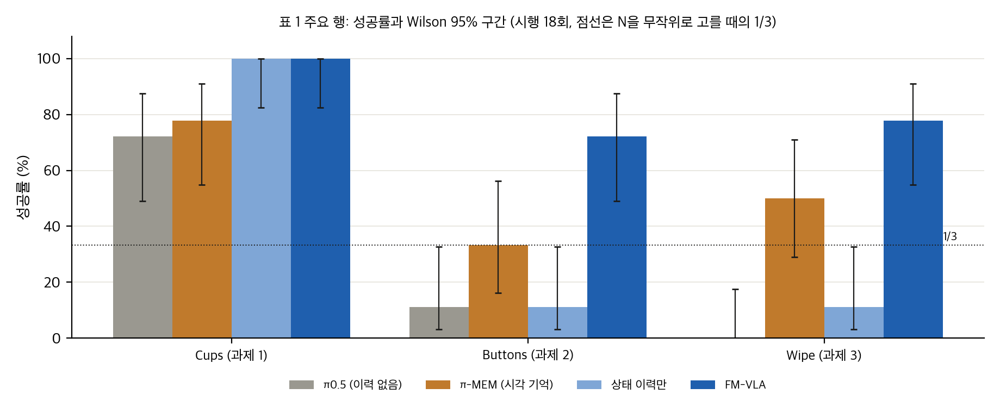
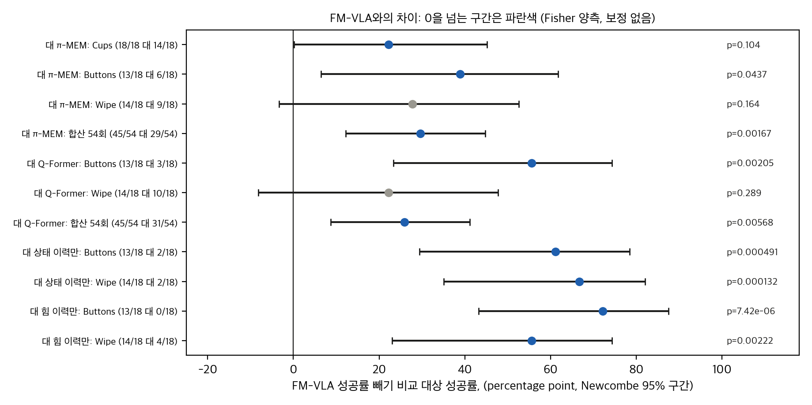
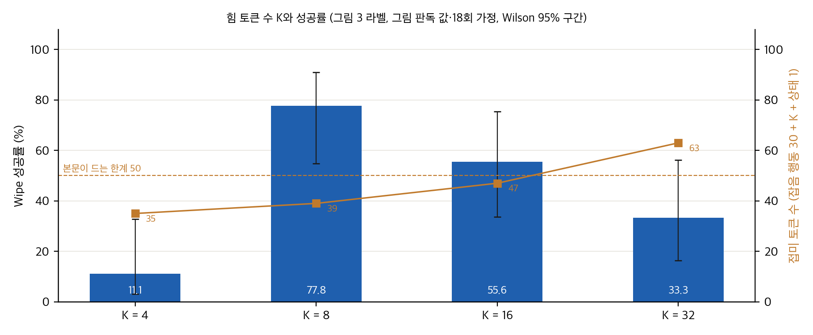

> **논문:** Ruicheng Li, Qixiu Li 외 9인. *FM-VLA: Force-based Memory for Vision-Language-Action Models in Contact-Rich Manipulation.* CoRL 2026 포스터, arXiv:2607.18231 (v1, 2026-07-20).
> 공식 GitHub 저장소는 있지만 2026-11-24 기준 README와 데모 영상만 있고 코드 파일은 없습니다. 이 글의 그림 세 장은 모두 표의 값으로 우리가 다시 그린 그래프입니다(논문 그림은 arXiv 라이선스상 싣지 않았습니다).

## 논문이 묻는 것

버튼을 세 번 눌러야 하는 과제를 생각해 보면, 누를 때마다 화면은 거의 변하지 않습니다. 지금까지 몇 번 눌렀는지는 카메라보다 손목 힘 센서에 더 분명히 남습니다. FM-VLA는 에피소드 처음부터 현재까지의 손목 wrench(힘과 토크) 이력을 8개의 토큰으로 압축해 VLA의 행동 전문가에 기억으로 붙입니다. 시각 기억 방식(과거 프레임을 입력)과 달리 추론 지연이 거의 늘지 않는다는 것이 장점으로 제시됩니다(+3.3 ms 대 +39.1 ms).

## 방법에서 기억할 세 가지

**첫째, 힘 이력은 재구성으로 먼저 학습한 VAE로 압축합니다.** Perceiver-IO 구조의 인코더가 100 Hz 센서를 30 Hz로 낮춘 이력(EMA 평활, 무작위 길이의 잡음 사전 패딩)을 8개 잠재 토큰으로 줄입니다. 학습이 끝나면 인코더를 동결하고 평균만 씁니다.

**둘째, 짧은 관절 상태 창(약 0.9 s)을 토큰 하나로 더합니다.** 힘 이력만으로는 접촉 전 동작이 불안정해진다고 설명합니다.

**셋째, 토큰은 행동 전문가의 접미에 붙입니다.** `[잡음 행동 30][힘 토큰 8][상태 토큰 1]` 순서이며, 사전학습된 잡음 행동 토큰의 위치를 그대로 둡니다.

## 결과를 다시 계산하면

양팔 로봇(AgiBot G1)에서 세 과제를 방법마다 18회씩 평가합니다. 컵 두 개 아래의 블록 찾기(Cups), 버튼 N번 누르기(Buttons), 그릇 N번 닦기(Wipe)입니다. 표 1의 괄호 안 성공 수(k/18)로 모든 비율과 평균(합산 성공 수 / 54)을 다시 계산했고 전부 일치했습니다. FM-VLA의 합산은 45/54 = 83.3%이고 Wilson 95% 구간은 71.3–91.0%입니다. 초록의 "80% 이상"은 점추정입니다.

*그림 1. 표 1의 k/18로 우리가 그린 그래프. 점선은 N ∈ {1, 2, 3}을 무작위로 고를 때의 1/3입니다.*

**메모리 없는 기준선과 단일 모달리티 절제 대비 우위는 큽니다.** π0.5 대비 Buttons 13/18 대 2/18(Fisher p = 0.0005), Wipe 14/18 대 0/18입니다.

**시각 기억 기준선(π-MEM) 대비는 합산에서 유의하고 과제별로는 확정하기 어렵습니다.** 합산 45/54 대 29/54는 p = 0.0017입니다. 과제별로는 Cups 0.104, Buttons 0.044(과제별 21개 검정 Holm 보정 후 0.35), Wipe 0.164입니다. 관측된 차이가 참값이라고 해도 n = 18에서 Buttons를 구분할 확률은 0.58, Wipe는 0.30(시뮬레이션)이어서, 80% 검정력으로 Wipe를 구분하려면 팔당 약 46회가 필요합니다.

*그림 2. FM-VLA와의 성공률 차이와 Newcombe 95% 구간(Fisher 양측 p, 보정 없음). 구간이 0을 넘는 행은 파란색입니다. 합산 행은 시행이 독립이라는 가정이 필요합니다.*

## 해석할 때 눈여겨볼 점

**결합에서만 효과가 크게 나타납니다.** Buttons에서 π0.5는 2/18, 힘 이력만은 0/18, 상태 이력만은 2/18이고, 둘을 결합하면 13/18입니다. 상태 이력만 대비 차이(Buttons 13 대 2, Wipe 14 대 2)는 이 논문에서 가장 분명한 증거입니다. 다만 힘 기억이 단독으로 기여한다기보다 힘 토큰과 상태 토큰의 결합이 필요하다는 읽기가 자연스럽고, 논문은 상태 토큰이 접촉 전 동작을 안정시킨다고 설명하지만 이를 재는 지표는 없습니다.

**Cups는 힘 기억을 가려 주는 과제로는 약합니다.** 상태 이력만과 Q-Former가 18/18이고, 이력이 없는 π0.5도 13/18입니다. 블록이 앞 컵 아래에 있는 시행이 9회이므로 13/18은 뒤 컵 시행에서 최소 4회 성공한 결과입니다.

**VAE 구조의 우위는 요인이 겹친 비교입니다.** GRU와 Q-Former는 구조, 사전학습 여부, 동결 여부, KL 정규화가 함께 다릅니다. 같은 Perceiver 구조를 end-to-end로 학습한 대조는 없습니다. Wipe에서 Q-Former 대비는 14/18 대 10/18, p = 0.29입니다. GRU의 기울기 소실, Q-Former의 과적합 같은 설명도 직접 측정한 결과는 없습니다.

**시각 기억 기준선의 기억 구간이 다릅니다.** π-MEM(K = 5, 간격 1.5 s)은 최근 6 s를 봅니다. FM-VLA의 힘 기억은 에피소드 전체이고, 그림 4의 시간 축(그림 판독 값)은 Cups 약 20 s, Buttons 약 8 s, Wipe 약 10 s입니다. 성공률은 K = 5만 보고하고 K = 16(지연 190 ms)은 지연만 보고합니다. 비교에는 기억 방식과 기억 구간 길이가 함께 들어 있습니다.

## 토큰 수 절제

*그림 3. 그림 3의 막대 라벨(그림 판독 값, 18회 가정)에 Wilson 95% 구간과 접미 토큰 수를 겹쳐 그린 그래프.*

Wipe에서 토큰 수 4, 8, 16, 32의 성공률은 11.1, 77.8, 55.6, 33.3%이고 8을 고릅니다. 본문은 16과 32의 하락을 "사전학습 행동 전문가가 최대 50 토큰을 본다"는 분포 이동으로 설명합니다. 잡음 행동 30 + 힘 토큰 K + 상태 1로 세면 접미 토큰은 35, 39, 47, 63이어서, 이 설명은 K = 32에는 맞지만 K = 16(47)에는 맞지 않습니다. 8 대 16(14/18 대 10/18)은 p = 0.29입니다. K를 평가에 쓴 시행으로 골랐다면 최고값이 낙관적일 수 있습니다(선택 절차는 논문에 없습니다).

## 문서 안의 표기 차이

- 사전 패딩 최대 길이를 본문은 "10 s"로, 부록은 "1000 프레임(약 10 s)"과 "30 Hz"로 적습니다. 30 Hz에서 1000 프레임은 약 33 s이고 100 Hz에서 10 s입니다. 센서 원 주파수로 센 길이일 가능성이 있어 저자 확인이 필요합니다.
- "상태 이력만" 절제는 본문에서 관절 상태만으로, 부록 E.4에서는 같은 Perceiver-IO로 긴 상태 이력을 인코딩하고 10만 스텝 학습한 것으로 적혀 있습니다.

## 작은 계산 실험

재구성으로만 학습한 소형 8토큰 VAE의 잠재에 접촉 횟수가 남는지 합성 신호로 봤습니다(1500 스텝, 시드 1개). 선형 프로브 정확도는 논문 설정(β = 1e-3, free-bits 0.5) 0.839, KL 없음 0.848, 강한 KL(β = 0.1) 0.740, 무작위 초기화 인코더 0.742, 원신호 구간 요약 특징 0.863이었습니다. 합성 데이터와 작은 규모에서의 관찰이며 논문 실험의 대체는 아닙니다. 논문 설정의 KL 항은 계수가 작아 KL을 없앤 설정과 이 규모에서 거의 같았습니다.

또한 부록 값으로 Force-VAE(약 22M 파라미터, 구조 일부는 가정)를 만들어 CPU 4스레드에서 한 스텝 시간을 쟀더니 표본당 11–16 ms였고, 논문 Stage 1(10만 스텝, 배치 512)을 그대로 돌리면 약 160–230시간으로 추정됩니다.

## 정리

표 1의 산술과 표 2의 지연 증가분은 모두 맞습니다. 힘 토큰과 상태 토큰의 결합이 메모리 없는 기준선과 단일 모달리티 절제를 크게 앞서는 결과는 분명합니다. 시각 기억 기준선 대비 과제별 차이, VAE와 다른 인코더의 차이, 토큰 수 8의 선택은 과제당 18회의 시행 수로는 확정하기 어렵고, 설명 일부는 직접 측정이 없습니다. 코드가 공개되면 사전 패딩의 단위와 평가 설정을 먼저 확인할 만합니다.

## 자료

- [통합 리포트 PDF](report/report_public.pdf)
- [FM-VLA: 힘 기반 기억을 가진 VLA (arXiv:2607.18231) 논문 분석](analysis/01_paper_analysis.md)
- [FM-VLA 선행연구, 구성 요소 출처, 공식 저장소](analysis/02_prior_work.md)
- [FM-VLA 수치 재계산과 일관성 검사 (V1–V20, K1–K10)](analysis/03_analysis.md)
- [FM-VLA 주장 검증 (공식 코드 파일이 없어 논문 내부 대조)](analysis/04_claim_verification.md)
