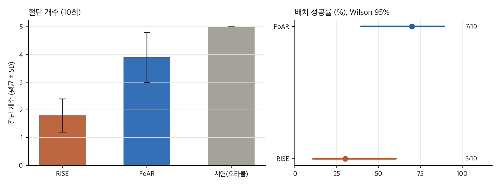
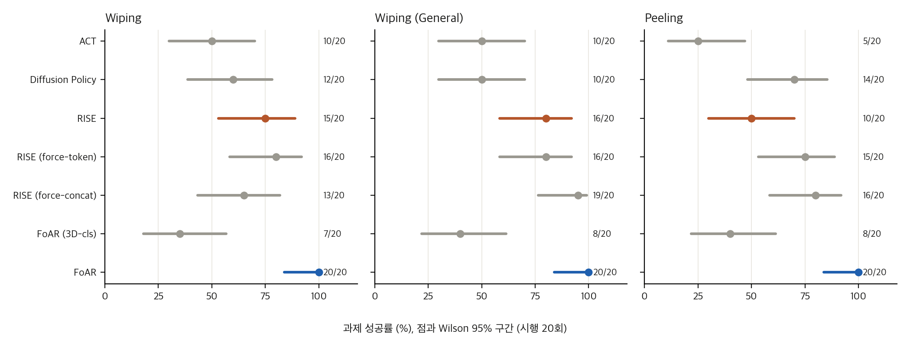
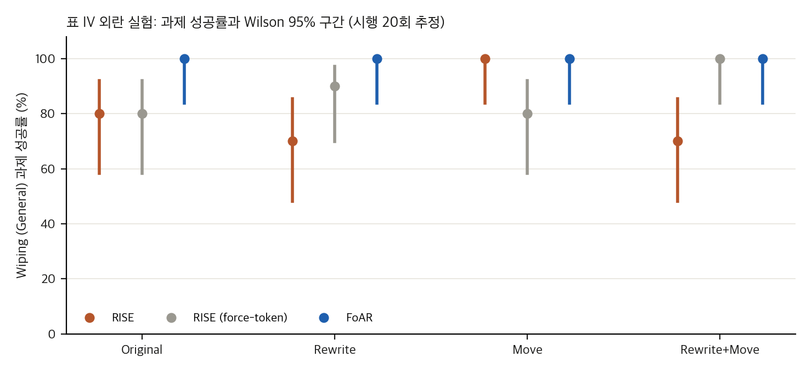

> **논문:** Zihao He, Hongjie Fang, Jingjing Chen, Hao-Shu Fang, Cewu Lu. *FoAR: Force-Aware Reactive Policy for Contact-Rich Robotic Manipulation.* IEEE Robotics and Automation Letters, 2025. arXiv:2411.15753 (v2, 2025-05-02).
> 공식 코드(Alan-Heoooh/FoAR, LICENSE 파일 없음)는 정적으로만 읽었고 실행하지 않았습니다. 논문은 CC BY-NC-SA 4.0이라 논문 그림은 싣지 않았고, 우리가 만든 그래프만 씁니다.

## 논문이 묻는 것

접촉이 많은 조작에서 시각 정책은 접촉 전후를 잘 구분하지 못합니다. 닦기 전에 지우개가 화이트보드 위에 있는지, 닦는 중에 힘이 실리는지는 카메라만으로 보기 어렵습니다. 힘·토크 센서를 넣으면 이 정보가 생기지만, 접촉이 없는 구간에서는 센서 잡음이 오히려 정책을 흔듭니다.

FoAR는 RISE 정책에 힘 입력을 붙이고, **미래 접촉 확률 ϕ**로 힘 특징의 비중을 정합니다. ϕ가 높으면 힘 특징을 그대로 쓰고, 낮으면 학습된 중립 임베딩으로 바꿉니다. 실행 단계에서는 ϕ와 현재 힘으로 행동 청크를 조금씩 보정합니다. 제어 명령은 위치 명령입니다.

## 이 글에서 확인한 것

**재계산은 대체로 맞습니다.** 표 I, III, IV의 닦기 점수는 시행 20회의 0.025 격자에 맞고, 썰기는 10회의 10% 격자에 맞습니다. 본문 수치 0.875, 0.850, 0.756은 표 I과 일치합니다.

**기준선과의 차이는 보정 후 갈립니다.** 닦기 점수 FoAR 0.875는 ACT 0.275, DP 0.400에 대해 Holm 보정 후에도 유의합니다. 같은 과제에서 RISE 0.500, RISE (force-token) 0.575, RISE (force-concat) 0.475 대비는 보정 후 유의하지 않습니다. 최소 p_Holm은 0.064입니다. 검정은 개별 시행이 없어 평균과 상한 분산을 쓴 보수적 Welch 검정입니다.

**본문 주장 하나는 표와 반대입니다.** 논문은 RISE (force-token)이 복합 외란에서 성능이 떨어진다고 씁니다. 표 IV에서는 원래 조건 0.600, 재작성과 이동 0.600이고, 성공률은 90/80에서 100/100으로 올라갑니다.

**썰기 결과는 수치가 큽니다.** 조각 수 3.9 대 1.8은 2.17배입니다. 보고된 ±를 SD로 가정하면 p < 0.001입니다. 다만 10회입니다.

그래프: 썰기 10회의 절단 개수(평균 ± SD)와 배치 성공률(Wilson 95%)입니다. SD가 SE인지 논문이 밝히지 않아 SD로 가정했습니다. 우리가 그린 그래프입니다.

그래프: 표 I의 세 과제 성공률을 시행 20회 기준 Wilson 95% 구간으로 그렸습니다. 우리가 그린 그래프이며 개수는 논문 표에서 옮겼습니다.

## 공식 코드에서 본 것

공식 코드는 논문의 주요 구조를 대부분 따릅니다. 점군 인코더, 힘 Transformer, 예측기, 융합 식, 확산 헤드, 반응 제어의 임계값(0.9, 8 N, 5 N·m, 0.006 m)이 맞습니다. 다른 점은 다음과 같습니다.

- **손실 가중치.** 논문은 α = 0.1이라고 씁니다. 학습 코드의 기본값은 10.0이고, 공식 학습 스크립트는 값을 바꾸지 않습니다.
- **접촉 라벨 창.** 논문은 [t−2 s, t+2 s]입니다. 공식 스크립트의 미래 창은 3 s라서 접촉 직전 3초부터 양성이 됩니다.
- **제어 명령.** 논문은 컴플라이언스 없는 위치 제어라고 씁니다. 코드는 Flexiv의 Cartesian motion-force 계열 모드로 명령을 보냅니다. 이 모드의 강성과 최대 접촉 힘은 저장소에 없습니다.
- **평가 스크립트.** 기본 명령 중 `--max_steps` 인자가 파서에 없어 실행이 실패할 것으로 보입니다(정적 판독).

## 이 맥에서 구현할 수 있는가

**논문 결과의 재현은 불가능합니다.**

- 실로봇 평가(Flexiv 팔, 힘 센서, 그리퍼, 카메라)는 저장소 밖 장비가 필요합니다.
- 공식 학습은 NCCL과 CUDA를 전제하고, 체크포인트는 공개되어 있지 않습니다.
- MinkowskiEngine은 CUDA 빌드를 권장합니다.

**구조의 PyTorch 재구현과 반응 제어 로직의 검사는 가능합니다.** 점군 인코더만 대체하면 되고, 노력은 1–2주로 추정합니다. 측정은 하지 않았습니다.

## 읽을 때 조심할 것

- 과제당 20회 시행이고 개별 점수가 없습니다. 20회로는 점수 차이 약 0.3 이하를 80% 검출력으로 구분할 수 없습니다.
- 표 V(껍질, MLP 인코더 변형)의 FoAR 값 0.588은 표 I의 0.756과 다릅니다. 두 판본 모두 그렇습니다.
- 표 III의 "반응 제어 유무" 차이 0.225는 p ≈ 0.10입니다. 예측기와 반응 제어가 함께 쓰이는 효과는 이 표로 판단할 수 없습니다.
- 공식 저장소에는 기준선(ACT, DP, RISE) 코드, 썰기와 외란 실험 코드, 체크포인트가 없습니다.

그래프: 표 IV의 외란 네 조건에서 세 방법의 과제 성공률입니다. 논문은 시행 수를 밝히지 않아 20회로 가정했습니다. RISE (force-token)의 재작성과 이동 조합이 원래보다 높게 나온 점을 볼 수 있습니다. 우리가 그린 그래프입니다.

## 정리

접촉 확률로 힘의 비중을 정하는 아이디어는 쓸 만합니다. 힘 잡음이 비접촉 구간에서 정책을 흔든다는 문제 제기도 설득력이 있습니다. 다만 수치를 그대로 믿기 어렵습니다. 공식 설정과 논문 설정이 다르고, 통계는 작은 표본에 기대고, 본문 주장 하나는 표와 맞지 않습니다. 아이디어는 가져가고, 수치는 우리 실험으로 다시 보는 편이 안전합니다.

## 자료

- [통합 리포트 PDF](report/report_public.pdf)
- [01. 논문 분석: FoAR (arXiv:2411.15753)](analysis/01_paper_analysis.md)
- [02. 선행연구, 구성 요소의 출처, 공식 저장소](analysis/02_prior_work.md)
- [03. 수치 재계산, 일관성 검사, 주장 판정](analysis/03_analysis.md)
- [04. 논문 ↔ 공식 코드 정적 대조와 구현 가능성](analysis/04_code_verification.md)
