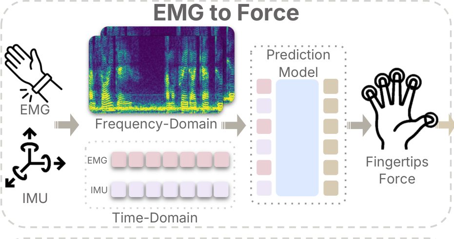
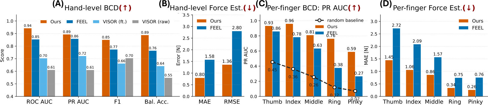
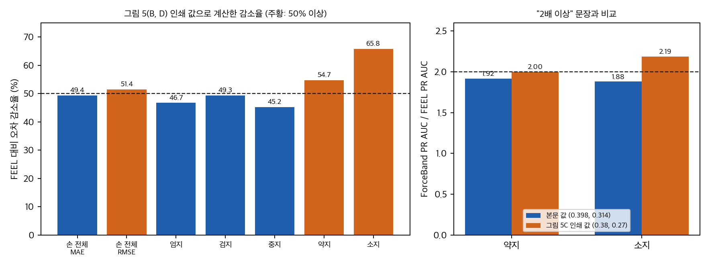
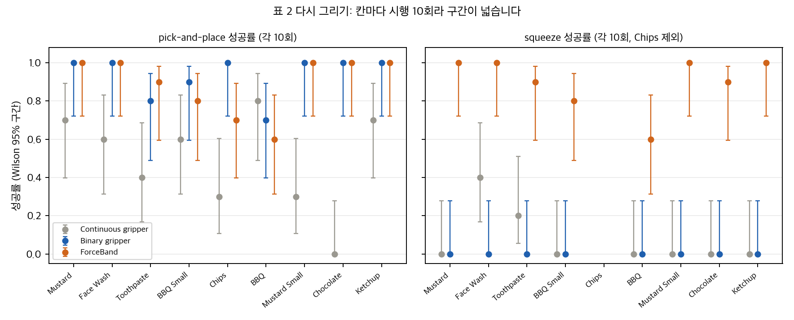
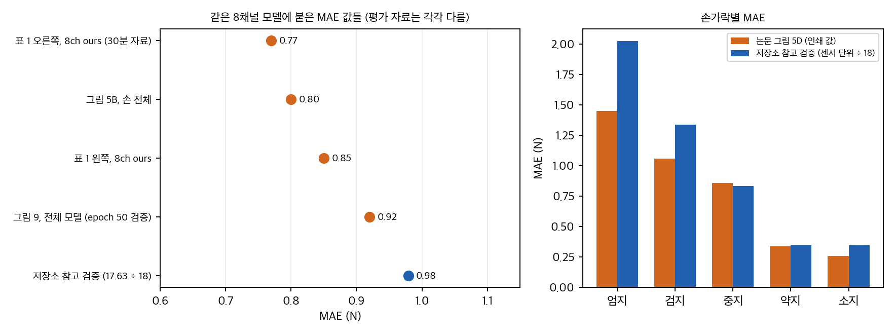
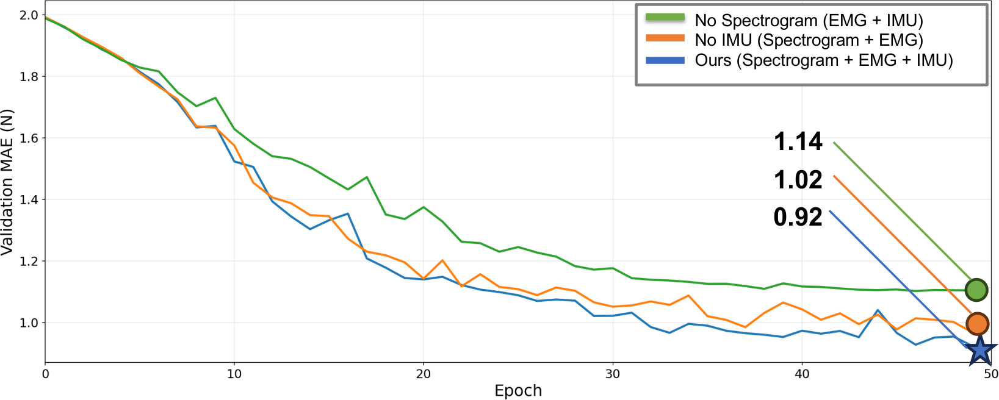
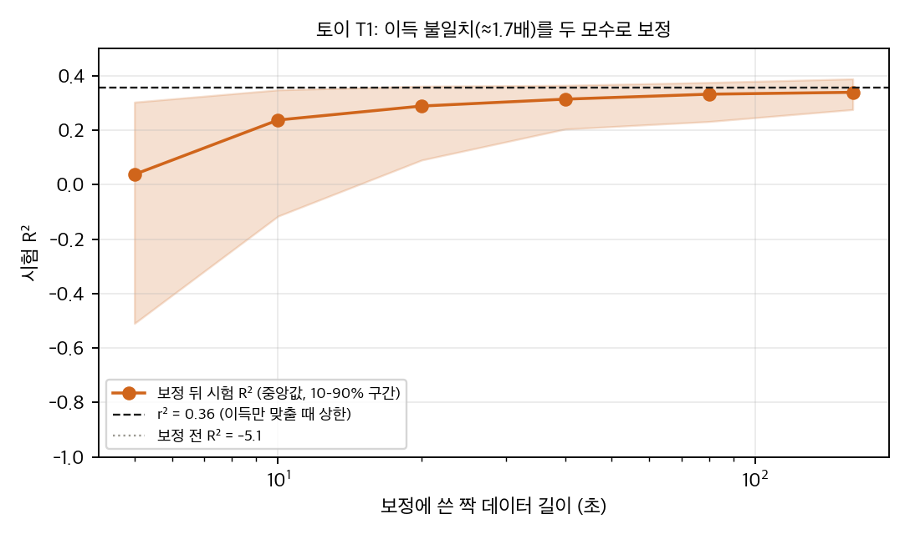

> **논문:** Botao He, Zhi Wang, Linna Kuang, Ishaan Ghosh, Jitendra Malik, Cornelia Fermuller, Tingfan Wu, Jiayuan Mao, Ruoshi Liu, Haozhi Qi, Yiannis Aloimonos. *ForceBand: Learning Forceful Manipulation with sEMG.* CoRL 2026 포스터, arXiv:2606.26093 (v1, 2026-06-24, CC BY 4.0).
> 공식 코드는 GitHub Bottle101/ForceBand(Apache-2.0)에 있고 EMG2Force 모델만 담고 있습니다. 이 글의 그림은 논문의 도식과 그래프 세 장(출처 표기)과 우리가 그린 그래프 네 장입니다. 분석은 논문 본문, 프로젝트 페이지, 공식 코드의 정적 읽기와 표 재계산으로 했고 코드를 실행하지 않았습니다.

## 논문이 묻는 것

사람 시연 영상은 동작과 외형을 알려 주지만 접촉 힘이 빠져 있습니다. 촉각 장갑은 힘을 재지만 시각을 가리고 수집이 번거롭습니다. ForceBand는 **손목에 차는 8채널 sEMG 밴드와 IMU**로 손가락 힘을 추정(EMG2Force)하고, 그 힘 라벨을 단 사람 영상으로 평행 그리퍼 로봇의 "동작 + 힘" 정책을 학습합니다. 사용자는 손끝 힘 센서를 단 채 약 15분 보정을 하고, 그 뒤 시연에는 센서 없이 밴드와 영상만 씁니다.

*그림 2의 위쪽 패널 (논문 원문). © 저자, CC BY 4.0, 출처 arXiv:2606.26093.*

모델은 5 s 창의 sEMG 8채널과 IMU 10차원(250 Hz)을 받아, 스펙트로그램은 사전학습 DINOv3, 시계열은 1-D 합성곱으로 인코딩하고 변환기가 5손가락 힘을 냅니다. 정책은 흐름 매칭이고 행동에 힘 성분을 더해 관측과 행동 양쪽에 힘이 들어갑니다. 로봇은 UR-5와 Robotiq에 힘 센서 네 개를 붙여 사전 파지 5 N 뒤 PD로 목표 힘을 따라갑니다.

## 이 글에서 확인한 것

**1. 힘 추정은 모든 막대에서 영상 기준선보다 낮은 오차를 보입니다.** 손 전체 MAE 0.80 대 1.58 N, RMSE 1.36 대 2.80 N입니다(그림 5B). 손가락별 MAE의 평균은 0.794와 1.578로 손 전체 값과 일치합니다. 다만 초록의 "50% 넘게 낮다"는 RMSE(51.4%)와 약지(54.7%), 소지(65.8%)에서 성립하고, 손 전체 MAE는 49.4%, 엄지·검지·중지는 45–49%입니다. 평가 분할, 사용자, 시드, 구간은 본문에 없습니다.

*논문 그림 5 (논문 원문). © 저자, CC BY 4.0, 출처 arXiv:2606.26093.*

*그래프 (우리가 그림). 왼쪽은 그림 5 인쇄 값으로 계산한 감소율, 오른쪽은 본문 문장과 그림 인쇄 값에서 나온 PR AUC 비입니다.*

본문은 약지와 소지 PR AUC에서 FEEL 값을 0.398, 0.314로 적고 "2배 넘게 앞선다"고 쓰는데, 같은 그림 5C의 인쇄 값은 0.38과 0.27입니다. 본문 값으로 비는 1.92와 1.88이고, 그림 값으로는 2.00과 2.19입니다. 무작위 기준선(유병률)에 대한 6배 이상은 두 경우 모두 성립합니다.

**2. 정책 성공률 87%는 표에서 정수 시행 수로 정확히 나오는 정의가 없습니다.** 표 2는 물체 9개, 칸마다 10회입니다. ForceBand는 pick-and-place 80/90 = 88.9%, squeeze 72/80 = 90.0%(Chips는 squeeze 불필요)입니다. squeeze가 필요한 물체는 squeeze, Chips는 pick으로 세면 79/90 = 87.8%이고, 87%로 반올림되는 정수 비율은 78/90입니다. 논문은 87%의 정의를 적지 않았으므로 저자 확인이 필요합니다.

*그래프 (우리가 그림). 표 2를 다시 그렸습니다. 칸마다 시행 10회라 구간이 넓습니다.*

pick-and-place만 보면 이진 그리퍼가 84/90으로 ForceBand보다 4회 많습니다(Fisher p = 0.43, 합산은 물체 간 독립 가정). squeeze 비교는 구조에서 정해집니다. 이진 그리퍼는 힘 프로파일을 낼 수 없어 0/80이고, 연속 그리퍼는 6/80입니다. 물체별 squeeze 차이(ForceBand 대 연속 그리퍼)는 Holm 보정 뒤에도 모두 p < 0.05입니다. 그러나 힘 채널을 끈 같은 구조의 정책, 손끝 센서 정답 힘을 쓴 정책, 영상 기반 힘(FEEL)을 쓴 정책과의 비교가 없어서, 이 표만으로는 어디까지가 sEMG 추정의 기여인지 말하기 어렵습니다. 표 2에는 OOD 물체 표시가 없고, 물체별로 정책을 따로 학습했는지도 적혀 있지 않습니다.

**3. 같은 8채널 모델에 붙은 MAE가 0.77에서 0.98 N까지 놓입니다.** 표 1 오른쪽(30분 자료) 0.77, 그림 5B 0.80, 표 1 왼쪽 0.85, 그림 9의 전체 모델 0.92 N이고, 공식 저장소의 참고 검증은 17.63 센서 단위(README의 ÷18 환산으로 약 0.98 N)입니다. 평가 자료가 각각 달라 서로 모순이라고 단정할 수는 없지만, 오차를 인용할 때는 어느 평가 자료인지 함께 적어야 합니다.

*그래프 (우리가 그림). 오른쪽의 저장소 값은 센서 단위를 18로 나눈 값입니다(README 환산). 약지·소지·중지는 비슷하고 엄지·검지는 저장소 쪽이 큽니다.*

**4. 절제 결과는 한 번의 학습 곡선입니다.** 전체 0.92, IMU 제거 1.02, 스펙트로그램 제거 1.14 N(epoch 50 검증 MAE)입니다. 스펙트로그램 제거 곡선은 epoch 12 이후 계속 위에 있어 방향이 일관됩니다. IMU 제거와의 0.10 N 차이는 마지막 10 epoch에서 IMU 제거 곡선이 약 ±0.05 N 진동하는 폭의 두 배 안쪽입니다(그림 판독). 곡선 끝 표식의 높이도 초록 약 1.10으로 읽혀 레이블 1.14와 0.04 차이가 납니다.

*논문 그림 9 (논문 원문). © 저자, CC BY 4.0, 출처 arXiv:2606.26093.*

**5. 그림 4B의 색 대응이 본문 제스처 비율과 다르게 읽힙니다.** 본문은 2-finger 51%, 3-finger 17%, 5-finger 11%, in-the-wild 21%라고 적는데, 그림 4B의 범례 색과 조각 색을 맞추면 2-finger 17%, 3-finger 11%, 5-finger 21%, in-the-wild 51%로 읽힙니다(그림 판독). 숫자 집합은 같고 배정이 다릅니다. 저자 확인이 필요합니다.

## 공식 코드와 논문의 차이

저장소는 EMG2Force 모델(평가, 보정, 학습 스크립트)과 체크포인트, 검증 자료 일부를 담고 있습니다. 정책 학습, 영상 변환, 로봇 힘 제어, 기준선 코드는 없어서 표 2와 그림 5의 기준선은 이 저장소로 다룰 수 없습니다. 코드를 읽고 눈에 띈 차이는 다음과 같습니다.

| 항목 | 논문 | 코드 |
|---|---|---|
| 표본 주파수, 창 | 250 Hz, 5 s | 1 kHz로 올린 자료, 10 s |
| 스펙트로그램 백본 | DINOv3 | DINOv2 ViT-S/14 (DINOv3는 학습했으나 출하하지 않음) |
| STFT 입력 | EMG + IMU 18채널 | EMG 8채널만(8→3 투영), IMU는 시계열 분기로만 |
| 백본 갱신 | 미기재 | 업샘플 단계가 기울기를 끊어 백본과 투영이 사실상 동결 |
| **직전 힘 입력** | 없음 | 기본 켬: 직전 창 마지막 **정답 힘**을 입력으로 받음 |
| 평가 | 미기재 | teacher_forced 기본(README의 보고 지표). rollout 모드는 있으나 결과 보고 없음 |
| 학습 | 그림 9는 50 epoch | 기본 300 epoch, 손실 MAE + 0.01 MSE |

직전 힘 입력은 센서를 뗀 배치 상태에서는 정답이 없으므로 직전 예측을 되먹이는 방식이 되어야 하는데, README의 수치는 정답을 쓰는 평가입니다. 이 입력이 10 s 창의 평가를 얼마나 유리하게 하는지는 접촉 지속 시간에 달려 있습니다. 아래 토이에서 "직전 값 유지"는 접촉이 몇 초 이내인 합성 신호에서는 전체 평균과 거의 같았고, 접촉이 약 5 s로 길 때만 평균보다 약간 나았습니다(합성 신호이므로 이 모델에 대한 결론은 아닙니다).

README는 보정의 필요성을 수치로 보여 줍니다. 데모 보정 전 제로샷은 Pearson r 0.59인데 r2가 −4.94이고, 36개 데모로 보정하면 r 0.78, r2 0.58, MAE 약 0.53 N입니다(센서 단위 ÷ 18, 세 손가락 평균). r이 0.59인데 r2가 크게 음수인 것은 예측의 크기 불일치로 설명할 수 있고, 평균이 같다고 가정하면 예측의 표준편차가 정답의 약 2.9배일 때 이 값이 나옵니다(근사).

## 합성 토이: 이득 불일치와 짧은 보정

실제 sEMG 모델이나 자료를 쓰지 않은 사고 실험입니다. 접촉이 켜졌다 꺼지는 합성 힘 신호에서 출력 = 이득 × (신호 + 평활 잡음), 상관 약 0.6, 예측의 표준편차가 정답의 약 2.9배가 되게 두었습니다. 이득과 오프셋 두 모수만 맞추는 보정으로 시험 r2가 10 s에 0.24, 40 s에 0.31, 160 s에 0.34(이득만 틀린 모델의 상한 r² = 0.36)가 됩니다.

*그래프 (우리가 그림). 합성 신호 200회 반복의 중앙값과 10–90% 구간입니다.*

이 토이에는 전극 위치 변화로 입력과 힘의 "모양" 자체가 달라지는 경우가 들어 있지 않습니다. 15분 보정이 필요한 이유가 이득 불일치만인지는 이 토이로 판단할 수 없습니다.

## 읽고 남는 질문

- 87%의 정의와, 표 2에서 정책을 물체별로 학습했는지 하나로 학습했는지, 어느 물체가 OOD인지.
- 같은 8채널 모델의 MAE 0.77–0.92 N이 각각 어떤 평가 자료인지, 분할과 사용자 구성은 무엇인지.
- 힘 채널을 끈 같은 구조의 정책, 정답 힘 정책, 영상 기반 힘 정책과의 비교.
- 공식 모델의 직전 정답 힘 입력이 논문 모델에도 있는지, 그리고 rollout 평가 결과.
- 250 Hz 표본화(나이퀴스트 125 Hz)와 1 kHz로 올려 쓰는 코드의 관계.

## 구현 가능성 (요약)

논문 전체(밴드 제작, 정책 학습, UR-5 실험)는 정책·로봇·기준선 코드가 저장소에 없어 이 글의 환경(Apple M4 Pro, CUDA 없음)에서 재현할 수 없습니다. EMG2Force 체크포인트의 평가와 보정은 패키지 설치와 파일 내려받기를 거치면 CPU나 MPS에서 가능할 것으로 보이지만 시도하지 않았고 속도는 측정 전입니다. 표와 그림의 수치 재계산과 합성 토이는 이 글에서 끝냈습니다.

## 출처와 범위

수치는 논문 본문, 표, 그림 인쇄 값과 공식 저장소 README에서 가져왔고, "그림 판독"으로 적은 값은 그림 막대·곡선·색에서 읽은 값입니다. 합산 검정은 시행이 독립이라는 가정을 쓴 계산입니다. 분석 문서, 재계산 스크립트와 토이는 함께 올린 자료에 있습니다.

## 자료

- [통합 리포트 PDF](report/report_public.pdf)
- [01. 논문 분석: ForceBand](analysis/01_paper_analysis.md)
- [02. 선행연구와 관련 저장소](analysis/02_prior_work.md)
- [03. 수치 재계산, 일관성 검사, 토이](analysis/03_analysis.md)
- [04. 공식 코드 대조와 구현 가능성](analysis/04_code_verification.md)
