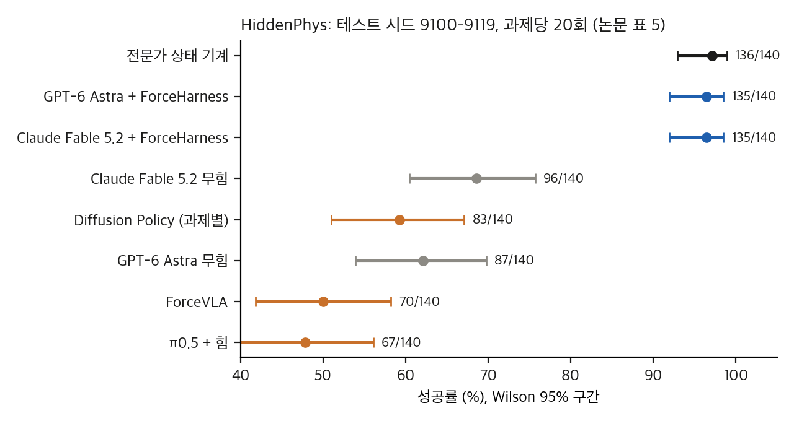
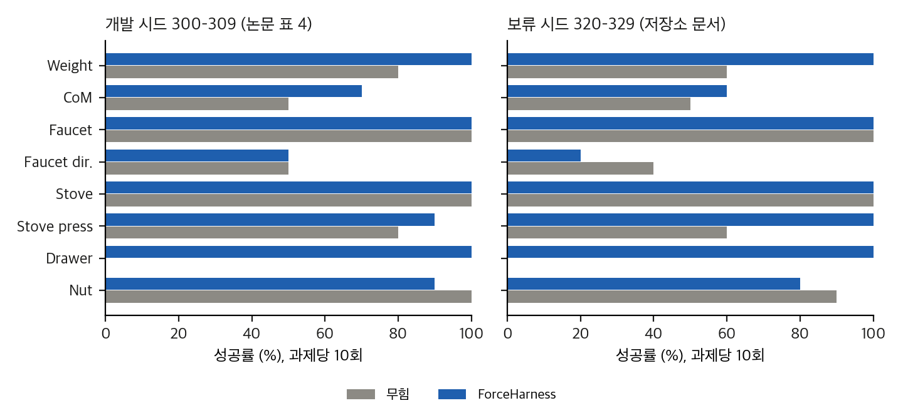
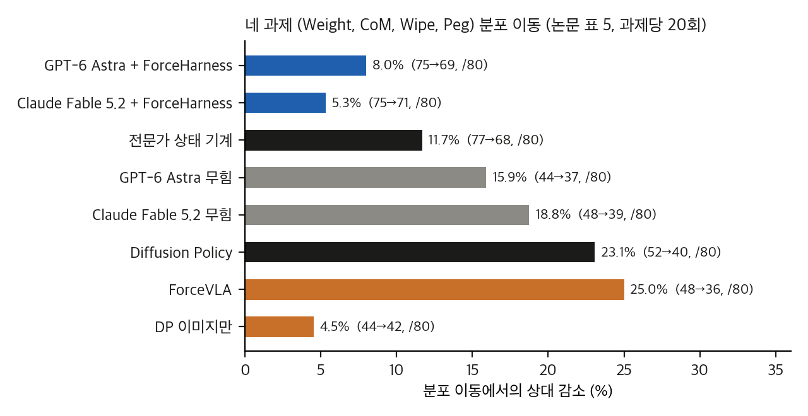

> **논문:** Ke Sun, Kevin Yuchen Ma, Yike Zhang, Yanzhe Chen, Mike Zheng Shou. *ForceHarness: Turning Force into Action and Physics for Frozen Frontier Models.* arXiv:2611.21099 v1 (2026-11-16). 학회 표기는 없습니다.
> 공식 코드(MIT, showlab/ForceHarness)는 정적으로만 읽었고 실행하지 않았습니다. 논문 그림은 라이선스(non-exclusive) 때문에 싣지 않고, 우리가 다시 그린 그래프만 씁니다.

## 논문이 묻는 것

API로만 접근하는 frozen 모델은 이미지로 로봇을 움직일 수 있지만, 접촉 힘이 중요한 과제에서는 이미지만으로 판단이 어렵습니다. 힘을 주는 기존 방법은 대부분 시연과 학습을 요구하거나, 원시 힘 숫자를 모델에 그대로 넘깁니다. 이 논문은 가중치를 바꾸지 않고, 시연 없이 힘을 쓰게 하는 harness를 제안합니다.

세 층입니다. 맨 아래는 관절 토크에서 손의 힘을 추정하고 영점을 맞춥니다. 가운데는 **자기 종료 힘 프리미티브**가 목표 힘을 맞추며 접촉 사건에서 멈춥니다. 맨 위는 힘 궤적을 질량, 마찰, 접촉 높이 같은 **물리량과 불확실도**로 바꿔 모델에 돌려줍니다. 모델은 호출 한 번마다 도구를 고르고 결과를 읽습니다.

## 이 글에서 확인한 것

**표의 숫자는 맞습니다.** 실로봇, ForceBench, HiddenPhys의 합계와 평균을 모두 다시 계산했습니다. 차이는 반올림 한 자리뿐입니다. 실로봇에서 여섯 과제 모두 무힘 대 힘 비교가 Fisher 검정으로 p < 0.01입니다.

*그림: HiddenPhys 합계(140회)와 Wilson 95% 구간. 논문 표 5의 값을 우리가 다시 계산해 그렸습니다.*

HiddenPhys에서 힘을 쓴 GPT 계열 모델은 140회 중 135회를 성공했습니다. 손으로 짠 전문가 상태 기계는 136회입니다. 두 값의 차이는 −0.7 pp이고 95% 구간은 [−5.6, +4.0] pp입니다. 같은 수준이라고 읽을 수 있습니다. 힘을 쓰지 않은 같은 모델은 87회입니다.

**ForceBench 이득은 튜닝에 쓴 시드에서 나왔습니다.** 논문 본문에는 "여덟 개 시드로 튜닝했다"고 적혀 있습니다. 공개 저장소 문서는 더 구체적으로, 시드 300–309의 기록을 재생해서 한 과제의 창을 골랐다고 적습니다. 저자들이 따로 한 보류 시드(320–329) 결과는 논문 본문에 없고 저장소와 프로젝트 페이지에만 있습니다. 거기서는 무힘 62.5%, 힘 82.5%로, 차이가 17.5 pp에서 20.0 pp로 조금 커졌습니다. 방향은 같습니다. 이득의 대부분은 Drawer Pull 한 과제에서 나옵니다.

*그림: GPT-6 Astra의 과제별 성공 수. 왼쪽은 논문 표 4(개발 시드 300–309), 오른쪽은 저장소 문서의 보류 시드(320–329) 결과입니다.*

**통계 검정은 일부만 재현됩니다.** 짝 McNemar 검정은 공개된 집계로 다시 계산했습니다. 개발 시드에서 p = 0.0094, 보류 시드에서 p = 0.0037로 논문과 문서의 값과 맞습니다. 그러나 검정 코드와 에피소드별 결과는 저장소에 없습니다. 그래서 나머지 검정은 확인할 수 없습니다.

**분포 이동에서 힘의 이점은 줄지 않았습니다.** 네 과제의 숨은 범위를 바꿔도 ForceHarness는 8% 줄었고, 힘을 쓰지 않은 모델은 16–19%, 힘을 입력으로 받은 학습 기준선은 대부분 17–25% 줄었습니다(이미지만 쓴 DP는 4.5%).

*그림: 분포 이동에서 네 과제(Weight, CoM, Wipe, Peg) 성공 수의 상대 감소. 논문 표 5의 값을 우리가 다시 그렸습니다.*

## 공식 코드와 논문

식 1–5(외력 추정, 리드 상한, admittance 이득, 질량과 마찰의 오차 전파)와 부록 표 A2의 상수는 공식 코드와 맞습니다. 힘 상한 25 N, 제어 주기(MuJoCo 20 Hz, ForceBench 15 Hz), 테스트 시드 9100–9119도 맞습니다.

몇 가지는 다릅니다. 학습 기준선의 "데모 200개"는 실제로 과제마다 185–210개입니다. 논문 부록은 코드를 "게재 시 공개"한다고 하지만 저장소는 이미 공개되어 있습니다. Astra의 Stove Press 행은 현재 코드에 없는 이전 도구 결과를 씁니다.

## 구현할 수 있는지

**부분적으로 가능합니다.** 이 맥(Apple M4 Pro, 24 GiB, MPS, CUDA 없음)에서는 힘 추정층과 물리량 식을 옮기는 일, 그리고 MuJoCo 기반 프리미티브 루프까지는 할 수 있습니다. 시뮬레이션 전체 재현은 패키지 설치와 모델 API 비용이 필요합니다. ForceBench(Isaac Lab, NVIDIA GPU), 실로봇(Franka FR3), π0.5와 ForceVLA 학습은 이 맥에서는 할 수 없습니다.

## 한계와 다음으로 볼 것

- 모델 호출이 프리미티브 사이에 몇 초를 더해서 반응형 조정이 어렵습니다.
- 프리미티브 메뉴가 고정되어 있습니다.
- 어블레이션은 시뮬레이션에서만 했습니다.
- 소형 모델의 결정 정확도 차이(0.69에서 0.85)는 분모가 논문에 없어서 강도를 확정할 수 없습니다.

분석 원본과 재계산 스크립트(`analysis/`, `recompute.py`, `plot_figures.py`)는 `publish/git/`에 있습니다.

## 자료

- [통합 리포트 PDF](report/report_public.pdf)
- [01. 논문 분석: ForceHarness](analysis/01_paper_analysis.md)
- [02. 선행연구, 구성 요소의 출처, 자료와 학회](analysis/02_prior_work.md)
- [03. 수치 재계산과 일관성 검사](analysis/03_analysis.md)
- [04. 논문과 공식 코드의 대조](analysis/04_code_verification.md)
