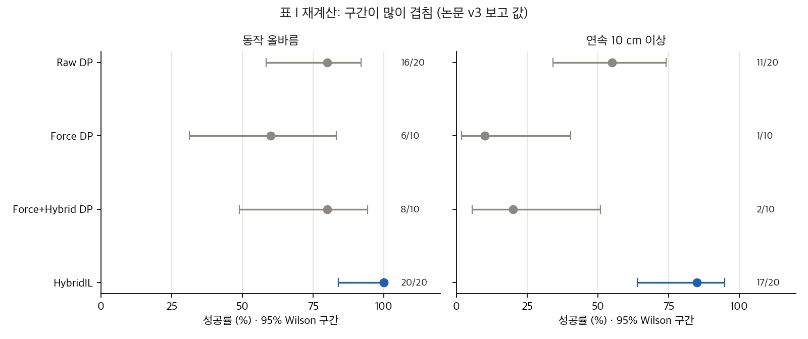
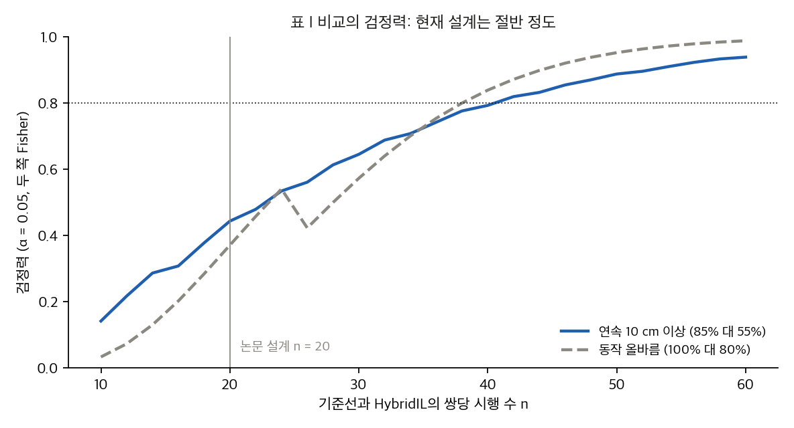

> **논문:** Wenhai Liu, Junbo Wang, Yiming Wang, Weiming Wang, Cewu Lu. *ForceMimic: Force-Centric Imitation Learning with Force-Motion Capture System for Contact-Rich Manipulation.* ICRA 2025, arXiv:2410.07554 (v3, 2025-03-03).
> 공식 코드(MIT, ForceMimic/hybridil과 ForceMimic/forcecapture)는 얕게 내려받아 정적으로만 읽었고 실행하지 않았습니다. 논문 그림은 싣지 않고, 우리가 만든 그래프만 씁니다.

## 논문이 묻는 것

사람이 물체를 다룰 때는 손의 궤적만 보는 것이 아니라 힘을 조절합니다. 로봇 모방학습은 대부분 영상과 자세에서 행동을 예측하고, 힘은 입력으로도 출력으로도 잘 쓰지 않습니다. 이 논문은 두 가지를 묻습니다. 첫째, 로봇 없이 사람이 든 채로 힘과 자세를 함께 기록할 수 있을까요? 둘째, 그렇게 모은 데이터로 힘을 예측하고 실행하면 영상 기반 정책보다 나을까요?

첫 번째 답은 **ForceCapture**입니다. 6축 힘 센서와 SLAM 카메라를 손잡이에 달아, 사람이 호박 껍질을 벗기는 힘을 기록합니다. 저자들은 한 사람이 5분 만에 벗기는 동안 힘 피드백 원격조작은 13분 넘게 걸린다고 보고합니다(그림 5b, 측정 값 2.9분, 4.5분, 13분).

두 번째 답은 **HybridIL**입니다. 점군과 자세로 확산 정책을 학습해 자세와 힘-토크를 함께 예측합니다. 실행할 때는 예측 힘이 6 N을 넘으면 힘-위치 하이브리드 제어로 바꾸고, 아니면 IK 관절 제어를 씁니다.

## 이 글에서 확인한 것

**1. 상대 54.5%는 수치가 맞지만 유의하지 않습니다.** 논문의 호박 껍질 벗기기 실험에서 "연속 10 cm 이상 벗기기" 기준으로 HybridIL은 20회 중 17회(85%), 영상 기준선 Raw DP는 20회 중 11회(55%)입니다. 85/55 − 1은 54.5%입니다. 그러나 두 쪽 Fisher 검정 p는 **0.082**입니다. 두 방법 모두 시행이 20회라서 구간도 많이 겹칩니다(HybridIL 64–95%, Raw DP 34–74%). 실제 차이가 30%p일 때 이 설계로 검출할 확률(검정력)은 약 0.44입니다. 0.8을 얻으려면 방법당 약 41회가 필요합니다.

그래프: 논문 표 I의 성공률과 95% Wilson 구간. 두 기준 모두 HybridIL과 기준선의 구간이 많이 겹칩니다. 우리가 그린 그래프입니다.

**2. 힘 입력 기준선이 나쁜 이유는 아직 확인되지 않았습니다.** 힘을 입력으로 넣은 두 기준선은 10%와 20%로 낮습니다. 저자들은 학습 데이터의 힘(약 10 N)과 기준선이 본 힘(20 N 이상)의 차이를 원인으로 봅니다. 그럴듯한 설명이지만 실험으로 확인하지 않았고, 기준선의 학습 설정도 본문에 없습니다.

**3. HybridIL의 효과를 원인별로 나누지 못합니다.** 영상 기준선과 다른 점이 세 가지 동시에 바뀝니다. 점군 입력, 힘-토크 출력, 하이브리드 제어입니다. IK로만 실행하는 대조 실험이 없어서, 효과가 힘 예측에서 왔는지 제어 방식에서 왔는지 알 수 없습니다.

**4. 수집 효율 3배는 한 번씩 잰 값입니다.** 각 방법을 한 번씩 측정했고 오차 막대가 없습니다. 조작자도 한 명입니다. 13/4.5 = 2.9라는 계산은 맞습니다.

## 공식 코드에서 본 것

공식 저장소는 학습 코드와 로봇 실행 코드만 공개합니다. 평가 코드, 세 기준선, 데이터, 체크포인트는 없습니다. 따라서 표의 수치를 이 저장소로 다시 만들 수는 없습니다.

코드를 읽으면서 본문과 다른 곳도 찾았습니다.

- 학습 에포크: 본문 500, 학습 설정 1000.
- 힘 센서 기록 주파수: 본문 1000 Hz, 수집 코드 200 fps.
- 프리미티브 전환 조건: 본문은 "연속된 스텝"이라고 쓰지만, 코드는 예측 구간에서 힘이 6 N을 넘는 비율(20%)을 봅니다.
- 점군 인코더: 본문은 MLP라고 쓰고, 코드는 PointNet입니다.
- 데이터 증강: 학습할 때마다 점군과 자세에 무작위 회전과 이동을 줍니다. 힘 열은 회전하지 않습니다. 본문에는 이 증강이 없습니다.

증강이 힘 열을 회전하지 않는 것은 힘의 좌표계가 증강 프레임과 같은지에 따라 문제가 될 수도, 아닐 수도 있습니다. 코드만으로는 판단할 수 없습니다.

## 이 맥에서 구현할 수 있는가

**논문 결과의 재현은 이 맥에서 불가능합니다.** 손 장치 수집에는 힘 센서와 카메라가 필요하고, 두 카메라 모델은 단종되었습니다. 실로봇 실행에는 Flexiv 로봇과 실시간 제어가 필요합니다. 학습은 GPU 기기와 처리된 데이터가 필요하고, 데이터셋은 공개 저장소의 링크로만 받을 수 있습니다.

맥에서 할 수 있는 것은 두 가지입니다. 첫째, 표를 다시 계산하는 것입니다(이 글의 검정과 검정력). 둘째, 힘 제어 로직과 중력 보정을 합성 데이터에서 검증하는 것입니다. 정책 구조를 작게 줄인 CPU 축소판은 새 설치를 한 뒤 가능합니다. 노력은 2–3주로 추정합니다.

## 라이선스와 그림

논문은 arXiv non-exclusive distribution 라이선스입니다. CC BY가 아니므로, 논문 그림은 이 글에 싣지 않았습니다. 아래 그래프 두 장은 표 I의 보고 값으로 우리가 그린 것입니다.

그래프: 연속 10 cm 기준(85% 대 55%)의 쌍당 시행 수에 따른 검정력(α = 0.05, 두 쪽 Fisher). 점선은 0.8입니다. 현재 설계(n = 20)에서 검정력은 0.44입니다. 우리가 그린 그래프입니다.

## 정리

ForceMimic은 손에 드는 힘 수집 장치와 힘을 예측하는 정책이라는 흥미로운 조합을 보여 줍니다. 다만 핵심 결과인 54.5%는 시행 20회에서 유의하지 않고, 원인을 나눈 실험이 없으며, 공식 저장소는 결과를 재현할 수 있을 만큼 완전하지 않습니다. 다음 논문을 읽을 때는 같은 기준을 쓰면 됩니다. 기준을 밝히고, 검정력을 계산하고, 저장소에 평가 코드가 있는지 확인합니다.

## 자료

- [통합 리포트 PDF](report/report_public.pdf)
- [01. 논문 분석: ForceMimic](analysis/01_paper_analysis.md)
- [02. 선행 연구, 구성 요소의 출처, 관련 분석, 공식 자료](analysis/02_prior_work.md)
- [03. 수치 재계산과 일관성 검사](analysis/03_analysis.md)
- [04. 논문 ↔ 공식 코드 대조](analysis/04_code_verification.md)
