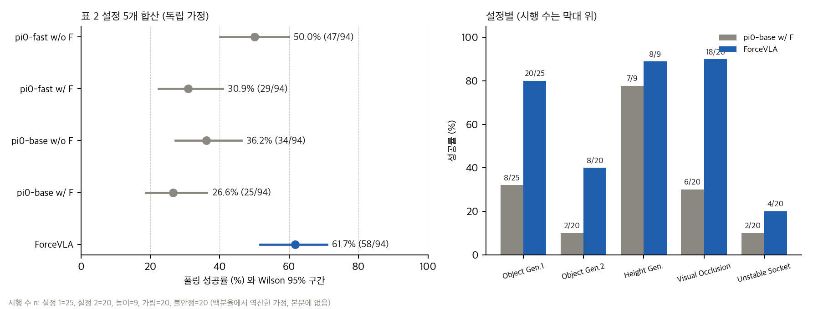
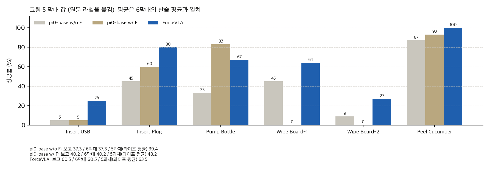

# 03. 재계산, 일관성 검사, 주장 판정

재계산은 `analysis/recompute.py`(수 초, scipy)로 했고, 결과는 `analysis/recompute_results.json`에 있습니다. 그림 5의 막대 값은 원문 7쪽을 확대해 읽은 것이고, `analysis/plot_figures.py`가 쓰는 값과 같습니다. 학습이나 추론은 하지 않았습니다. 재현 가능성은 `04` §4에 있습니다.

## 0. 방법과 가정

- **시행 수 n.** 본문에 설정별 n이 없는 표 2는 백분율이 $k/n$과 맞는 최소 n을 골랐습니다. 물체 1은 25(4% 단위), 물체 2는 20, 높이는 9(66.67, 77.78, 88.89, 44.44), 가림은 20, 불안정 소켓은 20입니다. 모든 값의 반올림 오차는 0.005 이하였습니다(`V1`).
- **표 5는 본문 시행 수 가정.** 펌핑 20, 플러그 20(본문에 없음, 100%로만 보임), USB 20, 화이트보드 10. 본문에 그 수가 있는 것은 펌핑 20, 화이트보드 10이고, 플러그와 USB는 추정입니다.
- **표 3은 시행 20 가정.** 모든 값이 $k/20$과 맞지만 과제와 시행 수가 적혀 있지 않습니다.
- **검정.** 시행을 독립 베르누이로 보고 양측 Fisher 정확 검정을 씁니다. 다중 비교는 Holm으로 보정합니다. 한 정책의 여러 시행이 같은 세션, 같은 시드에서 나왔다면 독립 가정은 과대평가입니다(`V8`).
- **구간.** Wilson 95%.

## 1. 재계산 결과

### 1.1 표 2 (일반화, 다섯 설정)

보고된 설정 평균은 모두 맞습니다(`V1`). 설정 평균(비가중)과 풀링 성공률(시행 가중)은 다릅니다.

| 방법 | 설정 평균 (보고) | 풀링 k/94 | 풀링 성공률 | Wilson 95% |
|---|---|---|---|---|
| ForceVLA | 63.78 | 58 | 61.7 | 51.6–70.9 |
| π0-fast w/o F | 52.78 | 47 | 50.0 | 40.1–59.9 |
| π0-base w/o F | 38.93 | 34 | 36.2 | 27.2–46.2 |
| π0-fast w/ F | 32.29 | 29 | 30.9 | 22.4–40.8 |
| π0-base w/ F | 31.96 | 25 | 26.6 | 18.7–36.3 |

ForceVLA 대 기준선 풀링 Fisher(Holm 보정 4개): π0-base w/o F p=0.0007(보정 0.0015), π0-base w/ F p=2×10⁻⁶(보정 8×10⁻⁶), π0-fast w/ F p=4×10⁻⁵(보정 1×10⁻⁴), **π0-fast w/o F p=0.14(보정 0.14, 유의하지 않음)**.

설정별 ForceVLA 대 π0-base w/ F (Holm 보정 5개):

| 설정 | ForceVLA | π0-base w/ F | p | 보정 p |
|---|---|---|---|---|
| 물체 1 | 20/25 | 8/25 | 0.0014 | 0.006 |
| 물체 2 | 8/20 | 2/20 | 0.065 | 0.19 |
| 높이 | 8/9 | 7/9 | 1.00 | 1.00 |
| 가림 | 18/20 | 6/20 | 0.0002 | 0.001 |
| 불안정 소켓 | 4/20 | 2/20 | 0.66 | 1.00 |

그래프: 우리가 그린 그래프. 표 2의 시행 수 가정(§0)에서 계산한 값이며, 설정별 n은 본문에 없습니다.

### 1.2 표 5 (다중 과제, 네 과제)

| 방법 | 펌핑 | 플러그 | USB | 화이트보드 | 평균 (재계산) | 풀링 k/70 |
|---|---|---|---|---|---|---|
| ForceVLA | 16/20 | 20/20 | 2/20 | 8/10 | 67.5 | 46 |
| π0-base w/ F | 10/20 | 20/20 | 2/20 | 1/10 | 42.5 | 33 |
| π0-base w/o F | 4/20 | 0/20 | 0/20 | 0/10 | 5.0 | 4 |
| π0-fast (두 가지) | 0 | 0 | 0 | 0 | 0.0 | 0 |

평균 67.5, 42.5, 5.0은 맞습니다(`V1`). ForceVLA 대 π0-base w/ F 풀링 p=0.040(시행 70 가정), 대 w/o F p<0.001. 과제 수가 네 개이고 화이트보드가 한 과제이므로, 그림 5의 "평균"과는 정의가 다릅니다(`V3`).

### 1.3 표 3 (어블레이션, 시행 20 가정)

| 방식 | 성공 | 검정 (Fisher, 양측) |
|---|---|---|
| baseline[10] | 9/20 | — |
| linear before VLM | 11/20 | — |
| MoE before VLM | 0/20 | — |
| concat after VLM | 12/20 | concat 대 baseline p=0.53 |
| ForceVLA | 16/20 | 대 baseline p=0.048, **대 concat after VLM p=0.30** |

"힘은 VLM 뒤에 넣어야 한다"(§5.4)와 "FVLMoE가 필요하다"의 근거는 ForceVLA 대 concat after VLM 차이 4/20뿐이고, 이 차이는 이 데이터로 유의하지 않습니다. 앞쪽 차이("VLM 앞에 넣으면 실패")는 MoE before VLM의 0/20이 가장 뚜렷합니다.

### 1.4 그림 5 평균 점검

그림 5 막대 값을 옮기고 평균을 다시 계산했습니다.

| 방법 | 보고 평균 | 6막대 평균 | 5과제 평균 (화이트보드 두 막대 평균) |
|---|---|---|---|
| ForceVLA | 60.5 | **60.5** | 63.5 |
| π0-base w/ F | 40.2 | **40.2** | 48.2 |
| π0-base w/o F | 37.3 | **37.3** | 39.4 |
| π0-fast w/ F | 14.2 | 14.2 | 14.0 |
| π0-fast w/o F | 31.0 | 31.0 | 23.6 |

보고 평균은 **여섯 막대(화이트보드 WB-1과 WB-2를 따로)의 산술 평균**과 일치합니다. 본문은 "다섯 과제 평균"이라고 씁니다. 화이트보드를 한 과제로 놓으면 ForceVLA와 π0-base w/ F의 차이는 20.3 포인트에서 15.3 포인트로 줄고, π0-base w/o F와의 차이는 23.2에서 24.1로 늘어납니다. 즉 헤드라인 숫자는 정의에 따라 다릅니다(`V2`).

그래프: 우리가 그린 그래프. 값은 원문 7쪽 그림 5의 막대 라벨을 옮긴 것이고(확대 판독), 평균 세 가지를 표시했습니다.

### 1.5 막대 값과 본문 시행 수

본문 시행 수(펌핑 20, 화이트보드 10, 삽입 20, 오이 15스트로크)로 나누어 보면 다음 값이 맞지 않습니다(`V4`).

- ForceVLA: 펌핑 67.0, 화이트보드 WB-1 64.0, WB-2 27.0.
- π0-base w/ F: 펌핑 83.0, 오이 93.0.
- π0-base w/o F: 펌핑 33.0, WB-1 45.0, WB-2 9.0, 오이 87.0.
- π0-fast w/o F: WB-1 91.0, WB-2 45.0.

예를 들어 시행 20회에서 67.0%는 나올 수 없습니다(13/20=65.0, 14/20=70.0). 정수 백분율이라 정확한 분모도 찾을 수 없습니다. 반면 6막대 평균이 보고 평균과 맞으므로 막대 값 자체는 보고 값과 일치합니다. 성공률을 어떤 단위로 셌는지(스트로크, 세션, 평균 등) 저자 설명이 필요합니다.

### 1.6 표 1 (오이 껍질 벗기기)

평균 벗긴 길이 14.12 대 13.17 대 10.27 cm, 최소 스트로크 7 대 10 대 14. 본문 수치와 맞습니다(`V1`). 그러나 표준편차와 시행별 값이 없어 차이를 검정할 수 없습니다.

## 2. 일관성 검사 (V)

| 번호 | 내용 | 결과 |
|---|---|---|
| V1 | 표 2 설정 평균, 표 5 평균, 그림 5 6막대 평균, 표 1 수치를 다시 계산 | 모두 일치 |
| V2 | "23.2%"의 정의 | 포인트 차이, 기준은 π0-base w/o F. 본문 §5.2 첫 문단은 37.3을 "π0-base w/ F"라 씀(라벨 오류). 같은 절 뒤에서 w/F는 40.2, w/o F는 37.3 |
| V3 | "다섯 과제 평균" | 실제로는 여섯 막대. 정의가 헤드라인을 바꿈 (§1.4) |
| V4 | 막대 값과 본문 시행 수 | 펌핑, 화이트보드, 오이 값이 본문 시행 수로 재현되지 않음 (§1.5) |
| V5 | 표 2 "Average"와 풀링 | 설정 평균은 비가중. 풀링(시행 가중)은 61.7이고 보고 63.78과 차이 |
| V6 | 표 3 기준선 45%와 표 2·5의 π0-base 수치 | 다른 세션으로 보임. 과제와 시행 수가 없어 대응 불가 |
| V7 | 학습 레시피 (본문 30k/10k 스텝, 배치 16/유효 2048) | 공개 설정(50k 스텝, 배치 4, LoRA)과 다름 (`04` D9). "글로벌 배치 16, 유효 2048"은 같은 문장 안에서 맞지 않음 |
| V8 | 독립 가정 | 시드, 세션 수, 분산이 없어 독립 검정은 과대평가일 수 있음 |
| V9 | 데이터 규모 (244 궤적, 140k 시점) | 공개 메타와 **정확히 맞음**: 에피소드 43+51+50+50+50=244, 프레임 25,869+28,205+34,478+17,563+34,808=140,923 (`04` D10) |
| V10 | 용어 "힘"과 "촉각" | §5.2에 "tactile information"이 있으나 입력은 6축 힘 |
| V11 | 표기 (§4.2 $E_{enc}$, $D_a$) | 차원 표기가 틀리거나 섞임 (`01` §2.3) |

## 3. 주장 판정 (C)

| 번호 | 주장 (논문 위치) | 판정 | 근거 |
|---|---|---|---|
| C1 | 평균 60.5%, "π0 기반 기준선 대비 23.2% 향상" (초록). 본문 계산 기준은 π0-base w/o F | **산술은 맞음, 정의와 기준선 라벨이 흐림** | V2, V3, §1.4 |
| C2 | "모든 기준선보다 유의하게 우월" (§5.2) | **부분 지지** | 펌핑 w/F 83 > 67, WB-1 fast w/o F 91 > 64, WB-2 fast w/o F 45 > 27. 과제별 검정 없음 |
| C3 | 일반화 설정 평균에서 최고 (표 2) | **지지** (설정 평균 63.78) | §1.1. 풀링에서도 최고이나 π0-fast w/o F와는 유의하지 않음(p=0.14) |
| C4 | 물체 1과 가림에서 특히 강함 (§5.3) | **지지** | 보정 p 0.006, 0.001 |
| C5 | 높이 변화와 불안정 소켓에서 우월 (§5.3) | **근거 없음** | 보정 p 1.00, 1.00 (높이 8/9 대 7/9, 불안정 4/20 대 2/20) |
| C6 | 오이 껍질 벗기기에서 가장 긺 (표 1) | **방향만 지지** | 검정 불가 (V1, §1.6) |
| C7 | 힘은 VLM 뒤에 넣어야 하고 FVLMoE가 필요하다 (§5.4) | **약함** | 대 concat after VLM 16/20 대 12/20, p=0.30. 단일 실험, 과제 미지정 (§1.3) |
| C8 | VLM 앞 융합은 실패 (표 3) | **지지(단일 실험)** | 0/20. 시드와 반복 없음 |
| C9 | 다중 과제에서 ForceVLA가 최고 (표 5) | **지지 (방향)** | 67.5 대 42.5, 풀링 p=0.04(시행 가정) |
| C10 | π0-fast는 힘을 넣으면 나빠짐 (31.0→14.2) | **평균은 맞음, 원인은 미검증** | 차이가 주로 WB-1(91→20)과 WB-2(45→10)에 있음. "토큰 공간 교란"은 실험 없음 |
| C11 | Expert 0이 범용 전문가 (부록 C) | **미검증** | 개방 루프, 과제당 약 10에피소드, 분산 없음. 공개 코드에 라우터 로그 없음 (`04` D12) |
| C12 | 전문가가 과제 단계에 따라 특화 (부록 C, 그림 9) | **미검증** | 같은 이유. 정성 해석 |
| C13 | 학습 시간 12시간(30k 스텝) (부록 B) | **검증 불가** | 장비와 로그가 없음. 공개 설정은 50k 스텝 |
| C14 | 데이터 244 궤적, 140k 시점 (§4.3) | **지지** | V9 (공개 메타와 정확히 맞음) |
| C15 | 과제당 약 50회 시연 (§4.3) | **지지** | 과제 43–51 에피소드 |
| C16 | 한계: 추정된 외력 사용 (§6) | **부분 지지** | 데이터 키 `f_ext_base_frame`은 외력 추정치로 보이나 변환 코드가 저장소에 없어 확인 불가 (`04` D8) |

## 4. 해석 주의

1. 이 재계산은 **보고된 수치의 내적 일관성**을 봅니다. 원 데이터(시행별 결과, 영상)가 없어 수치가 실제로 맞는지는 볼 수 없습니다.
2. 풀링 검정은 시행을 독립으로 봅니다. 같은 정책을 같은 세션에서 여러 번 굴린 결과라면 p값은 낮아 보입니다. 설정별 결과를 더 믿는 편이 안전합니다.
3. 표 5의 플러그 n=20과 USB n=20은 본문에 없는 가정입니다. 이 숫자가 바뀌면 p값도 바뀝니다(§0).
4. 그림 5 막대 값은 눈으로 읽은 값입니다. 0.5 포인트 정도의 오차가 있을 수 있습니다. 6막대 평균이 보고 평균과 정확히 맞는다는 사실은 읽기가 대체로 맞다는 근거입니다.
