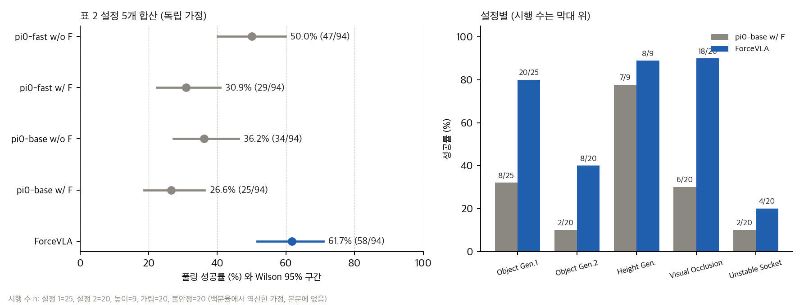
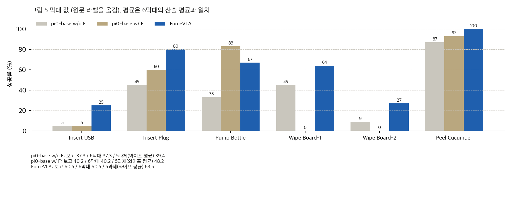

> **논문:** Jiawen Yu, Hairuo Liu, Qiaojun Yu, Jieji Ren, Ce Hao, Haitong Ding, Guangyu Huang, Guofan Huang, Yan Song, Panpan Cai, Wenqiang Zhang, Cewu Lu. *ForceVLA: Enhancing VLA Models with a Force-aware MoE for Contact-rich Manipulation.* NeurIPS 2025 포스터, arXiv:2505.22159 (v3, 2025-09-18).
> 공식 코드는 GitHub `ft-robotic/ForceVLA`(Apache-2.0)에 있습니다. 이 글의 그래프는 논문 수치에서 우리가 그렸습니다. 논문 그림은 넣지 않았습니다.

## 논문이 주장하는 것

접촉이 많은 작업(USB 삽입, 플러그 삽입, 병 펌핑, 화이트보드 닦기, 오이 껍질 벗기기)은 카메라만으로는 어렵습니다. 가려지거나 조명이 나쁘면 더 그렇습니다. ForceVLA는 6축 힘과 토크를 **입력의 한 모달리티**로 넣습니다.

핵심 구조는 세 단계입니다. 먼저 사전학습된 VLM이 영상과 언어를 처리합니다. 그다음 힘 토큰을 VLM 출력 뒤에 붙이고, 전문가 4개와 상위 1 라우팅으로 이루어진 MoE 블록(FVLMoE)에 넣습니다. 마지막으로 블록 출력의 마지막 액션 토큰 구간을 흐름 매칭 액션 헤드에 더합니다. 논문은 힘을 VLM 앞에 넣으면 사전학습 표현이 깨진다고 주장합니다(표 3).

## 공식 코드는 구조와 맞습니다

공식 저장소를 정적으로 읽었습니다(설치, 실행 안 함). `pi0_force.py`는 힘 토큰을 VLM 접두 출력 뒤에 붙이고, `limoe_simple.py`의 블록은 자기 주의, 상위 1 라우팅, 잔차 연결을 씁니다. 논문 §4.2와 표 4의 차원과 맞습니다.

다만 코드에는 논문에 없는 라우터 설정이 있습니다. 용량 계수가 1.0이라서, 전문가 하나가 토큰의 절반을 받는다는 논문 관찰과 겹치면 넘치는 토큰이 전문가를 거치지 못할 수 있습니다. 드롭 비율은 아직 재지 않았습니다.

데이터는 공개되어 있고 논문 수치와 정확히 맞습니다. 과제 다섯 개의 에피소드는 43, 51, 50, 50, 50으로 합계 244, 프레임은 140,923입니다. 학습 설정은 다릅니다. 논문은 다중 과제 3만 스텝과 단일 과제 1만 스텝을 쓰지만, 공개 설정은 오이 과제 하나에 5만 스텝, LoRA, 배치 4입니다.

## 숫자를 다시 세 보니

**평균 60.5%는 여섯 막대의 평균입니다.** 그림 5에서 화이트보드 WB-1과 WB-2를 따로 세면 여섯 막대가 됩니다. 본문은 "다섯 과제 평균"이라고 쓰지만, 그림의 막대 값으로 계산하면 보고 평균과 정확히 맞는 것은 여섯 막대 평균입니다. 화이트보드를 한 과제로 놓으면 ForceVLA와 π0-base w/ F의 차이는 20.3포인트에서 15.3포인트로 줄어듭니다.

그래프: 우리가 그린 그래프. 표 2의 일반화 실험을 다시 계산했습니다. 설정별 시행 수(25, 20, 9, 20, 20)는 본문에 없고 백분율에서 역산한 가정입니다.

일반화 실험(표 2)에서 풀링 성공률은 ForceVLA 61.7%(58/94), π0-base w/ F 26.6%(25/94)입니다. Fisher 검정으로 p=2×10⁻⁶이고 Holm 보정 후에도 유의합니다. 그러나 π0-fast w/o F(50.0%)와의 차이는 p=0.14로 유의하지 않습니다. 설정별로는 물체 1과 가림 설정에서 차이가 뚜렷하고, 높이와 불안정 소켓 설정에서는 차이가 없습니다.

**"23.2%"는 π0-base w/o F 대비 포인트 차이입니다.** 본문 첫 문단은 이 값(37.3)을 "π0-base w/ F"라고 씁니다. 같은 절 뒤에서는 w/F가 40.2입니다. 상대 증가율로는 62%입니다.

그래프: 우리가 그린 그래프. 막대 값은 논문 그림 5의 라벨을 옮긴 것입니다. 평균은 6막대 평균과 맞고, 5과제 평균(화이트보드 두 막대 평균)은 다릅니다.

## 조심할 부분

- **어블레이션은 약합니다.** "힘은 VLM 뒤에 넣어야 한다"의 근거는 ForceVLA 16/20 대 concat after VLM 12/20입니다. 이 차이는 p=0.30으로 유의하지 않습니다. 과제도 표에 없습니다.
- **막대 값 일부가 본문 시행 수로 나누어 떨어지지 않습니다.** 펌핑 67%(시행 20회에서는 불가능), 화이트보드 64%와 27%(시행 10회에서는 불가능) 등입니다. 성공률의 단위(스트로크, 세션, 평균)를 저자 설명으로 확인해야 합니다.
- **라우팅 해석은 검증할 수 없습니다.** 부록 C의 전문가 분석은 개방 루프 평균이고, 시드와 분산이 없으며, 라우터 로그 코드가 공개되지 않았습니다. "전문가 0은 범용"이라는 해석은 아직 미검증입니다.
- **외력은 추정치일 수 있습니다.** 논문 §6은 추정된 외력이라고 쓰고, 데이터 키 `f_ext_base_frame`도 추정치를 시사합니다. 변환 코드는 저장소에 없습니다.
- **"촉각"과 "힘"을 섞어 씁니다.** §5.2는 "tactile information"이라고 쓰지만 입력은 6축 힘입니다.

## 이 맥에서 할 수 있는 것

- **재현 불가:** 공식 설정 학습(RTX 4090급 GPU, 22.5 GB 이상), 실로봇 평가. 공식 체크포인트도 찾지 못했습니다.
- **가능:** FVLMoE 블록만 PyTorch로 옮겨 라우팅 분포와 용량 초과 토큰 비율을 재는 일입니다. 블록이 작아서 CPU나 MPS에서 돌릴 수 있습니다.

## 자료와 권리

- 논문: arXiv abs 페이지의 라이선스 링크는 arXiv 비배타 배포 라이선스 1.0입니다. CC BY가 아니므로 논문 그림은 게시하지 않았습니다.
- 코드: Apache-2.0. 저장소에 넣지 않았고, 정적으로만 읽었습니다.
- 데이터: Apache-2.0(HF 카드). 과제 메타 파일만 확인했습니다.
- 그래프와 분석 문서는 이 저장소 작성자가 만들었습니다. 재계산 스크립트와 결과는 함께 올렸습니다(`publish/git/`).

## 자료

- [통합 리포트 PDF](report/report_public.pdf)
- [01. 논문 분석: ForceVLA](analysis/01_paper_analysis.md)
- [02. 선행연구, 공식 코드, 이 저장소의 관련 분석](analysis/02_prior_work.md)
- [03. 재계산, 일관성 검사, 주장 판정](analysis/03_analysis.md)
- [04. 공식 코드 대조: ForceVLA](analysis/04_code_verification.md)
