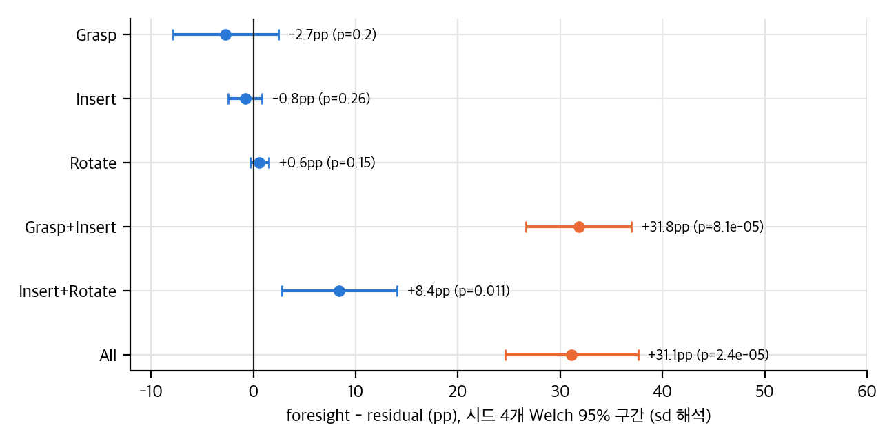
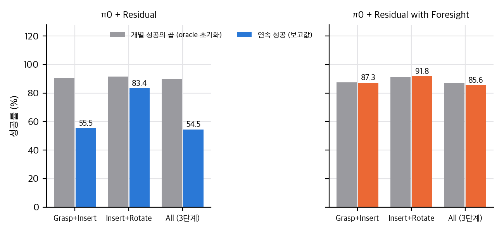
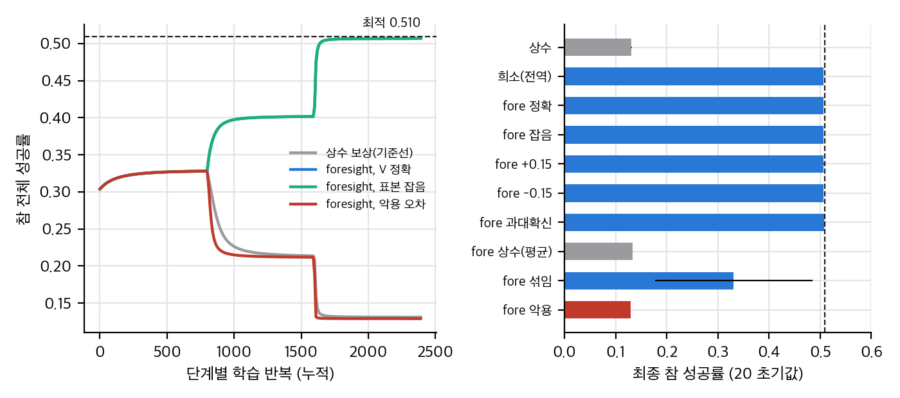
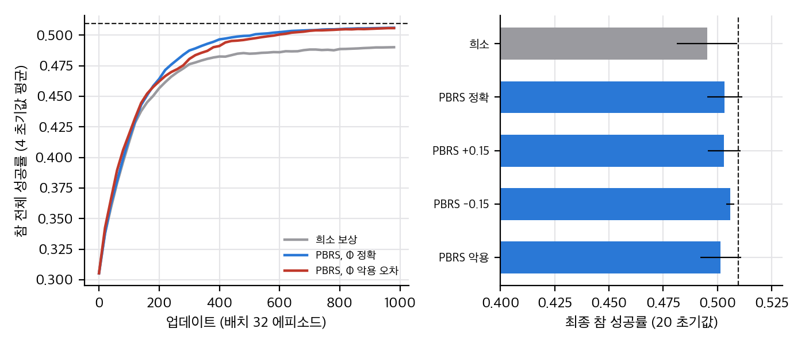

> **논문:** Liu, Zhang, Liu, Boularias. *Foresight Residual RL for Long-Horizon Robot Manipulation with Vision-Language-Action Models.* IROS 2026 (채택), arXiv:2607.16506v1.
> 논문 그림과 표는 라이선스(arXiv 비독점 배포) 때문에 싣지 않았습니다. 이 글의 그래프는 논문 수치와 직접 만든 toy로 그렸습니다. 공식 코드는 없습니다(2026-11-10 확인).

## 한 줄 요약

고정된 π0 위에서 잔차 RL을 학습할 때, 각 단계의 성공 보상에 "다음 단계가 성공할 확률"을 곱하면 나사 조립 전체 성공률이 54.5%에서 85.6%로 올라갑니다. 숫자 차이는 시드 4개에서도 유의합니다. 다만 이 곱셈이 무엇을 바꾸는지는 예측기가 정확할 때만 전역 목적과 같다는 조건이 붙습니다.

## 1. 아이디어

조립 과제는 단계마다 "성공"의 정의를 만족해도 다음 단계에서 실패하는 상태가 있습니다. 예를 들어 불안정하게 잡은 렌치는 잡기 성공 판정을 받지만 삽입에서 떨어집니다. 논문은 단계 경계의 종료 상태에서 다음 단계 성공 확률을 이미지로 예측하는 예측기를 오프라인으로 학습하고, 이를 보상의 곱셈 계수로 씁니다.

## 2. 표를 다시 계산하면

- 전체 과제 85.6 ± 3.9 대 54.5 ± 3.6은 시드 4개의 Welch 검정에서 p ≈ 2×10⁻⁵입니다. 차이는 31.1 %p이고 상대로는 57%입니다. 논문의 "+31.1%"는 %p라는 표기 문제가 있습니다.
- 단계별 성공률(oracle 초기화)의 차이는 검출되지 않았습니다. 초록의 "단계 성공은 변하지 않는다"는 "차이가 검출되지 않았다"로 읽는 것이 맞습니다.
- 개별 단계 성공의 곱과 연속 성공을 비교하면 foresight는 87.5 대 87.3으로 맞고, 잔차 RL은 90.7 대 55.5로 크게 벌어집니다. 핵심 현상(연결에서의 손실)을 잘 보여주는 검사입니다.
- 예측기 정확도는 Grasp→Insert 경계에서 86.2%(다수 기준 73.9%)로 분명하지만, 회전 단계 경계는 93.9%(다수 기준 90.4%)로 검정 세트 크기를 256으로 가정하면 유의하지 않습니다.

*논문 Table II 수치로 직접 계산한 열별 차이와 Welch 95% 구간(시드 sd 해석).*

*개별 단계 성공의 곱(회색)과 연속 성공 보고값(색)을 비교한 그래프.*

## 3. 곱셈 보상은 언제 옳은가

정확한 하류 가치 V가 있으면, 단계 k의 곱셈 보상의 기대 기울기는 하류까지 굴린 전역 희소 보상의 기대 기울기와 같습니다. 곱셈 보상은 분산을 줄이는 방법이지 다른 최적을 만드는 방법이 아닙니다.

가치가 틀리면 문제가 생깁니다. 3단계 체인 toy에서 "그럴듯하지만 불안정한 잡기" 행동의 가치만 0.99로 부풀리면 정책은 그쪽으로 몰리고 참 성공률은 0.507에서 0.129로 떨어졌습니다. 같은 오차를 PBRS 형태(덧셈, 상태 함수 차분)로 넣으면 최종 정책은 최적 근처에 머뭅니다. 학습 속도만 달라집니다.

*체인 toy의 단계별 학습 곡선(왼쪽)과 추정기 오차별 최종 성공률(오른쪽). 점선은 최적 0.510.*

*끝까지 학습에서 희소 보상과 PBRS(정확·악용 Φ)의 곡선과 최종 성공률.*

## 4. 빠진 것

- 예측기의 보정, AUC, 독립 평가가 없습니다. Table III의 점수는 학습에 쓴 같은 예측기로 잰 값이라 근거가 되기 어렵습니다.
- 상수 평균 가치, 섞인 가치, PBRS, 온라인 몬테카를로, 하류 critic 대조군이 없습니다. toy에서 상수 평균 가치는 상수 기준선과 같은 결과였으므로, 이득은 척도가 아니라 상태 의존성에서 나와야 합니다.
- 시뮬레이션 한 과제, 시드 4개, 전문가 시연의 좁은 분포입니다.

## 5. 재현 가능성

공식 코드가 없고, 저장소는 프로젝트 페이지 템플릿에 머물러 있습니다. 프로젝트 페이지는 404입니다. Isaac Gym 재현에는 NVIDIA GPU가 필요해서, CUDA가 없는 맥에서는 재현하지 못했습니다. 아이디어 자체는 짧게 구현할 수 있지만, 시뮬레이션 자산과 전문가가 공개되지 않아 재구현 노력은 큽니다.

## 6. 정리

곱셈 foresight는 "단계 분해된 전역 목적"으로 이해하면 깔끔합니다. 실전에서 중요한 것은 예측기가 정책이 방문하는 상태에서 얼마나 맞는지입니다. 논문 수치를 우리 과제에 옮기기 전에 보정 도표, 독립 평가, 대조군 세 가지를 먼저 확인하는 것을 권합니다.

## 자료

- [통합 리포트 PDF](report/report_public.pdf)
- [01. 논문 분석: Foresight Residual RL](analysis/01_paper_analysis.md)
- [02. 선행연구와 관계](analysis/02_prior_work.md)
- [03. 수치 재계산, 유도, toy 검증](analysis/03_analysis.md)
- [04. 주장 검증과 구현 가능성](analysis/04_claim_verification.md)
