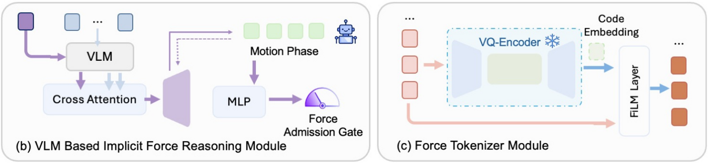

# FR-VLA: 접촉이 많은 조작을 위한 암묵 힘 추론 VLA (arXiv:2610.25981) 논문 분석

*FR-VLA: Implicit Force Reasoning VLA for Contact-Rich Manipulation.* Jiaju He, Zhiyuan Yang, Ruyang Han, Jiahong Tang, Zhiping Lin, Haiyue Zhu (Nanyang Technological University; Singapore Institute of Manufacturing Technology, A\*STAR). **CoRL 2026 포스터**(corl.org 공식 채택 목록, poster no. 146, Tue 11/10 5:00–6:30 PM). 프로젝트 페이지 https://fr-vla.pages.dev/ . 분석일 2026-11-21.

## 0. 버전과 원문

| 항목 | 내용 |
|---|---|
| 분석 대상 | arXiv **v1** (제출 2026-10-19, 10,403 KB, 20쪽). 2026-11-21 기준 제출 이력에 v2는 없습니다 |
| 버전 차이 | 비교할 버전이 없어 차이 표는 없습니다 |
| 학회 | CoRL 2026 포스터. 초록 댓글 "Accepted to CoRL 2026", 공식 목록의 발표 형식은 poster |
| 라이선스 | arXiv abs 페이지 "view license"가 `creativecommons.org/licenses/by/4.0/`을 가리킵니다(CC BY 4.0). PDF 본문에 ©, All rights reserved, 회사 고지가 없습니다(pdftotext 확인) |
| 원문 | `paper/paper.pdf`(11.4 MB, 저장소에 둡니다), `paper/paper.txt`(pdftotext -layout) |
| 공식 코드 | 찾지 못했습니다(`02_prior_work.md` §2). 따라서 대조 대상은 논문 본문과 부록입니다(`04_claim_verification.md`) |

## 1. 문제 설정과 주장

저자들은 힘 정보를 VLA에 넣는 문제를 "어떻게 인코딩하느냐"가 아니라 **"언제, 얼마나 힘이 행동 생성에 영향을 줄 수 있느냐"**(modality grounding)로 다시 세웁니다(§1, §3.1). 기존 방식은 두 가지입니다(Fig. 1a).

- 낮은 차원의 wrench를 VLM 토큰 열에 넣으면 시각·언어 토큰에 묻혀 희석됩니다(§1, [14–17]).
- 행동 전문가(action expert)에 조건으로 넣으면 VLM이 작업 진행과 접촉 단계를 추론하는 자리를 건너뜁니다(§1, [18–21]).

두 방식 모두 힘을 **노출**(exposure)할 뿐 **근거를 세우는**(grounding) 것은 아니라는 것이 핵심 주장입니다. 기여는 세 가지입니다(§1 (i)–(iii)).

1. 힘 관련성을 센서 가용성이 아니라 시각-언어 맥락에서 추정하도록 문제를 정의합니다.
2. 힘 쿼리 토큰이 만든 **force admission signal** $g^f_t$로 외부의 힘 경로(토큰화된 wrench 이력)에 대한 주의 질량을 조절하는 구조(FR-VLA)를 제안합니다.
3. 학습된 admission이 순간 힘 크기가 아니라 **작업 단계(interaction regime)**를 따른다는 분석을 보입니다.

## 2. 방법

전체 구조는 Fig. 2(a)입니다. 네 종류의 토큰 묶음(시각·언어 인코더 토큰, 행동 쿼리, 힘 쿼리, 힘 이력 토큰)이 있습니다. 힘 쿼리를 처리하는 **암묵 힘 추론 모듈**(Fig. 2b)이 admission을 만들고, **힘 토크나이저 모듈**(Fig. 2c)이 wrench 이력을 코드 임베딩으로 바꿔 FiLM으로 힘 토큰을 조건화합니다. 힘 토큰은 행동 브리지에서 admission으로 바뀐 점수를 받아 행동 전문가에 들어갑니다.

*그림 2 (b)(c) 발췌 (논문 원문). 그림 2의 (a)는 로봇 사진을 포함해 싣지 않았습니다. © 저자, CC BY 4.0, 출처 arXiv:2610.25981 (v1).*

### 2.1 Admission signal (§3.2, 식 1–2, 부록 A.1)

힘 쿼리 상태 $h^f_t$에서 위상 분포를 만들고 admission을 계산합니다.

- 식 (1): $\hat p_t = \mathrm{softmax}(P_\phi(h^f_t))$, 위상 헤드 $P_\phi$.
- 식 (2): $g^f_t = G_\eta(\hat p_t) = s_{adm}\left(1 - \dfrac{H(\hat p_t)}{\log K_p}\right)\tanh(M_g(\hat p_t))$. $H$는 엔트로피, $M_g$는 MLP, $K_p$는 위상 수입니다.
- $s_{adm} = \alpha_g \exp(\sigma_{adm})$는 학습되는 양의 스케일입니다. 불확실성이 크면 $(1 - H/\log K_p)$가 0에 가까워져 조정을 0으로 되돌립니다. 부호가 음수이면 힘 주의를 억제합니다.

### 2.2 위상 라벨 (§3.2, 부록 A.3, B.3.1, 표 5–6)

위상 라벨은 **학습 중에만** 힘·그리퍼 기록에서 자동으로 만듭니다. 그리퍼 개폐로 조작 구간을 나누고, 구간마다 최근 비접촉 프레임의 중앙값을 기준 $F_{ref}$로 두어 $d_t = \|F_t - F_{ref}\|_2$가 $\theta_{on}$을 넘는 사건을 찾습니다. 이 과정에 이력(hysteresis)과 지속 시간 조건이 있고, 큰 사건($m_j \ge \theta_{major}$이고 구간 최대의 $\rho$배 이상)만 남깁니다. 접촉 구간은 첫 주요 사건의 시작부터 마지막 해제까지입니다. 설정값은 $f_s = 10$ Hz, $N_{ref} = 10$, $\theta_{on} = 5$ N, $\theta_{off} = 2.5$ N, $N_{on} = 3$, $N_{off} = 5$, $N_{steady} = 15$, $\sigma_{steady} = 1.5$ N, $\theta_{major} = 8$ N, $\rho = 0.5$, $N_{approach} = 10$입니다(B.3.1). 이 설정은 과제 사이에 같다고 적혀 있습니다.

위상 헤드는 3개(Gear, Switch Cable: 자유·접근·접촉) 또는 2개(나머지: 자유·접촉) 범주를 예측합니다(표 5).

### 2.3 힘 토크나이저와 admission 주의 (§3.3, 식 3–5, 식 7–11, 부록 A.2)

- 토크나이저: 최근 $L_\tau = 8$ 프레임의 6축 wrench 창을 평탄화하고 표준화(식 8)한 뒤, VQ-VAE로 코드북 $K_\tau = 8$에서 가장 가까운 코드를 고릅니다(식 9–10). 과제마다 따로 사전 학습하고 VLA 학습 중에는 고정합니다.
- FiLM: 코드 임베딩 $e_t = w_t c_{k_t}$가 연속 힘 토큰 $\bar r_t$의 스케일과 이동을 바꿉니다(식 11). FiLM 선형층은 0으로 초기화되어 처음에는 항등 변환입니다. 연속 토큰은 그대로 남습니다.
- admission 주의(식 3–5): 힘 점수 $S^{tw,m}_t$에 헤드별 편향 $\beta_m$과 $g^f_t$를 더합니다(식 4). 힘 토큰 사이의 상대 점수는 유지되고 힘 토큰 전체의 주의 질량만 바뀝니다. 점수는 자기, 어댑터, 시각, 힘 소스를 함께 softmax합니다(식 5). 행동 브리지는 VLA-Adapter [43]의 어댑터 방식을 따릅니다.

### 2.4 학습 목적 (§3.4, 식 6)

$\mathcal L_{FR} = \| \hat A_t - A_t \|_1 + \lambda_p \mathrm{CE}(\hat p_t, y^p_t)$, $\lambda_p = 0.5$입니다. 행동 청크 $H = 8$, 7차원 절대 말단 자세와 그리퍼 명령을 예측합니다(B.1.2). 위상 입력은 하류 모듈에 분리(detach)되어 위상 손실은 힘 쿼리 경로만, 행동 손실은 admission 게이트와 행동 전문가만 갱신합니다. 추론 때는 시각·언어 맥락에서 위상을 추정하고, 그 결과로 힘 주의를 조절합니다.

## 3. 실험 설정과 결과

### 3.1 설정 (§4.1, B.1)

- 로봇: UR5e와 UR3e, 로봇 내장 6축 F/T 센서. 카메라는 3인칭 RealSense D455와 손목 D405입니다(Fig. 7).
- 과제 다섯 개: Gear Assembly, Switch Cable Connection(두 단계: 상단 이더넷 삽입, 측면 전원 커넥터 삽입), Curved Surface Cleaning, Screw Tightening, Seat Belt Buckle Insertion. 평가 단계는 총 6개입니다.
- 데이터: 과제당 70–90회 시연, 3D 마우스로 수집하고 Cartesian impedance 제어기를 씁니다(식 14). 영상 10 Hz, 힘·상태·행동 50 Hz로 기록하고 학습 때 영상 시각에 맞춥니다(B.1.1).
- 기준선: VLA-Adapter(힘 없음), VLA-Adapter w/F(시간 정렬된 6축 힘과 상태를 직접 입력), ForceVLA(힘 MoE 행동 디코더), TA-VLA(토크-행동 공동 확산 디코더).
- 학습 장비: RTX A6000 2장. 추론: RTX 3090 1장(B.1.2).
- 평가: 단계당 20회, 성공은 해당 단계 목표를 사람 개입 없이 완료한 경우입니다(B.1.1).

### 3.2 결과 (§4.2, 그림 5)

| 단계 | VLA-Adapter | w/F | ForceVLA | TA-VLA | FR-VLA |
|---|---|---|---|---|---|
| Gear | 55 | 60 | 70 | 60 | **90** |
| Switch 1 (상단) | 40 | 35 | 45 | 30 | **60** |
| Switch 2 (측면) | 0 | 5 | 10 | 15 | **35** |
| Cleaning | 40 | 45 | 45 | 50 | **70** |
| Screw | 10 | 15 | 25 | 20 | **40** |
| Buckle | 20 | 20 | 30 | 40 | **55** |
| 평균 | 27.5 | 30.0 | 37.5 | 35.8 | **58.3** |

(단위 %, 그림 5의 막대 위 라벨을 옮겼습니다. 평균은 우리가 계산했습니다.)

본문은 FR-VLA가 여섯 단계 모두 최고라고 쓰고, 평균 58.3%가 가장 강한 기준선보다 20.8 pp 높다고 씁니다. 가장 강한 기준선은 평균 37.5%인 ForceVLA입니다(논문은 기준선 이름을 쓰지 않습니다). 자기 크기 게이팅과의 비교는 Gear에서 90% 대 70%(20회)입니다(§4.2, B.2).

### 3.3 위상 추정 정확도 (§4.3, 표 1)

균형 정확도(balanced accuracy)는 Gear 93.7%, Switch 90.5%, Buckle 88.5%, Cleaning 80.6%, Screw 86.2%입니다. 평가 때 자유 위상은 자유와 접근을 합쳐서 계산합니다(B.3.2).

### 3.4 분석과 어블레이션 (§4.3–4.4, 표 2, 그림 6, 9–11)

- 한 번의 전체 궤적(Switch 상단)에서 두 번 걸린 뒤 재삽입하는 동안 wrench가 0에 가까워도 admission은 양수를 유지하고, 위상이 자유로 바뀐 뒤에야 음수가 됩니다(Fig. 6).
- 어블레이션(표 2, 평균): FR-VLA 58.3%, admission 제거 35.0%, 힘 토큰화 제거 40.0%. 여섯 단계 모두에서 두 어블레이션이 FR-VLA보다 낮습니다.
- 힘 코드는 사건과 연결된다고 합니다. Screw에서 코드 2는 걸림(jam)과 3.3배, 코드 5·7은 철수(withdraw)와 5.0배 함께 나타납니다(§4.4). 다른 과제의 연관은 부록 B.4 그림 11에 있습니다.

### 3.5 섭동 강건성 (§4.5, 표 3–4)

- 표 3(Gear, 범주당 20회): 미지 기어 FR-VLA 85% 대 VLA-Adapter w/F 60%, 미지 목표 위치 75% 대 50%. 둘 다 25 pp입니다.
- 표 4(Switch, 초기 케이블 위치 네 그룹, 그룹당 10회): 4/10, 6/10, 5/10, 5/10으로 합계 20/40입니다. 표에는 방법 이름이 없고 본문에서 FR-VLA로 읽힙니다. 기준선은 없습니다.

### 3.6 한계 (§6, 저자 서술)

정밀 조작의 작은 힘 기반 보정은 행동 복제에서 희석된다고 인정합니다. 향후 과제로 힘에 민감한 잔차 헤드와 전이 중심 목표, 그리고 여러 시각 프레임을 쓰는 예측을 듭니다.

## 4. 우리가 본 공백과 질문

자세한 검증은 `03_analysis.md`와 `04_claim_verification.md`에 있습니다. 여기서는 읽으면서 생긴 질문만 적습니다.

1. **위상 평가가 순환적입니다.** 평가 정답은 학습 라벨과 같은 힘 기반 자동 규칙을 rollout에 적용한 것입니다(B.3.2). 표 1은 "시각-언어로 위상을 맞히는 능력"보다 "힘 규칙을 근사하는 능력"을 재고 있을 수 있습니다. 이 점을 논문이 논의하지 않습니다.
2. **Curved Surface Cleaning의 admission은 접촉 구간에서 억제됩니다**(B.3.3). 다른 네 과제에서는 접촉 구간 내내 높다고 쓰므로, "위상을 따른다"는 서사와 긴장이 있습니다. 저자는 "안정된 힘은 새 정보가 적다"로 설명하지만 정량 검사는 없습니다.
3. **통계 검정이 없습니다.** 단계당 20회이고, 신뢰구간과 시드 반복이 없습니다. 다만 그림 5 값으로 다시 계산하면 여섯 단계 최고는 맞지만, 단계별 차이는 유의하지 않습니다(`03_analysis.md`).
4. **재현에 필요한 값이 빠져 있습니다.** VLM 백본 이름, 학습 단계 수, 학습률, 배치, $\alpha_g$, $\lambda_{com}$, $M_g$ 구조, 과제별로 따로 학습하는지 여부, 기준선 구현 출처, 과제와 로봇의 대응(Fig. 7은 두 로봇만 보여 줌)이 본문에 없습니다.
5. **"힘 어블레이션"의 정의가 불분명합니다.** "w/o force admission"이 $g^f_t = 0$인지, 힘 토큰 경로 전체를 빼는지 적혀 있지 않습니다.

## 5. 한눈에 본 기여와 한계

| 항목 | 평가 |
|---|---|
| 문제 설정(힘 관련성의 근거화) | 설득력 있음. 기존 주입 방식과의 대비가 명확합니다 |
| 구조(admission 게이트와 FiLM 토큰) | 수식이 충분히 적혀 있어 구현 설명으로는 쓸 만합니다. 세부 값은 빠져 있습니다 |
| 실험 증거 | 실로봇 6단계와 어블레이션이 있습니다. 시도 수가 작고 검정이 없어 단계별 우위는 약합니다 |
| 해석 증거 | 궤적 사례와 그림 중심입니다. 위상과 admission의 정량 관계는 없습니다 |
| 재현성 | 코드가 없고, 학습 설정과 백본이 빠져 있으며, 실로봇이 필요합니다 |
