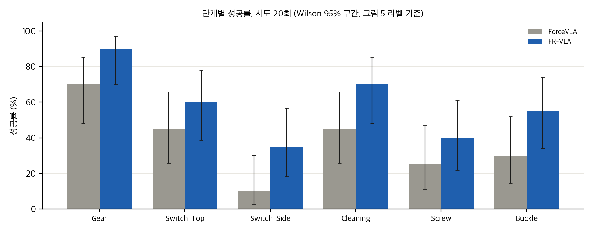
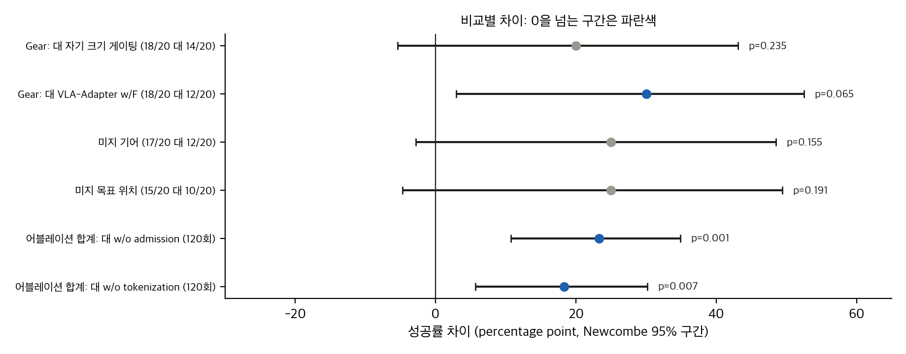

# FR-VLA 수치 재계산과 일관성 검사

재계산 스크립트는 `analysis/recompute.py`(수 초, numpy·scipy)이고 결과는 `analysis/recompute_results.json`입니다. 입력은 논문 본문과 표 2–4, 그림 5의 막대 라벨입니다. 학습이나 재현은 하지 않았습니다.

## 가정

- 성공률의 분모는 캡션의 시도 수입니다. 그림 5와 표 2는 단계당 20회, 표 3은 범주당 20회, 표 4는 그룹당 10회입니다.
- 그림 5의 값은 막대 위 라벨을 그대로 옮겼습니다. 라벨이 정수이므로 오차는 없다고 봅니다.
- 여러 단계를 하나로 묶는 검정(풀링)은 시도가 서로 독립이라고 가정합니다. 같은 정책과 같은 장치에서 나온 시도는 독립이 아닐 수 있어서, 풀링한 p값은 낙관적입니다. 단계별 검정은 이 가정이 덜 필요합니다.
- 구간은 Wilson 95%(비율)와 Newcombe 95%(비율 차이)를 씁니다. p값은 양측 Fisher 정확 검정입니다.

## 1. 재계산

### 1.1 단계별 성공률 (그림 5 라벨)

FR-VLA의 단계별 값과 Wilson 95% 구간은 다음과 같습니다.

| 단계 | FR-VLA | Wilson 95% | 가장 강한 기준선 | 차이 (pp) | Fisher p |
|---|---|---|---|---|---|
| Gear | 18/20 (90%) | 69.9–97.2 | ForceVLA 70% | 20 | 0.235 |
| Switch 1 (상단) | 12/20 (60%) | 38.7–78.1 | ForceVLA 45% | 15 | 0.527 |
| Switch 2 (측면) | 7/20 (35%) | 18.1–56.7 | TA-VLA 15% | 20 | 0.273 |
| Cleaning | 14/20 (70%) | 48.1–85.5 | TA-VLA 50% | 20 | 0.333 |
| Screw | 8/20 (40%) | 21.9–61.3 | ForceVLA 25% | 15 | 0.501 |
| Buckle | 11/20 (55%) | 34.2–74.2 | TA-VLA 40% | 15 | 0.527 |

여섯 단계 모두 FR-VLA가 가장 높다는 본문 주장은 그림 5 라벨로 맞습니다. 최소 차이는 15 pp입니다. 그러나 단계별 Fisher p는 0.23–0.53이고, 어느 단계도 기준선과 구별되지 않습니다. 단계당 20회에서는 15–20 pp 차이를 확실히 가릴 수 없습니다.



*그래프 (우리가 그림). FR-VLA와 가장 강한 기준선 ForceVLA의 단계별 값. 시도 20회, Wilson 95% 구간. 논문 그림 5의 막대 라벨이 입력입니다.*

### 1.2 평균과 어블레이션 (표 2)

| 방법 | 평균 (재계산) | 논문 값 | 6단계 모두 FR-VLA보다 낮음 |
|---|---|---|---|
| FR-VLA | 58.33 | 58.3 | — |
| w/o force admission | 35.00 | 35.0 | 예 (6/6) |
| w/o force tokenization | 40.00 | 40.0 | 예 (6/6) |

평균 기준선(그림 5에서 계산): VLA-Adapter 27.5, VLA-Adapter w/F 30.0, ForceVLA 37.5, TA-VLA 35.8입니다. 본문의 "가장 강한 기준선 대비 20.8 pp"는 ForceVLA 37.5와 맞습니다.

풀링(120회)한 비교는 다음과 같습니다.

| 비교 | 차이 (pp) | Newcombe 95% | Fisher p |
|---|---|---|---|
| FR-VLA 대 w/o force admission | 23.3 | 10.7–34.9 | 0.0005 |
| FR-VLA 대 w/o force tokenization | 18.3 | 5.7–30.2 | 0.007 |
| FR-VLA 대 ForceVLA | 20.8 | 8.2–32.6 | 0.002 |
| FR-VLA 대 TA-VLA | 22.5 | 9.9–34.1 | 0.0007 |
| FR-VLA 대 VLA-Adapter w/F | 28.3 | 15.8–39.6 | <0.0001 |

풀링 검정이 모두 유의한 것은 독립 가정 아래의 결과입니다. 단계별 차이는 작아도 여섯 단계가 같은 방향이므로, 어블레이션에서 힘 게이트와 힘 토큰화가 기여한다는 방향은 합리적으로 보입니다. 그 크기는 정확하지 않습니다(단계 간 상관 가능, 시드 1개).

### 1.3 소규모 비교 (본문과 표 3–4)



*그래프 (우리가 그림). 비교별 성공률 차이. 파란 점은 구간이 0을 넘는 경우입니다. Newcombe 95% 구간과 Fisher p를 표시했습니다.*

| 비교 (논문 위치) | 차이 (pp) | 95% 구간 | p |
|---|---|---|---|
| Gear: FR-VLA 90% 대 크기 기반 게이팅 70% (§4.2, 20회씩) | 20.0 | −5.4 ~ 43.1 | 0.235 |
| Gear: FR-VLA 90% 대 VLA-Adapter w/F 60% (그림 5) | 30.0 | 2.9 ~ 52.5 | 0.065 |
| 미지 기어: FR-VLA 85% 대 VLA-Adapter w/F 60% (표 3) | 25.0 | −2.8 ~ 48.5 | 0.155 |
| 미지 목표 위치: FR-VLA 75% 대 VLA-Adapter w/F 50% (표 3) | 25.0 | −4.7 ~ 49.4 | 0.191 |
| 케이블 미지 위치 20/40 대 상단 삽입 FR-VLA 12/20 (표 4, 그림 5) | −10.0 | −33.4 ~ 16.0 | 0.585 |

- 표 3의 "25 pp 우위"는 산술로는 맞지만 통계적으로는 확정할 수 없습니다.
- 크기 기반 게이팅과의 비교(§4.2)는 차이가 20 pp이고 구간이 0을 포함합니다. 논문이 쓰는 "크기만으로는 관련성을 반영하지 못한다"는 결론은 이 데이터로는 확정되지 않습니다.
- 표 4의 합계 20/40은 Wilson 95%로 35.2–64.8%입니다. 그룹별 4/10–6/10은 Wilson 95%로 17–69%에서 31–83%까지 넓습니다.

### 1.4 검정력

단계당 20회 설계로 90% 대 70%의 차이를 80% 검정력(양측 5%)으로 찾으려면 팔당 62회가 필요합니다. 58.3% 대 37.5%(평균)에는 팔당 90회, 85% 대 60%에는 49회입니다. 논문의 모든 단계 비교는 이보다 적으므로, 단계별 우위를 확정하기에는 시도가 부족합니다.

## 2. 일관성 검사

| 번호 | 검사 | 결과 | 판정 |
|---|---|---|---|
| K1 | 표 2의 FR-VLA 행과 그림 5의 FR-VLA 값 | 90, 60, 35, 70, 40, 55로 일치 | 일치 |
| K2 | 표 2 평균(58.3, 35.0, 40.0)과 재계산 | 일치 | 일치 |
| K3 | 본문 "여섯 단계 모두 최고"와 그림 5 | 여섯 단계 모두 FR-VLA가 최고 | 일치 |
| K4 | 본문 "가장 강한 기준선 대비 20.8 pp" | ForceVLA 평균 37.5로 일치. 기준선 이름은 본문에 없음 | 일치 (표기 부족) |
| K5 | 표 2 "여섯 단계 모두 두 어블레이션이 낮다" | 12쌍 모두 낮음 | 일치 |
| K6 | 표 3 VLA-Adapter w/F 기어 60%와 그림 5 | 같은 값 (60%) | 일치 |
| K7 | 표 4 합계 "절반" | 20/40 = 50% | 일치 |
| K8 | 표 4의 방법 이름 | 표에 없음. 본문에서 FR-VLA로 읽힘 | 표기 부족 |
| K9 | 표 5 위상 수와 부록 A.1 $K_p$ | Gear와 Switch는 3, 나머지는 2로 일치 | 일치 |
| K10 | 표 6 라벨 비율 합 | 각 과제 합계 100%. 표 5와 과제 구성 일치 | 일치 |
| K11 | 위상 라벨 시간 설정(B.3.1)과 기록 주파수(B.1.1) | 라벨은 10 Hz 기준(Nsteady 15 = 1.5 s), 기록은 힘 50 Hz. 다운샘플링 단계는 적혀 있지 않음 | 불완전 |
| K12 | 본문 "모든 방법이 같은 데이터와 조건" 대 부록 B.1 | 부록 B.1에 백본, 학습 단계 수, 학습률, 배치, 시드가 없음 | 불완전 |
| K13 | 초록 "두 로봇 플랫폼" 대 과제 배정 | 어떤 과제가 어느 로봇에서 도는지 적혀 있지 않음 | 불완전 |
| K14 | Cleaning 접촉 구간 admission 억제(B.3.3) 대 다른 과제의 "접촉 구간 내내 높음" | 같은 접촉 위상에서 방향이 반대. 설명은 있으나 정량 검사 없음 | 긴장 (`04` C13) |
| K15 | 위상 평가 정답의 출처(B.3.2) | 정답은 학습 라벨과 같은 힘 기반 자동 규칙을 rollout에 적용 | 순환 가능 (`04` C9) |
| K16 | 표 1 균형 정확도 | 평가 rollout 수와 혼동 행렬이 없어 구간과 재계산 불가 | 검증 불가 |
| K17 | §4.4 코드 연관 3.3배, 5.0배 | 연관 횟수 표가 없어 재계산 불가 | 검증 불가 |
| K18 | 식 (2)의 엔트로피 항과 본문 설명 | $H = \log K_p$일 때 계수가 0이 되어 "불확실하면 0으로 되돌린다"와 일치 | 일치 |

## 3. 재계산 결과의 해석

1. **방향은 맞고 크기는 불확실합니다.** 여섯 단계 모두 같은 방향이고 어블레이션 합계는 유의하지만, 단계별 우위와 크기 비교는 시도 수가 부족합니다.
2. **가장 강한 주장은 어블레이션입니다.** 힘 게이트를 빼면 평균이 58.3%에서 35.0%로 떨어집니다. 이 차이는 풀링에서 가장 크고, 여러 단계에서 같은 방향입니다. 다만 정의(`01` §4의 5번)가 불분명합니다.
3. **가장 약한 주장은 자기 크기 게이팅과의 비교입니다.** 차이 20 pp, 구간이 0을 포함합니다.
4. **강건성 결과는 기준선 한 개와의 비교뿐입니다.** 표 3은 VLA-Adapter w/F만 있고, 표 4는 기준선이 없습니다.
5. **위상 정확도는 재계산이 불가능합니다.** 정답 방식이 순환할 수 있다는 점(K15)이 해석에 더 중요합니다.

## 4. 재계산 스크립트 재실행

```bash
python3 analysis/recompute.py          # recompute_results.json 생성
python3 analysis/plot_figures.py       # report/figures/own_*.png 생성
```
