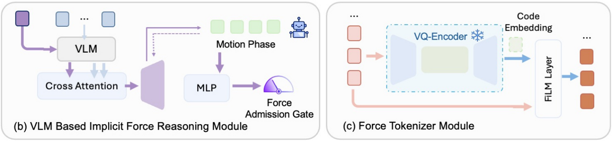
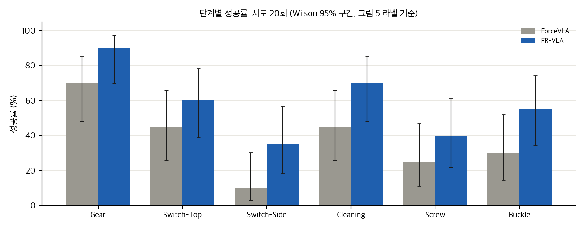
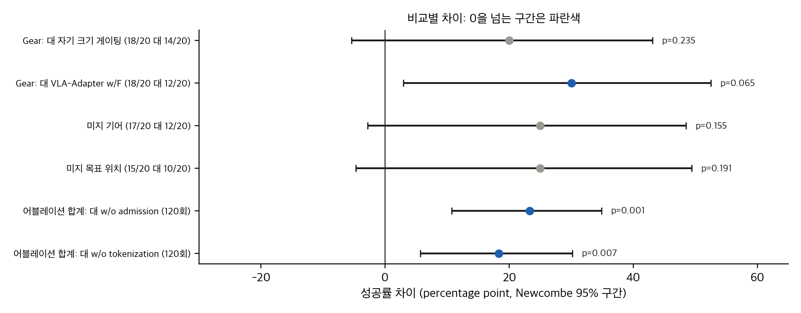

> **논문:** Jiaju He, Zhiyuan Yang, Ruyang Han, Jiahong Tang, Zhiping Lin, Haiyue Zhu. *FR-VLA: Implicit Force Reasoning VLA for Contact-Rich Manipulation.* CoRL 2026 포스터, arXiv:2610.25981 (v1, 2026-10-19).
> 공식 코드는 찾지 못했습니다(arXiv 초록, 프로젝트 페이지, GitHub 검색 2026-11-21). 이 글의 그림 세 장은 논문 그림 한 장의 발췌(출처 표기)와 우리가 그린 그래프 두 장입니다.

## 논문이 묻는 것

접촉이 많은 조작에서 힘 정보는 쓸모가 있지만 언제 쓸모가 있는지가 문제입니다. 삽입 과정에서 큰 힘은 제약일 수도 있고 잘못 맞춰졌다는 신호일 수도 있습니다. 그런데 힘이 줄어드는 순간은 제약이 풀렸다는 뜻일 수 있습니다. 기존 힘 입력 VLA는 힘을 정해진 경로로 넣습니다. 토큰 열에 넣으면 시각·언어 토큰에 묻히고, 행동 전문가에 바로 조건으로 주면 VLM이 작업 단계를 추론하는 자리를 건너뜁니다.

FR-VLA는 이 문제를 "힘 관련성의 근거 세우기"로 다시 씁니다. 힘 쿼리 토큰이 시각-언어 맥락에서 접촉 위상을 추정하고, 그 결과로 만든 admission 신호가 힘 토큰에 대한 주의를 올리거나 낮춥니다. 측정된 wrench 이력은 행동 쪽 별도 경로에 그대로 남습니다.

*그림 2 (b)(c) 발췌 (논문 원문). 그림 2의 (a)는 로봇 사진이 있어 싣지 않았습니다. © 저자, CC BY 4.0, 출처 arXiv:2610.25981 (v1).*

## 방법에서 기억할 두 가지

**첫째, admission은 확률 분포에서 나옵니다.** 위상 분포의 엔트로피가 크면 조정은 0으로 돌아갑니다. 위상이 불확실할 때 힘 조정을 하지 않는다는 뜻입니다. 힘 토큰 사이의 상대 점수는 바꾸지 않고 전체 주의 질량만 조절합니다.

**둘째, 위상 라벨은 학습 때만 힘으로 만듭니다.** 그리퍼 개폐로 구간을 나누고, 비접촉 구간의 중앙값을 기준으로 힘 편차가 임계값을 넘는 사건을 찾습니다. 추론 때는 힘 없이 시각-언어만으로 위상을 맞혀야 합니다.

## 논문의 결과

실로봇 다섯 과제(여섯 단계)에서 FR-VLA의 평균 성공률은 58.3%입니다. 그림 5의 막대를 같은 방식으로 평균하면 ForceVLA 37.5%, TA-VLA 35.8%, VLA-Adapter w/F 30.0%, VLA-Adapter 27.5%입니다. 어블레이션에서 힘 게이트를 빼면 35.0%, 힘 토큰화를 빼면 40.0%로 떨어집니다.

## 우리가 다시 계산한 것

논문의 표와 그림 5 라벨로 계산했습니다. 학습은 하지 않았습니다.

**여섯 단계 모두 최고입니다.** 최소 차이는 15 pp입니다. 그러나 단계마다 시도가 20회라서 단계별 Fisher p는 0.23에서 0.53 사이입니다. 어느 단계 하나도 기준선과 확실히 다르다고 하기 어렵습니다.

*그래프 (우리가 그림). FR-VLA와 가장 강한 기준선 ForceVLA의 단계별 값. 시도 20회, Wilson 95% 구간.*

**어블레이션이 가장 확실한 근거입니다.** 여섯 단계를 합치면(120회) 힘 게이트 제거와의 차이는 23.3 pp이고 Newcombe 95% 구간은 10.7–34.9입니다. 다만 단계 사이가 독립이라는 가정이 필요합니다.

**크기 기반 게이팅과의 비교는 약합니다.** Gear에서 90%와 70%(20회씩)의 차이는 20 pp이고 구간은 −5에서 43입니다(p = 0.24). 크기만으로는 관련성을 반영하지 못한다는 논문의 결론을 이 숫자로 확정하기는 어렵습니다. 80% 검정력으로 이 차이를 찾으려면 팔당 62회가 필요합니다.

*그래프 (우리가 그림). 비교별 성공률 차이. 파란 점은 구간이 0을 넘는 경우입니다.*

## 읽으면서 걸리는 점

- **위상 정확도는 순환할 수 있습니다.** 표 1의 정답은 학습 라벨과 같은 힘 기반 규칙을 rollout에 적용한 것입니다. 힘이 없이 시각-언어만으로 맞힌 정확도인지 아직 알 수 없습니다.
- **Cleaning에서는 접촉 구간 내내 admission이 억제됩니다.** 다른 과제는 접촉 구간에서 높습니다. 논문은 "안정된 힘은 새 정보가 적다"로 설명하지만, 정량 검사는 없습니다.
- **재현에 필요한 값이 빠져 있습니다.** VLM 백본, 학습 단계 수와 학습률, 힘 게이트 스케일, 코드북 손실 가중치, 과제와 로봇의 대응이 본문에 없습니다.

## 구현 가능성

- **원 실험 재현: 불가.** 실로봇 UR5e와 UR3e, 과제당 70–90회 시연, GPU 학습이 필요합니다. 공식 코드도 없습니다.
- **구성 요소 재구현: 가능합니다.** 위상 라벨 규칙, admission 게이트와 주의, 힘 VQ 토크나이저는 PyTorch로 옮길 수 있습니다. 노력은 1–2주로 추정합니다(측정 전).

이 글은 재현 실험을 하지 않았습니다. 재현은 필요성과 자원을 따져서 따로 정하는 것이 맞습니다.

## 출처와 라이선스

- 논문: arXiv:2610.25981 v1, CC BY 4.0(arXiv 라이선스 페이지 확인). 원문 PDF의 저작권 표시는 찾지 못했습니다.
- 그림 2의 (b)(c)는 원문에서 잘라 실었습니다(© 저자, CC BY 4.0). 로봇 사진이 있는 (a)는 싣지 않았습니다.
- 그래프 두 장과 재계산은 우리가 만들었습니다. 논문 표와 그림 5의 값은 인용과 재계산을 위해 옮겼습니다.
- 프로젝트 페이지: https://fr-vla.pages.dev/ (코드 링크는 없습니다).

## 자료

- [통합 리포트 PDF](report/report_public.pdf)
- [FR-VLA: 접촉이 많은 조작을 위한 암묵 힘 추론 VLA (arXiv:2610.25981) 논문 분석](analysis/01_paper_analysis.md)
- [FR-VLA 선행연구와 공식 저장소 (arXiv:2610.25981)](analysis/02_prior_work.md)
- [FR-VLA 수치 재계산과 일관성 검사](analysis/03_analysis.md)
- [FR-VLA 주장 검증 (공식 코드가 없어 논문 내부 대조)](analysis/04_claim_verification.md)
