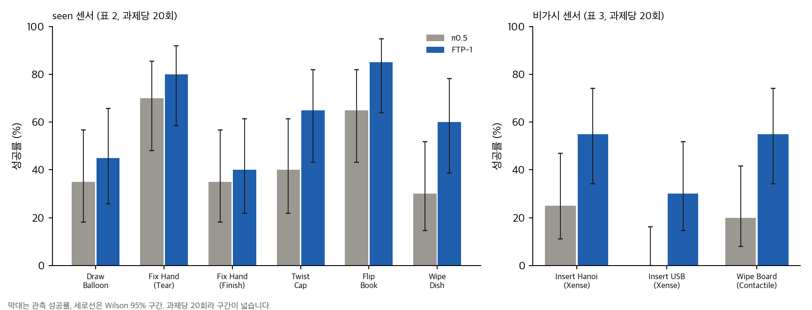
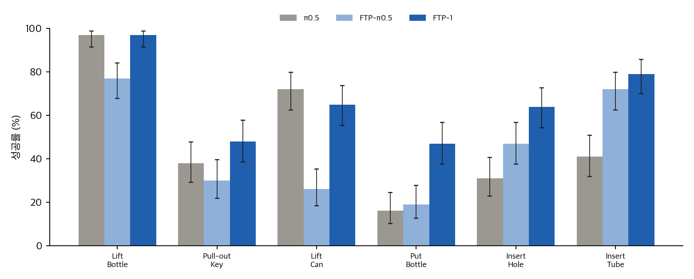
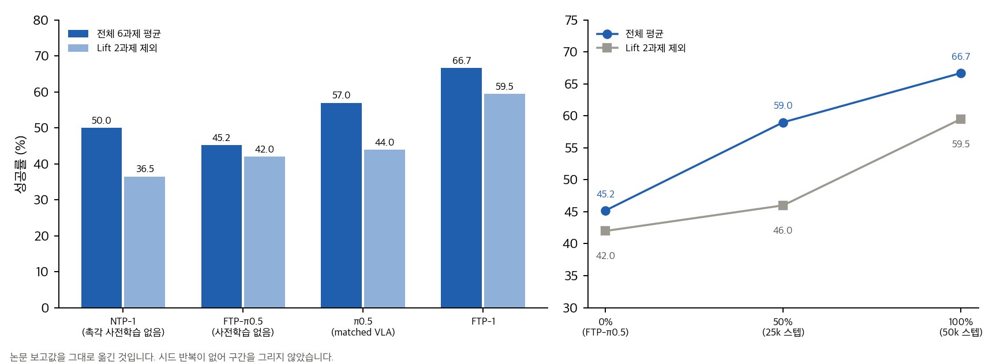

> **논문:** Chengbo Yuan 외 16명. *FTP-1: A Generalist Foundation Tactile Policy Across Tactile Sensors for Contact-Rich Manipulation.* CoRL 2026 포스터, arXiv:2606.13102 (v4, 2026-10-27).
> 공식 코드는 GitHub michaelyuancb/ftp1-policy(Apache-2.0)에 있습니다. 논문 라이선스는 CC BY-SA 4.0이라 이 글에는 논문 그림을 넣지 않았습니다. 그래프는 모두 표 값으로 우리가 다시 그렸습니다.

## 논문이 묻는 것

촉각 센서는 종류마다 신호 모양이 다릅니다. 이미지로 나오는 GelSight 계열, 배열로 나오는 촉각 패드, 힘과 토크 값만 주는 센서가 있습니다. 그래서 촉각 정책은 보통 센서와 로봇에 묶입니다. 센서가 바뀌면 처음부터 다시 학습해야 합니다.

FTP-1은 이 문제를 "범용 기반 모델"로 풉니다. 세 가지 설계가 핵심입니다.

- **기능 영역 토큰 (MTTS).** 센서가 무엇을 보든 손끝, 손바닥, 손목 같은 기능 영역 24칸에 맞춥니다. 각 칸에 공유 임베딩을 더합니다.
- **센서별 인코더.** 이미지형은 ViT와 공유 Transformer, 배열형은 CNN, 상태형은 MLP로 처리하고 같은 토큰 차원으로 맞춥니다.
- **공유 촉각 전문가.** 촉각 토큰을 독립된 Transformer 전문가가 처리하고, 블록 어텐션으로 행동 생성에 연결합니다. 기반은 π0.5입니다.

사전학습 데이터는 26개 출처, 21개 센서, 약 3,000시간입니다. 인간 손 데이터 20%, 손 로봇 30%, 그리퍼 50%로 섞었습니다.

*그림 1. 우리가 그린 그래프. 실로봇 과제별 성공률과 Wilson 95% 구간. 과제당 20회라 구간이 넓습니다. 왼쪽은 seen 센서(표 2), 오른쪽은 학습 때 없던 센서(표 3)입니다.*

## 이 글에서 확인한 것

**1. seen 센서의 +17.2%는 보고값 기준입니다.** 본문은 실로봇 평균 62.5와 π0.5의 45.3을 비교해 17.2를 씁니다. 그런데 π0.5의 6과제 값을 다시 평균하면 45.8이 나옵니다. 45.3은 과제당 20회 측정의 6과제 평균으로는 나올 수 없는 값입니다. 차이를 다시 계산하면 16.7%p입니다. 과제별 검정을 층화해서 보면 p = 0.007입니다. 방향과 유의성은 맞습니다. 숫자는 16.7%p로 읽는 것이 맞습니다.

**2. 학습 때 없던 센서의 +31.6%p는 소표본입니다.** Xense 이미지 센서 두 과제와 Contactile 배열 센서 한 과제, 세 과제 60회에서 FTP-1은 28회, π0.5와 FTP-π0.5는 각각 9회 성공했습니다. 차이는 p = 0.0003입니다. 다만 과제 하나가 흔들려도 결과가 달라질 수 있는 규모입니다. 이 결과를 "새 센서에서도 확실히 된다"로 읽기는 이릅니다. 상대로는 3배 이상이라 "+31%"라는 표기는 %p라는 점을 같이 봐야 합니다.

*그림 2. 우리가 그린 그래프. UniVTAC 6과제의 성공률과 Wilson 95% 구간(과제당 100회). 논문 표 1 값을 옮겼습니다.*

**3. 시뮬레이션 평균의 향상은 맞습니다.** 전체 평균은 66.7%로 π0.5의 49.2%보다 17.5%p 높습니다. 과제 Lift Can만 FTP-1(65)이 π0.5(72)보다 낮습니다. 독립 시행으로 계산하면 p는 10^-4보다 작습니다. 다만 시드를 반복하지 않았습니다.

**4. 사전학습 효과는 전체 평균에서만 뚜렷합니다.** 이 논문의 핵심 질문은 "사전학습이 촉각 지식을 주는가"입니다. 이를 보려고 저자는 같은 데이터로 촉각 입력만 뺀 사전학습(NTP-1)을 만들었습니다. UniVTAC 전체 평균은 NTP-1 50.0, FTP-1 66.7로 차이가 큽니다. 하지만 NTP-1과 촉각 사전학습 없는 FTP-π0.5를 비교하면 전체 평균에서 +4.8%p(p = 0.11)이고, Lift 두 과제를 뺀 평균에서는 반대로 −5.5%p입니다. 본문이 "NTP-1이 FTP-π0.5보다 낫다"고 쓰는 것은 약한 근거 위에 있습니다.

*그림 3. 우리가 그린 그래프. 논문 표 4, 10, 11의 UniVTAC 평균 값입니다. 과제별 값이 없어 구간은 그리지 않았습니다. 왼쪽은 사전학습 대조, 오른쪽은 데이터와 스텝을 함께 늘린 경우입니다.*

**5. 힘 프로빙은 엇갈립니다.** 동결 특징에서 미끄럼 감지 F1은 0.725에서 0.780으로 올랐습니다. 반면 FeelAnyForce 데이터셋의 힘 추정 MAE는 0.273에서 0.314와 0.424로 나빠졌습니다. 본문은 "힘 정보가 남아 있다"는 쪽만 씁니다. 나빠진 쪽은 보고하지 않습니다.

**6. 촉각 입력이 해칠 수 있다는 말은 근거가 약합니다.** 본문은 "촉각 입력이 시각-언어 지각을 방해할 수 있다"고 씁니다. FTP-π0.5(촉각 있음)와 π0.5(촉각 없음)의 차이는 −4.2%p이고 p = 0.60입니다. 방향만 있고 확실하지 않습니다.

## 공식 코드와 맞춰 보기

- **구조는 맞습니다.** 블록 어텐션 마스크(비전-언어, 촉각, 행동 세 블록)와 MTTS 24칸, 행동 차원 120은 공식 코드와 같습니다.
- **촉각 전문가 크기가 다릅니다.** 본문은 300M 전문가를 말하고 부록은 폭 1024를 줍니다. 공식 학습 스크립트는 모두 폭 512의 `gemma_small`을 씁니다. 블록 파라미터는 폭 1024가 약 311M, 폭 512가 약 99M으로 계산됩니다. 어느 쪽으로 배포 체크포인트를 학습했는지는 확인하지 못했습니다.
- **사전학습 예제가 논문과 다릅니다.** 논문은 50k 스텝, 배치 768을 씁니다. 공개 예제는 150k 스텝, 배치 128입니다. README는 이 예제를 "가벼운 예제"라고 씁니다. 논문 전체 레시피는 공개되지 않았습니다.
- **파인튜닝 설정은 맞습니다.** 배치 64, 20k 스텝, 학습률 5e-5에서 5e-6은 논문과 스크립트가 같습니다.
- **공개 상태가 논문 문장과 다릅니다.** v4 초록은 체크포인트와 코드가 "앞으로 공개될 것"이라고 쓰지만, 저장소는 2026년 6월에 이미 만들어졌고 체크포인트 링크가 있습니다.

## 맥에서 할 수 있는 것

이 맥에는 CUDA가 없습니다. 사전학습(48장 GPU), 파인튜닝, UniVTAC 시뮬(Isaac Sim), 실로봇 재현은 모두 불가능합니다. 공식 체크포인트를 받아 단일 샘플 추론을 MPS에서 돌리는 것은 조건부로 가능합니다. 포팅에는 1–2주쯤 걸릴 것으로 추정합니다. 이것도 체크포인트 크기와 설치 승인을 먼저 확인해야 합니다.

## 정리

FTP-1은 "촉각 정책을 센서 밖에서 사전학습한다"는 방향을 분명히 보여 줍니다. 공유 토큰 공간과 독립 촉각 전문가라는 설계도 명확합니다. 다만 세 가지를 조심해서 읽어야 합니다. 첫째, seen 센서의 향상은 16.7%p로 읽습니다. 둘째, 학습 때 없던 센서의 +31.6%p는 세 과제 60회 결과입니다. 셋째, 사전학습 효과는 시뮬 전체 평균에서만 뚜렷합니다.

## 자료

- [통합 리포트 PDF](report/report_public.pdf)
- [01. 논문 분석: FTP-1 (arXiv:2606.13102 v4)](analysis/01_paper_analysis.md)
- [02. 선행연구, 코드 저장소, 관련 분석](analysis/02_prior_work.md)
- [03. 재계산, 검정, 일관성 검사](analysis/03_analysis.md)
- [04. 공식 코드 대조 (정적 읽기)](analysis/04_code_verification.md)
