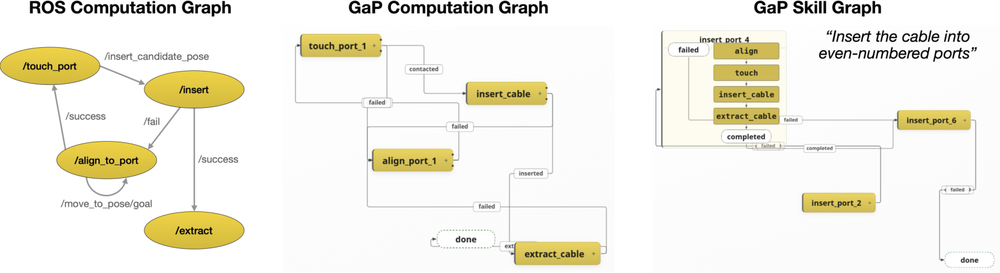
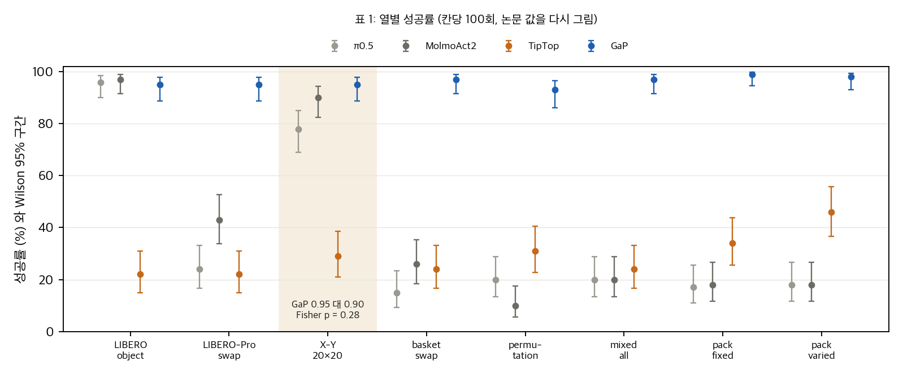
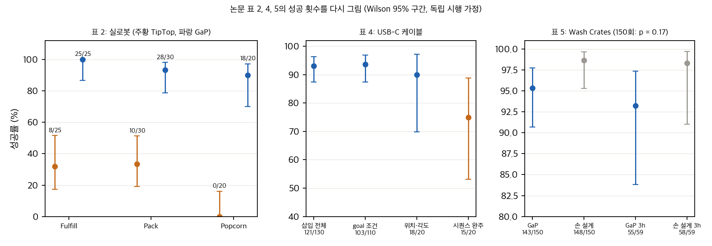
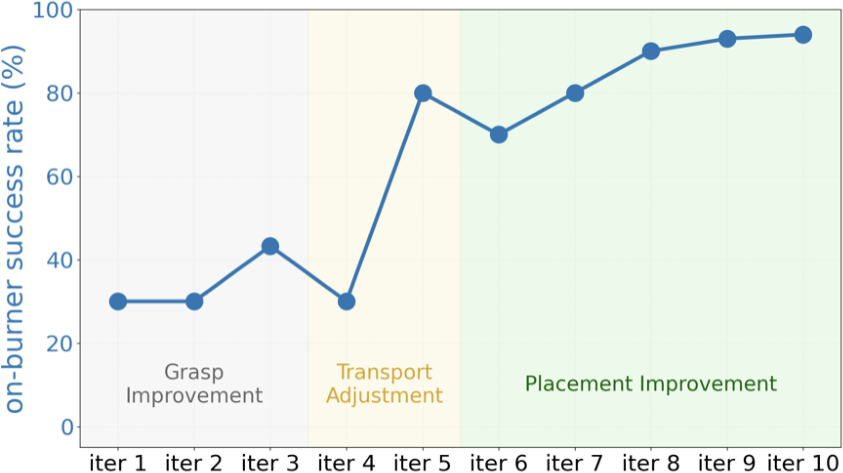
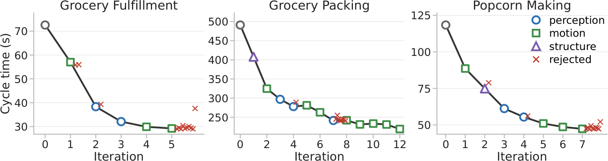
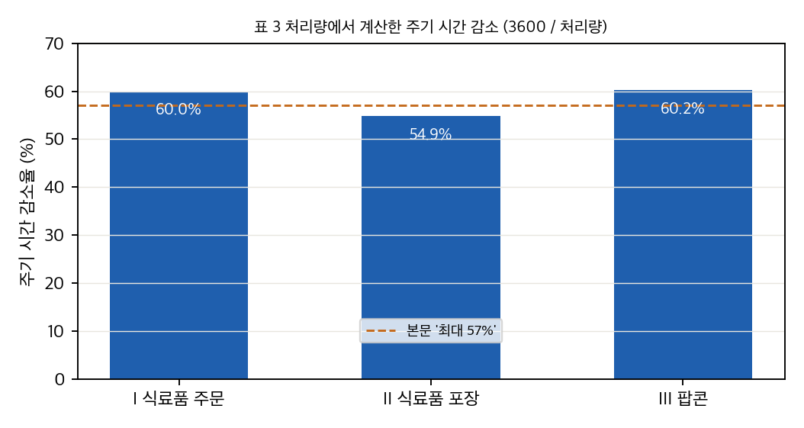
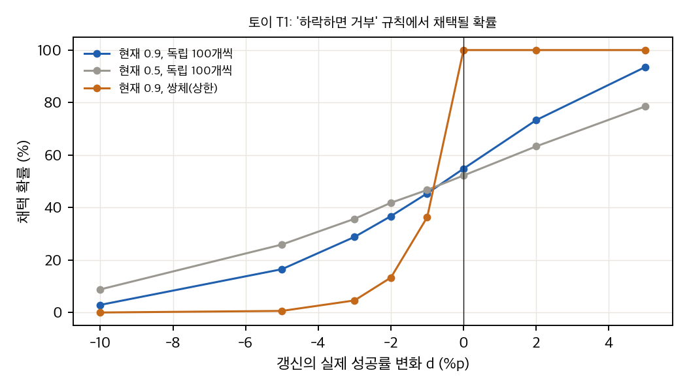

> **논문:** Kaiyuan Chen, Shuangyu Xie 외 22명. *GaP: A Graph-as-Policy Multi-Agent Self-Learning Harness For Variational Automation (VA) Tasks.* CoRL 2026 Spotlight, arXiv:2607.05369 (v3, 2026-11-04).
> 공식 코드는 GitHub graph-robots/graph-as-policy(Apache-2.0, 베타)에 있습니다. 이 글의 그림은 논문 그림 세 장(출처 표기)과 우리가 그린 그래프 네 장입니다.

## 논문이 묻는 것

범용 로봇(VLA)은 아직 산업 수준의 신뢰도에 못 미칩니다. 그렇다고 같은 동작만 되풀이하는 고정 자동화로 돌아가기에는, 물체의 모양과 자세가 매번 조금씩 다른 일이 많습니다. 저자들은 이 중간 영역을 "Variational Automation(VA)"이라 부릅니다. 작업 셀은 고정되어 있고 물체 형상과 자세 범위만 알려져 있는 반복 과제입니다.

GaP의 답은 코딩 에이전트가 로봇 정책을 "타입이 있는 계산 그래프"로 쓰게 하는 것입니다. 노드는 인지, 파지 계획, 모션 계획 같은 스킬이고, 간선은 데이터 흐름과 조건 분기입니다. 만들어진 그래프는 시뮬레이션에서 리허설하며 고치고, 배포할 때는 코딩 에이전트 없이 인터프리터가 실행합니다.

*그림 1. 케이블 삽입 과제의 ROS 계산 그래프(왼쪽)와 GaP가 같은 노드로 만든 그래프(가운데, 오른쪽). © 저자, CC BY 4.0, 출처 arXiv:2607.05369 (논문 그림 5).*

## 표 1: 위치가 변할 때 격차는 크지만, 두 열은 다릅니다

시뮬레이션 비교(표 1)는 칸당 task instance 100개, 55칸 5,500회입니다. 모든 값이 100개 중 정수 비율과 맞습니다. GaP는 VLA(π0.5, MolmoAct2), TAMP 계열 TipTop, 단일 에이전트 CaP-X와 비교됩니다.

*그림 2. 표 1의 성공률과 Wilson 95% 구간(우리가 다시 그린 그래프, 값은 논문 표 1).*

열별로 가장 높은 순수 기준선과 100 대 100으로 비교하면 8열 중 6열에서 차이가 52–73 %p이고 p < 0.001입니다. 반면 X-Y 20×20 열은 GaP 0.95 대 MolmoAct2 0.90이라 Fisher p = 0.28이고, LIBERO object 열은 GaP(0.95)가 VLA(0.96, 0.97)보다 낮습니다. 100 대 100의 검출 한계는 성공률 0.9 부근에서 12 %p 정도라 5 %p 차이는 이 시행 수로 구분되지 않습니다.

본문 §5.3.1은 VLA의 성능이 LIBERO-PRO에서 0.20까지 떨어진다고 씁니다. 표 1에서 LIBERO-Pro 열의 VLA 값은 0.24와 0.43이고, 0.20(그리고 표 전체의 최솟값 0.10)은 VA 열(permutation, mixed all)에서 나옵니다. 서술이 가리키는 열과 표의 열이 다르게 읽힙니다.

GaP로 대상 위까지 이동한 뒤 VLA에 넘기는 하이브리드는 "두 배 넘는 개선"으로 요약됩니다. 배율을 열별로 보면 8열 중 5열에서 2배 이상이고, LIBERO object 열에서는 두 VLA 모두 오히려 낮아집니다(0.85, 0.70). VLA가 약한 열(바구니 교환, 순열, 혼합, 포장)에서 성립하는 서술입니다.

## 실로봇, 케이블 삽입, 상자 씻기

*그림 3. 표 2, 4, 5의 성공 횟수와 Wilson 95% 구간(독립 시행 가정, 우리가 다시 그린 그래프).*

- **표 2(실로봇).** GaP는 25/25, 28/30, 18/20이고 TipTop은 8/25, 10/30, 0/20입니다. 과제 수준의 차이는 p < 1e-5로 분명합니다. 다만 하위 조건은 5회씩이라 개별로는 구분하기 어렵습니다(예: 대상 물체 3/5 대 5/5, p = 0.44). Pack Grocery Items의 30은 물건 단위 시행(6개 × 5회)으로 읽을 수 있고, 이 경우 같은 시행 안의 물건이 독립이 아닐 수 있습니다(시행 수 가정).
- **표 4(USB-C).** 121/130(0.931, Wilson [0.874, 0.963])으로 합이 맞습니다. 시퀀스 단위로 보면 15/20(75%)입니다. 표의 실행 시간을 포트 수로 나누면 삽입당 32–35초이고, 본문은 "약 30초"라고 씁니다.
- **표 5(Wash Crates).** GaP 143/150, 손 설계 그래프 148/150으로 차이는 −3.3 %p, Fisher p = 0.17, 차이의 95% 구간은 [−7.2, +0.5] %p입니다. 본문의 "closely matches"는 동등성 한계가 정의되어 있지 않아 이 시행 수로는 검정되지 않습니다.

## 자기 학습: Make Popcorn과 주기 시간

Make Popcorn에서 초기 그래프는 성공률 33%이고, 10번의 갱신 끝에 시뮬레이션 94%, 실로봇 90%(18/20)에 이릅니다.

*그림 4. Make Popcorn 자기 학습의 반복별 on-burner 성공률(왼쪽의 시뮬레이션 렌더 패널은 뺀 그래프 부분). © 저자, CC BY 4.0, 출처 arXiv:2607.05369 (논문 그림 2).*

그림에서 읽은 값(그림 판독 값)은 30, 30, 43, 30, 80, 70, 80, 90, 93, 94%입니다. 앞의 값들은 환경 30개일 때의 정수 비율(9/30, 13/30, …)과 맞고 마지막 94%만 맞지 않습니다. 반복마다 30개, 마지막 평가에 100개를 쓴 것일 수 있으나 본문에는 적혀 있지 않아 저자 확인이 필요합니다. 본문이 서술하는 단계(반복 1–3 파지, 4 지각 프롬프트, 4–8 놓기 오프셋)와 그림의 음영(1–3, 4–5, 6–10)도 다르게 나뉘어 있습니다.

성공률이 포화한 벤치마크에서는 주기 시간을 줄이는 방향으로 다시 자기 학습을 합니다.

*그림 5. 세 벤치마크의 반복별 주기 시간과 편집 종류(지각, 모션, 구조, 거부). © 저자, CC BY 4.0, 출처 arXiv:2607.05369 (논문 그림 3).*

표 3의 처리량(cycles/hr)에서 주기 시간을 3600/처리량으로 계산하면 그림 3의 값과 맞습니다(식료품 주문 72.4 → 29.0초, 포장 493 → 222초, 팝콘 118 → 47초). 즉 표 3의 처리량은 성공률을 곱하지 않은 값입니다. §2는 처리량을 "성공률 / 주기 시간"으로 정의하므로, 표 3을 이 정의로 읽을 때는 주의가 필요합니다(팝콘 초기 성공률 0.33을 곱하면 30.5가 아니라 10.1이 됩니다). 또 본문의 "주기 시간 최대 57% 감소"는 표 3으로 계산하면 60.0%, 54.9%, 60.2%입니다.

*그림 6. 표 3 처리량에서 계산한 주기 시간 감소율과 본문의 "최대 57%"(우리가 그린 그래프).*

## 채택 규칙은 얼마나 잡음에 민감한가 (토이)

§4.2는 "새 task instance 100개에서 성공률이나 주기 시간이 떨어지는 갱신은 거부한다"고 씁니다. 이 규칙이 표본 잡음에서 어떻게 작동하는지 numpy 토이로 계산했습니다. 갱신의 실제 효과 분포는 논문에 없어 가정이고, 쌍체 비교인지 독립 측정인지도 적혀 있지 않아 둘 다 계산했습니다.

*그림 7. 현재 성공률과 측정 방식별로, 실제 성공률이 d만큼 변하는 갱신이 규칙을 통과할 확률(토이, 효과 분포는 가정).*

독립 100개씩 비교하면 현재 성공률 0.9에서 3 %p 떨어뜨리는 갱신이 약 29%, 5 %p 떨어뜨리는 갱신이 약 17% 채택됩니다. 같은 난이도 난수를 공유하는 쌍체 비교(이상화한 상한)에서는 3 %p 후퇴가 5% 안팎입니다. 이 계산은 논문의 큰 이득(30% → 94%)을 뒤집지 않습니다. 다만 성공률이 0.95를 넘는 구간에서는 비교 방식이 최종 값에 영향을 줄 수 있어, 방식을 적어 두는 것이 재현에 필요합니다.

## 공식 코드와 논문

공식 저장소(커밋 `e572392`)를 정적으로만 읽었습니다. 실행, 설치, 가중치 다운로드는 하지 않았습니다.

- **범위.** 저장소는 베타 v1이고 문서가 "language → verified pick-and-place graphs on LIBERO and real Franka/UR"로 범위를 적습니다. 학습형 파지(GraspGen, M2T2), 양팔, 스토브 노브, USB 삽입, Isaac 기반 리허설은 "cut for scope"로 열거되어 있어 논문의 Make Popcorn, USB-C, Wash Crates에 해당하는 그래프는 저장소에서 찾지 못했습니다.
- **자기 학습.** 알고리즘 1(병렬 리허설, 100개 새 인스턴스 거부)에 해당하는 루프는 이 저장소에 없고, 별도 저장소(agentic-self-learning)가 있습니다. 그 루프는 코딩 에이전트 세션 하나를 이어서 쓰고 보류 에피소드로 평가하는 다른 구조입니다.
- **설정.** 기본 모델은 논문과 같은 Gemini-3.1-Flash-Lite 계열이지만 온도 기본값은 0.7(부분 에이전트 0.3)이고 논문은 0.1입니다. 평가 하니스는 과제 10개 × 시드 50개(칸당 500회)로, 논문의 칸당 100 instance와 구성이 다릅니다. 벤치마크 워커는 정책이 없을 때 관절을 목표 각도로 옮기는 "teleport" 모드를 기본으로 씁니다.
- **일치하는 부분.** 생성(coordinator → 부분 그래프 에이전트 → 체크포인트 에이전트)과 정적 검증(연결성, 타입, 종료 값), 준비된 노드를 동시에 실행하는 실행기는 논문 서술과 맞습니다.
- **메타데이터.** LICENSE와 `pyproject.toml`은 Apache-2.0이고 `NOTICE.md`는 MIT라고 적습니다.

## 읽고 남은 것

GaP의 중심 아이디어, 즉 에이전트의 산출물을 타입이 있는 그래프로 제한하고 정적으로 검사한 뒤 시뮬레이션 결과로 고친다는 구조는 코드에서도 구현되어 있습니다. 위치 변동 열 대부분과 실로봇 과제 수준의 차이는 큽니다. 남는 질문은 세 가지입니다. 표 3의 처리량 정의와 "최대 57%"의 계산, 그림 2의 평가 표본(N과 94%의 분모), 그리고 절제(§5.4)의 시행 수입니다. 절제는 표 없이 "0으로 무너진다"로만 보고되어 효과 크기를 재계산할 수 없습니다. 이 항목들은 저자 확인이 필요합니다.

분석 노트(표 재계산, 코드 대조, 스크립트)는 함께 올린 저장소에 있습니다.

## 자료

- [통합 리포트 PDF](report/report_public.pdf)
- [01. 논문 분석: GaP (arXiv:2607.05369)](analysis/01_paper_analysis.md)
- [02. 선행연구와 관련 저장소](analysis/02_prior_work.md)
- [03. 수치 재계산, 일관성 검사, 토이 실험](analysis/03_analysis.md)
- [04. 공식 코드 대조와 구현 가능성](analysis/04_code_verification.md)
