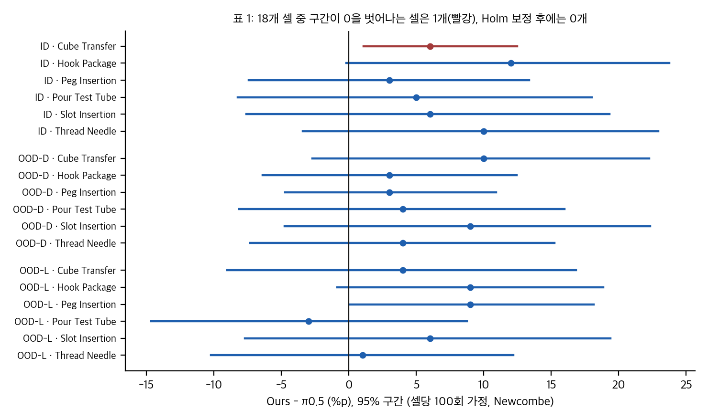
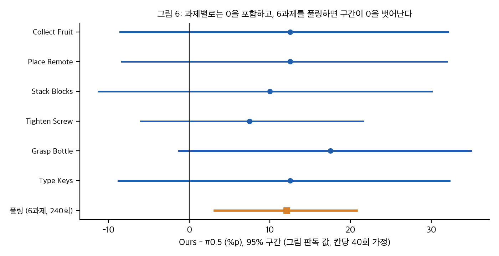
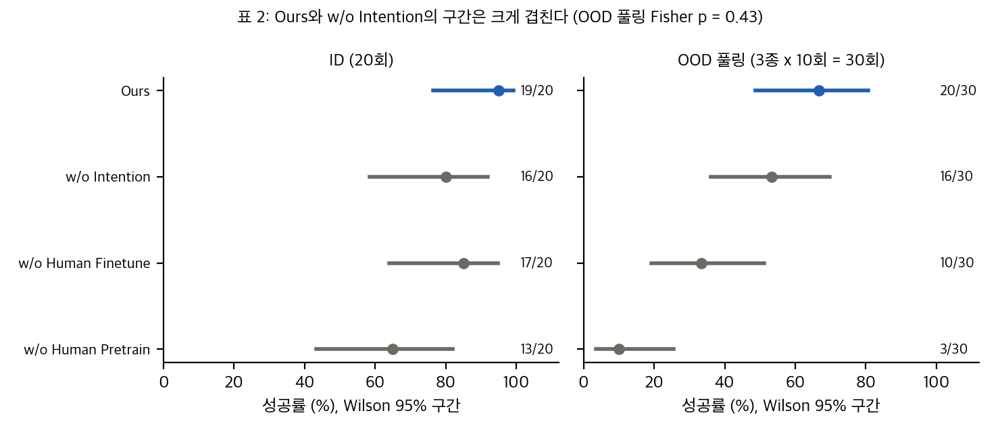
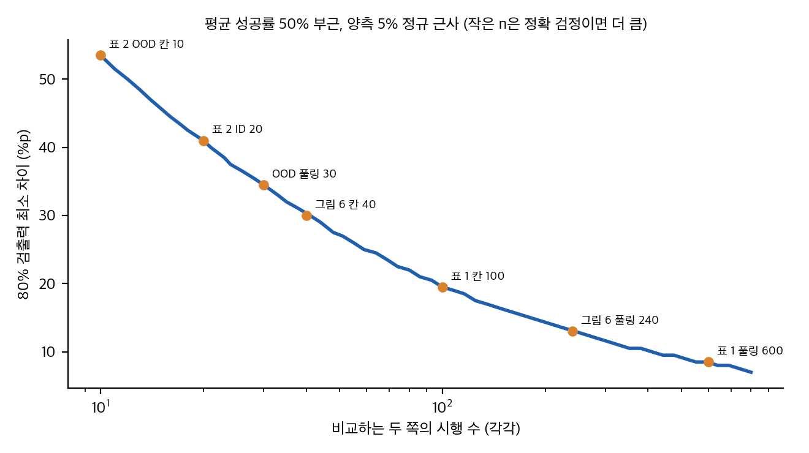

# 03. 수치 재계산과 해석

논문의 표·그림 수치를 다시 계산하고 표와 본문이 서로 맞는지 봅니다. 스크립트는 `analysis/recompute.py`(결과 `analysis/recompute_results.json`)와 `analysis/plot_figures.py`입니다. 이 문서의 검사 번호는 V1–V14입니다. 재현 실험은 하지 않았고, 원자료가 없으므로 모든 검사는 **보고된 값끼리** 맞는지를 봅니다.

## 0. 읽는 법

- **시행 수 가정.** 표 1은 4.2절의 "100회 시행"(셀당)을 따릅니다. 그림 6은 부록 D.1의 "2라운드 × 20회 = 40회"를 따르고, 막대 라벨은 그림에서 읽었습니다(그림 판독 값). 표 3은 시행 수가 없어 20회와 40회를 둘 다 계산합니다. 표 2와 표 6의 시행 수는 표에 있습니다. 가정한 곳은 문장 안에 "(시행 수 n 가정)"으로 적었습니다.
- **검정.** 시행이 서로 독립이라고 보고 두 비율은 Fisher 정확 검정, 층화는 Mantel–Haenszel(CMH), 구간은 Wilson과 Newcombe를 씁니다. 같은 세션·같은 초기 배치가 섞이면 실제 불확실성은 더 큽니다. 다중 비교는 Holm입니다.
- **토이 실험은 하지 않았습니다.** 논문의 중심 주장(의도 CoT가 행동을 개선한다, 사람 데이터가 로봇 데이터보다 효율적이다)은 학습과 로봇 시행이 필요합니다. CPU에서 가능한 토이로는 이 주장을 시험할 수 없다고 판단해, 수치 재계산·검출력 계산·공개 코드의 정적 근거 추출(`analysis/code_evidence.py`)로 대신했습니다.

## 1. 표 1: AV-ALOHA 시뮬레이션 (V1–V4)

### V1. 평균 열 재계산

12개 평균(4방법 × 3조건) 중 11개는 6과제 값의 평균을 반올림한 값과 일치합니다. 한 칸이 다릅니다: **ID의 π0.5는 평균 41.67인데 표에는 41**입니다(반올림하면 42). 나머지는 ID Ours 48.67 → 49, ID HRDT 38.5 → 39 등 반올림입니다. 표와 본문의 "ID 49 대 41"은 8 %p 차이로 읽히지만 반올림 규칙을 통일하면 7 %p입니다(원값 합계 292 대 250 / 600회 = 7.0 %p).

### V2. "OOD에서 π0.5 대비 22% 상대 향상" (4.2절)

12개 OOD 셀 평균은 Ours 27.4, π0.5 22.5로 상대 +21.9%입니다. 표에 적힌 반올림 평균으로 (28+27)/(22+23) − 1 = +22.2%입니다. 조건별로 나누면 Distractors +25.0%, Lighting +18.8%입니다. 본문 22%는 두 OOD 조건을 합친 값과 맞습니다. 같은 방식의 ID 상대 향상은 +16.8%입니다.

### V3. 셀 단위 우열 (18셀)

Ours가 단독 최고인 셀은 14개, 기준선과 동률인 셀 1개(OOD-Distractors Thread Needle, 23 = HRDT 23), 기준선이 더 높은 셀 3개입니다.

- ID Pour Test Tube: Ours 39, LFA 41
- ID Thread Needle: Ours 43, LFA 56 (LFA가 13 %p 높음)
- OOD-Lighting Pour Test Tube: Ours 22, π0.5 25

"모든 기준선을 이긴다"는 서술은 평균 열에 대해서입니다. 표 1 캡션의 "대부분의 OOD 설정에서 강건성이 개선된다"는 위 수치와 맞습니다.

### V4. 셀 단위와 풀링 검정 (셀당 100회 가정)

| 비교 | 셀 단위 | 풀링 (6과제 × 100 = 600회) |
|---|---|---|
| ID, Ours 대 π0.5 | 6셀 중 Fisher p < 0.05는 1개(Cube Transfer +6 %p, p = 0.029), Holm 후 0개 | +7.0 %p, p = 0.017 |
| ID, Ours 대 LFA | - | +5.3 %p, **p = 0.073** |
| OOD-Distractors, Ours 대 π0.5 | 0개 | +5.5 %p, p = 0.032 |
| OOD-Lighting, Ours 대 π0.5 | 0개 | +4.3 %p, p = 0.096 |
| OOD-Lighting, Ours 대 HRDT | - | +21.0 %p, p = 2.7e-23 |
| 18셀 전체, Ours 대 π0.5 (CMH) | - | p = 5.4e-5, 공통 오즈비 1.38 |

- 18셀의 Ours − π0.5 차이는 한 셀(Pour Test Tube Lighting −3)을 빼고 모두 0 이상이고 방향이 일관됩니다(+1 ~ +12 %p). 셀 하나하나는 100회로는 구별되지 않고, 셀을 층으로 묶은 CMH에서 일관된 우위가 나타납니다.
- 같은 정확 검정으로 π0.5와 비교하는 한 셀(약 8 %p 차이)의 검출력은 약 0.21입니다(V13). 셀 단위 "비유의"는 차이가 없다는 뜻이 아니라 이 시행 수로는 판단할 수 없다는 뜻입니다.
- ID 평균 49 대 LFA 43은 풀링에서도 p = 0.07이라 구별되지 않습니다. 본문 "ID와 OOD 모두에서 모든 기준선을 이긴다"를 통계적 우위로 읽을 수 있는 쪽은 ID의 π0.5·HRDT, OOD-Distractors의 π0.5·LFA·HRDT, OOD-Lighting의 HRDT·LFA입니다.

## 2. 그림 6: 실로봇 (V5, 그림 판독 값, 칸당 40회 가정)

### V5. 평균, 격자, 12.1%

- **격자 점검.** 40회면 성공률은 2.5%의 배수입니다. 24개 막대 라벨은 모두 어떤 k/40(k는 정수)의 반올림으로 설명됩니다. 14개는 정확히 .5 경계입니다(예: 2 ← 2.5%, 12 ← 12.5%, 43 ← 42.5%, 68 ← 67.5%). 경계의 반올림 방향이 섞여 있습니다(2·12·22·32·52·62·72는 내림, 38·43·48·68·78은 올림). 그림 6 라벨을 40회 격자로 되살릴 수 있다는 정도로 읽으면 됩니다.
- **평균.** 6과제 평균은 EgoMimic 38.3, HRDT 37.0, π0.5 40.8, Ours 53.0입니다. Ours − π0.5 = +12.2 %p(라벨 평균), 격자 값 평균으로는 +12.1 %p입니다. 1절의 "12.1%"는 π0.5가 평균이 가장 높은 기준선이라는 의미의 평균 차이와 맞습니다.
- **과제별 최고 기준선 대비.** 과제마다 가장 높은 기준선(Collect Fruit π0.5, Place Remote EgoMimic, Stack Blocks π0.5, Tighten Screw π0.5, Grasp Bottle HRDT, Type Keys π0.5)과 비교하면 평균 43.8이고 Ours는 +9.2 %p입니다. "strongest baseline" 표현이 평균 기준임을 본문이 밝히지 않습니다.
- **우열.** Ours는 6과제 모두에서 막대 값이 가장 높습니다.

### 검정 (40회 가정)

| 비교 | 값 |
|---|---|
| 과제별 Ours 대 π0.5 Fisher p | Collect Fruit 0.36, Place Remote 0.35, Stack Blocks 0.50, Tighten Screw 0.43, Grasp Bottle 0.11, Type Keys 0.36 (Holm 후 모두 ≥ 0.68) |
| 6과제 풀링(240회) Ours 127 대 π0.5 98 | +12.1 %p, Fisher p = 0.010, CMH p = 0.0035, 공통 오즈비 1.83 |
| 풀링 Ours 대 EgoMimic | CMH p = 4.0e-4 |
| 풀링 Ours 대 HRDT | CMH p = 9.3e-5 |
| Wilson 95% (풀링 240회) | Ours 46.6–59.1%, π0.5 34.8–47.1% |

과제 하나(40회)로는 12 %p 차이가 구별되지 않고, 과제 6개를 묶으면 구별됩니다(검출력 약 0.76, V13). 오차막대(두 라운드의 표준편차)는 막대 위 숫자로는 복원되지 않아 계산에 쓰지 않았습니다.

## 3. 표 2: 절제 (V6)

ID 20회, OOD 각 10회(OOD 풀링 30회)입니다. 성공 수 합계는 Ours 39/50, w/o Intention 32/50, w/o Human Finetune 27/50, w/o Human Pretrain 16/50입니다.

| 비교 (Ours 대 …) | 칸별 Fisher p (ID, Pos, Obj, Scene) | OOD 풀링 30회 | 4칸 CMH |
|---|---|---|---|
| w/o Intention | 0.34, 1.0, 0.63, 1.0 | 20/30 대 16/30, p = 0.43 | p = 0.11, 공통 오즈비 2.2 |
| w/o Human Finetune | 0.60, 0.37, 0.35, 0.17 | 20/30 대 10/30, p = 0.019 | p = 0.0056, 공통 오즈비 4.1 |
| w/o Human Pretrain | 0.044, 0.057, 0.023, 0.011 | 20/30 대 3/30, p = 1.1e-5 | p = 5.3e-7, 공통 오즈비 16.9 |

- **의도 절제.** 네 칸 모두 Ours가 같거나 높지만(+3, +1, +2, +1 성공) 칸마다도, 풀링해도(p = 0.43, CMH 0.11) 구별되지 않습니다. 본문 "일관되게 높인다"는 방향의 일관성에 대해서는 맞고, 효과의 확실성에 대해서는 이 표로 판단할 수 없습니다. 의도 효과를 보여 주는 논거는 이 표보다 그림 8(실패 사례)과 표 3입니다(그림 8은 정성적, 표 3은 §4).
- **사람 데이터.** 사전학습을 뺀 쪽의 하락은 확실합니다(OOD 3/30 대 20/30). 사후학습의 사람 데이터를 뺀 쪽(OOD 10/30)도 풀링에서 구별됩니다.
- **ID의 한계.** ID 19/20의 Wilson 구간은 76–99%입니다.

## 4. 표 3과 표 6 (V7, V8)

### V7. 표 3: 의도 원천 (Fruit Collecting)

시행 수가 표에 없습니다. 20회를 가정하면 Predicted(Ours) 13/20 대 VLM Keypoint 10/20은 p = 0.52, 대 No Intention 8/20은 p = 0.20, 대 Random Noise 5/20은 p = 0.025입니다. 40회를 가정하면 각각 p = 0.26, 0.043, 0.0006입니다. 즉 "의도를 주지 않거나 무작위로 주면 떨어진다"는 20회에서는 무작위에서만, 40회에서는 의도 없음에서도 구별됩니다. "시선이 VLM 키포인트를 크게 앞선다"(65 대 50)는 이 시행 수에서는 구별되지 않습니다. 또 Human Gaze와 Predicted가 같은 65%라서 "예측 시선이 사람 시선만큼 쓸 만하다"는 읽힙니다.

같은 과제(Fruit Collecting)의 그림 6 Ours는 라벨 68(40회면 27/40 = 67.5%)이고 표 3의 Predicted(Ours)는 65입니다. 3 %p 차이가 시행 집합이 다른 것인지 평가 조건 차이인지 논문에 적혀 있지 않습니다. 가능성 하나: 그림 6의 이 막대 오차막대(그림 판독 값, 약 ±4)는 두 라운드가 65%와 70%일 때의 표본 표준편차(3.5)와 맞고, 그렇다면 표 3의 65%는 한 라운드(13/20)와 같은 값이며 표 3의 시행 수는 20회로 볼 수 있습니다. 확인은 저자에게 물어야 합니다.

### V8. 표 6과 그림 9

표 6의 ID(5회) + OOD(15회) 합계는 13, 16, 17, 17, 18 / 20으로 그림 9 라벨 65, 80, 85, 85, 90과 모두 일치합니다. 데이터 양은 표 5와 일치합니다: 그림 6의 Grasp Bottle Ours(85)는 로봇 20궤적 + 사람 100궤적이고, 표 6의 "10m human + 10m robot"(17/20 = 85%)과 같은 구성입니다.

본문 "사람 10분을 더한 효과는 로봇 20분을 더한 효과와 비슷하다"는 85%(17/20)와 80%(16/20)·85%(17/20, 30분 로봇)로 맞습니다. 다만 세 값 사이의 Fisher p는 모두 1.0이고, 가장 큰 격차(10m 로봇 65% 대 20m 사람+10m 로봇 90%)도 p = 0.13입니다. 시행 20회에서는 이 곡선의 순서를 확정할 수 없습니다. 시간 기준 비교에서 사람 10분은 약 100궤적, 로봇 20분은 약 40궤적입니다(부록 E.2).

## 5. 단위와 산술 점검 (V9–V11)

### V9. 의도 예측 오차의 단위 (4.1절)

224×224 영상의 대각선은 316.8 px이므로 대각선의 4.8%는 15.2 px입니다. 11 px는 대각선의 3.5%, 한 변(224)의 4.9%입니다. 두 숫자는 "한 변의 약 4.8–4.9%" 또는 "대각선의 약 3.5%"라는 서로 다른 기준에서 나온 것으로 보입니다. 224 bin의 양자화 오차는 최대 0.5 px이라서 11 px 오차는 토큰화가 아니라 예측의 오차입니다.

### V10. 사전학습 계산량 (표 4, 부록 B.2)

1,344 GPU시간 / 8 GPU = 168시간(7일), 스텝당 30.2초입니다. 20,000 스텝 × 배치 2048 = 4,096만 샘플로 1.5억 프레임의 0.27회 통과입니다. 표 4의 "그래디언트 누적 4"가 배치 2048과 별개로 곱해지는 것이라면 1.64억 샘플(1.09회 통과)입니다. 배치 2048이 누적을 포함한 값인지는 논문에 적혀 있지 않습니다. 후자라면 GPU당 마이크로 배치는 64, 전자라면 256입니다.

### V11. 추론 지연 (부록 E.6)

44.384 − 32.205 = 12.179 ms로 보고된 추가 지연과 정확히 맞습니다. 상대 증가는 +37.8%이고, 10 Hz 주기(100 ms)의 44.4%입니다. 한계 절의 "추가 추론 시간"은 이 수치와 일관됩니다. 지연은 RTX 4090 한 대 기준입니다.

## 6. 버전 비교 (V12)

`01` §6의 표를 수치로 확인한 결과입니다.

- 그림 6 v2(20회): Ours 85, 55, 40, 20, 85, 45(평균 55.0), π0.5 70, 50, 30, 10, 65, 30(평균 42.5). 차이 +12.5 %p. v2의 풀링(칸당 20회 가정, 120회): 66/120 대 51/120, Fisher p = 0.070, CMH p = 0.033.
- 그림 6 v3(40회): 평균 차이 +12.2 %p. 풀링 p = 0.010(§2). 시행 수가 두 배가 되어 같은 차이의 구별력이 올랐지만, 과제 정의가 바뀌어(Fruit 1개 → 4개, Remote에 서랍 열고 닫기 추가) 같은 과제의 값을 직접 비교할 수는 없습니다.
- 표 2 v2에 있던 π0.5 행(17/20, 3/10, 4/10, 3/10)과 Ours의 4칸 CMH는 p = 0.0061이었고, 칸별로는 Fisher p = 0.17–0.60이었습니다. v3는 이 행을 싣지 않습니다.
- 표 1은 v3에서 DP 열(평균 28, 7, 0)이 빠졌고 나머지 값은 v2와 같습니다.

## 7. 검출력과 데이터 양 (V13, V14)

### V13. 이 논문의 시행 수로 구별되는 차이

같은 Fisher 정확 검정(양측 5%)에서 80% 검출력으로 구별되는 두 방법의 최소 성공률 차이(기준 성공률 40% 근방)는 다음과 같습니다.

| 시행 수(각각) | 최소 차이 | 해당하는 이 논문의 비교 |
|---|---|---|
| 10 | 50 %p 초과 | 표 2 OOD 칸 |
| 20 | 약 50 %p | 표 2 ID, 표 3 가정, 그림 9 |
| 40 | 약 35 %p | 그림 6 과제 칸 |
| 100 (정규 근사) | 약 20 %p | 표 1 셀 |
| 240 (정규 근사) | 약 13 %p | 그림 6 풀링 |
| 600 (정규 근사) | 약 9 %p | 표 1 풀링 |

이 시행 수에서 10 %p 안팎의 차이는 셀 단위로 구별되지 않고, 풀링할 때만 구별됩니다. 논문의 헤드라인(+12 %p)은 풀링 수준에서 구별되는 크기이고(그림 6 풀링 검출력 약 0.76), 절제의 "의도 효과"(OOD 풀링 +13 %p, 30회 풀링 검출력 약 0.12)는 구별되지 않는 크기입니다.

### V14. 표 5 데이터 양

10분당 로봇 약 20궤적, 사람 약 100궤적(부록 E.2)을 모든 과제에 적용하면 로봇 데이터는 Fruit Collecting·Screw Tightening 약 50분, Remote Stowing·Block Stacking 약 25분, 손 과제 10분이고 사람 데이터는 각각 20분, 10분, 10분입니다. 과제별 실제 수집 시간은 논문에 없으며 이 환산은 가정입니다. 사람 데이터가 시간당 약 5배 많은 궤적을 주므로(100 대 20), "같은 시간 예산"의 비교는 궤적 수 기준으로는 사람 쪽이 훨씬 많은 데이터를 갖습니다.

## 8. 요약

| 검사 | 결과 |
|---|---|
| V1 표 1 평균 | 12개 중 11개 일치, ID π0.5(41.67 → 41)만 반올림이 다름 |
| V2 22% | 두 OOD 조건 합산과 일치(21.9–22.2%), 조건별로는 18.8–25.0% |
| V3 셀 우열 | 단독 최고 14/18, 열세 3 |
| V4 표 1 검정 | 셀별로는 구별 안 됨, 풀링에서 π0.5·HRDT 대비 우위, ID에서 LFA와는 p = 0.07 |
| V5 그림 6 | 12.1%는 π0.5 평균 대비, 과제별 최고 기준선 대비 9.2 %p. 과제별은 비유의, 풀링 p = 0.010 |
| V6 표 2 | 의도 절제 비유의(풀링 p = 0.43), 사람 사전학습 절제 확실(p = 1e-5) |
| V7 표 3 | 시행 수 미기재, 예측 대 VLM 키포인트 p = 0.52(20회 가정), 표 3과 그림 6의 같은 과제 값이 다름 |
| V8 표 6·그림 9 | 표와 그림 일치, 세 비교 값 사이는 p = 1.0 |
| V9 의도 오차 | 4.8%(대각선)와 11 px가 한 기준에서 나온 값이 아님 |
| V10–V11 | 계산량·지연 산술 일치, 배치 2048의 누적 포함 여부는 미기재 |
| V12 버전 | v2 → v3에서 기준선·시행 수·과제 정의가 바뀜. 헤드라인 차이는 +12.5 → +12.2 %p |
| V13 검출력 | 셀 단위로는 약 20–35 %p 이상만 구별됨 |

저자 확인이 필요한 점: 그림 6의 시행 수와 라운드별 값, 표 3의 시행 수와 65%/68%의 관계, 4.1절의 의도 오차 기준 단위, 표 4의 배치 2048이 누적 포함인지, 시뮬레이션 Ours의 설정(`04` D1–D3).
