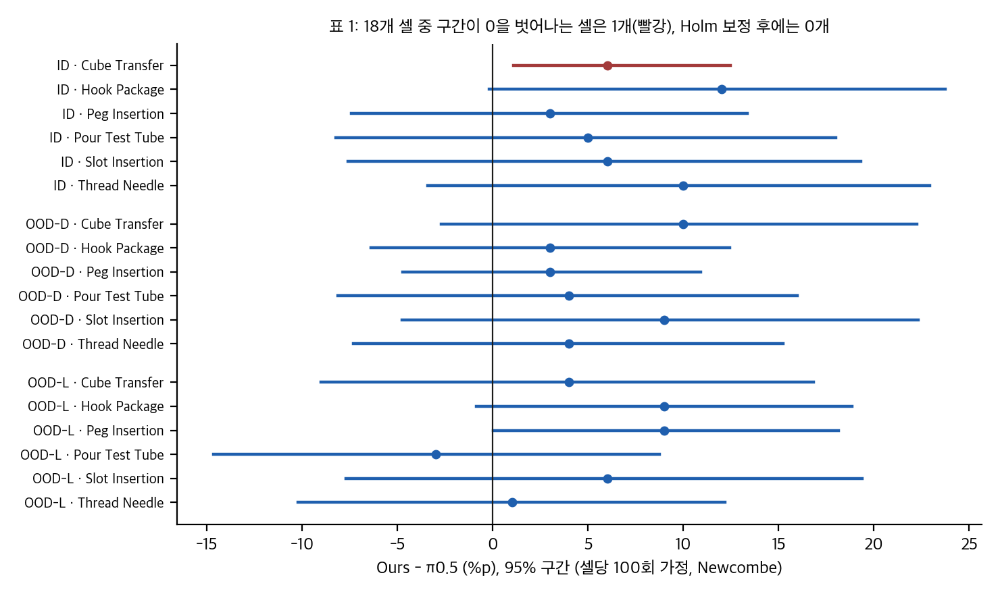
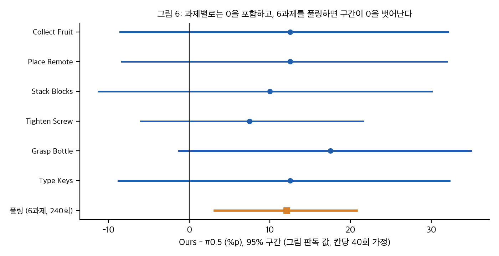
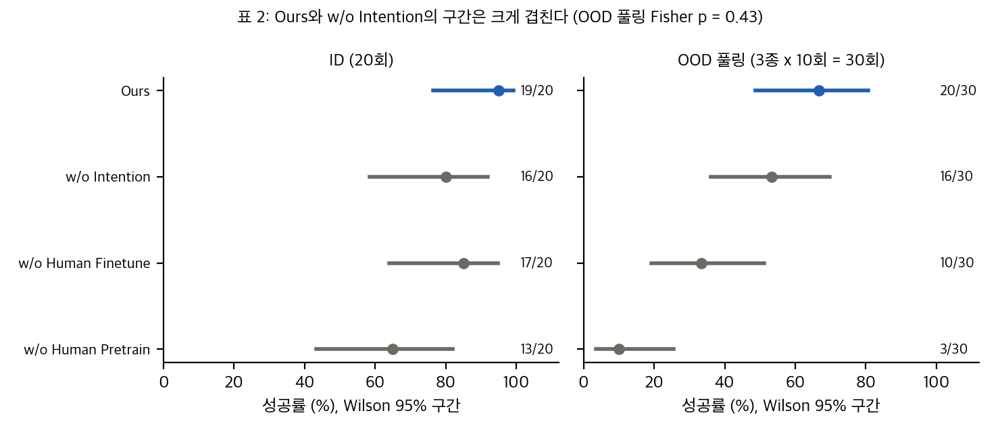
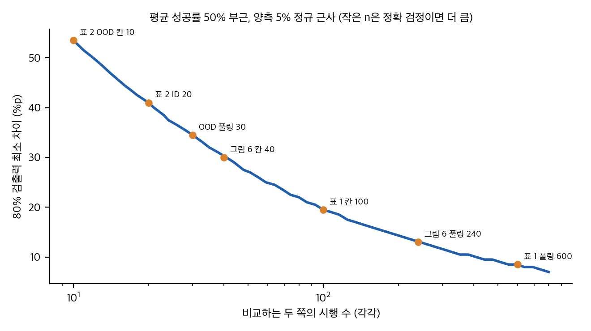

> **논문:** Chengyang Li, Kaiyi Xiong, Yuan Xu, Lei Qian, Yizhou Wang, Wentao Zhu. *GazeVLA: Learning Human Intention for Robotic Manipulation.* CoRL 2026 스포트라이트(공식 목록의 제목은 "Learning Human Intention for Robotic Manipulation"), arXiv:2604.22615 (v3, 2026-11-02).
> 공식 코드(lichy2004/GazeVLA)는 정적으로만 읽었고 실행하지 않았습니다. 논문 그림은 싣지 않고, 우리가 만든 그래프만 씁니다. 수치 가운데 그림에서 읽은 값과 가정한 시행 수는 문장 안에 표시했습니다.

## 논문이 묻는 것

사람의 1인칭 영상을 로봇 학습에 쓰려면 사람과 로봇의 몸 차이를 넘어야 합니다. 이 논문은 행동을 그대로 맞추는 대신 **시선 한 점을 "의도"로 두고**, 정책이 행동 전에 시선 토큰을 먼저 예측하게 합니다. 13개 1인칭 데이터(약 1.5억 프레임)로 사전학습하고, 소량의 로봇 데이터(의도 라벨 없음)와 과제 맞춤 사람 데이터를 1:1로 섞어 사후학습합니다. 추론에서는 시선 → 행동 순서로 생성합니다. 시뮬레이션(AV-ALOHA)과 실로봇 여섯 과제에서 π0.5, HRDT, EgoMimic 등을 앞선다고 보고합니다.

## 이 글에서 확인한 것

**표 1의 우위는 셀 단위로는 구별되지 않고, 묶으면 구별됩니다.** 표 1의 평균 12개 중 11개는 반올림과 일치하고, ID의 π0.5 한 칸(평균 41.67)만 41로 적혀 있습니다. 셀당 100회 시행(4.2절)을 가정하면 18셀 중 정확 검정 p < 0.05인 셀은 1개이고 Holm 보정 후에는 0개입니다. 6과제를 묶으면 ID에서 π0.5 대비 +7.0 %p(p = 0.017)지만 LFA와는 p = 0.07입니다. 18셀 중 Ours가 단독 최고인 셀은 14개, 기준선이 더 높은 셀이 3개입니다.

그래프: 표 1의 18개 셀에서 Ours와 π0.5의 성공률 차이와 Newcombe 95% 구간(셀당 100회 가정). 구간이 0을 벗어나는 셀은 하나(빨강)이고 Holm 보정 후에는 없습니다. 우리가 그린 그래프입니다.

**"12.1%"는 π0.5 평균 대비 값입니다.** 그림 6의 막대 라벨(그림 판독 값)로 6과제 평균은 Ours 53.0, π0.5 40.8입니다. 과제마다 가장 높은 기준선과 비교하면 +9.2 %p입니다. 과제별 비교는 40회(부록 D.1의 2라운드 × 20회 가정)로는 구별되지 않고(p = 0.11–0.50), 6과제를 묶은 240회에서는 p = 0.010입니다.

그래프: 그림 6의 막대 라벨(그림 판독 값)과 칸당 40회 가정으로 구한 과제별 차이와 95% 구간, 맨 아래는 6과제 풀링. 우리가 그린 그래프입니다.

**의도(시선) 절제는 방향은 일관되지만 이 시행 수로는 구별되지 않습니다.** 표 2에서 의도를 뺀 모델과 비교하면 네 칸 모두 Ours가 같거나 높습니다. 그러나 OOD 풀링은 20/30 대 16/30(p = 0.43)이고 네 칸 층화 검정은 p = 0.11입니다. 사람 사전학습을 뺀 쪽은 3/30으로 확실히 낮습니다(p = 1e-5). 표 3(의도 원천)은 시행 수가 적혀 있지 않고, 같은 과제의 그림 6 Ours(68)와 표 3의 Predicted(65)가 다릅니다.

그래프: 표 2의 ID(20회)와 OOD 풀링(30회) 성공률과 Wilson 95% 구간. Ours와 w/o Intention의 구간은 크게 겹칩니다. 우리가 그린 그래프입니다.

**4.1절의 오차 단위가 한 기준이 아닙니다.** 의도 예측 오차는 "영상 대각선의 4.8%, 224×224에서 11픽셀"인데, 대각선의 4.8%는 15.2 px이고 11 px는 한 변의 4.9%입니다. 어느 기준인지 저자 확인이 필요합니다.

**시행 수가 구별 가능한 차이를 정합니다.** 같은 정확 검정에서 80% 검출력으로 구별되는 최소 차이는 셀 100회에서 약 20 %p, 그림 6의 과제 칸 40회에서 약 35 %p, 풀링 240회에서 약 13 %p입니다. 논문의 헤드라인(+12 %p)은 풀링 수준에서 구별되는 크기이고, 의도 절제의 OOD 풀링(+13 %p, 30회)은 검출력이 약 0.12입니다.

그래프: 평균 성공률 50% 근처, 양측 5% 정규 근사에서 80% 검출력으로 구별되는 최소 차이와 이 논문 실험의 시행 수. 우리가 그린 그래프입니다.

## 버전 사이에서 바뀐 것

v1과 v2는 참고문헌 하나만 다르고, v3(CoRL 형식)에서 실로봇 기준선이 ACT·DP에서 EgoMimic·HRDT로, 평가가 20회에서 2라운드 × 20회로 바뀌었고 과제 정의도 달라졌습니다(예: 과일 1개 → 4개 순차). 표 1의 DP 열과 표 2의 기준선 행(v2에서 π0.5 포함)은 v3에 없습니다. π0.5 대비 평균 차이는 +12.5 %p에서 +12.2 %p로 거의 같습니다. v3의 표 2 Ours·절제 행은 v2와 같은 값이고, v2는 이 실험의 학습 데이터를 로봇 10, 사람 50궤적으로 적었으나 v3의 표 5에는 이 과제의 데이터 양이 없습니다.

## 공식 코드에서 본 것

공개 저장소(Apache-2.0 LICENSE 파일, README 표기는 별도)는 openpi의 포크이며 학습 설정이 **AV-ALOHA 시뮬레이션 하나**입니다. 사전학습 설정, 체크포인트, 평가 스크립트, 실로봇 코드는 공개되지 않았습니다(README의 TODO).

- 시뮬레이션 설정은 시연의 VR 시선을 정답 의도로 쓰고(`gaze_mask`가 모든 스텝에서 1), "로봇 데이터에는 의도 라벨이 없다"는 서술은 실로봇 사후학습에 해당하는 것으로 읽힙니다. 4.2절은 시뮬레이션 Ours의 라벨 출처를 적지 않습니다.
- 공개 설정은 100,000 스텝에 π0 베이스 가중치 경로이고 표 4의 사후학습은 30,000 스텝입니다. 시뮬레이션 기준선 π0.5는 30,000 스텝입니다(부록 C.1). 이 설정이 표 1에 쓰였는지는 코드만으로 알 수 없습니다.
- 의도 손실 가중치는 클래스 기본값이 0.01이고 시뮬레이션 설정에서 0.1로 덮어씁니다. 의도 예측은 언어 모델 헤드가 아니라 새 선형 헤드(224 bin)입니다.
- 공개 `sample_actions`에서 시선 토큰 임베딩 배율이 학습 √2048, 추론 √3이고, 위치 id도 패딩 처리가 다릅니다. 효과는 측정하지 않았고, 평가 스크립트가 없어 논문 평가가 이 구현을 썼는지는 확인할 수 없습니다.
- 사람 데이터 처리 저장소는 13개 중 EgoDex, HOT3D만 구현했고, EgoDex는 시선을 0, 마스크 0으로 채웁니다.

## 이 맥에서 구현할 수 있는가

논문 수치의 재현은 이 맥(Apple M4 Pro, 24 GiB, CUDA 없음)에서 불가능합니다. 공개 코드는 3.3B급 모델(추정)과 CUDA를 가정하고, 사전학습은 8 GPU로 1,344 GPU시간이며, 평가와 실로봇은 공개되지 않았습니다. 표·그림 재계산과 코드 정적 대조는 이 글에 담았습니다. 합성 2D 목표 과제에서 시선 점 CoT와 직접 행동을 비교하는 소형 검증은 조건부로 가능하나 논문 수치와 비교할 수는 없습니다.

## 한계

그림 6의 값은 막대 라벨을 읽은 것이고 시행 수는 부록 D.1을 따른 가정입니다. 검정은 시행이 독립이라는 가정에서 낙관적일 수 있습니다. 저자 확인이 필요한 점은 그림 6의 라운드별 값, 표 3의 시행 수, 시뮬레이션 Ours의 초기화와 시선 라벨 설정, 4.1절의 오차 기준 단위입니다.

## 자료

- [통합 리포트 PDF](report/report_public.pdf)
- [01. GazeVLA 논문 분석](analysis/01_paper_analysis.md)
- [02. 선행 연구와 가까운 대안](analysis/02_prior_work.md)
- [03. 수치 재계산과 해석](analysis/03_analysis.md)
- [04. 논문 ↔ 공식 코드 대조](analysis/04_code_verification.md)
