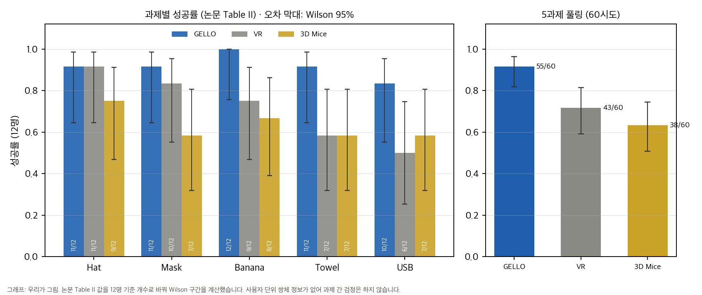
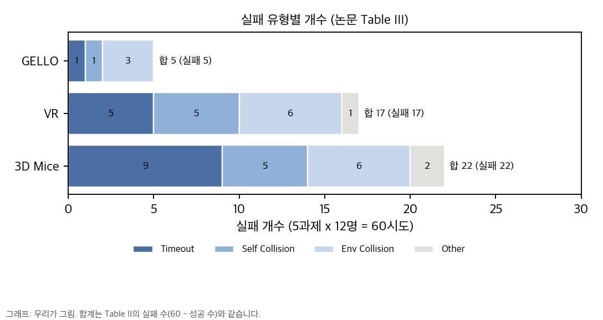

> **논문:** Philipp Wu, Yide Shentu, Zhongke Yi, Xingyu Lin, Pieter Abbeel. *GELLO: A General, Low-Cost, and Intuitive Teleoperation Framework for Robot Manipulators.* IEEE/RSJ IROS 2024, arXiv:2309.13037 (v2, 2024-07-18).
> 공식 소프트웨어는 GitHub wuphilipp/gello_software (MIT), 하드웨어는 wuphilipp/gello_mechanical (MIT)입니다. 이 글의 그림은 우리가 그린 그래프 두 장이며, 논문 그림은 넣지 않았습니다(논문 라이선스가 비배타 배포라서입니다).

## 논문이 묻는 것

시연 데이터의 양과 질이 모방 학습의 성능을 제한합니다. 시연을 모으는 장치로 VR 컨트롤러나 3D 마우스가 많이 쓰이지만, 둘 다 말단 공간에서 조작하므로 사용자가 관절 한계, 특이점, 자기 충돌을 느끼기 어렵습니다.

GELLO는 **타깃 로봇과 같은 운동학 구조를 가진 축소 복제 팔**을 저가 서보와 3D 프린트 부품으로 만듭니다. 리더의 관절 값을 그대로 팔에 보내므로 역기구학이 필요 없고, 사용자는 로봇의 관절 구조를 직접 느낍니다. 세 로봇(UR5, xArm7, Franka Panda)용 장치를 만들었고, 장치 비용은 300 USD 미만입니다.

## 이 글에서 확인한 것

**1. 풀링한 성공률은 두 기준선보다 높습니다.** 12명이 5과제를 수행했습니다(장치당 60시도). GELLO는 55/60, VR은 43/60, 3D 마우스는 38/60이었습니다. Fisher 검정은 VR 대비 p = 0.008, 3D 마우스 대비 p = 0.0003입니다.

**2. 하지만 VR 대비 차이는 사용자 군집을 넣으면 약해집니다.** 같은 사람의 5과제 시행은 독립이 아닙니다. 사용자 안 상관 ρ가 0.3이면 p가 0.056으로 커집니다. 논문은 사용자별 원자료를 공개하지 않아 쌍체 검정을 할 수 없습니다.

*그래프 (우리가 그림). 논문 Table II의 값을 12명 기준 개수로 바꿔 Wilson 95% 구간을 계산했습니다. 과제 간 검정은 하지 않았습니다.*

**3. 과제별로는 "큰 우위"라고 하기 어렵습니다.** 본문은 수건 접기와 USB 삽입에서 GELLO가 크게 낫다고 씁니다. 수건 접기는 11/12 대 7/12이고 원값 p = 0.155, USB는 10/12 대 6/12이고 p = 0.19입니다(VR 기준). 12명으로는 과제 하나에서 가르기 어렵습니다.

**4. 표의 수치는 모두 맞습니다.** 평균 0.92, 0.72, 0.63과 실패 집계(GELLO 5, 3D 마우스 22, VR 17)가 시행 수와 맞습니다. 실패 유형별 개수는 아래 그래프에 있습니다.

*그래프 (우리가 그림). 논문 Table III의 실패 기호 개수. 합계는 60에서 성공 수를 뺀 값과 같습니다.*

**5. 확인하지 못한 주장도 있습니다.** "완료 시간이 일관되게 짧다"(Fig. 6)는 그림만 있고 수치가 없습니다. 관절 규제가 있을 때 중력 힘이 약 1.9 N에서 자세에 따라 달라진다(Fig. 3, v2에 추가)는 주장도 원자료가 없습니다.

**6. 공식 코드는 논문 이후 바뀌었습니다.** 소프트웨어에는 제어 루프 30 Hz 설정, 로봇별 관절 보정 상수(offset, sign), ZMQ 통신이 있습니다. 논문에 없는 세부입니다. 저장소에는 YAM용 토크 제어 코드도 있는데, 논문의 "힘 피드백 없음" 한계가 그대로 적용되지는 않습니다.

## 구현할 수 있는가

- **전체 재현: 불가.** 장치를 만들고, 실로봇에 붙이고, 사람 참가자 12명을 모아야 합니다. 이 맥(Apple M4 Pro, CUDA 없음)에서 할 수 있는 일이 아닙니다.
- **공식 소프트웨어 실행: 조건부.** 가짜 드라이버와 ZMQ 루프백은 CPU로 가능하지만 의존성 설치와 공식 코드 실행이 필요합니다.
- **관절 보정 수식 검사: 가능.** 저장소의 설정 값을 numpy로 옮겨 리더 자세와 팔 자세의 대응을 검사할 수 있습니다.

## 시사점

- 관절 공간 1:1 명령은 데이터 파이프라인을 단순하게 만듭니다. 대신 로봇마다 장치를 새로 설계해야 합니다.
- 작은 사용자 연구에서는 과제별 검정보다 풀링 검정과 군집 효과를 같이 보고해야 효과를 실제보다 크게 읽지 않습니다. 쌍체 원자료는 처음부터 기록해야 합니다.
- 힘 피드백이 없어서 접촉이 많은 작업의 시연에는 한계가 있습니다.

## 정리

GELLO는 저비용 관절 미러 장치로 시연 성공률을 높인다는 주장을 **풀링 수준에서는 지지**합니다. 과제별 차이, 완료 시간, 힘 측정은 원자료 없이 확인할 수 없습니다. 재현은 하드웨어와 사람 실험이 있어야 가능합니다.

## 자료

- [통합 리포트 PDF](report/report_public.pdf)
- [01. 논문 분석: GELLO](analysis/01_paper_analysis.md)
- [02. 선행연구와 공식 저장소](analysis/02_prior_work.md)
- [03. 재계산과 검정: 사용자 연구 표](analysis/03_analysis.md)
- [04. 공식 코드 대조: GELLO](analysis/04_code_verification.md)
