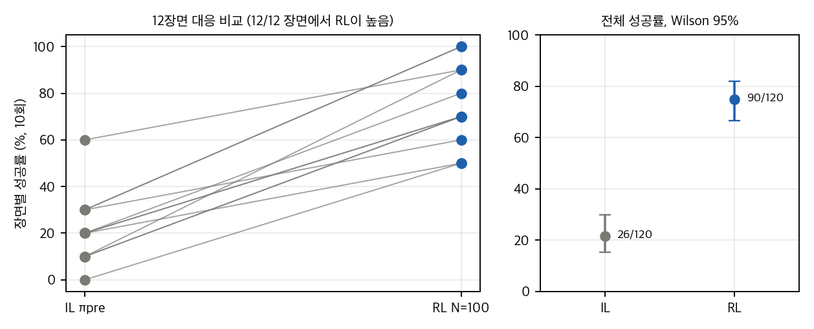
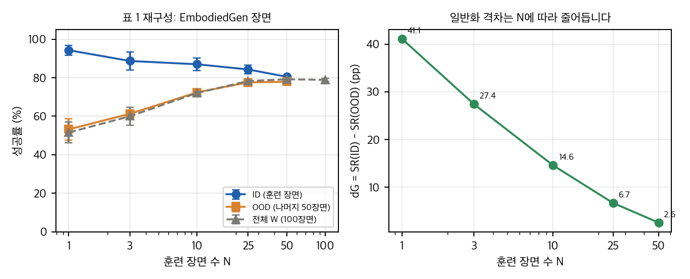
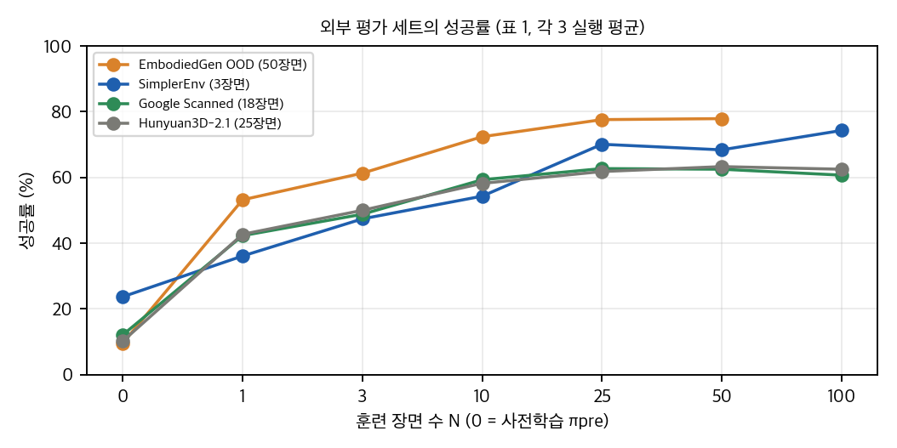

> **논문:** Andrew Choi, Xinjie Wang, Zhizhong Su, Wei Xu (Horizon Robotics). *Scaling Sim-to-Real VLA Reinforcement Learning with Generative 3D Worlds.* CoRL 2026 포스터, arXiv:2603.18532 (v4, 2026-09-29).
> 라이선스는 CC BY 4.0입니다. 이 글의 그래프는 논문 표의 값으로 제가 그렸고, 논문 그림은 쓰지 않았습니다.

## 논문이 묻는 것

VLA(언어와 영상을 받아 로봇 행동을 내는 모델)는 사전학습 뒤에 과제별 미세조정을 합니다. 실물에서 강화학습으로 미세조정하면 장면과 물체가 몇 개뿐이라서, 결과 정책이 그 장면에만 맞춰집니다. 시뮬레이션은 장면을 많이 만들 수 있지만 장면을 설계하는 비용이 큽니다.

이 논문은 두 가지를 묻습니다. 첫째, 3D 세계 생성 모델로 장면을 자동으로 많이 만들면 VLA의 RL 미세조정이 여러 장면에서 되는가. 둘째, 그렇게 학습한 정책이 실물에서도 성공하는가. 방법은 과제 문장을 GPT-4o로 장면 그래프로 바꾸고, EmbodiedGen으로 자산과 장면을 만든 뒤, π0 기반 정책을 희소 성공 보상으로 PPO 미세조정하는 것입니다. 흐름 정책은 단일 단계 가우시안으로 바꿔 학습합니다(PPOFlow).

## 이 글에서 확인한 것

**1. 실물 성공률 상승은 확실합니다.** 실물 WidowX 250S에서 장면 12개, 정책당 10회씩, 모두 240회를 했습니다. 사전학습 정책은 26/120(21.7%), RL 정책은 90/120(75.0%)입니다. Fisher 정확 검정 p는 약 7 × 10⁻¹⁷이고, 12장면 모두에서 RL이 더 높습니다. 다만 정책은 체크포인트 하나, 로봇도 한 대입니다.

*그래프 (우리가 그림). 왼쪽은 장면별 성공률(10회)의 대응 비교, 오른쪽은 전체 성공률과 Wilson 95% 구간입니다. 표 2의 값으로 그렸습니다.*

**2. 장면 수가 늘면 훈련 밖 장면의 성공률이 오릅니다.** 100장면을 세 개의 무작위 부분집합으로 나누고, 그중 N장면(N = 1, 3, 10, 25, 50)으로 학습한 뒤, 학습에 안 쓴 50장면에서 평가했습니다. OOD 성공률은 N = 1의 53.2%에서 N = 50의 77.9%로 올랐습니다. 1장면과 50장면 사이 차이 24.7 pp는 3 실행 기준 Welch p = 0.014입니다. N = 10에서 25 사이의 상승도 분명합니다(p = 0.002). N = 25와 50 사이에서는 차이가 없습니다(p = 0.69).

*그래프 (우리가 그림). 논문 표 1을 다시 그렸습니다. 평균과 표준편차는 3 실행 값입니다.*

**3. 포화는 연산량과 섞여 있습니다.** 배치 크기를 장면 수와 무관하게 고정했습니다. 그래서 장면이 많을수록 장면당 샘플이 줄어듭니다. 저자들도 이 점을 한계로 씁니다. 포화가 다양성의 한계인지 연산의 한계인지는 이 데이터로 나눌 수 없습니다.

**4. 헤드라인 79.8%는 단일 실행입니다.** 초록의 "9.7%에서 79.8%"에서 79.8은 K = 1 실험의 한 번 실행과 같은 값입니다. 표 1의 100장면 평균은 78.9 ± 0.9(3 시드)입니다. 두 값의 차이는 작지만, 결과를 인용할 때는 구분해야 합니다.

**5. 외부 평가 세트에서도 같은 방향입니다.** SimplerEnv 3장면, Google Scanned Objects 18장면, Hunyuan3D-2.1 생성 자산 25장면에서 모두 성공률이 올랐습니다. 다만 세 세트 모두 시뮬레이션이라 실물 전이의 근거는 되지 못합니다.

*그래프 (우리가 그림). 표 1의 외부 세트 값을 훈련 장면 수에 따라 그렸습니다.*

**6. 속도 향상은 정의를 확인해야 합니다.** 시뮬 완료 시간은 10.0초에서 8초 안팎으로 약 1.23–1.27배 줄었습니다. 실물은 보고된 평균 11.5초 대 10.2초로 1.13배인데, 장면별 평균을 쓰면 1.20배가 나옵니다. 원자료가 없어서 어느 쪽이 맞는지 확인할 수 없습니다.

## 논문이 주장하지만 확인되지 않은 것

- **실물 전이의 원인.** 저자들은 고품질 생성 장면, 도메인 무작위화, PD 제어와 중력 보상이 전이를 만든다고 씁니다. 각 요소를 빼 본 실험이 없어서 원인을 나눌 수 없습니다.
- **시스템 식별이 필요 없었다는 주장.** 식별을 쓴 경우와 비교한 실험이 없습니다.
- **K = 1이 성능을 떨어뜨리지 않는다는 주장.** 비교는 한 번씩 실행한 결과(79.75 대 77.2–77.3)입니다. 차이는 2.5 pp입니다.
- **장면 수용률 85%.** 나머지 15%를 "최소한 수정"으로 고쳤다고 하는데, 고친 장면이 학습에 들어갔는지는 본문에 없습니다.

## 공식 코드

논문 전용 학습 코드나 평가 코드는 찾지 못했습니다. 프로젝트 페이지에는 영상과 BibTeX가 있고 코드 링크는 없습니다. 프로젝트 페이지의 GitHub 저장소는 웹 페이지 소스만 있습니다. 관련 저장소로는 장면 생성 엔진 EmbodiedGen(Apache-2.0)이 있습니다. 사전학습 정책은 제3자 재구현 open-pi-zero(MIT) 체크포인트를 씁니다.

## 구현할 수 있을까

- **재현 불가:** 학습은 RTX 6000 Ada 8장으로 5일이 걸렸다고 합니다. 장면 생성은 RTX 4090 한 장에서 장면당 약 47분입니다. 실물 평가에는 로봇이 필요합니다. CUDA GPU가 없는 노트북에서는 재현할 수 없습니다.
- **가능:** 표 재계산과 통계 검사는 CPU로 끝낼 수 있습니다. PPOFlow의 단일 가우시안 구조와 희소 성공 판정식은 작은 토이로 구현할 수 있습니다. 다만 토이는 메커니즘만 보여 줄 뿐 VLA의 주장을 검증하지 못합니다.

## 출처

- 논문: arXiv:2603.18532 (v4), CC BY 4.0. https://arxiv.org/abs/2603.18532
- 프로젝트 페이지: https://horizonrobotics.github.io/gail/scale-vla-rl
- 학회: CoRL 2026 포스터 (corl.org 공식 채택 목록)
- 그래프와 표 재계산 스크립트는 이 글의 자료 폴더에 있습니다. 논문의 그림과 원문 PDF는 넣지 않았습니다.

## 자료

- [통합 리포트 PDF](report/report_public.pdf)
- [01. 논문 분석: Scaling Sim-to-Real VLA Reinforcement Learning with Generative 3D Worlds](analysis/01_paper_analysis.md)
- [02. 선행연구, 구성 요소의 출처, 저장소와 코드](analysis/02_prior_work.md)
- [03. 재계산, 검정, 일관성 검사](analysis/03_analysis.md)
- [04. 주장 대조와 구현 가능성 판정](analysis/04_claim_verification.md)
