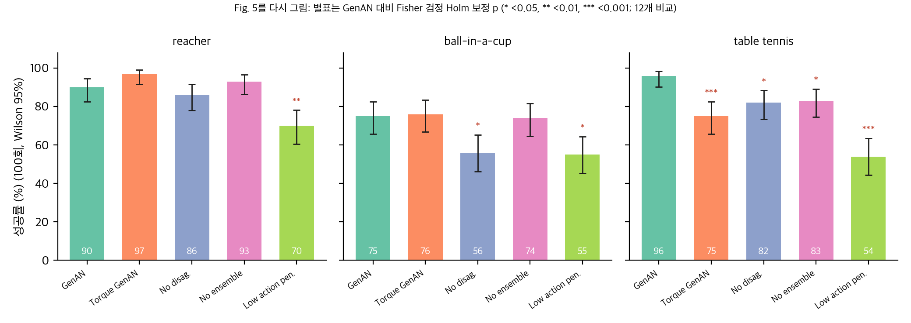
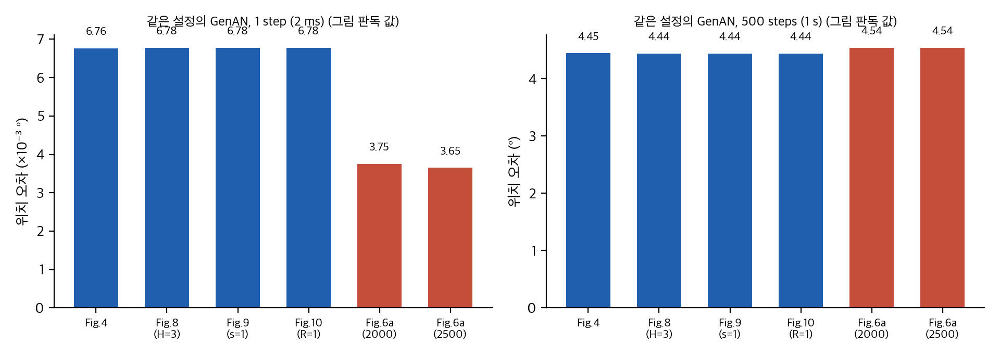
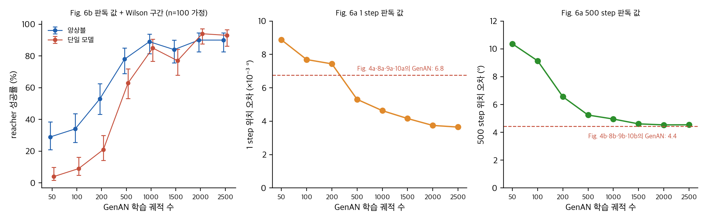
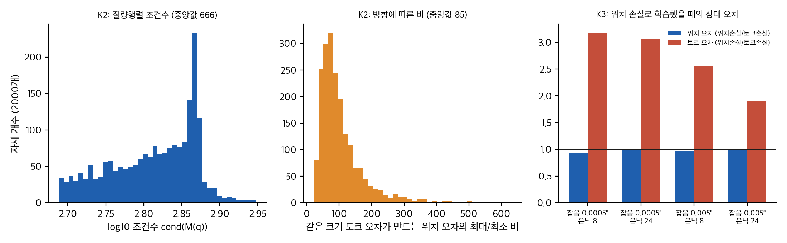

> **논문:** Jan Schneider, Mridul Mahajan, Le Chen, Simon Guist, Bernhard Schölkopf, Ingmar Posner, Dieter Büchler. *Sim-to-Real Transfer for Muscle-Actuated Robots via Generalized Actuator Networks.* CoRL 2026 포스터, arXiv:2604.09487 (v4, 2026-10-15).
> 논문은 arXiv non-exclusive 라이선스이므로 이 글에는 논문 그림을 넣지 않았고, 우리가 다시 그린 그래프만 실었습니다. 그림에서 읽은 값은 "(그림 판독 값)"으로, 논문에 없는 시행 수를 가정한 곳은 "(n = 100 가정)"으로 표시했습니다.

## 논문이 묻는 것

공압 인공근육과 힘줄로 움직이는 4자유도 팔 PAMY2는 가볍고 안전하지만 비선형성, 마찰, 히스테리시스 때문에 모델링이 어렵습니다. 논문은 강체 부분(팔과 물체)을 MuJoCo(MJX)에 맡기고, 근육과 힘줄의 구동만 신경망(GenAN)이 **제어 신호와 최근 위치 이력에서 관절 토크**를 내도록 학습합니다. 토크 센서가 없으므로 토크 라벨 대신, 시뮬레이터로 한 스텝 굴린 위치가 실제 다음 위치와 맞도록 학습합니다(식 1). 이렇게 학습한 5개 모델 앙상블로 reacher, ball-in-a-cup, 탁구 정책을 시뮬레이션에서만 학습해 실물에 옮깁니다.

## 이 글에서 확인한 것

**1. 성공률 표기는 n = 100의 Wilson 구간과 일치합니다.** Fig. 5의 15개 막대 값과 오차막대 끝이 100회 시행의 Wilson 95 % 구간과 0.01 퍼센트포인트 이내로 같습니다. 대표값은 reacher 90 % [82.6, 94.5], ball-in-a-cup 75 % [65.7, 82.5], 탁구 96 % [90.2, 98.4]입니다.

**2. GenAN이 Torque GenAN보다 낫다고 할 수 있는 과제는 탁구입니다.** 탁구 96 대 75는 Fisher p = 3×10⁻⁵입니다. reacher는 Torque GenAN이 97로 더 높고(90 대 97, p = 0.08), ball-in-a-cup은 75 대 76입니다. 본문 서술("탁구에서만 낫고 나머지는 비슷")과 맞습니다. 행동 페널티를 줄이면 세 과제 모두 나빠지고(p = 0.0007, 0.005, 10⁻¹²), 불일치 페널티나 앙상블을 빼면 탁구가 나빠집니다(p = 0.003, 0.005). ball-in-a-cup에서는 불일치 페널티를 뺄 때 56 대 75(p = 0.007)로 탁구와 비슷한 크기의 감소가 있습니다.

*그림 1. 우리가 그린 그래프. 논문 Fig. 5의 값을 다시 그렸고, 별표는 GenAN 대비 Holm 보정 p입니다.*

**3. 앙상블은 데이터가 적을 때 도움이 됩니다.** Fig. 6b(그림 판독 값, n = 100 가정)에서 학습 궤적 50–500개일 때 앙상블이 단일 모델보다 15–32 pp 높고(p ≤ 0.03), 1,000개 이상에서는 차이가 없습니다. 1,000개(33분 분량)로 줄여도 앙상블 성능은 전체 데이터와 같습니다(89 대 90). 곡선은 단조가 아니어서 1,500개에서 84로 내려갑니다.

**4. 같은 설정의 GenAN 1 step 오차가 그림 사이에서 다릅니다.** 전체 데이터, H = 3, stride 1의 GenAN은 Fig. 4, 8, 9, 10에서 1 step 오차가 약 6.8×10⁻³ °로 같습니다(그림 판독 값). Fig. 6a의 2,500개 점은 약 3.65×10⁻³ °로 0.54배입니다. 500 steps 오차는 4.4 °와 4.5 °로 일치합니다. 학습 설정이나 평가 집합이 다른 경우일 수 있어 저자 확인이 필요합니다.

*그림 2. 우리가 그린 그래프(그림 판독 값). 파란 막대는 Fig. 4, 8, 9, 10, 빨간 막대는 Fig. 6a입니다.*

또 1 step 오차는 인코더 분해능에 가깝습니다. 공식 코드는 PAMY2 인코더를 회전당 20,000 / 18,400 / 14,400 / 14,400 눈금(0.018–0.025°)으로 두는데, 1 step 오차 약 0.0068°는 분해능 평균의 0.31배이고 GenAN과 Torque GenAN의 차이(약 0.00045°)는 분해능의 2 %입니다. 1 step 지표는 모델 차이보다 측정 분해능을 재고 있을 가능성이 있습니다. 500 steps 지표는 이 문제가 없고, 여기서 GenAN은 Torque GenAN보다 32 % 낮습니다(구간이 겹치지 않음).

*그림 3. 우리가 그린 그래프(그림 판독 값). 왼쪽은 reacher 성공률과 Wilson 구간(n = 100 가정), 가운데와 오른쪽은 1 step과 500 steps 오차입니다.*

**5. 식 2는 이 팔에서 기계 정밀도로 성립하고, 효과는 질량행렬의 이방성에서 옵니다.** 논문은 위치 오차가 Δt² M(q)⁻¹(τ − τ̂)이라고 유도합니다. 저자 저장소의 MJCF(4자유도 팔과 라켓)를 데이터로 읽어 확인하니 잔차가 최대 1.9×10⁻¹⁶ rad이었습니다. 이 팔의 질량행렬 조건수 중앙값은 666이고, 같은 크기의 토크 오차가 방향에 따라 만드는 위치 오차의 최대/최소 비는 중앙값 85입니다. 합성 액추에이터로 한 용량 제한 MLP 장난감에서 위치 손실은 1 step 위치 오차를 1–8 % 낮추고 토크 오차를 1.9–3.2배 높였습니다. 논문의 1 step 6 %와 같은 크기이지만, 500 steps의 32 %가 같은 원리인지는 이 장난감으로 알 수 없습니다.

*그림 4. 우리가 그린 그래프. 왼쪽과 가운데는 질량행렬(2,000개 자세), 오른쪽은 위치 손실로 학습했을 때의 상대 오차입니다(시드 3개 평균).*

**6. 버전 사이에서 기준선 쪽이 바뀌었습니다.** v1(2026-04)은 reacher와 ball-in-a-cup 두 과제, v2(2026-05)에서 탁구, v3(2026-10)에서 SysID 기준선과 부록 G가 추가되었습니다. 그림에서 읽은 값으로 GenAN 오차는 v2와 v3이 같고, UAN의 500 steps 오차는 약 50 °에서 29 °로 바뀌었으며 본문의 "29 %"가 "32 %"로 바뀌었습니다. 이 변화는 저자 확인이 필요합니다.

## 공식 코드와 논문의 대조

공식 저장소(intelligent-soft-robots/genan, 라이선스 파일 없음)를 정적으로 읽어 27개 항목을 대조했습니다. 코드는 실행하지 않았고, 실험 데이터와 학습 로그는 Git LFS(약 9.8 GB)라 받지 않아 실제 학습 설정은 확인하지 못했습니다.

- **일치:** PPO 하이퍼파라미터(표 3–5), SysID 설정(표 6–7), GenAN 입력(위치·제어의 차이 이력, 32차원), 앙상블 구성, 성공 횟수 집계(ball-in-a-cup 75, 56, 74, 55, 76). 페널티 가중치 5000과 0.1은 4관절 평균 기준이라 논문의 합 기준 1250, 0.025와 같습니다.
- **다름 또는 표기 차이:** 위치 손실이 기본값으로 관절별 정규화됩니다(식 1에는 없음). 은닉층 수가 논문 표기보다 하나씩 많습니다(GenAN 3, 정책 5/4/5). ball-in-a-cup의 초기 제어 범위와 속도 페널티 기본값이 표 4와 다릅니다. 탁구에는 공 평행이동 증강과 시간 관측이 있습니다.
- **논문에 없는 처리:** 처음 200개 궤적 제외(2,500과 800은 제외 뒤의 개수로 보임), 위치 보간과 제어 1스텝 지연, 인코더 양자화 옵션.

## 이 맥에서 구현할 수 있는가

핵심 아이디어의 축소 재구현과 식 검증은 CPU로 가능하고 끝냈습니다(약 20초). 공식 코드로 GenAN을 학습하는 것은 새 환경과 LFS 데이터 받기가 필요한 조건부이고, 정책 학습은 GPU 전제이며 실물 재현은 PAMY2가 필요합니다.

## 한계

- Fig. 6b의 점별 시행 수는 논문에 없어 100으로 가정했습니다.
- 그림 판독 값은 벡터 그림의 막대와 눈금에서 읽은 것으로 0.01 이하의 오차를 보였지만, 숫자가 적히지 않은 그림에서는 같은 정도로 가정한 것입니다.
- 장난감은 합성 액추에이터와 한 스텝, 잡음 가정입니다. 실제 PAMY2의 값이 아닙니다.
- 공식 저장소의 학습 설정과 체크포인트(LFS)를 확인하지 못해 D 항목 일부는 "확인 불가"입니다.

## 자료

- [통합 리포트 PDF](report/report_public.pdf)
- [01. 논문 분석: GenAN (arXiv:2604.09487)](analysis/01_paper_analysis.md)
- [02. 선행연구와 관련 저장소](analysis/02_prior_work.md)
- [03. 수치 재계산, 일관성 검사, 장난감 실험](analysis/03_analysis.md)
- [04. 공식 코드 대조와 구현 가능성](analysis/04_code_verification.md)
