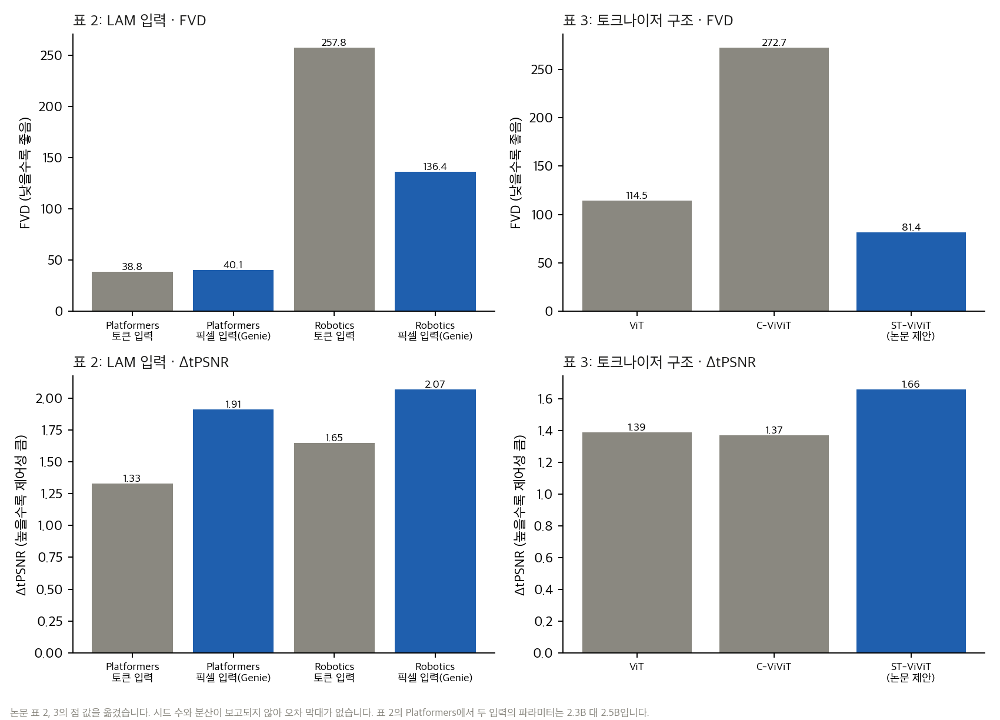
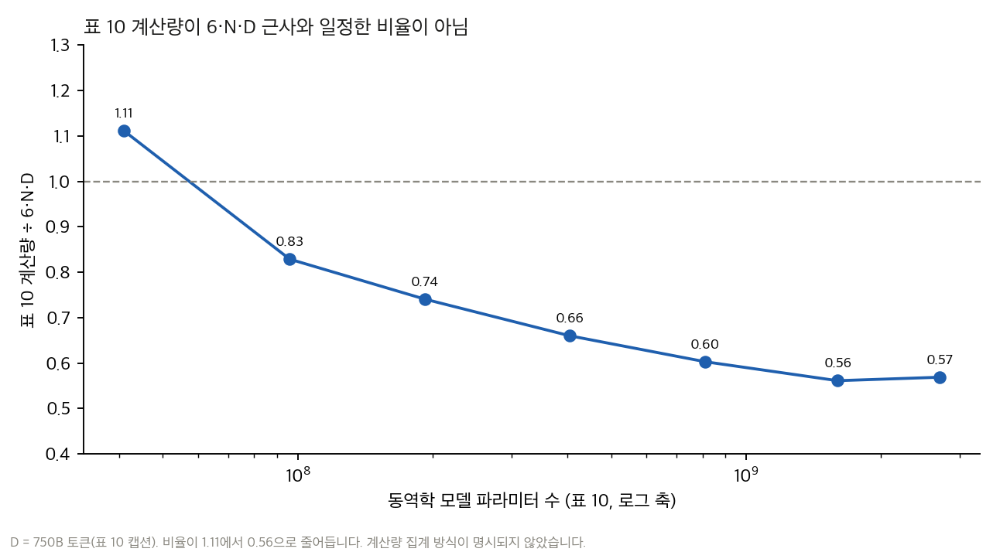

> **논문:** Jake Bruce, Michael Dennis, Ashley Edwards, Jack Parker-Holder, Yuge Shi 외. *Genie: Generative Interactive Environments.* ICML 2024 (PMLR 235:4603–4623), arXiv:2402.15391 (v1, 2024-02-23).
> 공식 코드는 없습니다. 이 글의 그림은 우리가 논문 표의 점 값으로 다시 그린 것입니다. 논문 그림은 쓰지 않았습니다(arXiv 라이선스가 비독점이고 PDF에 저작권 표기가 있습니다).

## 논문이 묻는 것

인터넷에는 영상이 많지만 행동 라벨은 거의 없습니다. 게임 조작 영상이라도 "어떤 버튼을 눌렀는가"는 기록되지 않습니다. Genie는 이 라벨 없이 **프레임 단위로 조작할 수 있는 생성 환경**을 만들 수 있는지 묻습니다. 한 장의 이미지(텍스트로 만든 그림, 손그림, 사진)에서 출발해 사용자가 고른 행동에 따라 다음 장면을 만들어 내는 모델입니다.

비교 대상은 두 갈래입니다. 행동 라벨이 필요한 세계 모델(Dreamer 계열 등)과, 텍스트나 행동을 입력으로 받는 영상 모델입니다. 가장 가까운 선행 연구는 잠재 행동으로 영상을 조작하는 PVG인데, 저자는 PVG가 정적인 예시에 한정되어 새 환경을 프롬프트로 만들지 못한다고 봅니다.

## 방법: 세 부품

1. **잠재 행동 모델 (LAM).** 과거 프레임과 다음 프레임을 받아 행동 하나를 냅니다. 행동은 8개 이산 코드(VQ)로 제한합니다. 학습이 끝나면 이 모델은 버리고, 추론 때는 사용자의 행동 번호만 씁니다.
2. **비디오 토크나이저.** 프레임을 이산 토큰으로 바꿉니다. 공간만 보는 이전 방법과 달리 시간 축도 함께 봅니다. 패치 4, 코드 1024개입니다.
3. **동역학 모델.** 과거 토큰과 잠재 행동으로 다음 프레임 토큰을 예측하는 MaskGIT 트랜스포머입니다. 잠재 행동은 덧셈 임베딩으로 넣습니다.

학습은 두 단계입니다. 토크나이저를 먼저 학습하고, 이어서 LAM과 동역학 모델을 함께 학습합니다.

## 이 글에서 확인한 것

**1. 데이터와 규모의 산술은 맞습니다.** 원본 5,500만 클립은 16초 기준 약 24.4만 시간입니다. 큐레이션한 680만 클립은 약 3만 시간이고 논문 값과 같습니다. 최종 모델의 학습 토큰은 512 × 125,000 스텝 × 16 프레임 × 920 토큰 = 942B로 논문 값과 맞습니다.

**2. 픽셀 입력 LAM의 제어성 이득은 방향이 맞지만 비교 조건이 다릅니다.** 제어성은 행동을 바꿨을 때와 무작위 행동을 넣었을 때의 PSNR 차이(Δt PSNR)로 잽니다. 로봇 데이터에서는 픽셀 입력이 Δt PSNR을 0.42 dB 높이고 FVD를 47% 낮춥니다. 플랫포머 데이터에서는 Δt PSNR이 0.58 dB 높지만 FVD는 3.4% 나쁩니다. 두 플랫포머 모델의 파라미터가 8.7% 다릅니다.

*그래프 (우리가 그림). 논문 표 2, 3의 점 값입니다. 논문에 시드 수와 분산이 없어 오차 막대는 없습니다.*

**3. 토크나이저 구조는 ST-ViViT가 FVD에서 가장 낫습니다.** ViT보다 FVD가 29%, C-ViViT보다 70% 낮습니다. 대가는 메모리입니다. ViT의 3배입니다. 시드가 없어 이 차이가 실험 잡음보다 큰지는 말할 수 없습니다.

**4. 계산량 표는 일정한 비율로 맞지 않습니다.** 표 10의 계산량을 6·N·D 근사와 비교하면 비율이 1.11에서 0.56까지 변합니다. 계산 집계 방식이 적혀 있지 않습니다. 근사가 맞지 않는다는 뜻은 아니지만, 계산량 수치를 그대로 믿기는 어렵습니다.

*그래프 (우리가 그림). 표 10의 계산량을 6·N·D (D = 750B 토큰)로 나눈 값입니다.*

**5. 설계 선택에 비교 수치가 없습니다.** 잠재 행동 코드 수를 8로 정한 이유, 덧셈 임베딩이 연결보다 낫다는 주장은 본문 서술뿐입니다. 이 둘은 확인할 수 없습니다.

**6. 가장 중요한 주장은 정성 그림으로만 뒷받침됩니다.** 같은 잠재 행동이 여러 시작 이미지에서 같은 움직임(왼쪽, 오른쪽, 점프)을 낸다는 주장은 그림 10, 13, 17에 있습니다. 정량 지표와 사람 평가는 없습니다. CoinRun에서 잠재 행동 정책이 200개 샘플로 오라클 수준에 도달한다는 주장도 수치가 그림에만 있어 확인할 수 없습니다.

## 재현할 수 있는가

**전체 모델은 재현할 수 없습니다.** 공식 코드, 체크포인트, 데이터가 공개되지 않았습니다. 논문도 가중치와 학습 데이터를 공개하지 않는다고 밝힙니다. 학습에는 256 TPU급 자원이 필요합니다.

**축소판은 설정이 구체적이지만 빠진 것이 있습니다.** 부록 F는 CoinRun 데이터와 세 단계 학습 설정을 적었습니다. 그러나 해상도, 동역학과 LAM의 학습 시간, 데이터 생성 시간이 없습니다. "1주 이내" 재현이라는 주장은 확인할 수 없습니다. 맥(M4 Pro, 24 GiB 통합 메모리, CUDA 없음)에서는 환경 설치와 데이터 생성 승인 후 짧은 측정을 먼저 해야 판단할 수 있습니다.

**가장 싼 첫 단계는 합성 토이입니다.** 정답 행동이 있는 격자 영상에서 LAM을 CPU로 학습하고, 잠재 행동 코드가 정답 행동과 얼마나 맞는지 봅니다. 노력은 1–2일로 추정합니다(측정 전).

## 공식 코드와 저장소

| 저장소 | 관계 | 라이선스 |
|---|---|---|
| 공식 구현 | 없음 (`google-deepmind/genie` 없음) | — |
| [myscience/open-genie](https://github.com/myscience/open-genie) | PyTorch 구현 (비공식) | MIT |
| [FLAIROx/jafar](https://github.com/FLAIROx/jafar) | JAX 재구현 (비공식) | Apache-2.0 |

커뮤니티 구현은 공식 결과와 같다고 볼 수 없습니다. 이 글에서 실행하지 않았습니다.

## 정리

Genie는 행동 라벨 없이도 조작 가능한 세계를 만들 수 있다는 가능성을 제시했습니다. 그러나 이 글의 읽기에서 근거가 강한 것은 산술과 방향뿐입니다. 제어성 이득의 크기, 설계 선택, 가장 중요한 정성 주장은 시드와 정량 평가 없이는 확인할 수 없습니다. 같은 아이디어를 로봇 정책 사전학습에 옮긴 후속 연구(LAPA, UniVLA 계열)는 자체 실험으로 효과를 보고합니다. 이 글은 그 실험을 대신하지 않습니다.

## 이 글의 파일

- `analysis/01_paper_analysis.md`: 논문 구조와 버전 기록
- `analysis/03_analysis.md`: 표 재계산과 산술 검사 (`analysis/recompute.py`)
- `analysis/04_claim_verification.md`: 주장 대조 14개와 구현 가능성 판정
- `report/report_public.pdf`: 공개 리포트 (논문 그림 없음)

## 자료

- [통합 리포트 PDF](report/report_public.pdf)
- [01. 논문 분석: Genie (arXiv:2402.15391)](analysis/01_paper_analysis.md)
- [02. 선행연구와 관련 저장소](analysis/02_prior_work.md)
- [03. 수치 재계산과 일관성 검사](analysis/03_analysis.md)
- [04. 주장 대조와 구현 가능성](analysis/04_claim_verification.md)
