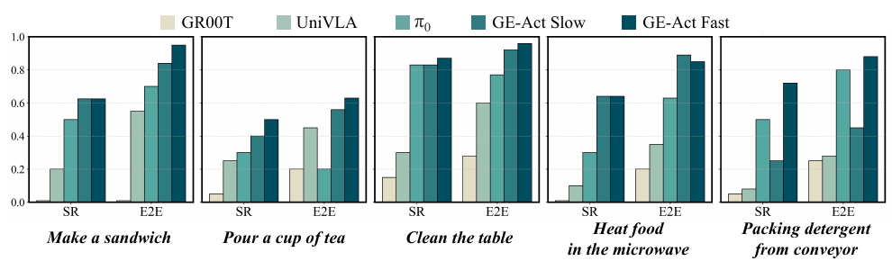
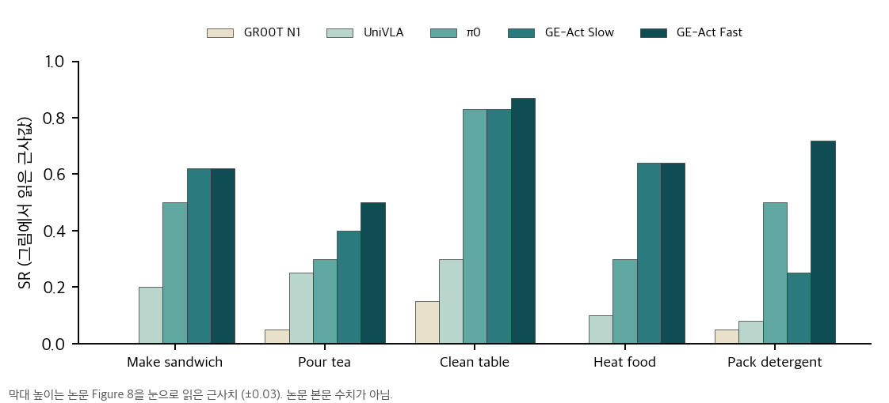
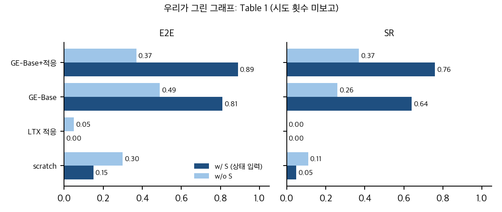
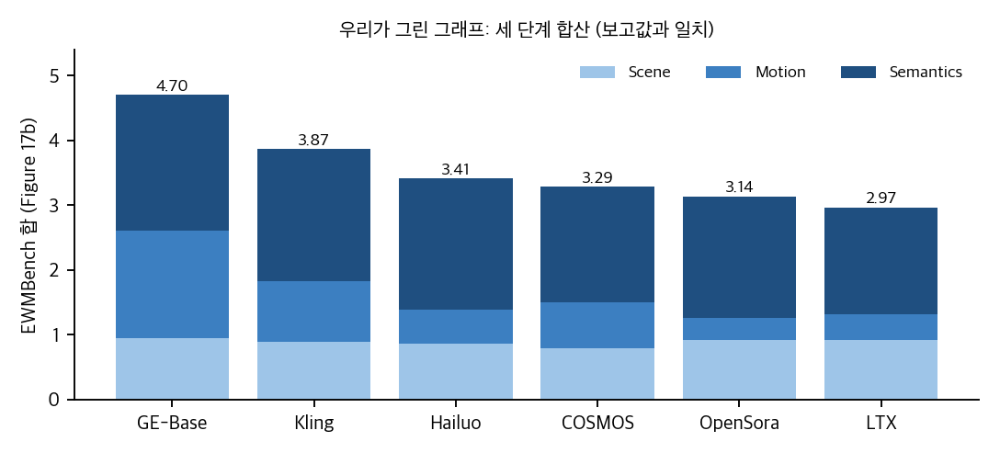

# Genie Envisioner 분석

*Genie Envisioner: A Unified World Foundation Platform for Robotic Manipulation* (Liao 외, AgiBot Genie Team · LV-NUS Lab · BUAA). arXiv:2508.05635 **v3 (2025-11-04)**를 분석했습니다. 학회는 **ICLR 2026**입니다 (공식 proceedings 목록에서 확인).

## 한눈에

- **재현.** 학습은 A100 32장을 7일 쓰는 규모라 재현할 수 없습니다. 실로봇 실험도 이 맥에서는 불가능합니다. 추론 일부만 조건부로 가능합니다.
- **숫자를 다시 계산했습니다.** EWMBench 세 단계 합은 보고 점수와 맞습니다. 그런데 Table 1의 본문 서술 ("거의 0")은 표의 scratch 행 (E2E 0.15와 0.30)과 맞지 않습니다.
- **시도 횟수가 없습니다.** 실로봇 모든 성공률에 n이 없어서 신뢰구간을 붙일 수 없습니다.
- **공식 코드와 논문이 다릅니다.** 사전학습에서 영상 모듈이 학습되고, CLIP 기준 영상 조건이 저장소에 없습니다.

## 구성

GE-Base는 세 시점 (머리, 좌·우 손목)을 쓰는 영상 확산 트랜스포머입니다. LTX-Video 2B가 기본 백본이고 과거 프레임 4장을 희소 메모리로 씁니다. GE-Act는 같은 깊이의 병렬 행동 분기를 붙여 14차원 EEF 행동 54스텝을 냅니다. 추론은 영상 DiT를 5 Hz에서 한 번 디노이징해 캐시하고, 행동 모델은 30 Hz에서 다섯 번 디노이징하는 비동기 구조입니다. GE-Sim은 같은 백본을 행동 조건부 시뮬레이터로 바꾼 것입니다.

## 실로봇 결과 (논문 Figure 8)

논문 Figure 8의 AgiBot G1 결과입니다. 아래 그래프는 막대 높이를 눈으로 읽은 근사값입니다. 논문에 수치가 없어서 그렇게 했습니다.

*그림: 논문 Figure 8 (AgiBot G1, 다섯 작업, SR과 E2E). © 저자 (Liao 외), CC BY 4.0, 출처 arXiv:2508.05635 (v3).*

*그래프: 우리가 그린 그래프. Figure 8의 SR을 눈으로 읽은 근사값 (±0.03). 시도 횟수가 없어서 차이의 유의성은 판단하지 않았습니다.*

**Packing detergent 작업에서 GE-Act Slow는 π0보다 낮습니다** (SR 약 0.25 대 0.50, E2E 약 0.45 대 0.80). 본문은 "consistently outperforms"라고 씁니다. 우세는 Fast 모드에서 주로 나타납니다.

## 사전학습 효과 (Table 1)

Table 1은 GE-Base 초기화와 상태 입력의 효과를 보여 줍니다. 상태 입력은 GE-Base 초기화된 모델에서 E2E를 0.49에서 0.81로 올립니다. 그러나 표본 수가 없으므로, 셀마다 n을 10, 20, 50으로 가정한 Fisher 검정으로 민감도만 계산했습니다. n=10에서는 상태 입력 효과가 유의하지 않습니다.

*그래프: 우리가 그린 그래프. 논문 Table 1의 E2E와 SR 값. 시도 횟수 미보고.*

## EWMBench 합산

Figure 17의 여섯 모델 세 단계 합 (Scene, Motion, Semantics)은 보고된 Score와 모두 맞습니다. 여덟 지표 값은 본문에 없어서 그 수준은 확인하지 못했습니다.

*그래프: 우리가 그린 그래프. Figure 17(b)의 세 단계 합. 보고된 Score와 일치 (차이 0.0001 이하).*

## 공식 코드와 논문의 차이

공식 저장소 `AgibotTech/Genie-Envisioner-V1` (커밋 d41358f, 2026-09-10)를 얕게 복제해 정적으로 읽었습니다. 실행이나 설치는 하지 않았습니다.

- **학습 모드.** 논문은 행동 사전학습에서 행동 분기만 갱신한다고 씁니다. 공개 설정은 `action_full`로 영상 모듈도 학습됩니다.
- **CLIP 기준 영상.** GE-Sim의 스타일 앵커로 쓰인다는 CLIP 이미지 인코더 코드가 없습니다.
- **행동 표현.** 학습 행동은 rpy 14차원입니다. GE-Sim 예제 입력은 쿼터니언 16차원입니다 (그리퍼는 0–120 범위).
- **서술.** 초록과 서론의 "torque trajectories"는 틀린 말입니다. 실제 행동은 EEF 자세 델타입니다.

## 라이선스와 공개 범위

- 논문: arXiv의 CC BY 4.0. PDF에 저작권 고지가 없습니다. 논문 그림은 Figure 8 하나만 출처와 함께 실었습니다.
- 코드: README는 CC BY-NC-SA 4.0이라고 적고 LICENSE 파일이 없습니다. 연구에 쓰려면 이 조건을 확인해야 합니다.

## 실행 가능성

| 작업 | 판정 |
|---|---|
| 학습 (GE-Base, GE-Act) | 불가 (A100 수십 장 x 수 일) |
| 실로봇 재현 | 불가 |
| LTX 2B 추론 (MPS) | 조건부. bf16이 MPS에서 막혀 있어 포팅이 필요하고 메모리가 빠듯합니다 |
| CALVIN 평가 (README 4.260) | 조건부. 시뮬 설치와 가중치 다운로드가 필요합니다 |
| 표 재계산과 일관성 검사 | 완료 (수 초) |

## 한계

논문 §8이 말하는 한계 (단일 플랫폼 데이터, 상체 평행 그리퍼, 대리 지표 평가) 외에도, 실로봇 시도 횟수가 없고 시드를 바꾼 반복도 없습니다. 그림 값은 원자료 없이 정확히 복원할 수 없습니다.

*분석 자료는 `analysis/01`–`04`에 있고, 재계산 스크립트는 `analysis/recompute.py`입니다.*

## 자료

- [통합 리포트 PDF](report/report_public.pdf)
- [Genie Envisioner: A Unified World Foundation Platform for Robotic Manipulation (arXiv:2508.05635) 논문 분석](analysis/01_paper_analysis.md)
- [02. 선행연구 계보, 공식 코드, 이 저장소의 관련 분석 (Genie Envisioner)](analysis/02_prior_work.md)
- [03. 수치 재계산과 일관성 검사 (Genie Envisioner, arXiv:2508.05635 v3)](analysis/03_analysis.md)
- [04. 공식 코드 대조 (정적 읽기): 논문 ↔ 저장소, 차이 D1–D15](analysis/04_code_verification.md)
