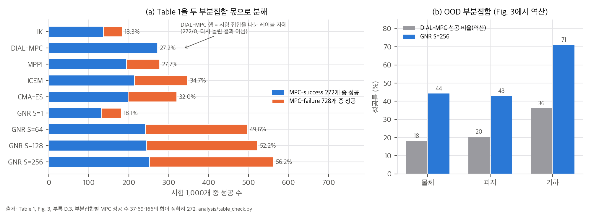
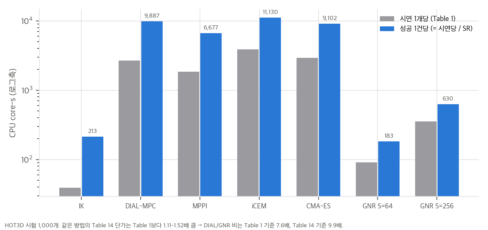
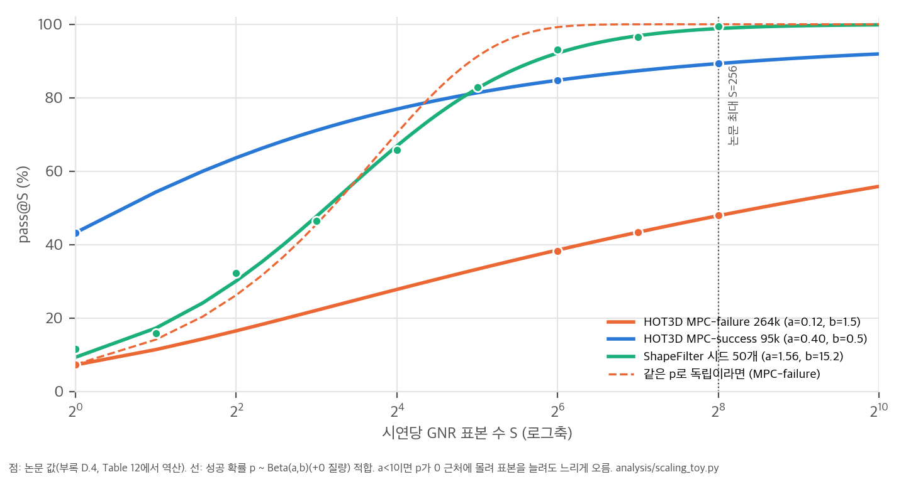
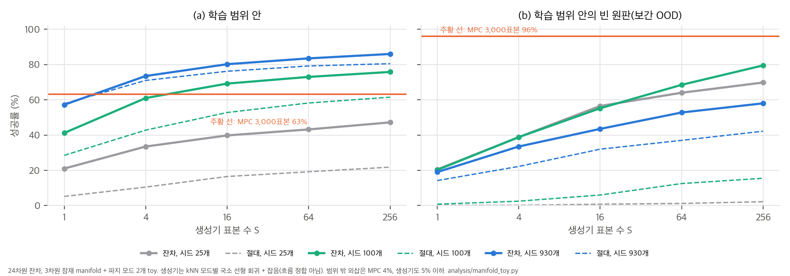

# 03. 수치 재계산과 해석

GNR의 주장은 대부분 "표본 S개 중 하나라도 통과하면 성공"이라는 pass@S와 CPU 비용 회계에 기대고 있습니다. 이 문서는 (1) Table 1의 구조, (2) pass@S 곡선이 왜 그렇게 생겼는지, (3) "가능한 해가 저차원 manifold 근처에 있다"는 가설의 toy, (4) "시연" 단위, (5) 비용 회계를 다룹니다. 모든 계산은 CPU 단일 스레드 numpy·scipy이고 각 스크립트는 수 초에서 수십 초 걸립니다.

| 스크립트 | 결과 파일 | 내용 |
|---|---|---|
| `analysis/table_check.py` | `table_check_results.json` | 표·본문·부록 재계산 C1–C12 (`04` §1) |
| `analysis/scaling_toy.py` | `scaling_toy_results.json` | pass@S 이질성 모델 적합, 조기 종료 비용 |
| `analysis/manifold_toy.py` | `manifold_toy_results.json` | manifold 가설 toy: 생성기 대용 대 annealed CEM |
| `analysis/plot_figures.py` | `report/figures/*.png` | 이 문서의 그래프 네 장 |

## 1. Table 1을 두 부분집합으로 다시 읽기 (`04` C2–C4)

그림 1. (a) Table 1의 각 행을 MPC-success 272개와 MPC-failure 728개 안의 성공 수로 나눈 것. 9개 행 모두 정수 개수로 정확히 맞습니다. (b) Fig. 3과 부록 D.3에서 역산한 OOD 부분집합별 DIAL-MPC 성공 비율과 GNR S=256.

- 전체 SR = 0.272 × SR_success + 0.728 × SR_failure가 9개 행 모두 반올림 안에서 맞고, 성공 수가 정수입니다(예: GNR S=256 = 252 + 310 = 562개).
- **DIAL-MPC 행은 분할 레이블입니다.** 272/1,000 = 27.2%이고, MPC-success에서 100%, MPC-failure에서 0%는 정의입니다. 모집단 MPC 성공률은 26.47%(Table 8)라서 시험 집합은 무작위 추출과 비슷합니다. 다만 초록의 "56.20% vs 27.20%"는 "같은 조건에서 MPC를 다시 돌린 결과"와는 다릅니다. 같은 MPC를 다른 시드로 다시 돌리면 MPC-failure의 일부를 풉니다(§4). 프로젝트 페이지의 표 각주는 이 행이 정의상 100%/0%라고 밝히지만, 논문 Table 1에는 그 각주가 없습니다.
- 독립적으로 다시 돌린 기준선(MPPI, iCEM, CMA-ES)은 MPC-success에서 71–79%만 다시 풉니다. 같은 계열 최적화기라도 시드와 잡음에 따라 결과가 크게 갈립니다. 이 사실은 MPC-failure가 "풀 수 없는 문제"가 아니라 상당수가 "이번 실행에서 못 푼 문제"라는 뜻입니다.
- OOD 부분집합 세 개의 MPC 성공 수를 역산하면 37·69·166개이고 합이 정확히 272입니다. 기하 변형 부분집합은 MPC도 36%를 풀 만큼 쉽고, 물체·파지 OOD는 18–20%로 어렵습니다. GNR의 OOD 성능(44·43·71%)도 같은 순서입니다. 즉 부분집합 간 차이는 GNR의 일반화보다 문제 난이도를 더 많이 반영합니다.

그림 2. HOT3D 시험 1,000개에서 시연 1개당 비용과 성공 1건당 비용(= 시연당 비용 / SR). GNR S=64는 성공 1건당 183 core-s로, DIAL-MPC 9,887 core-s의 1/54입니다.

성공 1건당 비용으로 보면 차이가 더 큽니다. 비율로 계산되는 이 지표는 시험 집합 분할의 영향을 받지 않습니다. 다만 IK도 213 core-s로 매우 싸다는 점을 같이 봐야 합니다. GNR S=64(183 core-s)가 IK보다 싼 이유는 IK의 성공률이 낮아서입니다.

## 2. Test-time scaling의 구조

### 2.1 유도

시연 i를 GNR이 표본 하나로 풀 확률을 p_i라고 합시다. 표본들이 조건부 독립이면 pass@S = 1 − E[(1 − p)^S]입니다. 모든 시연의 p가 같다면 S=1 성공률 p_1에서 곡선이 정해집니다. HOT3D MPC-failure는 p_1 = 6.87%이므로 pass@64가 98.9%여야 하는데, 실제로는 34.9%입니다. **시연마다 p가 크게 다릅니다.**

p의 분포를 "아예 못 푸는 비율 π0 + 나머지는 Beta(a, b)"로 두면 닫힌 꼴이 나옵니다.

E[(1 − p)^S | Beta] = B(a, b + S) / B(a, b)

pass@S = (1 − π0) · (1 − B(a, b + S) / B(a, b))

S가 크면 B(a, b + S)/B(a, b) ≈ Γ(a + b)/Γ(b) · S^(−a)이므로 실패율이 **S^(−a)의 거듭제곱 꼬리**로 줄어듭니다. 표본을 두 배로 늘릴 때마다 (π0를 뺀) 실패가 2^(−a)배가 됩니다. a는 "p가 0 근처에 얼마나 몰려 있는가"를 나타내는 하나의 숫자입니다.

조기 종료(성공하면 추출 중단)를 할 때 기대 표본 수는 다음과 같습니다.

E[min(T, S)] = Σ_{k=0}^{S−1} P(처음 k개 모두 실패) = Σ_{k=0}^{S−1} [π0 + (1 − π0) · B(a, b + k)/B(a, b)]

### 2.2 적합 결과 (`scaling_toy.py`)

그림 3. 논문 값(점)과 이질성 모델 적합(선). 주황 점선은 모든 시연의 p가 같다고 가정한 예측입니다. HOT3D MPC-failure는 a = 0.12라서 로그축에서도 거의 직선으로 천천히 오릅니다.

| 곡선 (출처) | π0 | a | b | RMSE (%p) | 시연당 평균 p | S=1024 외삽 | 조기 종료 시 기대 표본 (S=256) |
|---|---|---|---|---|---|---|---|
| HOT3D 시험 MPC-failure 728 (Table 1) | 0.21 | 0.14 | 1.46 | 0.35 | 0.069 | 48.8% | 163 |
| HOT3D 360k MPC-failure (D.4) | 0.00 | 0.12 | 1.55 | 0.18 | 0.072 | 55.8% | 151 |
| HOT3D 시험 MPC-success 272 (Table 1) | 0.04 | 0.46 | 0.46 | 0.42 | 0.48 | 94.2% | 29 |
| HOT3D 360k MPC-success (D.4, 점 3개) | 0.05 | 0.40 | 0.48 | 0 | 0.43 | 91.9% | 38 |
| ShapeFilter State (Table 11) | 0.00 | 0.84 | 0.81 | 0.31 | 0.51 | 99.7% | 8 |
| ShapeFilter 시드 N=2,448 (Table 12 역산) | 0.00 | 0.78 | 0.70 | 0.21 | 0.53 | 99.7% | 8 |
| ShapeFilter 시드 N=50 (Table 12 역산) | 0.00 | 1.56 | 15.2 | 1.33 | 0.09 | 99.9% | 23 |

읽는 법:

1. **HOT3D MPC-failure의 꼬리 지수 a ≈ 0.12–0.14입니다.** 표본을 두 배로 늘려도 실패가 8–9%만 줄어듭니다. S=256 → 1024(4배)로 외삽해도 49–56%입니다. 점이 4개뿐이라 π0(점근선)는 정해지지 않습니다. 시험 집합 적합은 π0 = 0.21, 360k 적합은 0이 나옵니다. 믿을 수 있는 것은 "느린 거듭제곱 꼬리"라는 모양이고, 점근선 값은 아닙니다.
2. **ShapeFilter는 이질성이 작습니다**(a ≈ 0.8). 두 배마다 실패가 약 42% 줄고, 조기 종료하면 평균 8개면 됩니다.
3. **시드 N=50은 모양이 다릅니다.** 평균 p는 0.09로 낮지만 a = 1.56, b = 15로 p가 모든 시연에 고르게 낮습니다. 그래서 S를 늘리면 빨리 99%에 닿습니다. 데이터가 적은 생성기는 "모든 시연에 넓고 흐린 제안"을 하고, 데이터가 많은 생성기는 "대부분에 날카롭고 일부에 거의 0인 제안"을 합니다. 논문의 "test-time scaling이 data scaling을 보완한다"(Sec. 5.3)는 ShapeFilter처럼 p가 0으로 몰리지 않는 과제에서만 성립합니다.
4. MPC-failure의 무거운 꼬리는 두 가지로 해석할 수 있습니다. (i) 복원 오차나 embodiment 차이로 레퍼런스 자체가 실행 불가능한 시연이 섞여 있다. (ii) 생성기 분포가 해에 거의 닿지 않는다. 논문 데이터만으로는 구분할 수 없습니다. 실패 시연에 MPC 예산을 크게 늘려 보는 실험이 있으면 구분됩니다.

**제안:** pass@256 하나 대신 (a, 평균 p)를 함께 보고하면 "표본을 더 쓰면 얼마나 오르는가"를 예측할 수 있습니다.

### 2.3 조기 종료와 비용

Table 1의 비용은 S에 거의 비례합니다(S=64 → 128 → 256에서 표본당 1.37 core-s). 그래서 조기 종료 없이 잰 값으로 봅니다. 부록 D.4는 확장 실험에서 "성공하면 추출을 멈춘다"고 쓰지만, 비용 추정(App. G.2)은 "모든 시연에 전체 예산을 쓴다"고 명시하고 354.1 core-s를 그대로 곱했습니다. 즉 **논문의 GNR 비용은 상한**입니다.

표본당 1.197 core-s, 고정 비용 47.7 core-s로 근사하고(S=1 → 256 기울기) 적합한 분포의 기대 표본을 쓰면 다음과 같습니다.

| 항목 | 논문 (전체 예산) | 조기 종료 추정 |
|---|---|---|
| MPC-failure 264,806개 확장 | 26,047 core-h | 약 16,800 core-h |
| 실제 배치 시나리오의 GNR 부분 (331,670개) | 32,623 core-h | 약 18,600 core-h |
| 실제 배치 시나리오 전체 대비 MPC 절감 | 2.62배 | 약 2.90배 |

반대로 이 시나리오에서 MPC 시드 비용(116.1k core-h)이 전체의 78%입니다. GNR 비용이 0이어도 절감은 390.0 / 116.1 = 3.36배를 넘지 못합니다. 더 줄이려면 시드 수를 줄여야 하고, 그 대가는 §2.2의 a가 작아지는 것(무거운 꼬리)으로 나타날 가능성이 큽니다.

## 3. manifold 가설 toy (`manifold_toy.py`)

**질문:** 가능한 해가 조건 c에 매끄럽게 의존하는 저차원 집합 근처에 있으면, 풀린 시연에서 배운 조건부 생성기가 시연마다 처음부터 찾는 sampling 최적화보다 적은 표본으로 푸는가? 그 이득은 어디까지 유지되는가?

**설정:** 물리 시뮬레이션이 아니라 기하만 남긴 장난감입니다.
- 조건 c ∈ [−1, 1]²(물체 크기, 접근 각 같은 시연 요약). IK 기준 ū(c) ∈ R²⁴는 c에 따라 크게 변합니다.
- 가능한 잔차는 3차원 잠재 구조 Δ*(c) = A·h(c)에 **두 가지 파지 모드**(오프셋 B)를 더한 것입니다. 어느 모드든 ‖Δ − Δ*_m(c)‖ < 0.45이면 성공입니다. 표본 하나를 평가하는 것이 시뮬레이션 롤아웃 한 번입니다.
- MPC: Δ = 0(IK)에서 시작하는 annealed CEM, 300표본 × 10반복 = 3,000표본, 첫 성공에서 멈춤.
- 시드: 조건 1,600개를 MPC로 풀어 성공한 것만 씁니다(66.9%). 보간 OOD 시험을 위해 원판(중심 (0.3, −0.2), 반지름 0.35) 안의 시드는 뺐고, 930개가 남았습니다.
- 생성기 대용: k-최근접 시드(k=12)를 모드별로 나누고, 모드마다 국소 선형 회귀로 대상 조건의 해를 예측한 뒤 잡음(σ = 0.06)을 더해 S개를 뽑습니다. **flow matching이 아니라 가장 단순한 비모수 조건부 생성기**입니다. 절대 제어 버전은 같은 일을 u = ū + Δ 공간에서 합니다.

그림 4. 생성기 대용의 pass@S. (a) 학습 범위 안, (b) 학습 범위 안의 빈 원판(보간 OOD). 주황 선은 MPC 3,000표본. 학습 범위 밖 외삽(c1 ∈ [1, 1.6])은 MPC 4.5%, 생성기 4.5% 이하라 그리지 않았습니다.

| 시드 수 N | 범위 안 pass@1 / @16 / @256 (잔차) | 범위 안 @256 (절대) | 빈 원판 @256 잔차 / 절대 | 범위 밖 @256 | MPC-failure 147개 중 생성기가 푼 비율 (@256) |
|---|---|---|---|---|---|
| 25 | 21.0 / 39.8 / 47.2 | 21.8 | 69.8 / 2.2 | 0 | 2.7% |
| 100 | 41.2 / 69.2 / 75.8 | 61.5 | 79.5 / 15.5 | 0 | 38.1% |
| 400 | 54.8 / 71.8 / 80.0 | 73.2 | 74.0 / 45.5 | 3.2 | 46.3% |
| 930 | 57.2 / 80.2 / 86.0 | 80.5 | 58.0 / 42.2 | 4.5 | 61.9% |
| MPC 3,000표본 | 63.2 | | 96.0 | 4.5 | (정의상 0%) |

해석:

1. **범위 안에서는 상각이 작동합니다.** N=930이면 표본 4개(73.5%)로 MPC 3,000표본(63.2%)을 넘습니다. 같은 CEM을 192표본으로 줄이면 0%입니다. 논문의 "MPC 표본의 8.5%로 MPC보다 높다"와 같은 방향입니다.
2. **"MPC가 못 푼 문제를 푼다"는 MPC 밖의 해를 찾았다는 뜻이 아닐 수 있습니다.** toy의 모든 조건에는 해가 있으므로 MPC 실패는 전부 예산·국소 탐색 실패입니다. 생성기는 이웃 시드에서 해를 옮겨 와서 이 중 62%를 풉니다. 논문의 MPC-failure 42.6%도 같은 메커니즘(주변 시연의 해를 옮겨 옴)으로 설명할 수 있습니다.
3. **잔차 예측이 절대 예측보다 낫고, 데이터가 적거나 보간 OOD일 때 차이가 큽니다**(N=100 빈 원판에서 79.5% 대 15.5%). ū(c)가 c에 따른 큰 변화를 이미 담고 있어서, 잔차가 남기는 부분이 더 작고 매끄럽기 때문입니다. App. E.4와 같은 방향입니다.
4. **학습 범위 밖 외삽은 실패합니다**(4.5% 이하). 생성기는 시드의 지지 집합 밖으로 나가지 못합니다. 논문의 OOD(새 물체·파지·기하)는 이 toy의 "빈 원판"에 가까운 보간일 가능성이 큽니다. 물체·파지 OOD에서도 MPC 성공 비율이 18–20%로 낮지 않습니다(§1).
5. **두 모드의 평균을 내는 결정론적 회귀는 0%입니다**(모드 간격의 절반이 ε의 4.4배). 해 집합이 여러 모드일 때 생성 모델이 필요한 이유입니다. 그런데 **논문에는 결정론적 회귀나 최근접 시드 검색 같은 더 단순한 기준선이 없습니다.** 이 toy의 생성기 대용이 바로 "최근접 시드 잔차 + 국소 보정" 검색 기준선인데, 범위 안에서는 MPC를 넘었습니다. flow matching이 검색보다 얼마나 나은지는 논문만으로 알 수 없습니다.
6. **한계:** 빈 원판에서는 N=400(74.0%)보다 N=930(58.0%)이 낮습니다. 데이터가 촘촘해지면 k=12 이웃이 원판 가장자리 한쪽에 몰려 국소 선형 외삽이 나빠지는 kNN 특유의 현상입니다. 따라서 N에 대한 정량 결론은 이 toy로 내리지 않습니다. MPC가 빈 원판에서 96%를 내는 것도 이 영역이 쉬워서입니다.

## 4. "시연" 단위와 데이터셋 크기 (`04` C5)

부록 C.5와 Table 8을 맞춰 보면, 기하 변형 쪽 "시연"은 (사람 동작, 기하 변형) 쌍에 최적화 시드를 곱한 **최적화 시도**입니다.

| 단위 | 개수 | MPC 성공 |
|---|---|---|
| 동작-변형 쌍 | 728 × 10 = 7,280 | 2,723쌍 (37.4%) |
| 시도 = 쌍 × 시드 24 | 174,720 (평가 173,840, 880개 누락) | 47,918 (27.6%) |
| MPC가 푼 쌍 안의 시도 | 2,723 × 24 = 65,352 | 47,918 (73.3%) |

- 기하 변형 쪽 MPC-failure 125,922개 중 **17,434개(13.8%)는 다른 시드로 MPC가 이미 푼 쌍**입니다.
- GNR의 조건 c = (x̄, o)는 최적화 시드와 상관이 없습니다. 같은 쌍의 시도 24개는 GNR에게 같은 문제를 24번(S=256씩) 푸는 것입니다. 기하 변형 쪽에서 GNR이 더 푼 52,745개는 서로 다른 문제 52,745개가 아닙니다.
- 원래 기하 쪽 186,310개도 사람 동작 780개에서 나왔습니다(동작당 평균 239개: 자세·시점·질량·마찰 증강과 시드).
- 궤적 수는 95,344 → 222,480개(+133%)로 늘지만, 서로 다른 물체 기하는 2,755 → 3,298개(+19.7%)이고 사람 동작은 780개 그대로입니다.

**정리:** "223k 시연, 3.3k 기하"는 사실이지만, 다양성의 실제 단위는 사람 동작 780개 × 기하 3.3k개입니다. Table 3에서 DexTrack 3,585개, SPIDER 2,885개 같은 수와 나란히 놓으면 단위가 다릅니다. 본문(222,806개, 기하 2,756개, MPC 성공률 26.43%)과 Table 8(222,480개, 2,755개, 26.47%)도 조금씩 다릅니다.

## 5. 비용 회계 (`04` C6, C7)

- **단가 출처:** 같은 방법의 Table 14 단가(core-h/에피소드)가 Table 1(core-s)보다 1.11–1.52배 큽니다. DIAL-MPC/GNR 비는 Table 1로 7.6배, Table 14로 9.9배입니다. 2.62배(App. G.2)는 MPC에 Table 14, GNR에 Table 1을 썼습니다. Table 14로 통일하면 2.56배입니다. 어느 쪽이든 결론은 같고, 차이는 작습니다.
- **ShapeFilter "1.6%":** Table 12의 비용은 조기 종료 비용입니다. S가 커지면 증분이 포화합니다. N=2,448에서 S=1 → 2 증분(18.3 core-s)을 S=1 실패율(47.4%)로 나누면 GNR 표본 하나는 약 38.6 core-s입니다. MPC 롤아웃 하나(3.84 core-s, 20스텝 구간)의 약 10배이고, GNR 표본이 전체 에피소드를 재생하기 때문으로 보입니다. 따라서 S=64의 비용은 다음과 같습니다.
  - 조기 종료: 38.6 + 171.1 ≈ 210 core-s → MPC 3,000표본(11,520 core-s)의 **약 1.8%**. 논문 1.6%와 비슷합니다.
  - 조기 종료 없이 64개를 모두 쓰면: 64 × 38.6 ≈ 2,470 core-s → **약 21%**.
  - "1.6%"는 대부분의 시연이 처음 몇 개 표본에서 풀리기 때문에 나오는 수치입니다. ShapeFilter의 a ≈ 0.8(§2.2)이 이를 뒷받침합니다.
- **학습 비용:** ShapeFilter·NIST의 GPU 학습은 H100으로 0.01–0.5 GPU-h라 무시할 만합니다(App. G.1). HOT3D 모델(19.57M, A100)의 학습 시간은 보고되지 않았습니다.

## 추가 검증 (2026-11-11)

스크립트: `analysis/extra_tail_and_generators.py` → `analysis/extra_tail_and_generators_results.json` (numpy·scipy, 단일 스레드, 약 5초). 내부에서 `manifold_toy.py`의 함수를 재사용한다.

### 추가 검증 1: 실행 불가능한 시연의 섞임이 꼬리 지수를 만드는가

**목적.** §2.2의 HOT3D MPC-failure 꼬리 지수 a ≈ 0.14가 해결 불가능한 시연이 섞여 있어서 생기는지, 아니면 해결 가능한 시연의 p 분포 모양이 필요한지 본다.

**설정(가정).**
- 시연 집단의 p(시연 하나를 GNR 표본 하나로 풀 확률)를 두 부분으로 나눈다. 비율 f는 실행 불가능(p = 0)이고, 나머지 1 − f는 p ~ Beta(α, β)다.
- 그러면 pass@S = (1 − f)(1 − B(α, β + S)/B(α, β))이다. 표본 독립 가정은 §2.1과 같다.
- α ∈ {0.14, 0.5, 2}, f ∈ {0, 0.2, 0.4, 0.5}마다 S = 1의 성공률 6.87%에 맞도록 β를 정하고, S = 64·128·256의 관측값 34.89, 38.05, 42.58%(Table 1)와 비교했다.
- 비교로 §2.2의 3-모수 적합을 두 가지로 다시 했다. π0 자유, π0 = 0 고정.

**결과.**

| f (실행 불가능) | α | β | 예측 S = 64 / 128 / 256 (%) | RMSE (%p) |
|---|---|---|---|---|
| 0 | 0.14 | 1.90 | 41.1 / 46.5 / 51.4 | 7.9 |
| 0.2 | 0.14 | 1.49 | 34.8 / 39.0 / 42.7 | **0.5** |
| 0.4 | 0.14 | 1.08 | 28.1 / 31.1 / 33.7 | 7.6 |
| 0.2 | 0.5 | 5.32 | 58.3 / 64.4 / 68.8 | 25.4 |
| 0.2 | 2.0 | 21.3 | 74.8 / 78.3 / 79.5 | 39.1 |
| 0.5 | 0.5 | 3.14 | 39.6 / 42.6 / 44.7 | 4.0 |
| 0.5 | 2.0 | 12.6 | 48.6 / 49.6 / 49.9 | 11.2 |

관측 곡선의 적합: π0 자유 → π0 = 0.21, a = 0.14, b = 1.46(RMSE 0.35%p). π0 = 0 고정 → a = 0.098, b = 1.30(RMSE 0.40%p).

**결론.**
- 실행 불가능한 비율만 섞고 해결 가능한 쪽을 날카롭게(α = 2) 두면 곡선이 나오지 않는다(RMSE 25–39%p). 곡선 모양에는 해결 가능한 시연 쪽 p가 0 근처에 많이 몰린 분포(α ≈ 0.14)가 필요하다.
- 두 요소가 함께 있을 때 가장 잘 맞는다. f = 0.2와 α = 0.14의 조합이 RMSE 0.5%p다. f = 0이면 7.9%p로 떨어진다.
- 따라서 §2.2에서 든 두 해석 중 (i) "실행 불가능한 시연 섞임"만으로는 부족하다. 실행 불가능한 시연은 필요하지만 충분하지 않다. 이 family 안에서는 꼬리 지수 a ≈ 0.1이 해결 가능한 시연의 p 분포가 가진 성질에서 온다고 보는 편이 맞다.
- π0를 0으로 고정하면 a가 0.098로 내려간다. 작은 a는 실패 질량을 꼬리에 흡수한 결과이기도 하다. 그래서 a만으로 "생성기 분포가 해에 닿지 않는다"는 결론을 내릴 수 없다.
- **한계.** Beta 혼합 가정, Table 1의 점 4개만 사용. 같은 곡선을 설명하는 다른 분포가 있을 수 있다. 시연별 p를 직접 재지 않았으므로 이 분해는 모형 안의 설명이다.

### 추가 검증 2: 조건부 생성기 비교(검색, 결정론적 회귀, 가우시안 혼합)

**목적.** §3의 manifold toy에서 최근접 검색 기준선이 다른 조건부 생성기보다 얼마나 나은지 본다. 비교 대상은 결정론적 회귀와, (c, Δ) 결합 공간에서 EM으로 적합한 가우시안 혼합 조건부 밀도다. 실행 불가능한 시드가 섞였을 때의 변화도 함께 본다.

**설정(가정).**
- manifold toy와 같은 장난감: D = 24, 잠재 차원 3, 모드 2, ε = 0.45. 시드는 MPC(3,000표본)로 푼 930개(보간 원판 밖).
- 오염 q = 0.2는 시드 187개의 Δ를 무작위 값(범위 ±2.5)으로 바꾼다. 실행 불가능한 시연에 해당한다.
- 검색: manifold toy의 최근접 잔차 방식(k = 12).
- 결정론적 회귀: 대상 조건에서 두 모드의 평균 한 점을 내고 잡음(σ = 0.06)을 더한다.
- 가우시안 혼합: K = 3, EM 300회(정규화 1e-3), 조건부 샘플링. 표본은 대상 조건마다 256개.
- 시험: 학습 범위 안 400개, 보간 원판 400개, S = 256. 시드를 바꾼 5회 반복(오염 위치와 EM 초기화가 달라짐)의 평균과 표준편차.

**결과.**

| 시험 집합 | 오염 q | 생성기 | pass@1 | pass@16 | pass@256 |
|---|---|---|---|---|---|
| 학습 범위 안 | 0 | 검색 | 60.0 ± 2.0 | 78.7 | 83.2 ± 0.3 |
| 학습 범위 안 | 0 | 가우시안 혼합 | 8.8 ± 1.1 | 55.0 | 79.0 ± 2.0 |
| 학습 범위 안 | 0 | 결정론적 회귀 | 0 | 0 | 0 |
| 보간 원판 | 0 | 검색 | 19.0 ± 0.9 | 50.4 | 67.7 ± 1.1 |
| 보간 원판 | 0 | 가우시안 혼합 | 7.3 ± 2.8 | 54.6 | 94.4 ± 7.3 |
| 학습 범위 안 | 0.2 | 검색 | 40.4 ± 0.8 | 62.8 | 67.3 ± 1.4 |
| 학습 범위 안 | 0.2 | 가우시안 혼합 | 2.7 ± 2.3 | 25.0 | 66.6 ± 8.0 |
| 보간 원판 | 0.2 | 검색 | 11.6 ± 1.7 | 33.7 | 46.2 ± 7.1 |
| 보간 원판 | 0.2 | 가우시안 혼합 | 1.9 ± 0.9 | 27.0 | 85.5 ± 6.8 |

**결론.**
- 결정론적 회귀는 모든 조건에서 0%다. 두 모드의 평균은 어느 모드에도 맞지 않는다. 생성 모델이 필요하다는 §3의 결론을 다시 확인한다.
- 가우시안 혼합은 S = 1에서 검색보다 훨씬 약하다(8.8% 대 60%). 표본을 늘리면 보간 원판에서 검색을 앞선다(256에서 94% 대 68%). 제안 분포가 넓고 흐린 생성기이므로, 표본당 비용이 큰 과제에서는 검색이 더 낫다.
- 시드 20%를 실행 불가능하게 바꾸면 두 방법 모두 떨어지지만, 보간 원판에서는 가우시안 혼합이 더 잘 버틴다(85.5 ± 6.8 대 46.2 ± 7.1). 학습 범위 안에서는 차이가 없다(66.6 ± 8.0 대 67.3 ± 1.4).
- 보간 원판에서 가우시안 혼합이 학습 범위 안보다 높게 나온 것은 toy의 특성으로 보인다(원판은 시드 사이 내부라 매끄러운 보간이 쉽다). 원인은 분리하지 않았다.
- **한계.** 시드 한 풀, 시드 변동 5회만 반영, K = 3과 k = 12 고정. flow matching은 쓰지 않았으므로 논문 모델과 비교하지 않았다. 검색과 가우시안 혼합의 차이를 논문 모델에 옮기는 근거는 되지 않는다.

### 추가 검증 3: 평면 3관절 팔 toy에서 잔차 flow matching은 절대 생성이나 검색보다 나은가

**목적.** §2의 pass@S 구조를 생성 모델 수준에서 확인합니다. 같은 과제에서 (i) 기준 행동(IK 한 번) 대비 잔차를 flow matching으로 학습한 생성기, (ii) 절대 행동을 flow matching으로 학습한 생성기, (iii) 가까운 학습 예시의 잔차를 옮기는 검색을 비교합니다.

**설정(가정).**
- 과제: 3관절 평면 팔(링크 0.5, 0.35, 0.25 m)의 관절각 a ∈ R³가 끝점 f(a) ∈ R²를 목표 c에 2 cm 안으로 맞추면 성공합니다. 시뮬레이터 판정은 정확한 f로 합니다. 해는 곡선(관절 3개, 제약 2개)이라 여러 해가 있습니다.
- 기준 행동 a₀(c): 명목 자세 (0.3, 0.3, 0.3)에서 Jacobian 최소 노름 역변환 한 번.
- 학습 쌍 40,000개(관절각 균일 샘플 −2–2 rad), MLP 256폭 3층 flow matching, 1500 step, Euler 16 step. U-Net 대신 MLP를 썼습니다(3차원 행동에 시간 해상도 구조가 없다고 보았습니다). 시험 목표 500개, S ∈ {1 … 256}, 시드 2개.
- 장치: CPU. 패키지: torch 2.15.0, numpy 1.26.4, Python 3.12.7. 실행 22초.

**결과 (pass@S, 시드 2개 평균).**

| 생성기 | S=1 | S=4 | S=16 | S=64 | S=256 | 실패율 적합 a |
|---|---|---|---|---|---|---|
| 잔차 flow | 0.039 | 0.12 | 0.39 | 0.74 | 0.96 | 0.52 |
| 절대 flow | 0.12 | 0.36 | 0.83 | 0.98 | 1.00 | 1.29 |
| 검색(잔차 옮기기) | 0.94 | 0.97 | 0.98 | 0.98 | 0.98 | 0.20 (포화) |

**결론.**
- 이 toy에서는 flow matching이 검색보다 낫지 않습니다. S = 1에서 검색 0.94 대 잔차 flow 0.04로 차이가 큽니다. 40,000개 학습 쌍이 시험 목표 근처를 촘촘히 덮어서 가까운 예시의 잔차가 거의 그대로 맞기 때문입니다. 검색 곡선은 S = 4 이후 0.98 근처에서 포화하므로 a 값을 해석하지 않습니다.
- 잔차 parameterization이 절대보다 낫다는 결과도 없습니다. 이 toy에서는 절대 flow가 모든 S에서 잔차 flow보다 높습니다. 기준 행동 a₀가 한 번의 Jacobian 역변환이라 잔차 분포가 더 복잡하고 생성기가 그 복잡도를 다 잡지 못한 것으로 보입니다.
- 따라서 "잔차 flow가 검색보다 낫다"는 조건은 이 toy에서 확인되지 않았습니다. 논문의 조건(HOT3D, 시연 수, 고차원 행동)과 다릅니다.

**한계.** 과제가 쉽습니다(절대 flow가 S = 256에서 0.999). 실패율 적합 a는 포화된 곡선에서 의미가 약합니다. 해가 곡선이라 "여러 해 중 하나를 맞추면 된다"는 설정이 실물 접촉보다 훨씬 관대합니다. U-Net, 학습 쌍 수, 기준 행동 품질을 바꾸면 순위가 달라질 수 있습니다. 시드 2개입니다.
