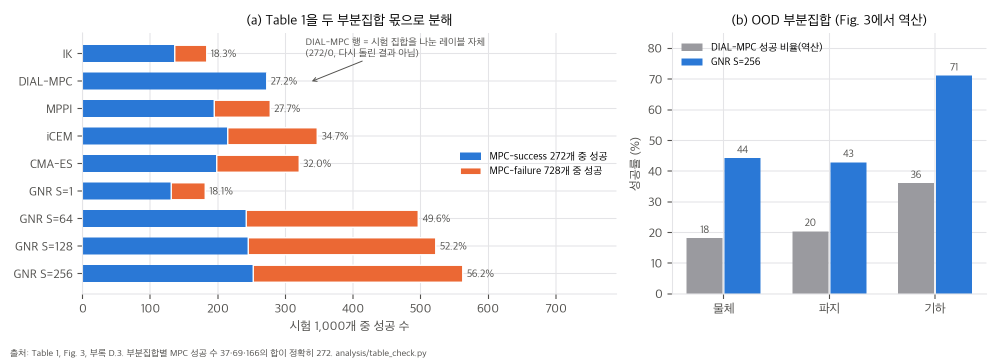
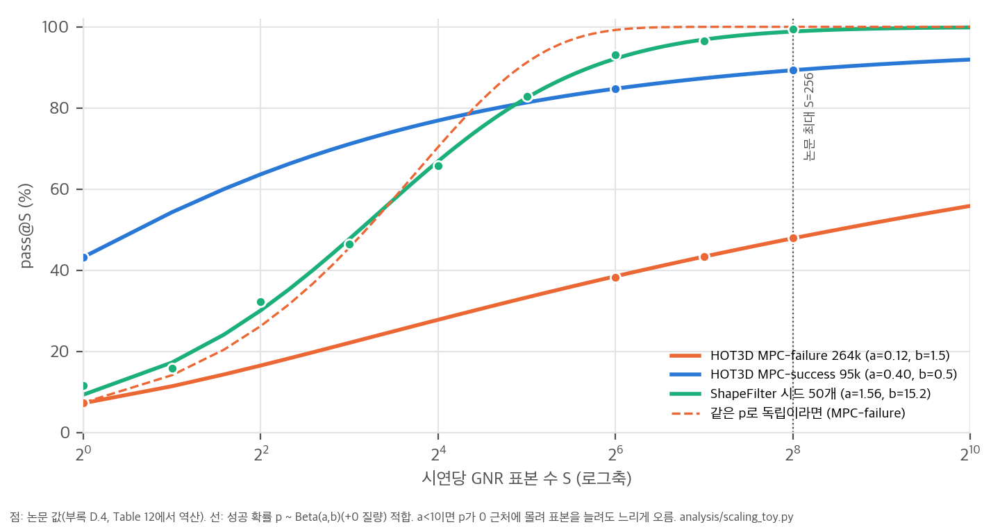
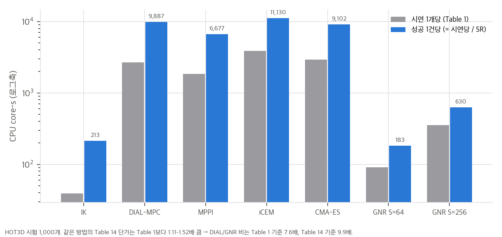
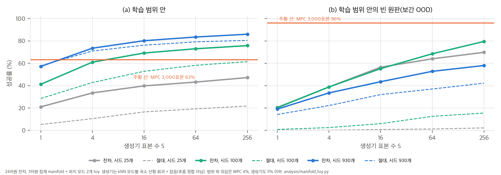

> **논문:** Gao, Yang et al. *Generative Neural Retargeting for Human-to-Robot Dexterous Manipulation.* arXiv:2610.12440v1 (2026). Meta Reality Labs Research.
> 논문은 CC BY-NC-ND 4.0이라 논문 그림은 싣지 않았습니다. 그림은 [arXiv](https://arxiv.org/abs/2610.12440)와 [프로젝트 페이지](https://yy-gx.github.io/GNR/)에서 볼 수 있습니다. 이 글의 그래프는 논문 표의 수치와 직접 만든 toy로 그렸습니다. 공식 코드와 데이터는 아직 공개되지 않았습니다(2026-11-03 확인).

## 한 줄 요약

사람 손 시연을 로봇손(Tesollo DG-5F) 궤적으로 옮길 때 시연마다 sampling MPC를 새로 돌리지 않습니다. MPC(DIAL-MPC)가 이미 푼 궤적으로 **IK 기준 제어에 더할 잔차의 조건부 flow matching 모델**을 학습합니다. 새 시연에서는 후보 S개를 뽑아 시뮬레이터로 거르고(pass@S), 길고 정밀한 과제에서는 생성 결과를 MPC 초기값으로 씁니다. HOT3D egocentric 데이터에서 223k 궤적과 시뮬레이션 접촉력 라벨을 만들었습니다.

## 1. 문제의식은 분명하다

물리 기반 리타겟팅은 비쌉니다. HOT3D 증강 시연 360k개를 DIAL-MPC로 돌리는 데 390k CPU core-h(512코어로 31.7일)가 들었고, 성공은 26%였습니다. 더 큰 문제는 시연마다 독립적으로 푼다는 점입니다. 비슷한 물체를 비슷하게 잡는 시연 수만 개를 풀어도, 다음 시연은 다시 처음부터 시작합니다. GNR은 "가능한 궤적은 시연들이 공유하는 저차원 manifold 근처에 있다"고 보고, 풀린 해의 분포를 배워 제안 분포로 씁니다. FlashDexRetarget이 같은 문제를 다중 레퍼런스 RL 정책으로 푼다면, GNR은 생성기 + 거부 표집으로 풉니다.

## 2. Table 1은 정확하다. 다만 27.2%는 비교 결과가 아니다

HOT3D OOD 시험 1,000개에서 GNR(S=256)은 56.2%, DIAL-MPC는 27.2%입니다. 표를 MPC-success 272개와 MPC-failure 728개로 나눠 다시 계산하면 9개 행 모두 정수 개수까지 맞습니다. OOD 부분집합 세 개의 MPC 성공 수(37·69·166)를 역산해도 합이 정확히 272입니다.

그런데 시험 집합 자체를 DIAL-MPC의 성공·실패로 나눴습니다. 그래서 DIAL-MPC 행의 100%/0%는 결과가 아니라 정의이고, 27.2%는 시험 집합의 분할 비율입니다. 프로젝트 페이지의 표 각주는 이를 "by construction"이라고 밝히지만 논문 표와 초록에는 그 설명이 없습니다. 독립적으로 다시 돌린 기준선(MPPI, iCEM, CMA-ES)은 27.7–34.7%이고, 이들조차 MPC-success의 71–79%만 다시 풉니다. MPC-failure의 상당수는 "풀 수 없는 문제"가 아니라 "이번 실행에서 못 푼 문제"라는 뜻입니다.

## 3. 이득은 거부 표집에서 나오고, 꼬리가 무겁다

GNR S=1은 18.1%로 IK(18.3%)와 같습니다. 이득은 전부 표본을 늘리고 시뮬레이터로 거르는 데서 나옵니다. 그렇다면 표본을 더 늘리면 어디까지 오를까요?

모든 시연의 성공 확률 p가 같다면 HOT3D MPC-failure의 pass@64는 98.9%여야 하는데 실제는 34.9%입니다. 시연마다 p가 크게 다릅니다. p를 "0 질량 + Beta(a, b)"로 두면 pass@S = (1 − π0)(1 − B(a, b+S)/B(a, b))이고, 실패는 S^(−a)로 줄어듭니다.

HOT3D MPC-failure는 a ≈ 0.12–0.14입니다. 표본을 두 배로 늘려도 실패가 8–9%만 줄고, S=1024로 외삽해도 49–56%입니다. 반면 ShapeFilter는 a ≈ 0.8이라 조기 종료하면 평균 8개면 됩니다. pass@256 하나보다 꼬리 지수 a를 같이 보고하면 "표본을 더 쓸 가치가 있는가"를 예측할 수 있습니다.
실행 불가능한 시연을 섞는 것만으로는 이 곡선이 나오지 않습니다. 해결 가능한 시연 쪽에도 p가 0 근처에 몰린 분포가 있어야 맞습니다. 그래서 꼬리 지수는 '실패가 섞였다'와 '대부분의 시연이 어렵다'를 같은 숫자로 보여 주며, 둘을 가르려면 실패 시연에 예산을 더 쓰는 실험이 필요합니다.

## 4. "223k 시연"의 단위

부록 C.5와 Table 8을 맞춰 보면, 기하 변형 쪽 "시연"은 (사람 동작, 기하 변형) 쌍 7,280개에 최적화 시드 24개를 곱한 **시도**입니다. 쌍 단위 MPC 성공률은 37.4%인데 시도 단위로는 27.6%입니다. MPC-failure의 13.8%는 다른 시드로 MPC가 이미 푼 쌍입니다. GNR의 조건은 시드와 무관하므로, 같은 쌍의 시도 24개는 GNR에게 같은 문제입니다. 궤적 수는 +133% 늘었지만 서로 다른 물체 기하는 +19.7%, 사람 동작은 780개 그대로입니다. 다른 연구의 시연 수와 나란히 놓을 때는 이 단위 차이를 감안해야 합니다.

## 5. 비용: 결론은 맞지만 단가가 섞였다

성공 1건당 비용으로 보면 GNR S=64는 183 core-s, DIAL-MPC는 9,887 core-s입니다. 결론은 분명합니다. 다만 세부 수치에는 확인할 것이 있습니다.

- 초록의 7.6배는 Table 1 단가이고, Table 14 단가로는 9.9배입니다. 2.62배 시나리오는 MPC에 Table 14, GNR에 Table 1 단가를 썼습니다.
- GNR 비용은 조기 종료를 무시한 상한입니다. 적합한 분포로 조기 종료를 반영하면 2.62배가 약 2.90배가 됩니다.
- 이 시나리오 비용의 78%가 MPC 시드입니다. GNR이 공짜여도 최대 3.36배입니다.
- ShapeFilter의 "S=64에서 MPC 비용의 1.6%"는 조기 종료할 때만 성립합니다. GNR 표본 하나가 MPC 롤아웃의 약 10배(38.6 core-s)라서, 64개를 다 쓰면 약 21%입니다.

정밀 과제와 부록의 "비슷하거나 나은" 비교는 통계적으로 구분되지 않습니다. NIST는 GNR+MPC 57/64 대 MPC 59/64(Fisher p = 0.76), 다중 embodiment는 GNR 95% 대 SPIDER 96%, BC 정책은 12/32 대 14/32(p = 0.80)입니다.

## 6. toy: 보간은 되고 외삽은 안 된다

가설을 직접 시험하려고 장난감을 만들었습니다. 24차원 잔차가 3차원 잠재 구조와 두 가지 파지 모드를 갖고, 조건 c에 매끄럽게 의존합니다. 생성기 대신 가장 단순한 비모수 조건부 생성기(최근접 시드 + 국소 선형 보정 + 잡음)를 쓰고, annealed CEM(3,000표본)과 비교했습니다.

- 학습 범위 안에서는 시드 930개로 표본 4개만에 MPC 3,000표본(63%)을 넘습니다. MPC가 못 푼 조건의 62%도 풉니다. toy의 모든 조건에는 해가 있으므로, 이 "MPC 실패 해결"은 이웃 시드의 해를 옮겨 온 결과입니다.
- 잔차 예측이 절대 예측보다 낫고, 데이터가 적을수록 차이가 큽니다(논문 App. E.4와 같은 방향).
- 학습 범위 밖 외삽은 MPC와 생성기 모두 4.5% 이하입니다.
- 두 모드를 평균 내는 결정론적 회귀는 0%입니다. 생성 모델이 필요한 이유입니다. 그런데 논문에는 회귀나 최근접 검색 같은 단순한 기준선이 없습니다. toy에서는 검색만으로도 범위 안에서 MPC를 넘었으므로, flow matching이 검색보다 얼마나 나은지가 다음 질문입니다.

## 7. 직접 구현할 수 있나

- **논문 그대로:** 불가능합니다. GNR 코드, 가중치, 223k 데이터, mocap 시연, 데이터 엔진이 모두 비공개입니다.
- **공개된 것:** 시뮬레이터 SuperDex(Apache-2.0, FR3 + DG-5F 모델 포함, macOS ARM 지원 표기), DIAL-MPC 원 구현(JAX + Brax), HOT3D, SAM 3D, Point Transformer V3.
- **아이디어만:** 잔차 flow matching + 거부 표집은 수백 줄이면 됩니다. 비용과 난이도의 대부분은 접촉 많은 시뮬레이터에서 시드를 만드는 sampling MPC와 판정 기준에 있습니다. HOT3D 기준(물체 위치 150 mm)은 느슨해서 실제로는 침투·쥐는 힘 조건이 성공을 가릅니다.
- **Apple Silicon 노트북(CUDA 없음):** 표 재계산과 toy는 CPU로 끝냈습니다. SuperDex와 PyTorch(MPS)를 설치하면 작은 규모의 재구현을 시도해 볼 수 있습니다.

## 8. 관련 GitHub

| 저장소 | 역할 |
|---|---|
| YY-GX/GNR | 프로젝트 페이지 저장소(코드 없음, "Code and Dataset buttons are omitted until release") |
| facebookresearch/project_superdex | 시뮬레이터 SuperDex, FR3 + DG-5F 모델 |
| LeCAR-Lab/dial-mpc | 시드 생성기·기준선 DIAL-MPC 원 구현 |
| facebookresearch/spider | 다중 embodiment 비교 기준선 SPIDER |
| facebookresearch/hot3d | HOT3D 데이터 API |
| Pointcept/PointTransformerV3, facebookresearch/sam-3d-objects | 기하 인코더, 기하 변형 생성 |

## 9. 정리

- "풀린 해로 제안 분포를 배워 다음 시연을 싸게"라는 방향은 맞고, 대규모 데이터 엔진과 접촉력 라벨은 쓸모가 큽니다.
- 보고된 수치는 정확합니다. 다만 27.2%는 분할 비율이고, "시연"은 시도 단위이며, 비용 단가는 표마다 섞였습니다.
- 이득은 거부 표집에서 나오고, 어려운 시연에서는 꼬리가 무거워 표본을 늘려도 수익이 빠르게 줄어듭니다.
- 다음에 보고 싶은 것은 최근접 검색 기준선, 문제 단위 성공률, 그리고 FlashDexRetarget 같은 RL 상각과 같은 조건에서의 비교입니다.

분석 문서, 재계산 스크립트, 리포트 PDF는 함께 공개한 저장소에 있습니다.

## 자료

- [통합 리포트 PDF](report/report_public.pdf)
- [01. 논문 분석: GNR (arXiv:2610.12440)](analysis/01_paper_analysis.md)
- [02. 선행연구와 계보](analysis/02_prior_work.md)
- [03. 수치 재계산과 해석](analysis/03_analysis.md)
- [04. 주장 검증: 수치 재계산, 재현 정보, 구현 가능성](analysis/04_claim_verification.md)
